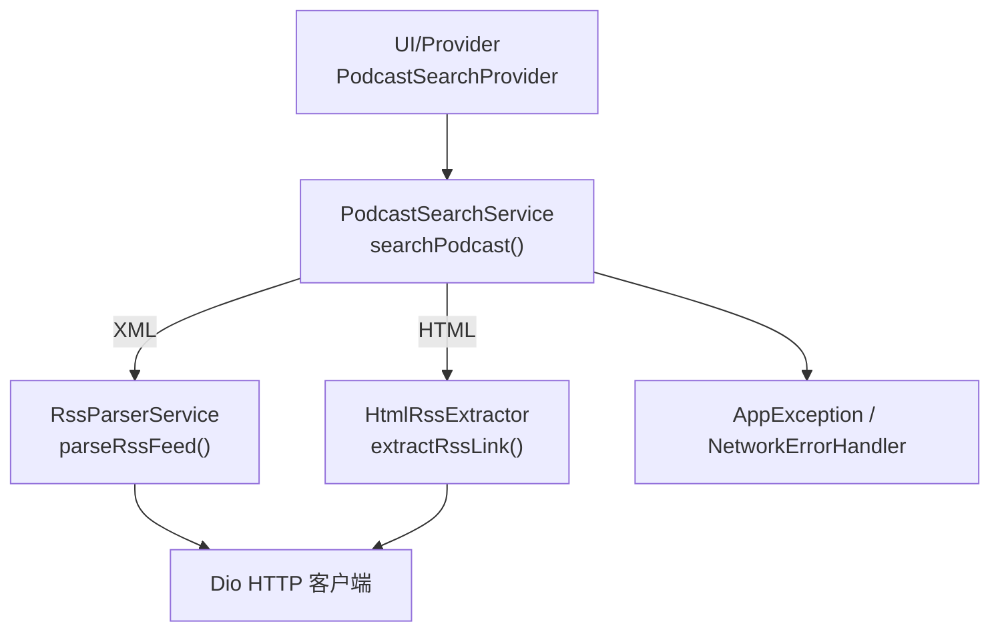
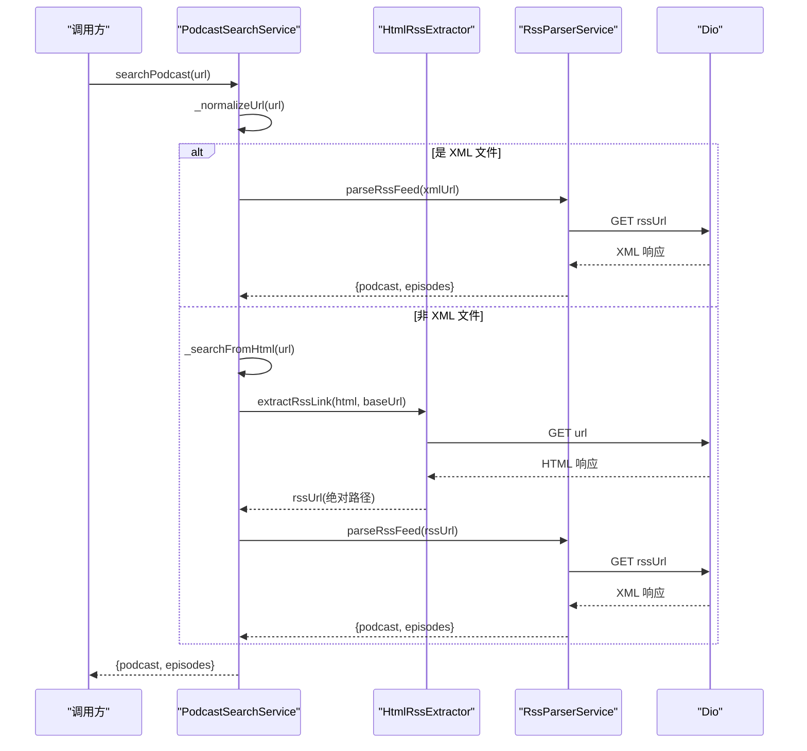
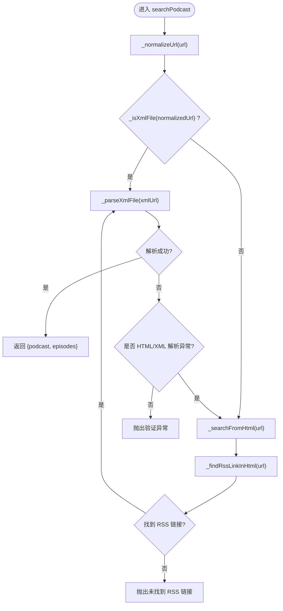
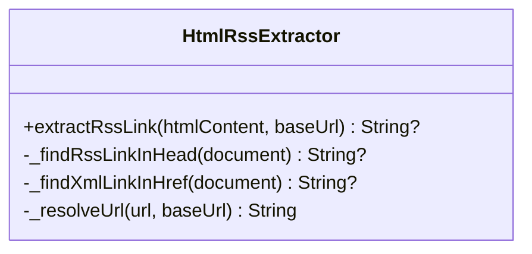
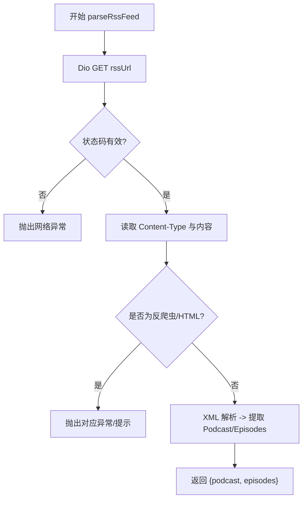
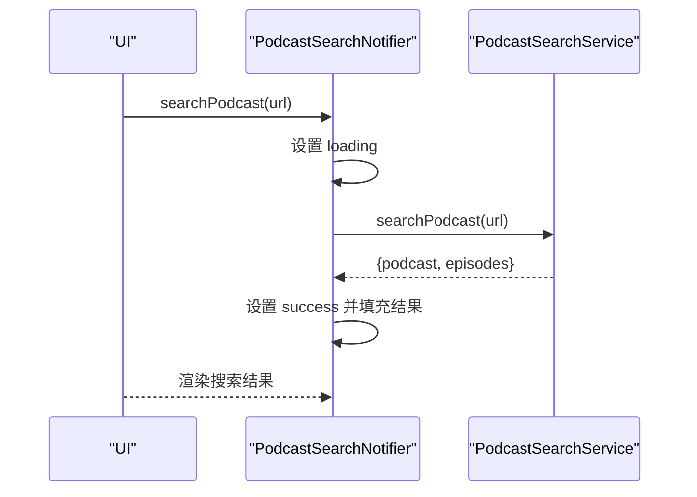
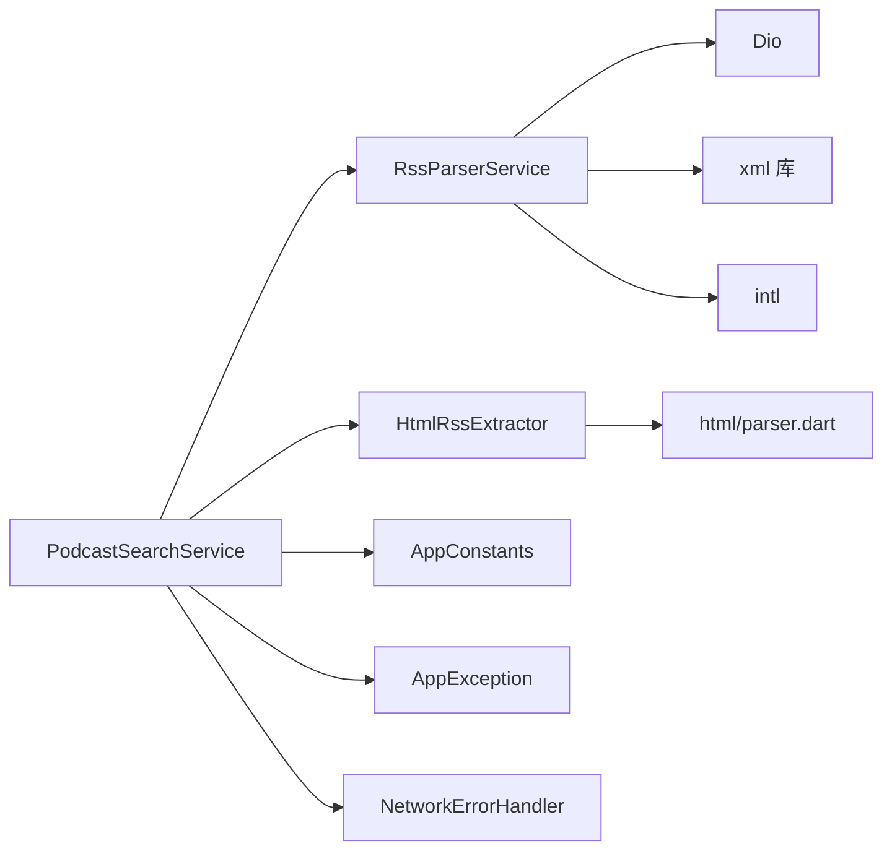

# 本地搜索实现

<cite>
**本文引用的文件**   
- [podcast_search_service.dart](file://lib/data/services/podcast_search_service.dart)
- [html_rss_extractor.dart](file://lib/core/utils/html_rss_extractor.dart)
- [rss_parser_service.dart](file://lib/data/services/rss_parser_service.dart)
- [app_constants.dart](file://lib/core/utils/app_constants.dart)
- [app_exception.dart](file://lib/core/utils/app_exception.dart)
- [network_error_handler.dart](file://lib/core/utils/network_error_handler.dart)
- [podcast_search_provider.dart](file://lib/presentation/features/search/podcast_search_provider.dart)
</cite>

## 目录
1. [简介](#简介)
2. [项目结构](#项目结构)
3. [核心组件](#核心组件)
4. [架构总览](#架构总览)
5. [详细组件分析](#详细组件分析)
6. [依赖关系分析](#依赖关系分析)
7. [性能与网络优化](#性能与网络优化)
8. [故障排查指南](#故障排查指南)
9. [结论](#结论)
10. [附录：使用示例与最佳实践](#附录使用示例与最佳实践)

## 简介
本文件聚焦 TinyCast 的“本地搜索”能力，围绕 PodcastSearchService 的核心逻辑展开，详细说明如何从 URL 或域名解析播客信息。内容涵盖：
- URL 标准化处理（自动补全协议）
- XML 文件检测与解析
- HTML 页面 RSS 链接提取（含相对路径解析）
- 重试机制、超时配置与网络请求优化
- 异常处理策略与错误分类

该功能支持三种输入形态：直接 RSS XML 地址、网页 URL、纯域名。系统会智能判断并选择最优路径获取并解析播客元数据与节目列表。

## 项目结构
与本地搜索相关的代码主要分布在以下模块：
- 服务层：PodcastSearchService（入口）、RssParserService（RSS/XML 解析）、HtmlRssExtractor（HTML 中 RSS 链接提取）
- 工具与常量：AppConstants（超时/重试等）、AppException（统一异常）、NetworkErrorHandler（网络错误归一化）
- 表现层：PodcastSearchProvider（状态管理与调用编排）

图表来源 
- [podcast_search_service.dart:1-208](file://lib/data/services/podcast_search_service.dart#L1-L208)
- [rss_parser_service.dart:1-459](file://lib/data/services/rss_parser_service.dart#L1-L459)
- [html_rss_extractor.dart:1-70](file://lib/core/utils/html_rss_extractor.dart#L1-L70)
- [podcast_search_provider.dart:1-369](file://lib/presentation/features/search/podcast_search_provider.dart#L1-L369)

章节来源
- [podcast_search_service.dart:1-208](file://lib/data/services/podcast_search_service.dart#L1-L208)
- [podcast_search_provider.dart:1-369](file://lib/presentation/features/search/podcast_search_provider.dart#L1-L369)

## 核心组件
- PodcastSearchService：对外暴露 searchPodcast(url)，内部根据 URL 形态分派到 XML 解析或 HTML 提取流程，负责重试、超时与错误转换。
- RssParserService：通过 Dio 拉取 RSS XML，使用 xml 库解析，提取 Podcast 与 Episode 列表，包含反爬虫/验证码识别与容错。
- HtmlRssExtractor：解析 HTML，优先查找 head 中的 RSS link，其次回退扫描 a[href] 中包含 .xml 的链接，并解析相对路径为绝对 URL。
- AppConstants/AppException/NetworkErrorHandler：提供超时/重试默认值、统一异常类型与 Dio 异常映射。

章节来源
- [podcast_search_service.dart:14-52](file://lib/data/services/podcast_search_service.dart#L14-L52)
- [rss_parser_service.dart:16-128](file://lib/data/services/rss_parser_service.dart#L16-L128)
- [html_rss_extractor.dart:4-22](file://lib/core/utils/html_rss_extractor.dart#L4-L22)
- [app_constants.dart:16-21](file://lib/core/utils/app_constants.dart#L16-L21)
- [app_exception.dart:22-58](file://lib/core/utils/app_exception.dart#L22-L58)
- [network_error_handler.dart:10-60](file://lib/core/utils/network_error_handler.dart#L10-L60)

## 架构总览
PodcastSearchService 作为统一入口，依据输入 URL 决定处理分支：
- 若 URL 以 .xml 结尾或查询参数包含 .xml，则走 XML 解析路径；
- 否则进入 HTML 路径：抓取页面 HTML，提取 RSS 链接后再次进入 XML 解析路径。

图表来源 
- [podcast_search_service.dart:43-127](file://lib/data/services/podcast_search_service.dart#L43-L127)
- [html_rss_extractor.dart:7-22](file://lib/core/utils/html_rss_extractor.dart#L7-L22)
- [rss_parser_service.dart:40-128](file://lib/data/services/rss_parser_service.dart#L40-L128)

## 详细组件分析

### PodcastSearchService 核心方法
- _normalizeUrl：去除首尾空白，空串抛验证异常；若无 http(s) 前缀，自动添加 https://。
- _isXmlFile：解析 URI path，判断是否以 .xml 结尾或包含 .xml?。
- _parseXmlFile：委托 RssParserService.parseRssFeed；捕获 AppException 或通用异常，若提示返回了 HTML 或 XML 解析异常，则降级为 HTML 路径；其他错误包装为验证异常抛出。
- _searchFromHtml：调用 _findRssLinkInHtml 获取 RSS 链接；未找到则抛验证异常；找到后递归进入 _parseXmlFile。
- _findRssLinkInHtml：Dio 请求页面，设置 Accept 与 User-Agent；状态码校验；空内容校验；调用 HtmlRssExtractor.extractRssLink；失败时按 DioException/AppException/未知异常分类记录并重试，指数延迟重试，最终抛出聚合异常。
- _extractRssLinkFromHtml：封装 HtmlRssExtractor 调用。

图表来源 
- [podcast_search_service.dart:43-127](file://lib/data/services/podcast_search_service.dart#L43-L127)

章节来源
- [podcast_search_service.dart:54-68](file://lib/data/services/podcast_search_service.dart#L54-L68)
- [podcast_search_service.dart:70-77](file://lib/data/services/podcast_search_service.dart#L70-L77)
- [podcast_search_service.dart:79-103](file://lib/data/services/podcast_search_service.dart#L79-L103)
- [podcast_search_service.dart:105-127](file://lib/data/services/podcast_search_service.dart#L105-L127)
- [podcast_search_service.dart:129-197](file://lib/data/services/podcast_search_service.dart#L129-L197)
- [podcast_search_service.dart:199-206](file://lib/data/services/podcast_search_service.dart#L199-L206)

### HTML RSS 链接提取器（HtmlRssExtractor）
- extractRssLink：解析 HTML，先尝试在 <head> 中查找 type="application/rss+xml" 的 <link> 标签；若未找到，回退扫描所有 <a href> 中包含 ".xml" 的链接；最后将相对路径解析为绝对 URL。
- _resolveUrl：若 URL 已含 scheme 则直接返回；否则基于 baseUrl 进行 resolveUri 拼接。
- 错误处理：解析失败记录日志并返回 null，避免上层崩溃。

图表来源 
- [html_rss_extractor.dart:4-69](file://lib/core/utils/html_rss_extractor.dart#L4-L69)

章节来源
- [html_rss_extractor.dart:7-22](file://lib/core/utils/html_rss_extractor.dart#L7-L22)
- [html_rss_extractor.dart:24-38](file://lib/core/utils/html_rss_extractor.dart#L24-L38)
- [html_rss_extractor.dart:40-52](file://lib/core/utils/html_rss_extractor.dart#L40-L52)
- [html_rss_extractor.dart:54-68](file://lib/core/utils/html_rss_extractor.dart#L54-L68)

### RSS 解析服务（RssParserService）
- parseRssFeed：Dio 拉取 RSS，设置 responseType=plain、Accept 头与 User-Agent；检查状态码与 Content-Type；检测反爬虫挑战（如 SG-Captcha）与 HTML 响应；解析 XML 构建 Podcast 与 Episode 列表；支持 iTunes/Dublin Core 命名空间字段；对缺失 GUID 的节目生成稳定标识；内置重试与延迟策略。
- 辅助方法：日期时间解析（RFC822/ISO8601）、时长解析、显式标志解析、图片链接提取、分类与关键词提取等。

图表来源 
- [rss_parser_service.dart:40-128](file://lib/data/services/rss_parser_service.dart#L40-L128)
- [rss_parser_service.dart:139-187](file://lib/data/services/rss_parser_service.dart#L139-L187)
- [rss_parser_service.dart:190-267](file://lib/data/services/rss_parser_service.dart#L190-L267)
- [rss_parser_service.dart:409-457](file://lib/data/services/rss_parser_service.dart#L409-L457)

章节来源
- [rss_parser_service.dart:24-33](file://lib/data/services/rss_parser_service.dart#L24-L33)
- [rss_parser_service.dart:40-128](file://lib/data/services/rss_parser_service.dart#L40-L128)
- [rss_parser_service.dart:139-187](file://lib/data/services/rss_parser_service.dart#L139-L187)
- [rss_parser_service.dart:190-267](file://lib/data/services/rss_parser_service.dart#L190-L267)
- [rss_parser_service.dart:409-457](file://lib/data/services/rss_parser_service.dart#L409-L457)

### Provider 集成与调用链
- PodcastSearchNotifier.searchPodcast：设置 loading 状态，调用 PodcastSearchService.searchPodcast，成功后更新 podcast、episodes 与 searchResults，失败则设置 error 状态。
- addPodcast/addAllPodcasts：订阅流程与批量订阅，结合自动下载策略异步执行下载任务。

图表来源 
- [podcast_search_provider.dart:99-123](file://lib/presentation/features/search/podcast_search_provider.dart#L99-L123)

章节来源
- [podcast_search_provider.dart:99-123](file://lib/presentation/features/search/podcast_search_provider.dart#L99-L123)
- [podcast_search_provider.dart:125-172](file://lib/presentation/features/search/podcast_search_provider.dart#L125-L172)
- [podcast_search_provider.dart:174-207](file://lib/presentation/features/search/podcast_search_provider.dart#L174-L207)

## 依赖关系分析
- PodcastSearchService 依赖：
  - Dio：HTTP 请求（HTML 抓取与 RSS 拉取）
  - RssParserService：RSS/XML 解析
  - HtmlRssExtractor：HTML 中 RSS 链接提取
  - AppConstants：超时与重试默认值
  - AppException/NetworkErrorHandler：异常分类与 Dio 异常映射
- RssParserService 依赖：
  - Dio、xml 库、intl（日期格式化）
- HtmlRssExtractor 依赖：
  - html/parser.dart（DOM 解析）

图表来源 
- [podcast_search_service.dart:1-8](file://lib/data/services/podcast_search_service.dart#L1-L8)
- [rss_parser_service.dart:1-10](file://lib/data/services/rss_parser_service.dart#L1-L10)
- [html_rss_extractor.dart:1-3](file://lib/core/utils/html_rss_extractor.dart#L1-L3)
- [app_constants.dart:16-21](file://lib/core/utils/app_constants.dart#L16-L21)
- [app_exception.dart:22-58](file://lib/core/utils/app_exception.dart#L22-L58)
- [network_error_handler.dart:1-5](file://lib/core/utils/network_error_handler.dart#L1-L5)

章节来源
- [podcast_search_service.dart:1-8](file://lib/data/services/podcast_search_service.dart#L1-L8)
- [rss_parser_service.dart:1-10](file://lib/data/services/rss_parser_service.dart#L1-L10)
- [html_rss_extractor.dart:1-3](file://lib/core/utils/html_rss_extractor.dart#L1-L3)

## 性能与网络优化
- 超时配置：Dio 连接/发送/接收超时由 AppConstants.defaultTimeout 控制，构造 PodcastSearchService/RssParserService 时统一设置。
- 重试策略：
  - HTML 抓取与 RSS 拉取均支持最大重试次数（AppConstants.maxRetryCount），每次失败后按 retryCount 秒延迟重试。
  - 指数退避：重试间隔随次数递增，降低瞬时压力。
- 请求头优化：
  - HTML 抓取 Accept 包含 text/html、application/xhtml+xml、application/xml、*/*，User-Agent 携带应用版本便于服务端识别。
  - RSS 拉取 Accept 指定 application/rss+xml、application/xml、text/xml，提高服务器返回正确类型的概率。
- 内容类型与反爬检测：
  - RssParserService 检测 Content-Type 与内容头部，识别 HTML 响应与反爬虫挑战（如 SG-Captcha），提前给出明确错误提示。
- 解析容错：
  - 节目缺少 GUID 时自动生成稳定标识，保证后续去重与播放进度跟踪。
  - 关键字段缺失时使用默认值或回退字段，提升鲁棒性。

章节来源
- [podcast_search_service.dart:25-36](file://lib/data/services/podcast_search_service.dart#L25-L36)
- [podcast_search_service.dart:133-197](file://lib/data/services/podcast_search_service.dart#L133-L197)
- [rss_parser_service.dart:24-33](file://lib/data/services/rss_parser_service.dart#L24-L33)
- [rss_parser_service.dart:40-128](file://lib/data/services/rss_parser_service.dart#L40-L128)
- [rss_parser_service.dart:409-457](file://lib/data/services/rss_parser_service.dart#L409-L457)
- [app_constants.dart:16-21](file://lib/core/utils/app_constants.dart#L16-L21)

## 故障排查指南
- 常见错误类型与定位：
  - 未找到 RSS 链接：HTML 路径下 _searchFromHtml 抛出验证异常，检查页面是否存在 RSS link 或 .xml 链接。
  - 反爬虫/验证码：RssParserService 检测到 sg-captcha 或 meta refresh 短页，抛出网络异常并给出建议。
  - 网络超时/连接失败：DioException 经 NetworkErrorHandler 转换为 AppException.network，查看日志确认超时原因。
  - XML 解析失败：若内容为 HTML 或 XML 标签异常，PodcastSearchService 会降级为 HTML 路径；否则抛出验证异常。
- 调试建议：
  - 开启 Logger 输出，关注“开始搜索播客”“找到 RSS 链接”“RSS 解析完成”等关键日志。
  - 检查 AppConstants 的超时与重试配置是否符合当前网络环境。
  - 对于域名输入，确保目标站点可被访问且返回 HTML；必要时更换网络或代理。

章节来源
- [podcast_search_service.dart:105-127](file://lib/data/services/podcast_search_service.dart#L105-L127)
- [rss_parser_service.dart:75-93](file://lib/data/services/rss_parser_service.dart#L75-L93)
- [network_error_handler.dart:10-60](file://lib/core/utils/network_error_handler.dart#L10-L60)
- [app_exception.dart:60-118](file://lib/core/utils/app_exception.dart#L60-L118)

## 结论
PodcastSearchService 通过统一的入口与清晰的分支策略，实现了从 URL/域名到播客信息的稳健解析。其核心优势包括：
- 智能分流：XML 直连与 HTML 回退，覆盖多种输入形态
- 健壮的网络层：超时、重试、反爬检测与错误归一化
- 灵活的解析器：RSS/XML 直接解析，兼容 iTunes/Dublin Core 扩展
- 良好的可观测性：完善的日志与异常分类，便于问题定位

## 附录：使用示例与最佳实践
- 输入形态与预期行为：
  - 直接 XML URL（如 https://example.com/feed.xml）：直接进入 _parseXmlFile，解析 RSS 并返回播客与节目列表。
  - 网页 URL（如 https://example.com/podcast-page）：进入 _searchFromHtml，抓取 HTML，提取 RSS 链接后解析。
  - 域名（如 example.com）：自动补全 https://，进入 HTML 路径，同上。
- 异常处理策略：
  - 验证异常（URL 为空、未找到 RSS、XML 解析失败）：向上抛出 AppException.validation，UI 展示错误提示。
  - 网络异常（超时、连接失败、反爬虫）：转换为 AppException.network，UI 提示重试或切换网络。
  - 未知异常：包装为 AppException.unknown，附带原始错误与堆栈，便于调试。
- 最佳实践：
  - 合理设置超时与重试次数，平衡用户体验与资源占用。
  - 对 HTML 抓取设置合适的 Accept 与 User-Agent，提高成功率。
  - 对 RSS 源进行 Content-Type 与反爬检测，尽早失败并给出明确指引。
  - 利用 Logger 输出关键节点日志，快速定位问题。

章节来源
- [podcast_search_service.dart:43-127](file://lib/data/services/podcast_search_service.dart#L43-L127)
- [rss_parser_service.dart:40-128](file://lib/data/services/rss_parser_service.dart#L40-L128)
- [html_rss_extractor.dart:7-22](file://lib/core/utils/html_rss_extractor.dart#L7-L22)
- [app_exception.dart:60-118](file://lib/core/utils/app_exception.dart#L60-L118)
- [network_error_handler.dart:10-60](file://lib/core/utils/network_error_handler.dart#L10-L60)