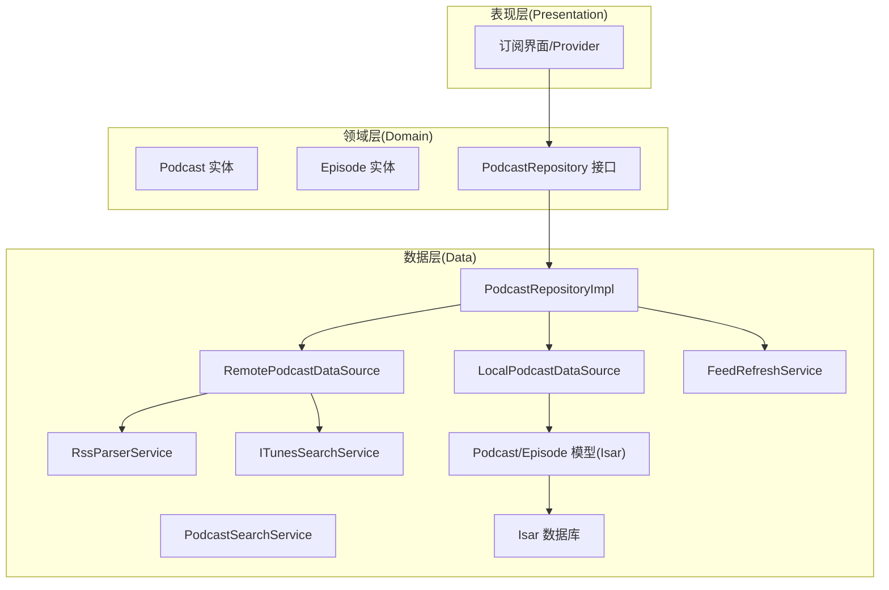
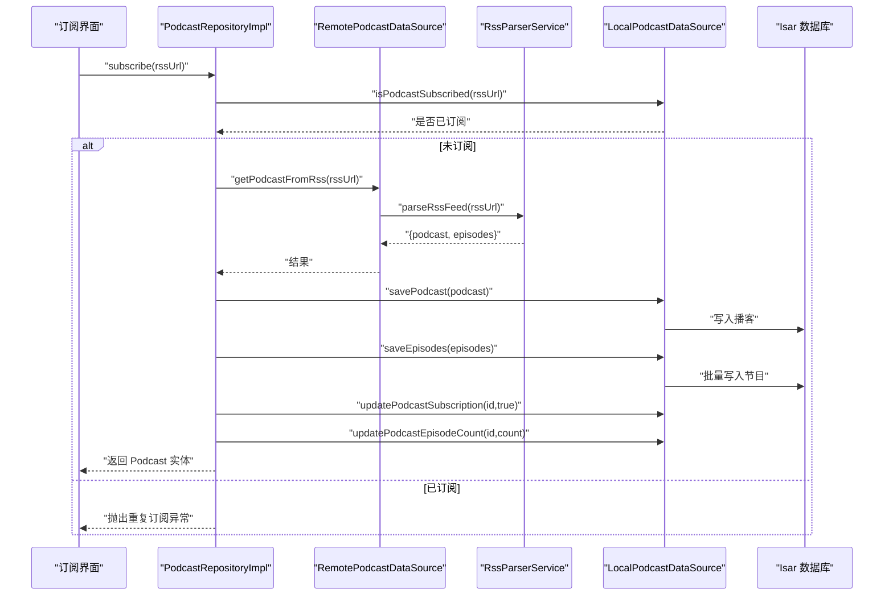
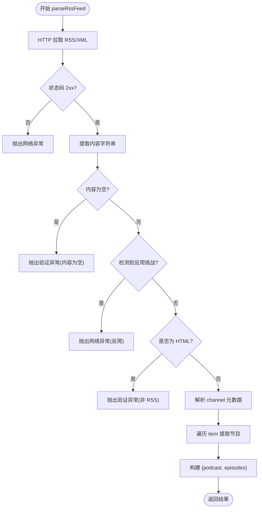
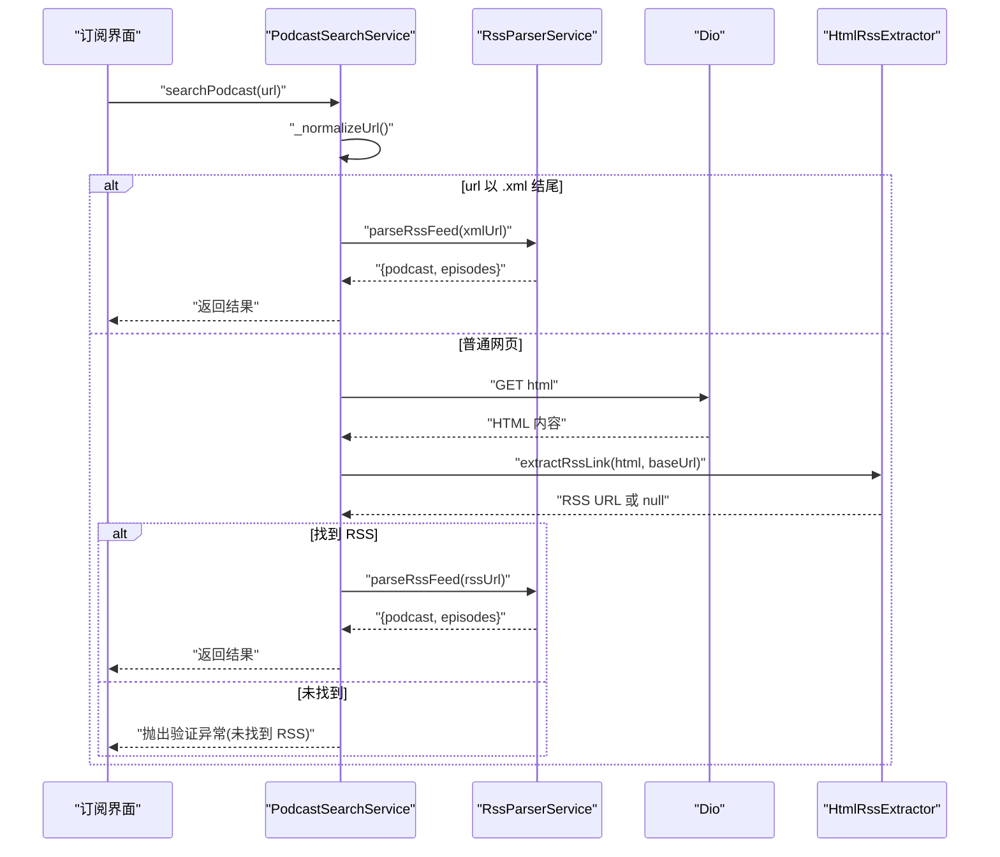
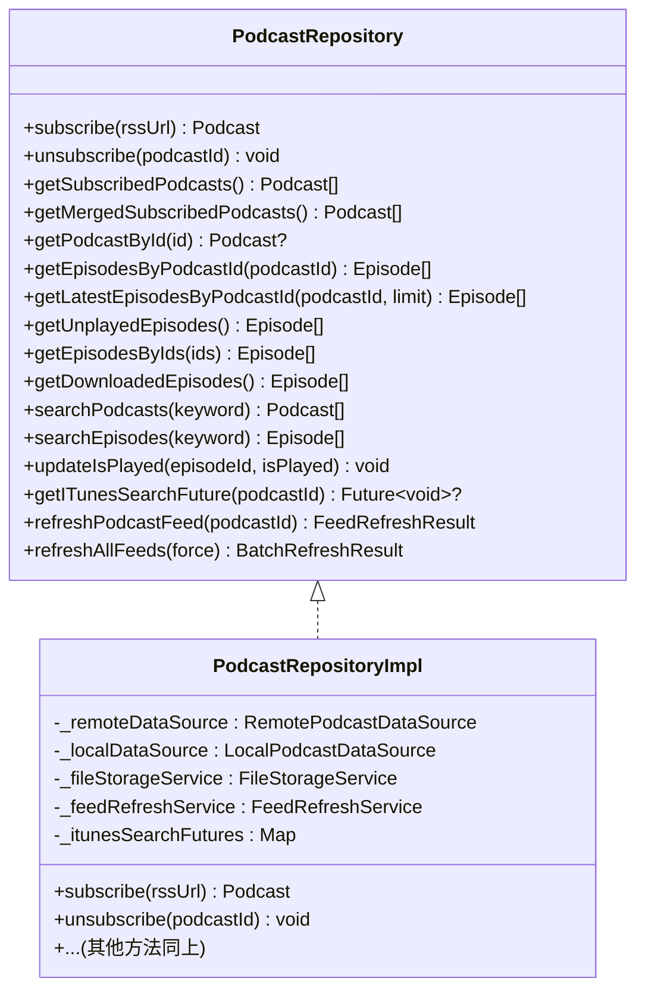
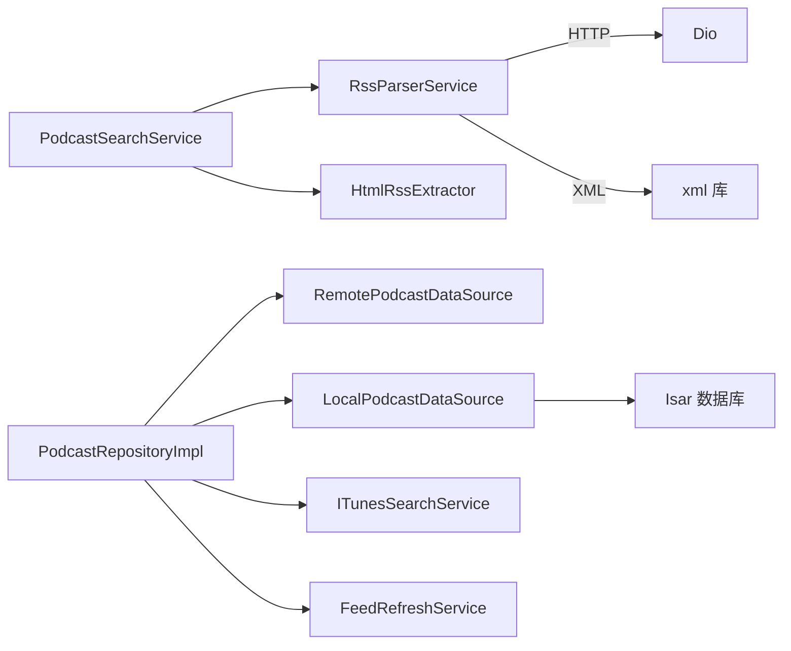

# 播客订阅系统

<cite>
**本文引用的文件**   
- [rss_parser_service.dart](file://lib/data/services/rss_parser_service.dart)
- [podcast_search_service.dart](file://lib/data/services/podcast_search_service.dart)
- [podcast_repository.dart](file://lib/domain/repositories/podcast_repository.dart)
- [podcast_repository_impl.dart](file://lib/data/repositories/podcast_repository_impl.dart)
- [local_podcast_datasource.dart](file://lib/data/datasources/local_podcast_datasource.dart)
- [remote_podcast_datasource.dart](file://lib/data/datasources/remote_podcast_datasource.dart)
- [itunes_search_service.dart](file://lib/data/services/itunes_search_service.dart)
- [feed_refresh_service.dart](file://lib/data/services/feed_refresh_service.dart)
- [episode_model.dart](file://lib/data/models/episode_model.dart)
- [podcast_model.dart](file://lib/data/models/podcast_model.dart)
- [isar_service.dart](file://lib/data/database/isar_service.dart)
- [app_exception.dart](file://lib/core/utils/app_exception.dart)
- [network_error_handler.dart](file://lib/core/utils/network_error_handler.dart)
- [html_rss_extractor.dart](file://lib/core/utils/html_rss_extractor.dart)
</cite>

## 目录
1. [简介](#简介)
2. [项目结构](#项目结构)
3. [核心组件](#核心组件)
4. [架构总览](#架构总览)
5. [详细组件分析](#详细组件分析)
6. [依赖关系分析](#依赖关系分析)
7. [性能考量](#性能考量)
8. [故障排查指南](#故障排查指南)
9. [结论](#结论)
10. [附录](#附录)

## 简介
本文件面向 TinyCast 的播客订阅系统，系统性阐述 RSS 解析机制、播客搜索能力与订阅管理逻辑的实现细节。文档覆盖以下关键点：
- RSS 2.0 与 Atom 格式支持、iTunes 扩展标签处理
- 重复订阅检测与批量保存优化
- 仓库层数据访问模式（Repository）
- 与数据库（Isar）、网络服务（Dio/iTunes/Podcast Index）的关系
- 常见订阅问题定位与解决方案
- 面向初学者的渐进式说明与面向资深开发者的技术深度

## 项目结构
TinyCast 采用 Clean Architecture 分层组织代码：Domain（实体与接口）、Data（数据源、仓库实现、服务）、Presentation（UI 与状态）。与订阅相关的关键路径如下：
- Domain 层定义 Podcast/Episode 实体与 PodcastRepository 接口
- Data 层提供 Remote/Local 数据源、RSS 解析器、iTunes 搜索、Feed 刷新等
- Presentation 层通过 Provider/UseCase 调用仓库方法完成用户操作

图表来源 
- [podcast_repository.dart:1-42](file://lib/domain/repositories/podcast_repository.dart#L1-L42)
- [podcast_repository_impl.dart:1-120](file://lib/data/repositories/podcast_repository_impl.dart#L1-L120)
- [rss_parser_service.dart:1-60](file://lib/data/services/rss_parser_service.dart#L1-L60)
- [podcast_search_service.dart:1-60](file://lib/data/services/podcast_search_service.dart#L1-L60)
- [itunes_search_service.dart](file://lib/data/services/itunes_search_service.dart)
- [feed_refresh_service.dart](file://lib/data/services/feed_refresh_service.dart)
- [local_podcast_datasource.dart](file://lib/data/datasources/local_podcast_datasource.dart)
- [remote_podcast_datasource.dart](file://lib/data/datasources/remote_podcast_datasource.dart)
- [podcast_model.dart](file://lib/data/models/podcast_model.dart)
- [episode_model.dart](file://lib/data/models/episode_model.dart)
- [isar_service.dart](file://lib/data/database/isar_service.dart)

章节来源
- [podcast_repository.dart:1-42](file://lib/domain/repositories/podcast_repository.dart#L1-L42)
- [podcast_repository_impl.dart:1-120](file://lib/data/repositories/podcast_repository_impl.dart#L1-L120)

## 核心组件
- RssParserService：负责拉取并解析 RSS/Atom XML，提取播客元数据与节目列表，内置重试、反爬识别、HTML 响应回退等健壮性策略。
- PodcastSearchService：统一入口，支持直接解析 .xml 或从 HTML 页面查找 RSS 链接，再交由 RSS 解析器处理。
- PodcastRepository + PodcastRepositoryImpl：封装订阅、取消订阅、查询、合并去重、批量刷新等业务逻辑，协调远程与本地数据源。
- Local/Remote 数据源：Local 对接 Isar 数据库；Remote 负责网络请求与 iTunes 搜索集成。
- ITunesSearchService：异步获取 Apple ID 与封面图，支持区域降级（US→CN）。
- FeedRefreshService：单条与批量刷新订阅源，增量更新新剧集。

章节来源
- [rss_parser_service.dart:1-130](file://lib/data/services/rss_parser_service.dart#L1-L130)
- [podcast_search_service.dart:1-120](file://lib/data/services/podcast_search_service.dart#L1-L120)
- [podcast_repository.dart:1-42](file://lib/domain/repositories/podcast_repository.dart#L1-L42)
- [podcast_repository_impl.dart:38-141](file://lib/data/repositories/podcast_repository_impl.dart#L38-L141)

## 架构总览
订阅主流程（以“订阅”为例）：
- 表现层调用仓库 subscribe(rssUrl)
- 仓库检查重复订阅 → 调用远程数据源获取 RSS → 解析为 Podcast/Episode → 批量写入本地数据库 → 标记订阅状态 → 可选异步 iTunes 搜索填充额外信息

图表来源 
- [podcast_repository_impl.dart:38-141](file://lib/data/repositories/podcast_repository_impl.dart#L38-L141)
- [rss_parser_service.dart:35-128](file://lib/data/services/rss_parser_service.dart#L35-L128)
- [local_podcast_datasource.dart](file://lib/data/datasources/local_podcast_datasource.dart)
- [remote_podcast_datasource.dart](file://lib/data/datasources/remote_podcast_datasource.dart)

章节来源
- [podcast_repository_impl.dart:38-141](file://lib/data/repositories/podcast_repository_impl.dart#L38-L141)

## 详细组件分析

### RssParserService（RSS/Atom 解析器）
职责与特性：
- 使用 Dio 发起 HTTP 请求，设置超时与 User-Agent
- 使用 xml 库直接解析 XML，兼容 RSS 2.0 与 Atom
- 提取 channel 元数据与 item 列表，支持 iTunes 命名空间字段（subtitle、summary、image、explicit、category、keywords、owner、id 等）
- 自动重试（默认次数可配置），指数退避
- 反爬虫识别（如 SG-Captcha）与 HTML 响应回退提示
- GUID 缺失时基于 audioUrl 生成稳定标识，保障去重与后续下载一致性

关键方法与行为：
- parseRssFeed(rssUrl)：主入口，返回 {podcast, episodes}
- _extractPodcastFromRss()/_extractEpisodesFromRss()：分别提取播客与节目
- _getITunesElementText()/ _getDublinCoreElementText()：命名空间安全读取
- _parseExplicit()/_parseDuration()/_parseDateTime()：类型转换与容错

返回值与异常：
- 成功：Map<String, dynamic>，包含 podcast 与 episodes
- 失败：抛出 AppException（网络/验证/未知错误），含原始错误与堆栈

图表来源 
- [rss_parser_service.dart:35-128](file://lib/data/services/rss_parser_service.dart#L35-L128)
- [rss_parser_service.dart:139-267](file://lib/data/services/rss_parser_service.dart#L139-L267)
- [rss_parser_service.dart:409-457](file://lib/data/services/rss_parser_service.dart#L409-L457)

章节来源
- [rss_parser_service.dart:1-459](file://lib/data/services/rss_parser_service.dart#L1-L459)

### PodcastSearchService（播客搜索服务）
职责与特性：
- 统一入口 searchPodcast(url)：若 URL 以 .xml 结尾则直接解析，否则抓取 HTML 页面查找 RSS 链接
- 标准化 URL（自动补全 https://）
- 在 HTML 中查找 type="application/rss+xml" 的 link 标签，或 href 中包含 .xml 的链接
- 失败时给出明确错误提示，便于前端展示

关键方法与行为：
- _normalizeUrl()：规范化输入
- _isXmlFile()/_parseXmlFile()：XML 直连解析
- _searchFromHtml()/_findRssLinkInHtml()/_extractRssLinkFromHtml()：HTML 页面内 RSS 发现

返回值与异常：
- 成功：{podcast, episodes}
- 失败：AppException（验证/网络/未知）

图表来源 
- [podcast_search_service.dart:38-127](file://lib/data/services/podcast_search_service.dart#L38-L127)
- [html_rss_extractor.dart](file://lib/core/utils/html_rss_extractor.dart)
- [rss_parser_service.dart:35-128](file://lib/data/services/rss_parser_service.dart#L35-L128)

章节来源
- [podcast_search_service.dart:1-208](file://lib/data/services/podcast_search_service.dart#L1-L208)

### PodcastRepository 与实现（订阅管理）
职责与特性：
- 订阅：先查重 → 拉取 RSS → 保存播客与节目（批量）→ 更新订阅状态与计数 → 可选异步 iTunes 搜索
- 取消订阅：级联删除节目与音频文件，清理数据库记录
- 查询：已订阅列表、按 ID 查询、最新节目、未播放节目、下载节目、关键词搜索
- 合并去重：过滤主站优先的播客条目
- 刷新：单条与批量刷新 feed，统计新增剧集数量

关键方法与行为：
- subscribe()：完整订阅流程，含计时日志与异常包装
- unsubscribe()：文件与数据一致性的清理
- getMergedSubscribedPodcasts()：合并去重后的列表
- refreshPodcastFeed()/refreshAllFeeds()：委托 FeedRefreshService

图表来源 
- [podcast_repository.dart:1-42](file://lib/domain/repositories/podcast_repository.dart#L1-L42)
- [podcast_repository_impl.dart:15-141](file://lib/data/repositories/podcast_repository_impl.dart#L15-L141)

章节来源
- [podcast_repository.dart:1-42](file://lib/domain/repositories/podcast_repository.dart#L1-L42)
- [podcast_repository_impl.dart:38-141](file://lib/data/repositories/podcast_repository_impl.dart#L38-L141)

### 数据模型与数据库（Isar）
- Podcast/Episode 模型：用于 Isar 持久化，包含索引（title、rssUrl、lastUpdated、podcastId、pubDate 等）与关联（Podcast -> Episode via podcastId）
- 数据库初始化：IsarService 打开数据库并注册集合
- 典型字段：
  - Podcast：title、subtitle、author、description、artworkUrl、rssUrl、websiteUrl、language、copyright、categories、keywords、isExplicit、ownerName、ownerEmail、lastUpdated、episodeCount、isSubscribed、subscribedAt、createdAt、itunesId、itunesArtworkUrl 等
  - Episode：podcastId、title、description、link、guid、author、pubDate、audioUrl、audioType、duration、artworkUrl、isExplicit、isPlayed、isDownloaded、downloadedPath、downloadProgress、playProgress、lastPlayedAt、createdAt、updatedAt、itunesId、itunesArtworkUrl、itunesReleaseDate、itunesExplicitness、itunesContentAdvisoryRating、podcastITunesId 等

章节来源
- [podcast_model.dart](file://lib/data/models/podcast_model.dart)
- [episode_model.dart](file://lib/data/models/episode_model.dart)
- [isar_service.dart](file://lib/data/database/isar_service.dart)

### iTunes 搜索与 Feed 刷新
- ITunesSearchService：异步搜索 Apple 播客目录，支持 US→CN 区域降级，提取 collectionId 与 artworkUrl600，提升封面质量
- FeedRefreshService：单条与批量刷新，增量对比新剧集并入库，返回统计结果

章节来源
- [itunes_search_service.dart](file://lib/data/services/itunes_search_service.dart)
- [feed_refresh_service.dart](file://lib/data/services/feed_refresh_service.dart)

## 依赖关系分析
- RssParserService 依赖 Dio、xml 库与 AppConstants/AppException/NetworkErrorHandler
- PodcastSearchService 依赖 RssParserService 与 HtmlRssExtractor
- PodcastRepositoryImpl 依赖 Remote/Local 数据源、FileStorageService、FeedRefreshService、ITunesSearchService
- Local/Remote 数据源分别依赖 Isar 与网络层

图表来源 
- [rss_parser_service.dart:1-34](file://lib/data/services/rss_parser_service.dart#L1-L34)
- [podcast_search_service.dart:1-36](file://lib/data/services/podcast_search_service.dart#L1-L36)
- [podcast_repository_impl.dart:15-36](file://lib/data/repositories/podcast_repository_impl.dart#L15-L36)

章节来源
- [podcast_repository_impl.dart:15-36](file://lib/data/repositories/podcast_repository_impl.dart#L15-L36)

## 性能考量
- RSS 解析
  - 直接 XML 解析避免 DOM 过度抽象开销
  - 重试退避减少瞬时网络抖动影响
  - GUID 缺失时的稳定标识生成降低重复风险
- 批量保存
  - 节目批量写入数据库，减少事务切换与 IO 次数
- 合并去重
  - 主站优先策略减少冗余条目，提升列表渲染效率
- 异步 iTunes 搜索
  - 不阻塞主订阅流程，后台填充增强信息
- 刷新策略
  - 增量对比新剧集，避免全量覆盖

[本节为通用指导，不直接分析具体文件]

## 故障排查指南
常见问题与解决思路：
- 反爬虫/验证码拦截
  - 现象：解析失败并提示反机器人验证
  - 原因：目标站点启用安全网关（如 SG-Captcha）
  - 解决：切换网络环境（如手机热点）、稍后重试、更换 RSS 地址
- 服务器返回 HTML 而非 RSS
  - 现象：提示“服务器返回了 HTML 页面而非 RSS 数据”
  - 原因：URL 指向主页或需要跳转
  - 解决：使用 PodcastSearchService 自动查找 RSS 链接，或直接提供 .xml 地址
- GUID 缺失导致去重异常
  - 现象：节目缺少 guid，系统自动生成标识
  - 解决：尽量确保 RSS 源提供唯一 guid；必要时人工校验 audioUrl 稳定性
- 订阅重复
  - 现象：抛出“该播客已订阅”
  - 解决：确认 rssUrl 唯一性，避免不同 URL 指向同一播客
- 网络超时/不稳定
  - 现象：多次重试后仍失败
  - 解决：检查网络连通性与代理设置，适当增大超时时间

章节来源
- [rss_parser_service.dart:75-93](file://lib/data/services/rss_parser_service.dart#L75-L93)
- [podcast_repository_impl.dart:44-48](file://lib/data/repositories/podcast_repository_impl.dart#L44-L48)
- [app_exception.dart](file://lib/core/utils/app_exception.dart)
- [network_error_handler.dart](file://lib/core/utils/network_error_handler.dart)

## 结论
TinyCast 的播客订阅系统以 Clean Architecture 为基础，通过 RssParserService 与 PodcastSearchService 提供健壮的 RSS/Atom 解析与搜索能力；PodcastRepositoryImpl 将订阅、去重、批量保存、iTunes 增强与 Feed 刷新整合为清晰的业务流；配合 Isar 数据库的高效存储与索引，整体具备高可用与可扩展性。对初学者而言，可按“搜索→解析→订阅→刷新”的路径逐步理解；对资深开发者，可通过扩展命名空间字段、优化重试策略与批量写入进一步提升性能与鲁棒性。

[本节为总结，不直接分析具体文件]

## 附录
- 配置项参考（示例）
  - 最大重试次数：maxRetryCount（默认来自 AppConstants）
  - 超时时间：defaultTimeout（连接/接收/发送）
  - User-Agent：TinyCast/${AppConstants.appVersion}
- 参数与返回值约定
  - RssParserService.parseRssFeed(rssUrl) → {podcast: Podcast, episodes: List<Episode>}
  - PodcastSearchService.searchPodcast(url) → {podcast: Podcast, episodes: List<Episode>}
  - PodcastRepository.subscribe(rssUrl) → Podcast
  - PodcastRepository.refreshAllFeeds({force}) → BatchRefreshResult
- 与外部服务关系
  - 网络：Dio（HTTP 请求）
  - 解析：xml（XML 解析）
  - 搜索：ITunesSearchService（Apple 播客目录）
  - 存储：Isar（本地数据库）

[本节为补充说明，不直接分析具体文件]