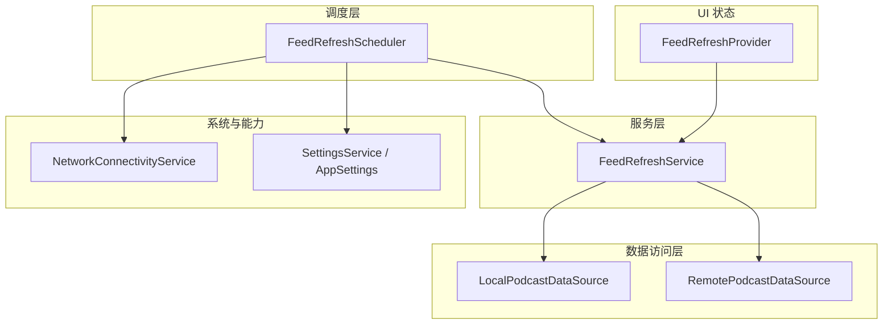
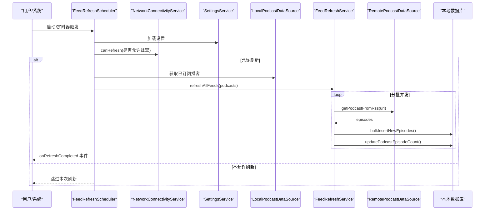
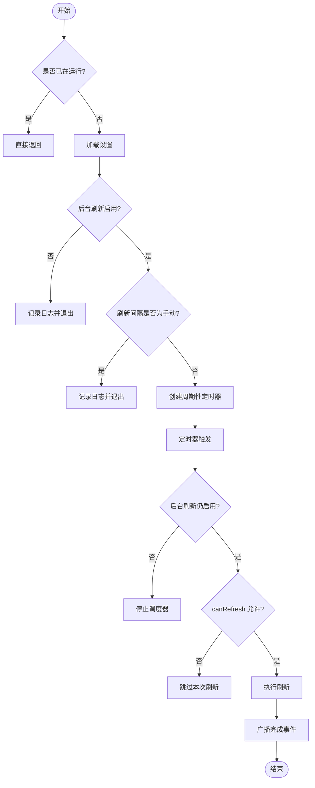
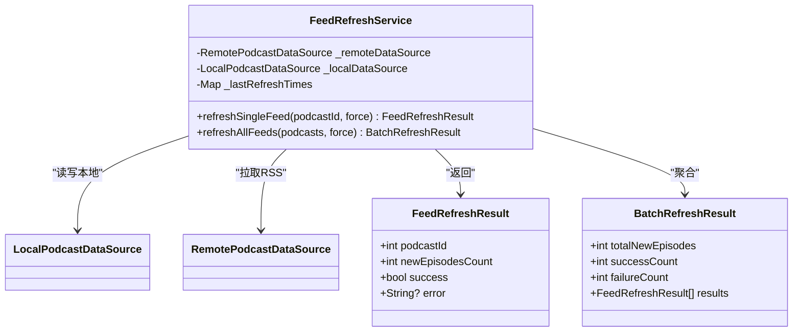
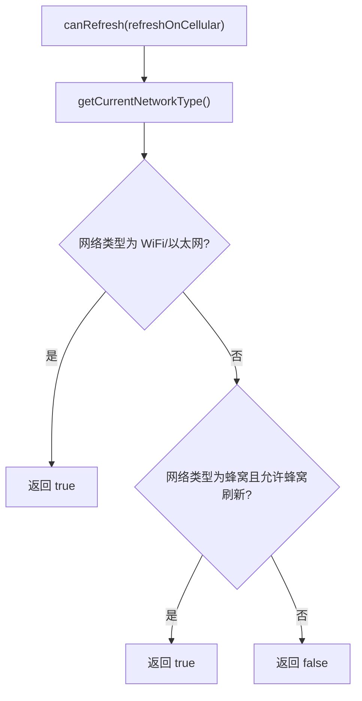
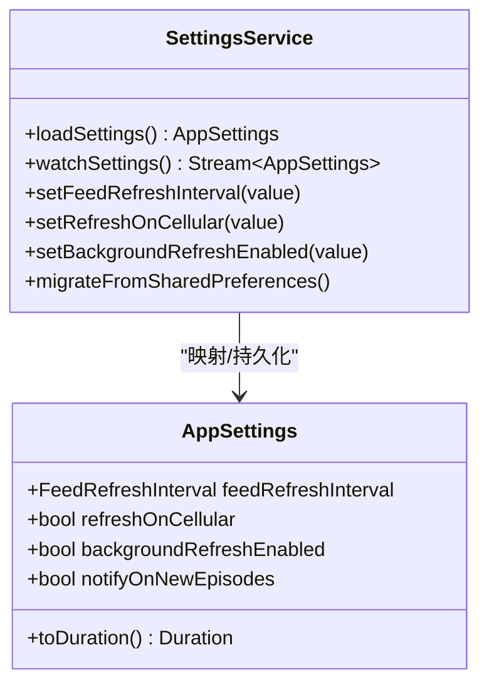
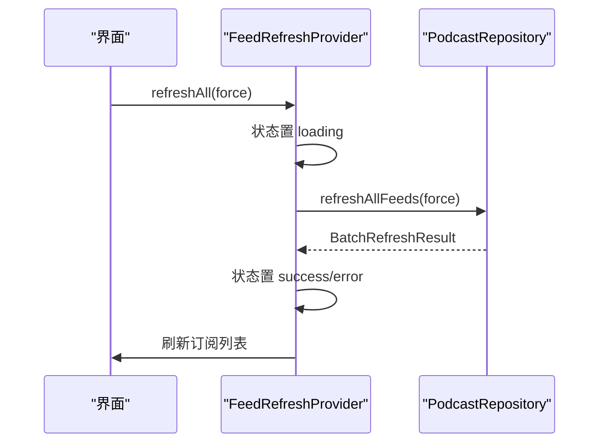
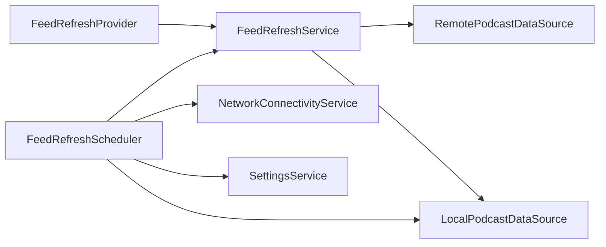

# 订阅源刷新系统

<cite>
**本文引用的文件**   
- [feed_refresh_scheduler.dart](file://lib/core/services/feed_refresh_scheduler.dart)
- [feed_refresh_service.dart](file://lib/data/services/feed_refresh_service.dart)
- [network_connectivity_service.dart](file://lib/core/services/network_connectivity_service.dart)
- [settings_service.dart](file://lib/data/services/settings_service.dart)
- [app_settings.dart](file://lib/domain/entities/app_settings.dart)
- [feed_refresh_provider.dart](file://lib/presentation/providers/feed_refresh_provider.dart)
- [feed_refresh_settings.dart](file://lib/presentation/features/settings/general_settings/feed_refresh_settings/feed_refresh_settings.dart)
- [feed_refresh_service_test.dart](file://test/data/services/feed_refresh_service_test.dart)
</cite>

## 目录
1. [简介](#简介)
2. [项目结构](#项目结构)
3. [核心组件](#核心组件)
4. [架构总览](#架构总览)
5. [详细组件分析](#详细组件分析)
6. [依赖关系分析](#依赖关系分析)
7. [性能考量](#性能考量)
8. [故障排查指南](#故障排查指南)
9. [结论](#结论)
10. [附录](#附录)

## 简介
本文件为 TinyCast 的订阅源（Feed）刷新系统提供系统化、可操作的文档。重点覆盖 FeedRefreshService 与 FeedRefreshScheduler 的实现机制，包括定时任务调度、增量更新策略、冲突解决算法、后台刷新任务的创建/执行/监控/错误恢复、智能刷新间隔计算、网络状态检测、电池优化与资源管理、批量刷新优化、断点续传、进度跟踪与失败重试等。同时给出优先级队列、并发控制、内存管理与性能监控的实践建议，并说明与系统通知、用户交互和设置选项的集成方式。

## 项目结构
该刷新系统由“调度层 + 服务层 + 数据访问层 + 设置与网络能力 + UI 状态”组成：
- 调度层：FeedRefreshScheduler 负责按配置周期触发刷新，并在应用生命周期变化时启停定时器。
- 服务层：FeedRefreshService 实现单播/批量刷新、冷却与退化策略、增量去重、结果聚合。
- 数据访问层：LocalPodcastDataSource 与 RemotePodcastDataSource 分别负责本地持久化与远程 RSS 拉取。
- 设置与网络：SettingsService 读取 AppSettings；NetworkConnectivityService 判断网络类型与是否允许刷新。
- UI 状态：FeedRefreshProvider 暴露刷新状态与操作，供界面消费。

图表来源
- [feed_refresh_scheduler.dart:1-165](file://lib/core/services/feed_refresh_scheduler.dart#L1-L165)
- [feed_refresh_service.dart:1-239](file://lib/data/services/feed_refresh_service.dart#L1-L239)
- [network_connectivity_service.dart:1-63](file://lib/core/services/network_connectivity_service.dart#L1-L63)
- [settings_service.dart:1-272](file://lib/data/services/settings_service.dart#L1-L272)
- [app_settings.dart:1-211](file://lib/domain/entities/app_settings.dart#L1-L211)
- [feed_refresh_provider.dart:1-162](file://lib/presentation/providers/feed_refresh_provider.dart#L1-L162)

章节来源
- [feed_refresh_scheduler.dart:1-165](file://lib/core/services/feed_refresh_scheduler.dart#L1-L165)
- [feed_refresh_service.dart:1-239](file://lib/data/services/feed_refresh_service.dart#L1-L239)
- [network_connectivity_service.dart:1-63](file://lib/core/services/network_connectivity_service.dart#L1-L63)
- [settings_service.dart:1-272](file://lib/data/services/settings_service.dart#L1-L272)
- [app_settings.dart:1-211](file://lib/domain/entities/app_settings.dart#L1-L211)
- [feed_refresh_provider.dart:1-162](file://lib/presentation/providers/feed_refresh_provider.dart#L1-L162)

## 核心组件
- FeedRefreshScheduler：基于 Timer.periodic 的周期性调度器，依据设置决定是否启动、何时停止，并在每次 tick 中检查网络条件后执行刷新。支持立即刷新、应用前后台切换时的启停。
- FeedRefreshService：单播与批量刷新逻辑，包含冷却期、退化模式、增量去重、失败计数与统计汇总。
- NetworkConnectivityService：根据 connectivity_plus 判断当前网络类型，结合“仅 WiFi”设置决定是否可以刷新。
- SettingsService/AppSettings：集中管理刷新间隔、是否允许蜂窝刷新、是否开启后台刷新与通知等。
- FeedRefreshProvider：Riverpod Notifier，封装刷新状态机与 UI 刷新回调，屏蔽重复请求。

章节来源
- [feed_refresh_scheduler.dart:1-165](file://lib/core/services/feed_refresh_scheduler.dart#L1-L165)
- [feed_refresh_service.dart:1-239](file://lib/data/services/feed_refresh_service.dart#L1-L239)
- [network_connectivity_service.dart:1-63](file://lib/core/services/network_connectivity_service.dart#L1-L63)
- [settings_service.dart:1-272](file://lib/data/services/settings_service.dart#L1-L272)
- [app_settings.dart:1-211](file://lib/domain/entities/app_settings.dart#L1-L211)
- [feed_refresh_provider.dart:1-162](file://lib/presentation/providers/feed_refresh_provider.dart#L1-L162)

## 架构总览
下图展示一次定时触发的完整调用链：调度器读取设置与网络状态，获取订阅列表，调用服务进行批量刷新，完成后通过 Stream 广播完成事件，UI 层可据此更新状态。

图表来源
- [feed_refresh_scheduler.dart:49-165](file://lib/core/services/feed_refresh_scheduler.dart#L49-L165)
- [feed_refresh_service.dart:204-239](file://lib/data/services/feed_refresh_service.dart#L204-L239)
- [network_connectivity_service.dart:49-63](file://lib/core/services/network_connectivity_service.dart#L49-L63)
- [settings_service.dart:18-40](file://lib/data/services/settings_service.dart#L18-L40)

## 详细组件分析

### FeedRefreshScheduler 调度器
职责
- 根据设置决定是否启用后台刷新与刷新间隔。
- 使用 Timer.periodic 定时触发 _onTimerTick。
- 在每次 tick 中检查网络条件，满足则执行 _performRefresh。
- 暴露 onRefreshCompleted 流，用于 UI 监听刷新完成。
- 处理应用前后台切换，保证资源占用最小化。

关键流程
- start(): 读取设置，若禁用或手动模式则不启动；否则按间隔创建定时器。
- _onTimerTick(): 再次校验设置与网络，满足则调用 _performRefresh。
- _performRefresh(): 获取订阅列表，调用 FeedRefreshService.refreshAllFeeds，完成后广播完成事件。
- handleAppPaused/handleAppResumed(): 暂停时停止定时器，恢复时重启。

图表来源
- [feed_refresh_scheduler.dart:49-115](file://lib/core/services/feed_refresh_scheduler.dart#L49-L115)
- [feed_refresh_scheduler.dart:117-147](file://lib/core/services/feed_refresh_scheduler.dart#L117-L147)
- [network_connectivity_service.dart:49-63](file://lib/core/services/network_connectivity_service.dart#L49-L63)

章节来源
- [feed_refresh_scheduler.dart:1-165](file://lib/core/services/feed_refresh_scheduler.dart#L1-L165)

### FeedRefreshService 刷新服务
职责
- 单播刷新：refreshSingleFeed，包含冷却期、退化模式、RSS 拉取、增量去重、写入与计数更新、失败计数维护。
- 批量刷新：refreshAllFeeds，分块并发执行，聚合结果并统计新剧集数、成功/失败数。

增量更新与冲突解决
- 增量去重：通过本地已存在 GUID 集合过滤远程剧集，避免重复插入。
- 冲突处理：对 GUID 为空或已存在的剧集进行跳过并记录统计信息。
- 失败降级：当某播客刷新失败次数达到阈值时进入退化模式，延长刷新间隔。

并发与资源控制
- 最大并发：_maxConcurrentRefreshes 限制每批并发数量，避免资源争用。
- 冷却期：_cooldownDuration 防止短时间内重复刷新同一播客。

图表来源
- [feed_refresh_service.dart:51-239](file://lib/data/services/feed_refresh_service.dart#L51-L239)

章节来源
- [feed_refresh_service.dart:1-239](file://lib/data/services/feed_refresh_service.dart#L1-L239)

### NetworkConnectivityService 网络检测
职责
- 判断当前网络类型（WiFi/以太网/蜂窝/无）。
- 根据“仅 WiFi”设置决定是否允许刷新。

图表来源
- [network_connectivity_service.dart:49-63](file://lib/core/services/network_connectivity_service.dart#L49-L63)

章节来源
- [network_connectivity_service.dart:1-63](file://lib/core/services/network_connectivity_service.dart#L1-L63)

### SettingsService 与 AppSettings 设置管理
职责
- 从 Isar 读取/监听设置变更，提供迁移方法从 SharedPreferences 迁移。
- 暴露刷新相关设置：刷新间隔、是否允许蜂窝刷新、是否开启后台刷新与通知。

图表来源
- [settings_service.dart:18-40](file://lib/data/services/settings_service.dart#L18-L40)
- [app_settings.dart:1-211](file://lib/domain/entities/app_settings.dart#L1-L211)

章节来源
- [settings_service.dart:1-272](file://lib/data/services/settings_service.dart#L1-L272)
- [app_settings.dart:1-211](file://lib/domain/entities/app_settings.dart#L1-L211)

### FeedRefreshProvider UI 状态与交互
职责
- 暴露刷新状态（idle/loading/success/error），避免重复请求。
- 封装 refreshAll/refreshSingle 调用，完成后刷新 UI。

图表来源
- [feed_refresh_provider.dart:51-92](file://lib/presentation/providers/feed_refresh_provider.dart#L51-L92)

章节来源
- [feed_refresh_provider.dart:1-162](file://lib/presentation/providers/feed_refresh_provider.dart#L1-L162)

### 设置界面集成
- FeedRefreshSettings 提供下拉选择刷新间隔、仅 WiFi 刷新开关、刷新通知开关、后台刷新开关。
- 通过 SettingsProvider 更新设置，影响调度器行为与网络检测策略。

章节来源
- [feed_refresh_settings.dart:1-136](file://lib/presentation/features/settings/general_settings/feed_refresh_settings/feed_refresh_settings.dart#L1-L136)

## 依赖关系分析
- FeedRefreshScheduler 依赖 SettingsService、NetworkConnectivityService、LocalPodcastDataSource 与 FeedRefreshService。
- FeedRefreshService 依赖 RemotePodcastDataSource 与 LocalPodcastDataSource。
- UI 层通过 FeedRefreshProvider 间接依赖 PodcastRepository（由上层注入），与服务层解耦。

图表来源
- [feed_refresh_scheduler.dart:1-165](file://lib/core/services/feed_refresh_scheduler.dart#L1-L165)
- [feed_refresh_service.dart:1-239](file://lib/data/services/feed_refresh_service.dart#L1-L239)

章节来源
- [feed_refresh_scheduler.dart:1-165](file://lib/core/services/feed_refresh_scheduler.dart#L1-L165)
- [feed_refresh_service.dart:1-239](file://lib/data/services/feed_refresh_service.dart#L1-L239)

## 性能考量
- 批量并发控制：通过固定大小的分块与 Future.wait 控制并发度，避免过多并发导致 CPU/IO 抖动。
- 冷却期与退化模式：减少无效请求与服务器压力，提升整体吞吐与稳定性。
- 增量去重：基于 GUID 的本地集合比对，降低重复写入与解析开销。
- 网络条件前置判断：仅在满足条件时发起刷新，节省电量与带宽。
- 建议的性能监控指标：
  - 单次刷新耗时、批量刷新总耗时、各阶段耗时（网络、写入）。
  - 成功率、失败原因分布、退化模式触发频率。
  - 内存峰值、CPU 占用、I/O 等待时间。
- 建议的优化方向：
  - 引入优先级队列：优先刷新最近活跃或高价值播客。
  - 断点续传：记录每个播客的 lastFetchedAt 与已处理批次，异常恢复时从断点继续。
  - 进度跟踪：在服务层暴露进度流（如已完成数/总数），供 UI 显示。
  - 失败重试：指数退避重试，区分网络错误与业务错误。
  - 资源管理：限制并发、合理设置超时、及时释放临时对象。

[本节为通用指导，不直接分析具体文件]

## 故障排查指南
常见问题与定位要点
- 定时器未启动：检查后台刷新是否启用、刷新间隔是否为手动模式。
- 网络条件不满足：确认当前网络类型与“仅 WiFi”设置。
- 刷新频繁被跳过：检查冷却期与退化模式是否触发。
- 大量重复插入：检查 GUID 是否为空或本地去重逻辑是否正确。
- 失败计数持续增加：查看错误日志，区分网络错误与解析错误。

调试建议
- 启用详细日志：关注调度器与服务层的日志输出。
- 单元测试验证：参考测试用例对结果结构与边界条件进行验证。
- 观察 UI 状态：通过 FeedRefreshProvider 的状态变化定位问题阶段。

章节来源
- [feed_refresh_service_test.dart:1-107](file://test/data/services/feed_refresh_service_test.dart#L1-L107)

## 结论
TinyCast 的订阅源刷新系统以清晰的职责分层与稳健的策略设计实现了高效可靠的后台刷新能力。调度器负责时机与生命周期管理，服务层实现增量去重、冷却与退化策略，网络与设置能力确保资源友好。建议在后续迭代中引入优先级队列、断点续传、进度跟踪与失败重试，进一步提升用户体验与系统鲁棒性。

[本节为总结性内容，不直接分析具体文件]

## 附录
- 关键枚举与默认值：
  - FeedRefreshInterval：manual/hourly/every3h/every6h/every12h/daily，默认 every6h。
  - AppSettings：refreshOnCellular=false，backgroundRefreshEnabled=true，notifyOnNewEpisodes=true。
- 关键常量：
  - 冷却时长、退化阈值与倍数、最大并发刷新数。

章节来源
- [app_settings.dart:1-211](file://lib/domain/entities/app_settings.dart#L1-L211)
- [feed_refresh_service.dart:51-56](file://lib/data/services/feed_refresh_service.dart#L51-L56)