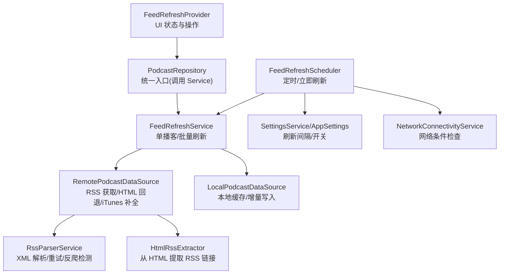
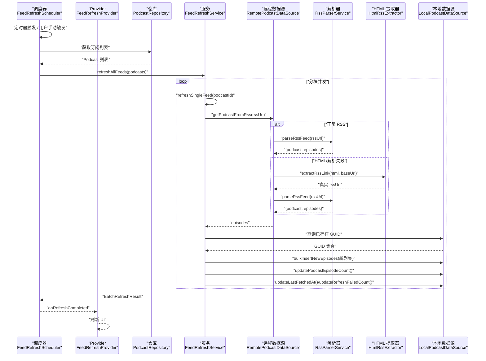
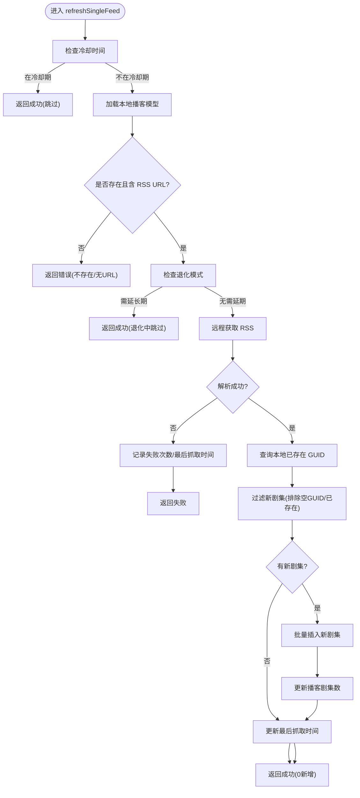
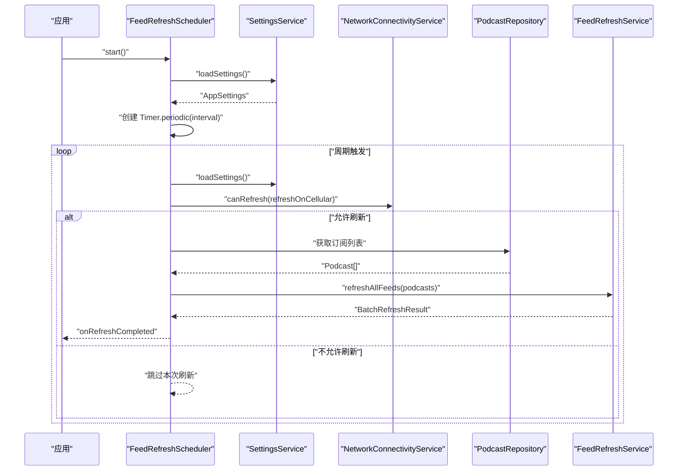
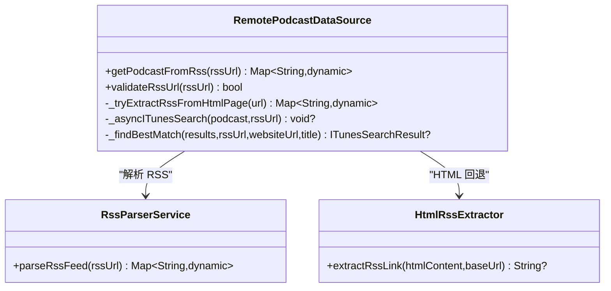
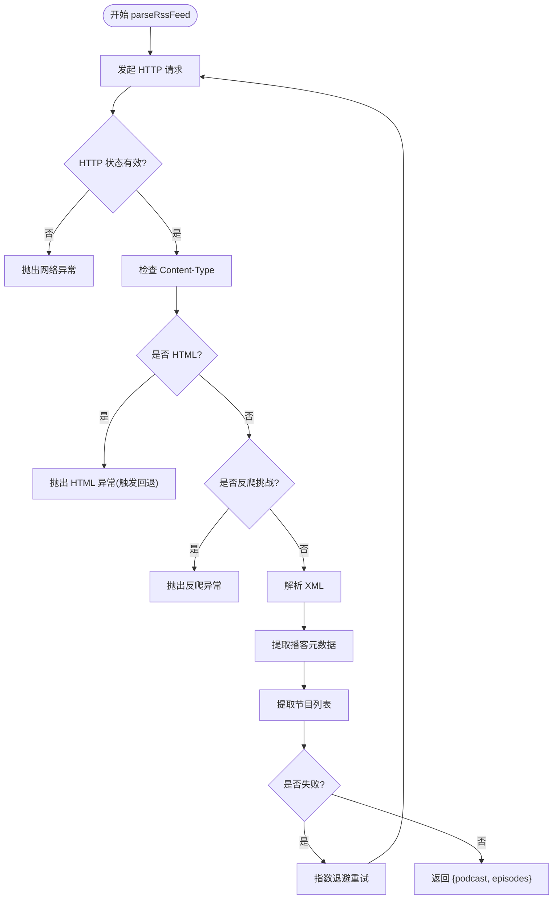
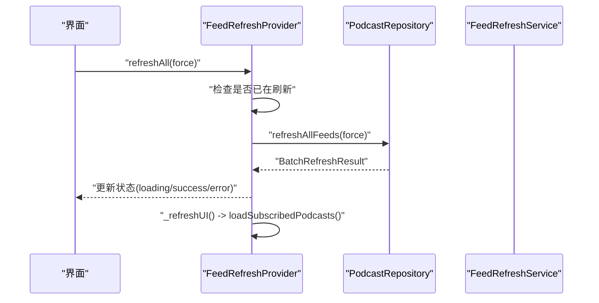
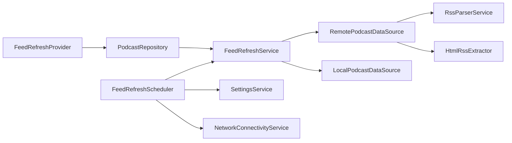

# Feed 刷新系统

<cite>
**本文引用的文件**   
- [lib/data/services/feed_refresh_service.dart](file://lib/data/services/feed_refresh_service.dart)
- [lib/core/services/feed_refresh_scheduler.dart](file://lib/core/services/feed_refresh_scheduler.dart)
- [lib/data/datasources/remote_podcast_datasource.dart](file://lib/data/datasources/remote_podcast_datasource.dart)
- [lib/data/services/rss_parser_service.dart](file://lib/data/services/rss_parser_service.dart)
- [lib/core/utils/html_rss_extractor.dart](file://lib/core/utils/html_rss_extractor.dart)
- [lib/presentation/providers/feed_refresh_provider.dart](file://lib/presentation/providers/feed_refresh_provider.dart)
- [lib/domain/entities/podcast.dart](file://lib/domain/entities/podcast.dart)
- [lib/domain/entities/app_settings.dart](file://lib/domain/entities/app_settings.dart)
- [test/data/services/feed_refresh_service_test.dart](file://test/data/services/feed_refresh_service_test.dart)
</cite>

## 目录
1. [简介](#简介)
2. [项目结构](#项目结构)
3. [核心组件](#核心组件)
4. [架构总览](#架构总览)
5. [详细组件分析](#详细组件分析)
6. [依赖关系分析](#依赖关系分析)
7. [性能考量](#性能考量)
8. [故障排查指南](#故障排查指南)
9. [结论](#结论)
10. [附录](#附录)

## 简介
本文件为 TinyCast 的 Feed 刷新系统提供系统化、可操作的文档。重点覆盖：
- refreshPodcastFeed() 与 refreshAllFeeds() 的实现架构与处理逻辑
- FeedRefreshService 的工作流程、RSS 解析机制、增量更新策略与冲突解决
- 刷新调度器的定时任务管理、网络重试机制与错误恢复策略
- 与 RemotePodcastDataSource 的集成模式与异步任务管理
- 常见异常（网络超时、RSS 格式异常、数据合并冲突）的处理示例与定位方法

## 项目结构
Feed 刷新系统由“调度器 + 服务 + 数据源 + 解析器 + UI Provider”构成，职责清晰、分层明确：
- 调度层：FeedRefreshScheduler 负责定时触发、网络条件判断与应用生命周期联动
- 业务层：FeedRefreshService 负责单播客/批量刷新、冷却控制、退化模式、增量更新
- 数据层：RemotePodcastDataSource 负责 RSS 获取、HTML 回退、iTunes 信息补全
- 解析层：RssParserService 负责 XML 解析、字段映射、反爬检测与重试
- 工具层：HtmlRssExtractor 从 HTML 页面提取真实 RSS URL
- 表现层：FeedRefreshProvider 暴露刷新状态与操作给 UI

图表来源
- [lib/core/services/feed_refresh_scheduler.dart:1-165](file://lib/core/services/feed_refresh_scheduler.dart#L1-L165)
- [lib/data/services/feed_refresh_service.dart:1-239](file://lib/data/services/feed_refresh_service.dart#L1-L239)
- [lib/data/datasources/remote_podcast_datasource.dart:1-345](file://lib/data/datasources/remote_podcast_datasource.dart#L1-L345)
- [lib/data/services/rss_parser_service.dart:1-459](file://lib/data/services/rss_parser_service.dart#L1-L459)
- [lib/core/utils/html_rss_extractor.dart:1-70](file://lib/core/utils/html_rss_extractor.dart#L1-L70)
- [lib/presentation/providers/feed_refresh_provider.dart:1-162](file://lib/presentation/providers/feed_refresh_provider.dart#L1-L162)
- [lib/domain/entities/app_settings.dart:1-211](file://lib/domain/entities/app_settings.dart#L1-L211)

章节来源
- [lib/core/services/feed_refresh_scheduler.dart:1-165](file://lib/core/services/feed_refresh_scheduler.dart#L1-L165)
- [lib/data/services/feed_refresh_service.dart:1-239](file://lib/data/services/feed_refresh_service.dart#L1-L239)
- [lib/data/datasources/remote_podcast_datasource.dart:1-345](file://lib/data/datasources/remote_podcast_datasource.dart#L1-L345)
- [lib/data/services/rss_parser_service.dart:1-459](file://lib/data/services/rss_parser_service.dart#L1-L459)
- [lib/core/utils/html_rss_extractor.dart:1-70](file://lib/core/utils/html_rss_extractor.dart#L1-L70)
- [lib/presentation/providers/feed_refresh_provider.dart:1-162](file://lib/presentation/providers/feed_refresh_provider.dart#L1-L162)
- [lib/domain/entities/app_settings.dart:1-211](file://lib/domain/entities/app_settings.dart#L1-L211)

## 核心组件
- FeedRefreshService
  - 单播客刷新：refreshSingleFeed(podcastId, force)
    - 冷却控制：同播客 5 分钟内重复刷新会被跳过（除非 force）
    - 退化模式：当失败次数达到阈值时，基于 lastFetchedAt 延长刷新间隔
    - 增量更新：对比本地 GUID 集合，仅插入新剧集并更新计数
    - 失败统计：失败时递增 refreshFailedCount 并记录 lastFetchedAt
  - 批量刷新：refreshAllFeeds(podcasts, force)
    - 分块并发：按最大并发数分批执行 Future.wait，避免资源耗尽
    - 结果聚合：汇总成功/失败与新剧集总数

- FeedRefreshScheduler
  - 启动/停止：根据设置决定是否启用定时器
  - 定时触发：周期性读取订阅列表并调用批量刷新
  - 网络条件：结合 NetworkConnectivityService 判断是否允许刷新
  - 应用生命周期：后台暂停停止定时器，前台恢复重新启动

- RemotePodcastDataSource
  - RSS 获取：通过 RssParserService 拉取并解析
  - HTML 回退：若返回 HTML 或 XML 解析失败，尝试从页面提取真实 RSS 链接并重试
  - iTunes 补全：异步搜索并回填封面、分类、国家等元数据

- RssParserService
  - 网络请求：带连接/接收/发送超时配置
  - 反爬检测：识别 SG-Captcha 等挑战并抛出友好错误
  - HTML 判定：根据 Content-Type 与内容特征判断是否为 HTML
  - 解析映射：将 RSS 转为 Podcast/Episode 实体，支持多种日期/时长格式
  - 重试策略：指数退避式重试，限制最大次数

- HtmlRssExtractor
  - 在 <head> 中查找 application/rss+xml 的 link 标签
  - 兜底扫描 a[href] 中包含 .xml 的链接
  - 相对路径解析为绝对 URL

- FeedRefreshProvider
  - 暴露刷新状态与操作：refreshAll(force)、refreshSingle(podcastId)
  - 防抖与去重：同一时刻只允许一个刷新任务
  - UI 刷新：完成后重新加载订阅列表

章节来源
- [lib/data/services/feed_refresh_service.dart:1-239](file://lib/data/services/feed_refresh_service.dart#L1-L239)
- [lib/core/services/feed_refresh_scheduler.dart:1-165](file://lib/core/services/feed_refresh_scheduler.dart#L1-L165)
- [lib/data/datasources/remote_podcast_datasource.dart:1-345](file://lib/data/datasources/remote_podcast_datasource.dart#L1-L345)
- [lib/data/services/rss_parser_service.dart:1-459](file://lib/data/services/rss_parser_service.dart#L1-L459)
- [lib/core/utils/html_rss_extractor.dart:1-70](file://lib/core/utils/html_rss_extractor.dart#L1-L70)
- [lib/presentation/providers/feed_refresh_provider.dart:1-162](file://lib/presentation/providers/feed_refresh_provider.dart#L1-L162)

## 架构总览
下图展示了从调度到解析、再到本地存储与 UI 更新的完整链路。

图表来源
- [lib/core/services/feed_refresh_scheduler.dart:1-165](file://lib/core/services/feed_refresh_scheduler.dart#L1-L165)
- [lib/data/services/feed_refresh_service.dart:1-239](file://lib/data/services/feed_refresh_service.dart#L1-L239)
- [lib/data/datasources/remote_podcast_datasource.dart:1-345](file://lib/data/datasources/remote_podcast_datasource.dart#L1-L345)
- [lib/data/services/rss_parser_service.dart:1-459](file://lib/data/services/rss_parser_service.dart#L1-L459)
- [lib/core/utils/html_rss_extractor.dart:1-70](file://lib/core/utils/html_rss_extractor.dart#L1-L70)

## 详细组件分析

### FeedRefreshService：单播客与批量刷新
- 单播客刷新流程
  - 冷却控制：最近 5 分钟内的重复刷新直接返回成功，避免频繁请求
  - 退化模式：当失败次数达到阈值时，基于 lastFetchedAt 计算扩展间隔，未到期则跳过
  - 增量更新：获取远程 episodes，过滤缺失 GUID 与已存在 GUID，仅插入新条目
  - 失败统计：捕获异常后递增失败次数并更新时间戳，便于退化策略生效
- 批量刷新流程
  - 分块并发：按 _maxConcurrentRefreshes 切分批次，使用 Future.wait 并行执行
  - 结果聚合：统计成功/失败与新剧集总数，便于上层展示与决策

图表来源
- [lib/data/services/feed_refresh_service.dart:74-202](file://lib/data/services/feed_refresh_service.dart#L74-L202)

章节来源
- [lib/data/services/feed_refresh_service.dart:1-239](file://lib/data/services/feed_refresh_service.dart#L1-L239)

### FeedRefreshScheduler：定时任务与网络条件
- 启动/停止：依据 settings.backgroundRefreshEnabled 与 feedRefreshInterval 决定是否创建定时器
- 定时器回调：每次触发先检查后台刷新开关与网络条件，满足后再执行刷新
- 刷新执行：获取订阅列表并调用批量刷新，完成后广播 onRefreshCompleted
- 生命周期：应用进入后台停止定时器；恢复前台时重启定时器

图表来源
- [lib/core/services/feed_refresh_scheduler.dart:1-165](file://lib/core/services/feed_refresh_scheduler.dart#L1-L165)
- [lib/domain/entities/app_settings.dart:1-211](file://lib/domain/entities/app_settings.dart#L1-L211)

章节来源
- [lib/core/services/feed_refresh_scheduler.dart:1-165](file://lib/core/services/feed_refresh_scheduler.dart#L1-L165)
- [lib/domain/entities/app_settings.dart:1-211](file://lib/domain/entities/app_settings.dart#L1-L211)

### RemotePodcastDataSource：RSS 获取与 HTML 回退
- getPodcastFromRss(rssUrl)
  - 优先通过 RssParserService 解析
  - 若检测到 HTML 响应或 XML 解析失败，自动尝试从 HTML 页面提取真实 RSS 链接并重试
  - 成功后可选异步 iTunes 搜索以补全元数据
- validateRssUrl(rssUrl)
  - HEAD 请求验证可达性，区分超时、连接错误与 HTTP 状态码错误

图表来源
- [lib/data/datasources/remote_podcast_datasource.dart:1-345](file://lib/data/datasources/remote_podcast_datasource.dart#L1-L345)
- [lib/data/services/rss_parser_service.dart:1-459](file://lib/data/services/rss_parser_service.dart#L1-L459)
- [lib/core/utils/html_rss_extractor.dart:1-70](file://lib/core/utils/html_rss_extractor.dart#L1-L70)

章节来源
- [lib/data/datasources/remote_podcast_datasource.dart:1-345](file://lib/data/datasources/remote_podcast_datasource.dart#L1-L345)

### RssParserService：解析、重试与反爬
- parseRssFeed(rssUrl)
  - 网络请求带超时配置
  - 反爬检测：识别 SG-Captcha 等挑战，抛出友好提示
  - HTML 判定：根据 Content-Type 与内容特征判断是否为 HTML
  - 重试策略：指数退避式重试，限制最大次数
  - 解析映射：生成 Podcast/Episode 实体，兼容多格式日期/时长
- 辅助方法
  - _isCaptchaChallenge：识别验证码挑战
  - _isHtmlResponse：判断 HTML 响应
  - _parseDateTime/_parseDuration：日期与时长解析

图表来源
- [lib/data/services/rss_parser_service.dart:40-128](file://lib/data/services/rss_parser_service.dart#L40-L128)
- [lib/data/services/rss_parser_service.dart:409-457](file://lib/data/services/rss_parser_service.dart#L409-L457)

章节来源
- [lib/data/services/rss_parser_service.dart:1-459](file://lib/data/services/rss_parser_service.dart#L1-L459)

### FeedRefreshProvider：UI 状态与操作
- refreshAll(force)：防止重复请求，设置 loading 状态，完成后更新 success/error 状态并刷新 UI
- refreshSingle(podcastId)：同上，但针对单个播客
- 内部刷新：完成后调用 podcastProvider 重新加载订阅列表

图表来源
- [lib/presentation/providers/feed_refresh_provider.dart:1-162](file://lib/presentation/providers/feed_refresh_provider.dart#L1-L162)

章节来源
- [lib/presentation/providers/feed_refresh_provider.dart:1-162](file://lib/presentation/providers/feed_refresh_provider.dart#L1-L162)

## 依赖关系分析
- FeedRefreshService 依赖 RemotePodcastDataSource 与 LocalPodcastDataSource
- RemotePodcastDataSource 依赖 RssParserService 与 HtmlRssExtractor
- FeedRefreshScheduler 依赖 SettingsService、NetworkConnectivityService、LocalPodcastDataSource
- FeedRefreshProvider 依赖 PodcastRepository（对外封装 Service）

图表来源
- [lib/core/services/feed_refresh_scheduler.dart:1-165](file://lib/core/services/feed_refresh_scheduler.dart#L1-L165)
- [lib/data/services/feed_refresh_service.dart:1-239](file://lib/data/services/feed_refresh_service.dart#L1-L239)
- [lib/data/datasources/remote_podcast_datasource.dart:1-345](file://lib/data/datasources/remote_podcast_datasource.dart#L1-L345)
- [lib/data/services/rss_parser_service.dart:1-459](file://lib/data/services/rss_parser_service.dart#L1-L459)
- [lib/core/utils/html_rss_extractor.dart:1-70](file://lib/core/utils/html_rss_extractor.dart#L1-L70)
- [lib/presentation/providers/feed_refresh_provider.dart:1-162](file://lib/presentation/providers/feed_refresh_provider.dart#L1-L162)

章节来源
- [lib/core/services/feed_refresh_scheduler.dart:1-165](file://lib/core/services/feed_refresh_scheduler.dart#L1-L165)
- [lib/data/services/feed_refresh_service.dart:1-239](file://lib/data/services/feed_refresh_service.dart#L1-L239)
- [lib/data/datasources/remote_podcast_datasource.dart:1-345](file://lib/data/datasources/remote_podcast_datasource.dart#L1-L345)
- [lib/data/services/rss_parser_service.dart:1-459](file://lib/data/services/rss_parser_service.dart#L1-L459)
- [lib/core/utils/html_rss_extractor.dart:1-70](file://lib/core/utils/html_rss_extractor.dart#L1-L70)
- [lib/presentation/providers/feed_refresh_provider.dart:1-162](file://lib/presentation/providers/feed_refresh_provider.dart#L1-L162)

## 性能考量
- 并发控制：批量刷新按固定并发度分块执行，避免过多并发导致资源争用
- 冷却与退化：单播客 5 分钟冷却与失败次数阈值延长间隔，降低无效请求
- 增量更新：基于 GUID 去重，减少不必要的写入与比较
- 网络优化：RSS 解析器与 Dio 均配置超时，提升稳定性
- iTunes 异步补全：不阻塞主流程，提升用户体验

[本节为通用指导，不直接分析具体文件]

## 故障排查指南
- 网络超时
  - 现象：RSS 解析失败，抛出网络异常
  - 定位：查看 RssParserService 的重试日志与 DioException 类型
  - 处理：检查网络连接、代理与服务器可达性；必要时切换网络环境
- RSS 格式异常
  - 现象：XML 解析失败或返回 HTML
  - 定位：检查 _isHtmlResponse 与 _isCaptchaChallenge 的判断逻辑
  - 处理：确认 RSS URL 是否正确；如为 HTML，等待自动回退提取真实 RSS 链接
- 数据合并冲突
  - 现象：GUID 为空或缺失导致无法去重
  - 定位：查看 FeedRefreshService 中对 GUID 的过滤与警告日志
  - 处理：确保 RSS 包含稳定 GUID；若无 GUID，系统将基于 audioUrl 生成备选标识
- iTunes 信息补全失败
  - 现象：异步 iTunes 搜索未找到匹配
  - 定位：查看 _asyncITunesSearch 的日志与匹配优先级
  - 处理：修正播客标题/网站域名或 feedUrl 以提高匹配率

章节来源
- [lib/data/services/rss_parser_service.dart:101-128](file://lib/data/services/rss_parser_service.dart#L101-L128)
- [lib/data/services/rss_parser_service.dart:409-457](file://lib/data/services/rss_parser_service.dart#L409-L457)
- [lib/data/services/feed_refresh_service.dart:120-170](file://lib/data/services/feed_refresh_service.dart#L120-L170)
- [lib/data/datasources/remote_podcast_datasource.dart:132-212](file://lib/data/datasources/remote_podcast_datasource.dart#L132-L212)

## 结论
TinyCast 的 Feed 刷新系统通过清晰的层次划分与稳健的错误恢复机制，实现了高可用的播客订阅刷新能力。其关键优势包括：
- 冷却与退化策略保障系统稳定性
- 增量更新与 GUID 去重提升效率
- HTML 回退与反爬检测增强鲁棒性
- 分块并发与异步 iTunes 补全优化性能与体验

建议在实际部署中关注网络环境与 RSS 源质量，并结合日志进行持续优化。

[本节为总结性内容，不直接分析具体文件]

## 附录
- 相关实体与配置
  - Podcast：包含 lastFetchedAt、refreshFailedCount 等字段，用于退化策略
  - AppSettings：定义刷新间隔枚举与默认值，影响调度器行为

章节来源
- [lib/domain/entities/podcast.dart:1-74](file://lib/domain/entities/podcast.dart#L1-L74)
- [lib/domain/entities/app_settings.dart:1-211](file://lib/domain/entities/app_settings.dart#L1-L211)
- [test/data/services/feed_refresh_service_test.dart:1-107](file://test/data/services/feed_refresh_service_test.dart#L1-L107)