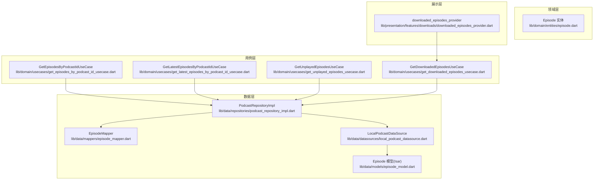
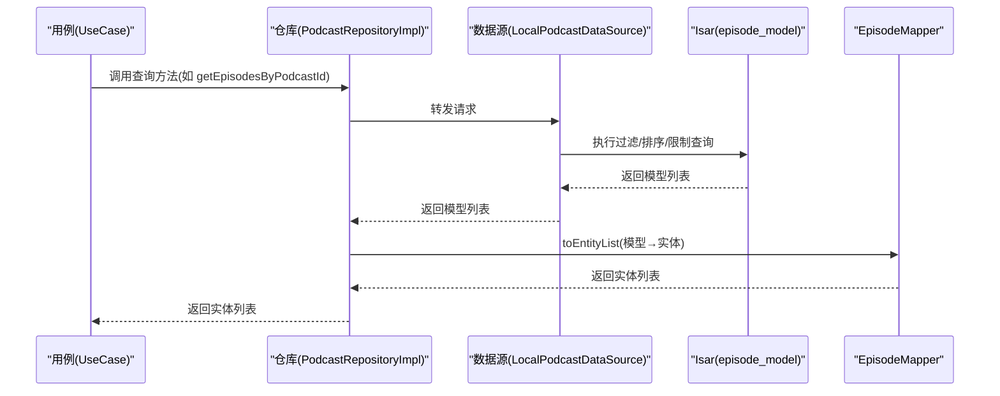
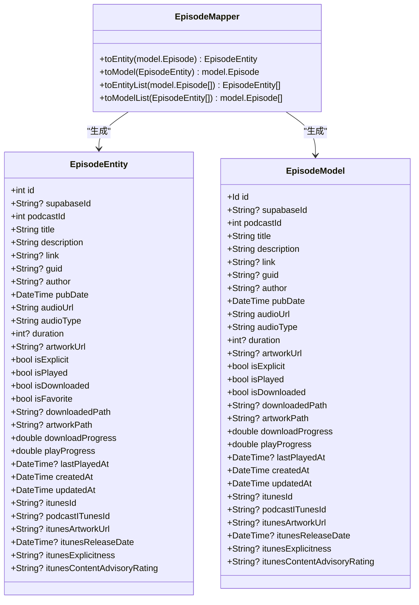
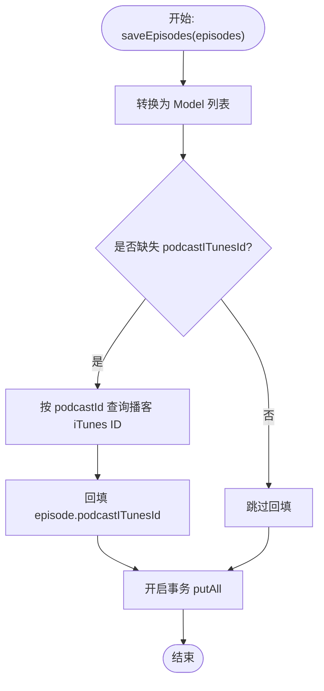
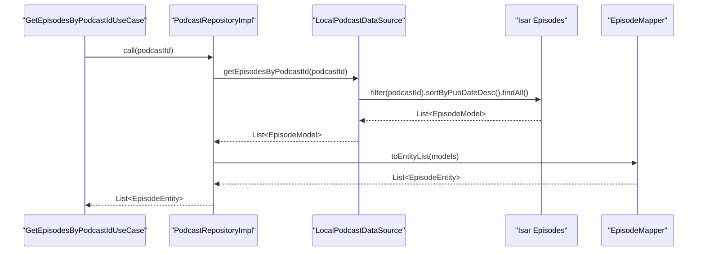
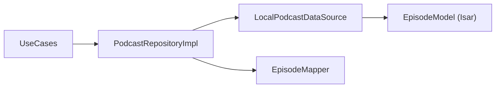

# 剧集管理

<cite>
**本文引用的文件**   
- [lib/domain/entities/episode.dart](file://lib/domain/entities/episode.dart)
- [lib/data/models/episode_model.dart](file://lib/data/models/episode_model.dart)
- [lib/data/mappers/episode_mapper.dart](file://lib/data/mappers/episode_mapper.dart)
- [lib/data/datasources/local_podcast_datasource.dart](file://lib/data/datasources/local_podcast_datasource.dart)
- [lib/data/repositories/podcast_repository_impl.dart](file://lib/data/repositories/podcast_repository_impl.dart)
- [lib/domain/usecases/get_episodes_by_podcast_id_usecase.dart](file://lib/domain/usecases/get_episodes_by_podcast_id_usecase.dart)
- [lib/domain/usecases/get_latest_episodes_by_podcast_id_usecase.dart](file://lib/domain/usecases/get_latest_episodes_by_podcast_id_usecase.dart)
- [lib/domain/usecases/get_unplayed_episodes_usecase.dart](file://lib/domain/usecases/get_unplayed_episodes_usecase.dart)
- [lib/domain/usecases/get_downloaded_episodes_usecase.dart](file://lib/domain/usecases/get_downloaded_episodes_usecase.dart)
- [lib/presentation/features/downloads/downloaded_episodes_provider.dart](file://lib/presentation/features/downloads/downloaded_episodes_provider.dart)
- [docs/database.md](file://docs/database.md)
</cite>

## 目录
1. [简介](#简介)
2. [项目结构](#项目结构)
3. [核心组件](#核心组件)
4. [架构总览](#架构总览)
5. [详细组件分析](#详细组件分析)
6. [依赖关系分析](#依赖关系分析)
7. [性能考量](#性能考量)
8. [故障排查指南](#故障排查指南)
9. [结论](#结论)
10. [附录](#附录)

## 简介
本文件面向 TinyCast 的“剧集（Episode）管理系统”，系统性阐述以下能力：
- 剧集批量保存与去重策略
- 查询过滤、排序与分页（限制条数）
- 播放状态跟踪与下载进度管理
- 关键查询方法实现细节：getEpisodesByPodcastId()、getLatestEpisodesByPodcastId()、getUnplayedEpisodes()、getDownloadedEpisodes()
- Episode 实体字段定义、数据映射转换、与 Podcast 实体的关联关系和外键约束设计
- 复杂查询场景示例（排序、分页、条件过滤）

## 项目结构
围绕剧集管理的代码主要分布在领域层（entities）、数据层（models、mappers、datasources、repositories）以及用例层（usecases），UI 侧通过 Provider 消费数据。

图表来源
- [lib/domain/entities/episode.dart](file://lib/domain/entities/episode.dart)
- [lib/data/models/episode_model.dart](file://lib/data/models/episode_model.dart)
- [lib/data/mappers/episode_mapper.dart](file://lib/data/mappers/episode_mapper.dart)
- [lib/data/datasources/local_podcast_datasource.dart](file://lib/data/datasources/local_podcast_datasource.dart)
- [lib/data/repositories/podcast_repository_impl.dart](file://lib/data/repositories/podcast_repository_impl.dart)
- [lib/domain/usecases/get_episodes_by_podcast_id_usecase.dart](file://lib/domain/usecases/get_episodes_by_podcast_id_usecase.dart)
- [lib/domain/usecases/get_latest_episodes_by_podcast_id_usecase.dart](file://lib/domain/usecases/get_latest_episodes_by_podcast_id_usecase.dart)
- [lib/domain/usecases/get_unplayed_episodes_usecase.dart](file://lib/domain/usecases/get_unplayed_episodes_usecase.dart)
- [lib/domain/usecases/get_downloaded_episodes_usecase.dart](file://lib/domain/usecases/get_downloaded_episodes_usecase.dart)
- [lib/presentation/features/downloads/downloaded_episodes_provider.dart](file://lib/presentation/features/downloads/downloaded_episodes_provider.dart)

章节来源
- [lib/domain/entities/episode.dart](file://lib/domain/entities/episode.dart)
- [lib/data/models/episode_model.dart](file://lib/data/models/episode_model.dart)
- [lib/data/mappers/episode_mapper.dart](file://lib/data/mappers/episode_mapper.dart)
- [lib/data/datasources/local_podcast_datasource.dart](file://lib/data/datasources/local_podcast_datasource.dart)
- [lib/data/repositories/podcast_repository_impl.dart](file://lib/data/repositories/podcast_repository_impl.dart)
- [lib/domain/usecases/get_episodes_by_podcast_id_usecase.dart](file://lib/domain/usecases/get_episodes_by_podcast_id_usecase.dart)
- [lib/domain/usecases/get_latest_episodes_by_podcast_id_usecase.dart](file://lib/domain/usecases/get_latest_episodes_by_podcast_id_usecase.dart)
- [lib/domain/usecases/get_unplayed_episodes_usecase.dart](file://lib/domain/usecases/get_unplayed_episodes_usecase.dart)
- [lib/domain/usecases/get_downloaded_episodes_usecase.dart](file://lib/domain/usecases/get_downloaded_episodes_usecase.dart)
- [lib/presentation/features/downloads/downloaded_episodes_provider.dart](file://lib/presentation/features/downloads/downloaded_episodes_provider.dart)

## 核心组件
- Episode 实体：承载剧集业务语义，包含播放状态、下载状态、iTunes 扩展字段等
- Episode 模型（Isar）：持久化存储结构，含索引字段（podcastId、pubDate）
- EpisodeMapper：实体与模型的双向映射
- LocalPodcastDataSource：本地数据访问层，封装 Isar 查询与事务
- PodcastRepositoryImpl：仓储层，协调数据源与映射器，暴露统一接口
- UseCases：用例层封装具体查询场景（按播客获取、最新、未播放、已下载）
- downloaded_episodes_provider：展示层提供者，驱动 UI 刷新

章节来源
- [lib/domain/entities/episode.dart](file://lib/domain/entities/episode.dart)
- [lib/data/models/episode_model.dart](file://lib/data/models/episode_model.dart)
- [lib/data/mappers/episode_mapper.dart](file://lib/data/mappers/episode_mapper.dart)
- [lib/data/datasources/local_podcast_datasource.dart](file://lib/data/datasources/local_podcast_datasource.dart)
- [lib/data/repositories/podcast_repository_impl.dart](file://lib/data/repositories/podcast_repository_impl.dart)
- [lib/domain/usecases/get_episodes_by_podcast_id_usecase.dart](file://lib/domain/usecases/get_episodes_by_podcast_id_usecase.dart)
- [lib/domain/usecases/get_latest_episodes_by_podcast_id_usecase.dart](file://lib/domain/usecases/get_latest_episodes_by_podcast_id_usecase.dart)
- [lib/domain/usecases/get_unplayed_episodes_usecase.dart](file://lib/domain/usecases/get_unplayed_episodes_usecase.dart)
- [lib/domain/usecases/get_downloaded_episodes_usecase.dart](file://lib/domain/usecases/get_downloaded_episodes_usecase.dart)
- [lib/presentation/features/downloads/downloaded_episodes_provider.dart](file://lib/presentation/features/downloads/downloaded_episodes_provider.dart)

## 架构总览
下图展示了从用例到数据源的调用链路与数据流向，体现 Repository 作为适配层屏蔽底层实现细节。

图表来源
- [lib/domain/usecases/get_episodes_by_podcast_id_usecase.dart](file://lib/domain/usecases/get_episodes_by_podcast_id_usecase.dart)
- [lib/data/repositories/podcast_repository_impl.dart](file://lib/data/repositories/podcast_repository_impl.dart)
- [lib/data/datasources/local_podcast_datasource.dart](file://lib/data/datasources/local_podcast_datasource.dart)
- [lib/data/models/episode_model.dart](file://lib/data/models/episode_model.dart)
- [lib/data/mappers/episode_mapper.dart](file://lib/data/mappers/episode_mapper.dart)

## 详细组件分析

### Episode 实体与模型
- 实体字段涵盖基础信息、媒体元数据、播放与下载状态、时间戳及 iTunes 扩展字段
- 模型使用 Isar 注解并建立索引，提升按 podcastId 和 pubDate 的查询效率
- Mapper 提供双向转换与批量转换方法

图表来源
- [lib/domain/entities/episode.dart](file://lib/domain/entities/episode.dart)
- [lib/data/models/episode_model.dart](file://lib/data/models/episode_model.dart)
- [lib/data/mappers/episode_mapper.dart](file://lib/data/mappers/episode_mapper.dart)

章节来源
- [lib/domain/entities/episode.dart](file://lib/domain/entities/episode.dart)
- [lib/data/models/episode_model.dart](file://lib/data/models/episode_model.dart)
- [lib/data/mappers/episode_mapper.dart](file://lib/data/mappers/episode_mapper.dart)

### 数据源与仓储：批量保存与关联补全
- 批量保存 episodes：在事务中写入，若 episode 缺少 podcastITunesId，则根据 podcastId 回查播客的 iTunes ID 并回填，保证多区域 iTunes 关联一致性
- 删除与更新：支持按 podcastId 删除全部剧集、更新播放状态等

图表来源
- [lib/data/datasources/local_podcast_datasource.dart](file://lib/data/datasources/local_podcast_datasource.dart)

章节来源
- [lib/data/datasources/local_podcast_datasource.dart](file://lib/data/datasources/local_podcast_datasource.dart)

### 查询方法详解

#### getEpisodesByPodcastId()
- 功能：按 podcastId 获取所有剧集，按发布时间降序排序
- 关键点：使用 podcastId 索引；默认排序为 pubDate 倒序；无分页参数时返回全部

图表来源
- [lib/domain/usecases/get_episodes_by_podcast_id_usecase.dart](file://lib/domain/usecases/get_episodes_by_podcast_id_usecase.dart)
- [lib/data/repositories/podcast_repository_impl.dart](file://lib/data/repositories/podcast_repository_impl.dart)
- [lib/data/datasources/local_podcast_datasource.dart](file://lib/data/datasources/local_podcast_datasource.dart)
- [lib/data/mappers/episode_mapper.dart](file://lib/data/mappers/episode_mapper.dart)

章节来源
- [lib/domain/usecases/get_episodes_by_podcast_id_usecase.dart](file://lib/domain/usecases/get_episodes_by_podcast_id_usecase.dart)
- [lib/data/repositories/podcast_repository_impl.dart](file://lib/data/repositories/podcast_repository_impl.dart)
- [lib/data/datasources/local_podcast_datasource.dart](file://lib/data/datasources/local_podcast_datasource.dart)

#### getLatestEpisodesByPodcastId()
- 功能：按 podcastId 获取最新 N 个剧集，默认 limit=3
- 关键点：在查询末尾追加 limit，结合 pubDate 倒序确保“最新”

章节来源
- [lib/data/repositories/podcast_repository_impl.dart](file://lib/data/repositories/podcast_repository_impl.dart)
- [lib/data/datasources/local_podcast_datasource.dart](file://lib/data/datasources/local_podcast_datasource.dart)

#### getUnplayedEpisodes()
- 功能：获取所有未播放剧集，按发布时间降序
- 关键点：isPlayed=false 过滤；适合“待看/待听”列表

章节来源
- [lib/domain/usecases/get_unplayed_episodes_usecase.dart](file://lib/domain/usecases/get_unplayed_episodes_usecase.dart)
- [lib/data/repositories/podcast_repository_impl.dart](file://lib/data/repositories/podcast_repository_impl.dart)
- [lib/data/datasources/local_podcast_datasource.dart](file://lib/data/datasources/local_podcast_datasource.dart)

#### getDownloadedEpisodes()
- 功能：获取所有已下载剧集，按发布时间降序
- 关键点：isDownloaded=true 过滤；UI 层通过 provider 消费并刷新

章节来源
- [lib/domain/usecases/get_downloaded_episodes_usecase.dart](file://lib/domain/usecases/get_downloaded_episodes_usecase.dart)
- [lib/data/repositories/podcast_repository_impl.dart](file://lib/data/repositories/podcast_repository_impl.dart)
- [lib/data/datasources/local_podcast_datasource.dart](file://lib/data/datasources/local_podcast_datasource.dart)
- [lib/presentation/features/downloads/downloaded_episodes_provider.dart](file://lib/presentation/features/downloads/downloaded_episodes_provider.dart)

### 播放状态与下载进度管理
- 播放状态：isPlayed 布尔位，lastPlayedAt 记录最后播放时间；可通过 updateIsPlayed 更新
- 下载状态：isDownloaded 布尔位，downloadProgress 记录下载进度（0.0-1.0），downloadePath 记录本地路径
- 典型流程：下载完成后设置 isDownloaded=true 并清空或重置进度；播放过程中持续更新 playProgress 与 lastPlayedAt

章节来源
- [lib/data/datasources/local_podcast_datasource.dart](file://lib/data/datasources/local_podcast_datasource.dart)
- [lib/domain/entities/episode.dart](file://lib/domain/entities/episode.dart)

### 与 Podcast 的关联关系与外键约束
- 关系：Podcast 1:N Episode，通过 Episode.podcastId 指向 Podcast.id
- 索引：Episode.podcastId 与 Episode.pubDate 均建立索引，加速按播客与时间排序查询
- Fallback 关联：当使用 iTunes 标识进行跨区匹配时，优先使用 podcastITunesId + episodeITunesId，其次 fallback 到 guid，最后到自增 id

章节来源
- [docs/database.md](file://docs/database.md)

## 依赖关系分析
- UseCase 仅依赖 PodcastRepository 接口，不感知数据源实现
- Repository 组合 Remote/Local 数据源与映射器，对外暴露统一 API
- DataSource 直接操作 Isar 模型，负责事务与异常包装
- Mapper 隔离 Entity 与 Model 的差异，避免上层耦合

图表来源
- [lib/domain/usecases/get_episodes_by_podcast_id_usecase.dart](file://lib/domain/usecases/get_episodes_by_podcast_id_usecase.dart)
- [lib/data/repositories/podcast_repository_impl.dart](file://lib/data/repositories/podcast_repository_impl.dart)
- [lib/data/datasources/local_podcast_datasource.dart](file://lib/data/datasources/local_podcast_datasource.dart)
- [lib/data/mappers/episode_mapper.dart](file://lib/data/mappers/episode_mapper.dart)
- [lib/data/models/episode_model.dart](file://lib/data/models/episode_model.dart)

章节来源
- [lib/data/repositories/podcast_repository_impl.dart](file://lib/data/repositories/podcast_repository_impl.dart)
- [lib/data/datasources/local_podcast_datasource.dart](file://lib/data/datasources/local_podcast_datasource.dart)
- [lib/data/mappers/episode_mapper.dart](file://lib/data/mappers/episode_mapper.dart)

## 性能考量
- 索引利用：podcastId 与 pubDate 索引显著提升按播客筛选与时间排序的性能
- 事务批量写入：saveEpisodes 使用 writeTxn 与 putAll，减少 IO 次数
- 限制条数：getLatestEpisodesByPodcastId 使用 limit 控制结果集大小
- 内存与对象转换：toEntityList 批量转换，避免逐条转换开销
- 建议：对高频查询可考虑分页（offset/limit）与缓存策略；对大列表渲染采用虚拟滚动

[本节为通用指导，无需引用具体文件]

## 故障排查指南
- 常见错误类型：IsarError、AppException.storage、AppException.unknown
- 定位要点：
  - 检查 podcastId 是否正确传入且存在
  - 确认 pubDate 索引是否存在
  - 查看事务是否成功提交（putAll）
  - 校验 isPlayed/isDownloaded 更新是否生效
- 日志关键字：保存节目失败、获取节目失败、更新 isPlayed 失败、获取已下载节目失败

章节来源
- [lib/data/datasources/local_podcast_datasource.dart](file://lib/data/datasources/local_podcast_datasource.dart)
- [lib/data/repositories/podcast_repository_impl.dart](file://lib/data/repositories/podcast_repository_impl.dart)

## 结论
TinyCast 的剧集管理系统以清晰的分层架构与明确的职责划分，实现了高效的剧集批量保存、灵活的查询过滤与稳定的状态管理。通过索引与事务优化，保证了在大规模数据下的查询与写入性能。UseCase 与 Repository 的组合使得扩展新查询场景（如分页、多条件过滤）变得简单可控。

[本节为总结性内容，无需引用具体文件]

## 附录

### 复杂查询场景示例（思路与步骤）
- 排序：按 pubDate 升/降序（sortByPubDateAsc / sortByPubDateDesc）
- 分页：在现有 limit 基础上叠加 offset（需自行扩展查询方法）
- 条件过滤：组合 isPlayed、isDownloaded、titleContains、descriptionContains 等条件
- 多表关联：通过 podcastId 关联 Podcast，必要时使用 podcastITunesId 做跨区匹配

[本节为概念性说明，无需引用具体文件]