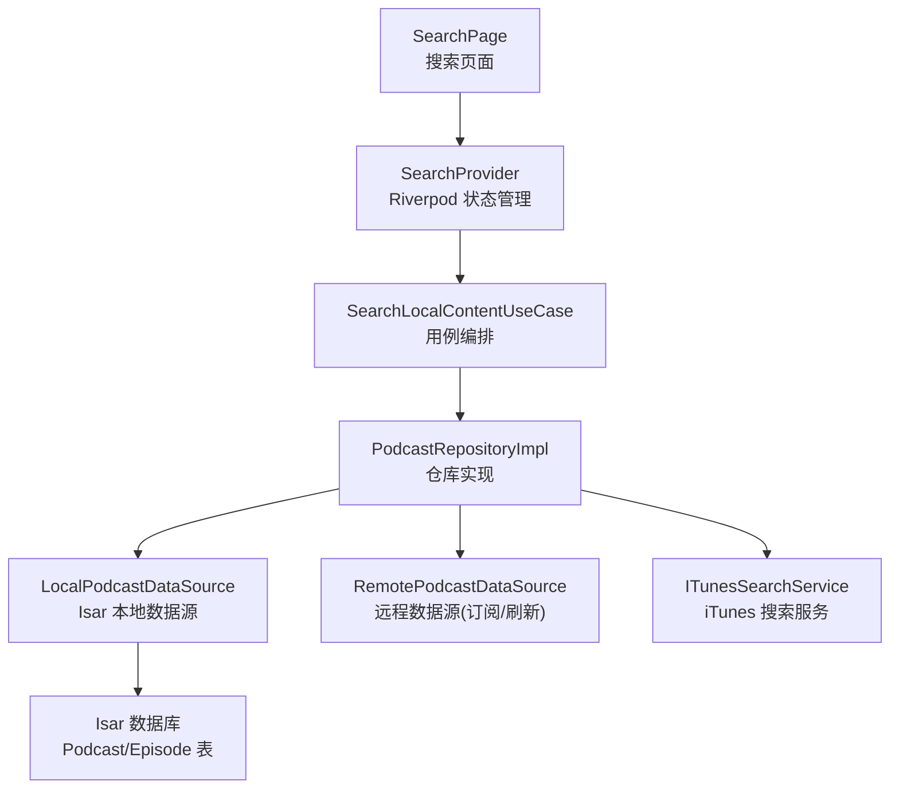
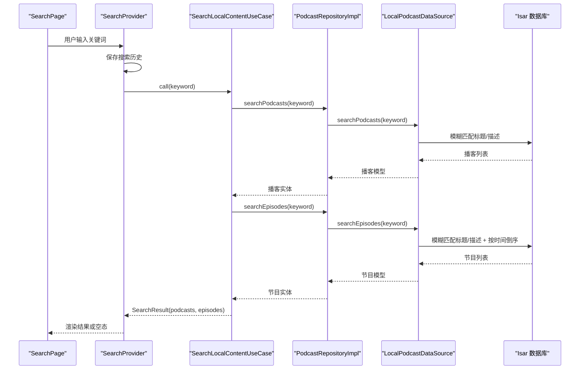
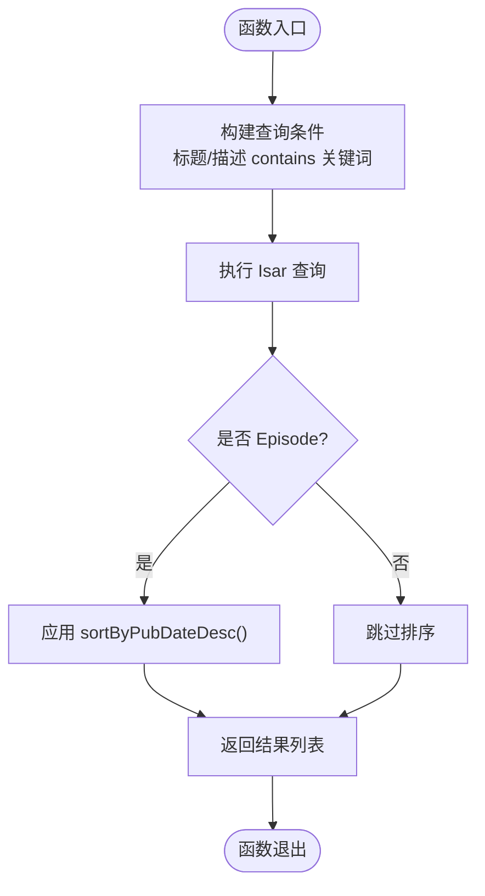
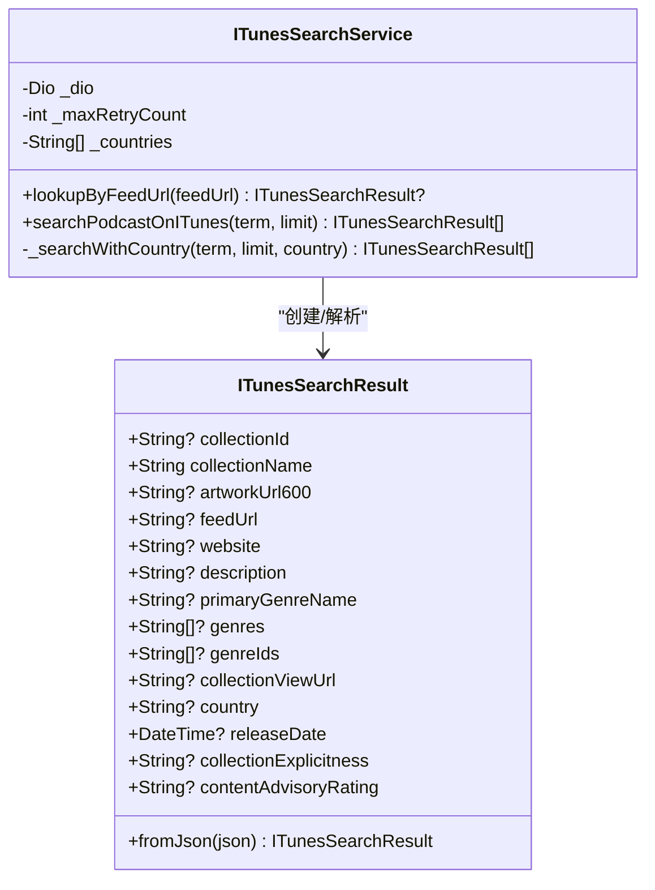
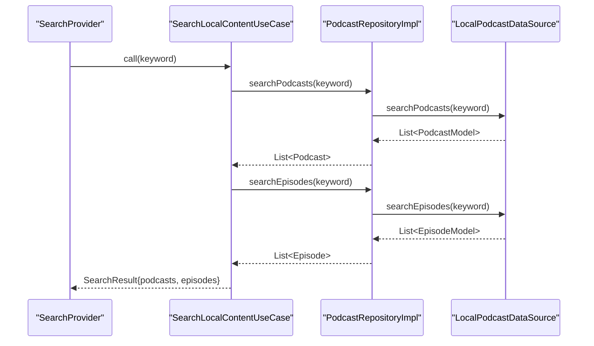
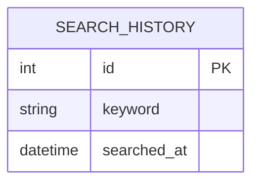
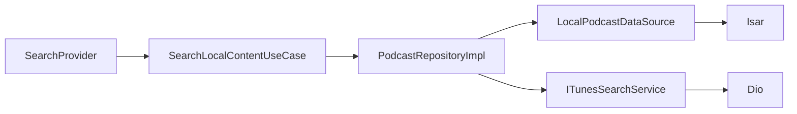

# 搜索功能

<cite>
**本文引用的文件**   
- [local_podcast_datasource.dart](file://lib/data/datasources/local_podcast_datasource.dart)
- [podcast_repository_impl.dart](file://lib/data/repositories/podcast_repository_impl.dart)
- [search_local_content_usecase.dart](file://lib/domain/usecases/search_local_content_usecase.dart)
- [itunes_search_service.dart](file://lib/data/services/itunes_search_service.dart)
- [search_provider.dart](file://lib/presentation/features/search/search_provider.dart)
- [search_page.dart](file://lib/presentation/features/search/search_page.dart)
- [search_result.dart](file://lib/domain/entities/search_result.dart)
- [search_history.dart](file://lib/domain/entities/search_history.dart)
- [search_history_model.dart](file://lib/data/models/search_history_model.dart)
</cite>

## 目录
1. [简介](#简介)
2. [项目结构](#项目结构)
3. [核心组件](#核心组件)
4. [架构总览](#架构总览)
5. [详细组件分析](#详细组件分析)
6. [依赖分析](#依赖分析)
7. [性能考量](#性能考量)
8. [故障排查指南](#故障排查指南)
9. [结论](#结论)
10. [附录](#附录)

## 简介
本文件为 TinyCast 的搜索功能提供系统化文档，重点围绕以下目标展开：
- 深入解释本地全文搜索方法 searchPodcasts() 与 searchEpisodes() 的实现原理、模糊匹配策略与排序方式。
- 说明 iTunes 搜索服务的集成方式、API 调用封装与结果数据处理流程。
- 记录搜索索引构建策略、关键词分词算法（当前实现）与性能优化技巧。
- 给出高亮显示、搜索历史管理与搜索结果缓存的实践建议与示例路径。
- 阐述与 ITunesSearchService 的协作模式及第三方 API 的错误处理机制。

## 项目结构
搜索功能在代码库中采用分层架构：
- 表现层：SearchPage 与 SearchProvider 负责 UI 状态与交互。
- 领域层：SearchLocalContentUseCase 聚合仓库能力，返回统一 SearchResult。
- 数据层：PodcastRepositoryImpl 协调远程与本地数据源；LocalPodcastDataSource 基于 Isar 执行本地搜索。
- 服务层：ITunesSearchService 封装 iTunes 搜索 API，支持多区域降级与重试。

图表来源 
- [search_page.dart:1-78](file://lib/presentation/features/search/search_page.dart#L1-L78)
- [search_provider.dart:1-284](file://lib/presentation/features/search/search_provider.dart#L1-L284)
- [search_local_content_usecase.dart:1-19](file://lib/domain/usecases/search_local_content_usecase.dart#L1-L19)
- [podcast_repository_impl.dart:1-524](file://lib/data/repositories/podcast_repository_impl.dart#L1-L524)
- [local_podcast_datasource.dart:1-859](file://lib/data/datasources/local_podcast_datasource.dart#L1-L859)
- [itunes_search_service.dart:1-317](file://lib/data/services/itunes_search_service.dart#L1-L317)

章节来源
- [search_page.dart:1-78](file://lib/presentation/features/search/search_page.dart#L1-L78)
- [search_provider.dart:1-284](file://lib/presentation/features/search/search_provider.dart#L1-L284)
- [search_local_content_usecase.dart:1-19](file://lib/domain/usecases/search_local_content_usecase.dart#L1-L19)
- [podcast_repository_impl.dart:1-524](file://lib/data/repositories/podcast_repository_impl.dart#L1-L524)
- [local_podcast_datasource.dart:1-859](file://lib/data/datasources/local_podcast_datasource.dart#L1-L859)
- [itunes_search_service.dart:1-317](file://lib/data/services/itunes_search_service.dart#L1-L317)

## 核心组件
- LocalPodcastDataSource：基于 Isar 的本地数据访问，包含 searchPodcasts() 与 searchEpisodes() 两个关键方法，使用 contains 进行不区分大小写的模糊匹配，并对 Episode 结果按发布时间倒序排序。
- PodcastRepositoryImpl：对外暴露 searchPodcasts()/searchEpisodes()，将模型映射为实体后返回给上层。
- SearchLocalContentUseCase：组合仓库的两个搜索方法，合并为统一的 SearchResult。
- SearchProvider：管理搜索状态（历史、结果、空态）、保存搜索历史、触发搜索并更新 UI。
- ITunesSearchService：封装 iTunes 搜索 API，支持多区域降级、重试与错误处理。

章节来源
- [local_podcast_datasource.dart:583-648](file://lib/data/datasources/local_podcast_datasource.dart#L583-L648)
- [podcast_repository_impl.dart:401-446](file://lib/data/repositories/podcast_repository_impl.dart#L401-L446)
- [search_local_content_usecase.dart:1-19](file://lib/domain/usecases/search_local_content_usecase.dart#L1-L19)
- [search_provider.dart:114-144](file://lib/presentation/features/search/search_provider.dart#L114-L144)
- [itunes_search_service.dart:195-316](file://lib/data/services/itunes_search_service.dart#L195-L316)

## 架构总览
搜索请求从 UI 发起，经过 Riverpod 状态管理，进入用例层，再由仓库协调数据源完成本地搜索，必要时可结合 iTunes 搜索服务补充元数据。

图表来源 
- [search_page.dart:1-78](file://lib/presentation/features/search/search_page.dart#L1-L78)
- [search_provider.dart:114-144](file://lib/presentation/features/search/search_provider.dart#L114-L144)
- [search_local_content_usecase.dart:1-19](file://lib/domain/usecases/search_local_content_usecase.dart#L1-L19)
- [podcast_repository_impl.dart:401-446](file://lib/data/repositories/podcast_repository_impl.dart#L401-L446)
- [local_podcast_datasource.dart:583-648](file://lib/data/datasources/local_podcast_datasource.dart#L583-L648)

## 详细组件分析

### 本地全文搜索：searchPodcasts() 与 searchEpisodes()
- 模糊匹配策略
  - 使用 Isar 的 contains 方法对标题与描述字段进行不区分大小写的子串匹配。
  - 通过 group 与 or 组合条件，满足“标题或描述包含关键词”的语义。
- 排序策略
  - 播客搜索：仅过滤已订阅且匹配的条目，未显式排序（保持入库顺序）。
  - 节目搜索：在查询末尾添加 sortByPubDateDesc()，确保结果按发布时间倒序排列。
- 异常处理
  - 捕获 IsarError 与通用异常，转换为 AppException 并记录日志。

图表来源 
- [local_podcast_datasource.dart:583-648](file://lib/data/datasources/local_podcast_datasource.dart#L583-L648)

章节来源
- [local_podcast_datasource.dart:583-648](file://lib/data/datasources/local_podcast_datasource.dart#L583-L648)
- [podcast_repository_impl.dart:401-446](file://lib/data/repositories/podcast_repository_impl.dart#L401-L446)

### iTunes 搜索服务集成：ITunesSearchService
- API 封装
  - 提供 lookupByFeedUrl() 精确查找与 searchPodcastOnITunes() 关键词搜索。
  - 支持多国家区域降级（如 us → cn），失败时自动尝试下一区域。
  - 内置重试机制与超时配置，统一抛出 AppException。
- 结果处理
  - 将 JSON 解析为 ITunesSearchResult，包含 collectionId、artworkUrl600、genres、releaseDate 等字段。
  - 在订阅流程中，异步获取 iTunes 信息并更新到本地播客记录。

图表来源 
- [itunes_search_service.dart:1-317](file://lib/data/services/itunes_search_service.dart#L1-L317)

章节来源
- [itunes_search_service.dart:195-316](file://lib/data/services/itunes_search_service.dart#L195-L316)
- [podcast_repository_impl.dart:118-121](file://lib/data/repositories/podcast_repository_impl.dart#L118-L121)

### 搜索用例与仓库协作
- SearchLocalContentUseCase 同时调用仓库的 podcast 与 episode 搜索，合并为 SearchResult。
- PodcastRepositoryImpl 仅做数据源协调与模型映射，不改变搜索逻辑。

图表来源 
- [search_local_content_usecase.dart:1-19](file://lib/domain/usecases/search_local_content_usecase.dart#L1-L19)
- [podcast_repository_impl.dart:401-446](file://lib/data/repositories/podcast_repository_impl.dart#L401-L446)
- [local_podcast_datasource.dart:583-648](file://lib/data/datasources/local_podcast_datasource.dart#L583-L648)

章节来源
- [search_local_content_usecase.dart:1-19](file://lib/domain/usecases/search_local_content_usecase.dart#L1-L19)
- [podcast_repository_impl.dart:401-446](file://lib/data/repositories/podcast_repository_impl.dart#L401-L446)

### 搜索历史管理
- 数据模型
  - SearchHistory 实体：id、keyword、searchedAt。
  - SearchHistoryModel：Isar 集合，keyword 与 searchedAt 字段，searchedAt 建立索引。
- 状态管理
  - SearchProvider 在每次搜索前保存历史，并在搜索完成后刷新历史列表。
  - 支持清空历史与回到初始状态。

图表来源 
- [search_history.dart:1-12](file://lib/domain/entities/search_history.dart#L1-L12)
- [search_history_model.dart:1-14](file://lib/data/models/search_history_model.dart#L1-L14)

章节来源
- [search_history.dart:1-12](file://lib/domain/entities/search_history.dart#L1-L12)
- [search_history_model.dart:1-14](file://lib/data/models/search_history_model.dart#L1-L14)
- [search_provider.dart:98-112](file://lib/presentation/features/search/search_provider.dart#L98-L112)
- [search_provider.dart:114-144](file://lib/presentation/features/search/search_provider.dart#L114-L144)

### 搜索结果展示与导航
- SearchPage 根据 SearchStatus 切换历史、结果与空态视图。
- SearchProvider 维护 selectedIndex，支持键盘上下导航与 Enter 确认跳转至播客或节目详情。

章节来源
- [search_page.dart:1-78](file://lib/presentation/features/search/search_page.dart#L1-L78)
- [search_provider.dart:182-217](file://lib/presentation/features/search/search_provider.dart#L182-L217)

## 依赖分析
- 耦合关系
  - SearchProvider 依赖 SearchLocalContentUseCase、搜索历史用例与仓库。
  - PodcastRepositoryImpl 依赖 LocalPodcastDataSource、RemotePodcastDataSource、ITunesSearchService。
  - LocalPodcastDataSource 直接依赖 Isar 数据库。
- 外部依赖
  - ITunesSearchService 依赖 Dio 进行网络请求，并通过 AppConstants 控制超时与重试。
  - NetworkErrorHandler 统一处理 Dio 异常。

图表来源 
- [search_provider.dart:1-284](file://lib/presentation/features/search/search_provider.dart#L1-L284)
- [podcast_repository_impl.dart:1-524](file://lib/data/repositories/podcast_repository_impl.dart#L1-L524)
- [local_podcast_datasource.dart:1-859](file://lib/data/datasources/local_podcast_datasource.dart#L1-L859)
- [itunes_search_service.dart:1-317](file://lib/data/services/itunes_search_service.dart#L1-L317)

章节来源
- [search_provider.dart:1-284](file://lib/presentation/features/search/search_provider.dart#L1-L284)
- [podcast_repository_impl.dart:1-524](file://lib/data/repositories/podcast_repository_impl.dart#L1-L524)
- [local_podcast_datasource.dart:1-859](file://lib/data/datasources/local_podcast_datasource.dart#L1-L859)
- [itunes_search_service.dart:1-317](file://lib/data/services/itunes_search_service.dart#L1-L317)

## 性能考量
- 本地搜索优化
  - 使用 Isar 的 contains 与 group/or 组合条件，避免内存级遍历。
  - Episode 搜索增加 sortByPubDateDesc() 以在数据库层排序，减少客户端排序开销。
  - 建议在 Podcast/Episode 表的 title、description 上建立全文索引以提升 contains 性能（需评估 Isar 版本与索引类型）。
- 网络搜索优化
  - ITunesSearchService 支持多区域降级与重试，降低单次失败影响。
  - 合理设置超时与最大重试次数，避免阻塞主线程。
- 状态与渲染优化
  - SearchProvider 仅在关键字非空时触发搜索，空关键字回退到历史视图。
  - 使用 Riverpod 的 Notifier 与 Provider 组合，最小化不必要的重建。

[本节为通用指导，无需特定文件引用]

## 故障排查指南
- 本地搜索无结果
  - 检查关键词是否为空或全空格。
  - 确认 Isar 表中是否存在 isSubscribed=true 的播客记录。
  - 查看日志输出，确认 contains 查询是否命中。
- iTunes 搜索失败
  - 检查网络连接与代理设置。
  - 查看 ITunesSearchService 的重试与区域降级日志。
  - 确认 AppConstants 中的超时与重试参数是否合理。
- 搜索历史未保存
  - 确认 SearchProvider 的 save 调用是否被执行。
  - 检查 SearchHistoryModel 的 Isar 写入事务是否成功。

章节来源
- [local_podcast_datasource.dart:583-648](file://lib/data/datasources/local_podcast_datasource.dart#L583-L648)
- [itunes_search_service.dart:227-316](file://lib/data/services/itunes_search_service.dart#L227-L316)
- [search_provider.dart:114-144](file://lib/presentation/features/search/search_provider.dart#L114-L144)

## 结论
TinyCast 的搜索功能以本地全文搜索为核心，结合 iTunes 搜索服务增强元数据与封面图展示。通过分层架构与 Riverpod 状态管理，实现了清晰的职责划分与良好的可扩展性。未来可在索引策略、分词算法与缓存机制方面进一步优化，以提升大规模数据下的搜索性能与用户体验。

[本节为总结，无需特定文件引用]

## 附录

### 高亮显示实现建议
- 在前端渲染时，对匹配到的关键词进行正则替换，包裹高亮标签（如 ）。
- 针对标题与描述分别计算匹配位置，优先高亮标题片段。
- 示例路径参考：
  - 搜索结果项组件：[search_results_episode_item.dart](file://lib/presentation/features/search/search_results/search_results_episode/search_results_episode_item.dart)
  - 空结果组件：[search_results_empty.dart](file://lib/presentation/features/search/search_results/search_results_empty/search_results_empty.dart)

### 搜索历史管理最佳实践
- 去重策略：按 keyword 去重，保留最近一次搜索时间。
- 分页加载：当历史记录较多时，采用分页加载以减少首屏压力。
- 清理策略：支持一键清空与按时间段清理。
- 示例路径参考：
  - 历史模型：[search_history_model.dart](file://lib/data/models/search_history_model.dart)
  - 历史实体：[search_history.dart](file://lib/domain/entities/search_history.dart)
  - 状态管理：[search_provider.dart](file://lib/presentation/features/search/search_provider.dart)

### 搜索结果缓存策略
- 短期缓存：在 SearchProvider 中缓存最近一次搜索结果，避免重复搜索相同关键词。
- 长期缓存：将搜索结果序列化存储到本地（如 SharedPreferences 或 Isar），设定过期时间。
- 缓存失效：当底层数据变更（新增/删除播客或节目）时，主动清除相关缓存。

### 与 ITunesSearchService 的协作模式
- 订阅流程中异步触发 iTunes 搜索，不阻塞主流程。
- 成功后更新播客的 iTunes 字段（如 itunesId、artworkUrl600、genres 等）。
- 失败时不影响订阅，保证鲁棒性。
- 示例路径参考：
  - 仓库订阅流程：[podcast_repository_impl.dart](file://lib/data/repositories/podcast_repository_impl.dart)
  - iTunes 搜索服务：[itunes_search_service.dart](file://lib/data/services/itunes_search_service.dart)