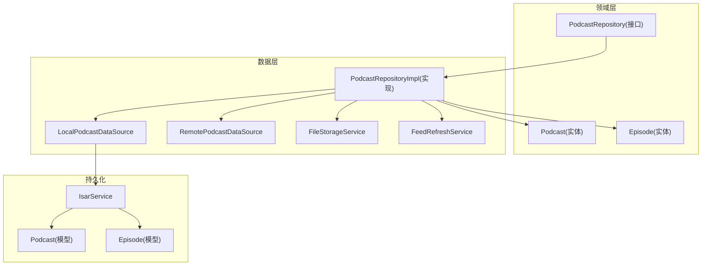
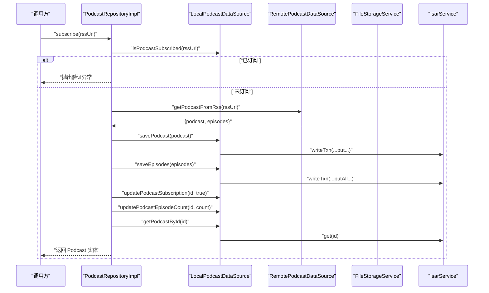
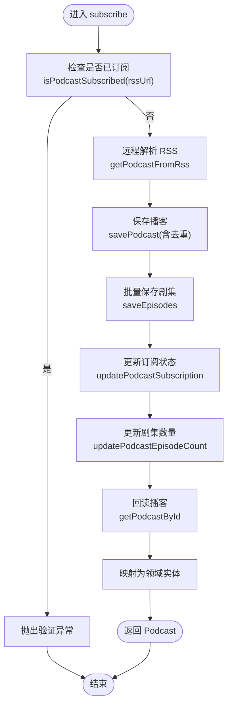
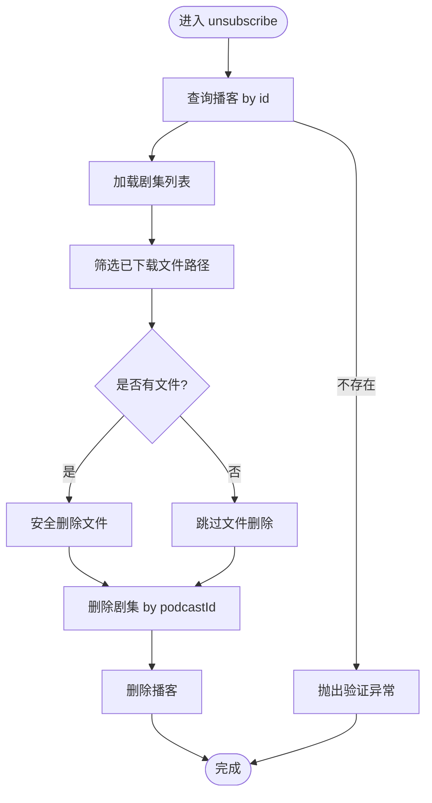
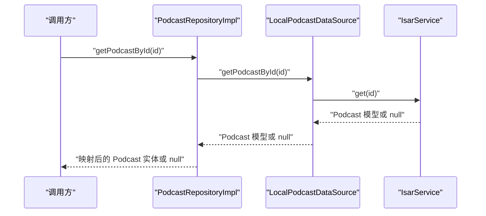
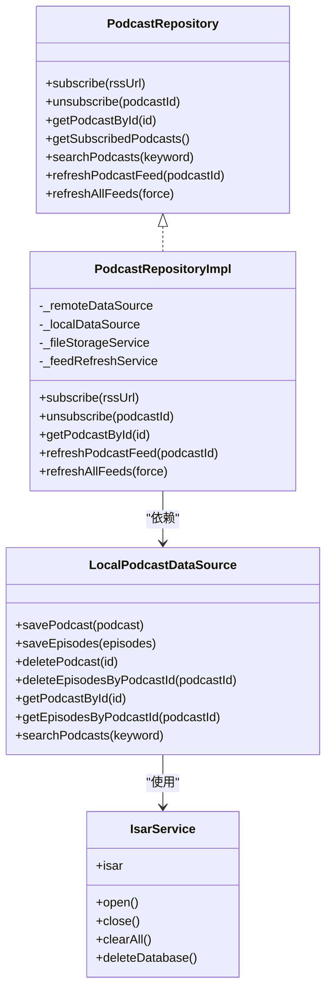

# 播客 CRUD 操作

<cite>
**本文引用的文件**   
- [podcast_repository_impl.dart](file://lib/data/repositories/podcast_repository_impl.dart)
- [podcast_repository.dart](file://lib/domain/repositories/podcast_repository.dart)
- [local_podcast_datasource.dart](file://lib/data/datasources/local_podcast_datasource.dart)
- [podcast_model.dart](file://lib/data/models/podcast_model.dart)
- [episode_model.dart](file://lib/data/models/episode_model.dart)
- [isar_service.dart](file://lib/data/database/isar_service.dart)
- [database.md](file://docs/database.md)
</cite>

## 目录
1. [简介](#简介)
2. [项目结构](#项目结构)
3. [核心组件](#核心组件)
4. [架构总览](#架构总览)
5. [详细组件分析](#详细组件分析)
6. [依赖关系分析](#依赖关系分析)
7. [性能考量](#性能考量)
8. [故障排查指南](#故障排查指南)
9. [结论](#结论)
10. [附录](#附录)

## 简介
本文件面向 TinyCast 的播客 CRUD 能力，重点围绕 PodcastRepositoryImpl 的实现展开，系统阐述订阅 subscribe()、取消订阅 unsubscribe()、按 ID 查询 getPodcastById() 等关键流程。文档同时覆盖数据验证、重复订阅检测、事务处理与错误恢复机制；梳理 Isar 数据库索引设计与查询优化策略；并给出并发访问、数据迁移与异常处理的实践建议。最后说明与 LocalPodcastDataSource 的交互模式与接口规范。

## 项目结构
- 领域层（Domain）：定义 Podcast 与 Episode 实体以及 PodcastRepository 抽象接口。
- 数据层（Data）：实现 PodcastRepositoryImpl，封装本地数据源 LocalPodcastDataSource、远程数据源 RemotePodcastDataSource、文件存储 FileStorageService、FeedRefreshService 等。
- 持久化（Isar）：通过 IsarService 管理数据库实例，使用 podcast_model.dart 与 episode_model.dart 定义集合与索引。

图表来源 
- [podcast_repository.dart:6-41](file://lib/domain/repositories/podcast_repository.dart#L6-L41)
- [podcast_repository_impl.dart:15-36](file://lib/data/repositories/podcast_repository_impl.dart#L15-L36)
- [local_podcast_datasource.dart:13-17](file://lib/data/datasources/local_podcast_datasource.dart#L13-L17)
- [isar_service.dart:14-59](file://lib/data/database/isar_service.dart#L14-L59)
- [podcast_model.dart:5-77](file://lib/data/models/podcast_model.dart#L5-L77)
- [episode_model.dart:5-66](file://lib/data/models/episode_model.dart#L5-L66)

章节来源
- [podcast_repository.dart:6-41](file://lib/domain/repositories/podcast_repository.dart#L6-L41)
- [podcast_repository_impl.dart:15-36](file://lib/data/repositories/podcast_repository_impl.dart#L15-L36)
- [local_podcast_datasource.dart:13-17](file://lib/data/datasources/local_podcast_datasource.dart#L13-L17)
- [isar_service.dart:14-59](file://lib/data/database/isar_service.dart#L14-L59)
- [podcast_model.dart:5-77](file://lib/data/models/podcast_model.dart#L5-L77)
- [episode_model.dart:5-66](file://lib/data/models/episode_model.dart#L5-L66)

## 核心组件
- PodcastRepository（接口）：声明订阅、取消订阅、查询、搜索、刷新等能力。
- PodcastRepositoryImpl（实现）：协调远程解析、本地持久化、文件删除、iTunes 信息缓存与 feed 刷新。
- LocalPodcastDataSource（数据源）：基于 Isar 的增删改查、过滤、排序、批量写入与事务。
- IsarService（数据库服务）：单例管理 Isar 实例、版本、清理与删除。
- 模型层（Podcast/Episode）：定义集合与索引，支撑高效查询与关联。

章节来源
- [podcast_repository.dart:6-41](file://lib/domain/repositories/podcast_repository.dart#L6-L41)
- [podcast_repository_impl.dart:15-36](file://lib/data/repositories/podcast_repository_impl.dart#L15-L36)
- [local_podcast_datasource.dart:13-17](file://lib/data/datasources/local_podcast_datasource.dart#L13-L17)
- [isar_service.dart:14-59](file://lib/data/database/isar_service.dart#L14-L59)
- [podcast_model.dart:5-77](file://lib/data/models/podcast_model.dart#L5-L77)
- [episode_model.dart:5-66](file://lib/data/models/episode_model.dart#L5-L66)

## 架构总览
PodcastRepositoryImpl 作为门面，屏蔽底层细节：
- 订阅流程：校验重复订阅 → 远程拉取 RSS → 保存播客与剧集 → 更新订阅状态与计数 → 可选 iTunes 信息缓存 → 返回实体。
- 取消订阅：读取已下载文件路径 → 安全删除文件 → 删除剧集 → 删除播客。
- 查询与搜索：委托 LocalPodcastDataSource 执行 Isar 查询，映射为领域实体返回。
- 刷新：调用 FeedRefreshService 进行单条或批量刷新，统一结果封装。

图表来源 
- [podcast_repository_impl.dart:39-141](file://lib/data/repositories/podcast_repository_impl.dart#L39-L141)
- [local_podcast_datasource.dart:89-127](file://lib/data/datasources/local_podcast_datasource.dart#L89-L127)
- [local_podcast_datasource.dart:129-179](file://lib/data/datasources/local_podcast_datasource.dart#L129-L179)
- [local_podcast_datasource.dart:373-411](file://lib/data/datasources/local_podcast_datasource.dart#L373-L411)
- [local_podcast_datasource.dart:413-442](file://lib/data/datasources/local_podcast_datasource.dart#L413-L442)
- [local_podcast_datasource.dart:59-87](file://lib/data/datasources/local_podcast_datasource.dart#L59-L87)
- [isar_service.dart:38-59](file://lib/data/database/isar_service.dart#L38-L59)

章节来源
- [podcast_repository_impl.dart:39-141](file://lib/data/repositories/podcast_repository_impl.dart#L39-L141)
- [local_podcast_datasource.dart:89-127](file://lib/data/datasources/local_podcast_datasource.dart#L89-L127)
- [local_podcast_datasource.dart:129-179](file://lib/data/datasources/local_podcast_datasource.dart#L129-L179)
- [local_podcast_datasource.dart:373-411](file://lib/data/datasources/local_podcast_datasource.dart#L373-L411)
- [local_podcast_datasource.dart:413-442](file://lib/data/datasources/local_podcast_datasource.dart#L413-L442)
- [local_podcast_datasource.dart:59-87](file://lib/data/datasources/local_podcast_datasource.dart#L59-L87)
- [isar_service.dart:38-59](file://lib/data/database/isar_service.dart#L38-L59)

## 详细组件分析

### 订阅 subscribe() 完整流程
- 重复订阅检测：通过 isPodcastSubscribed(rssUrl) 检查是否已存在且 isSubscribed=true，若存在则抛出验证异常。
- 远程解析：调用远程数据源获取播客与剧集列表。
- 持久化：
  - savePodcast：在事务中根据 rssUrl 去重，存在则复用 id 更新，否则新增。
  - saveEpisodes：批量写入剧集，必要时回填 podcastITunesId。
- 状态更新：设置 isSubscribed=true 与 subscribedAt，更新 episodeCount 与 lastUpdated。
- 结果返回：再次查询并映射为领域实体返回。
- 错误处理：捕获 AppException 原样抛出，其他异常包装为未知异常并记录堆栈。

图表来源 
- [podcast_repository_impl.dart:39-141](file://lib/data/repositories/podcast_repository_impl.dart#L39-L141)
- [local_podcast_datasource.dart:240-274](file://lib/data/datasources/local_podcast_datasource.dart#L240-L274)
- [local_podcast_datasource.dart:89-127](file://lib/data/datasources/local_podcast_datasource.dart#L89-L127)
- [local_podcast_datasource.dart:129-179](file://lib/data/datasources/local_podcast_datasource.dart#L129-L179)
- [local_podcast_datasource.dart:373-411](file://lib/data/datasources/local_podcast_datasource.dart#L373-L411)
- [local_podcast_datasource.dart:413-442](file://lib/data/datasources/local_podcast_datasource.dart#L413-L442)

章节来源
- [podcast_repository_impl.dart:39-141](file://lib/data/repositories/podcast_repository_impl.dart#L39-L141)
- [local_podcast_datasource.dart:240-274](file://lib/data/datasources/local_podcast_datasource.dart#L240-L274)
- [local_podcast_datasource.dart:89-127](file://lib/data/datasources/local_podcast_datasource.dart#L89-L127)
- [local_podcast_datasource.dart:129-179](file://lib/data/datasources/local_podcast_datasource.dart#L129-L179)
- [local_podcast_datasource.dart:373-411](file://lib/data/datasources/local_podcast_datasource.dart#L373-L411)
- [local_podcast_datasource.dart:413-442](file://lib/data/datasources/local_podcast_datasource.dart#L413-L442)

### 取消订阅 unsubscribe() 逻辑
- 查找播客：不存在则抛验证异常。
- 收集已下载文件路径：筛选 isDownloaded=true 且 downloadedPath 非空的剧集。
- 安全删除文件：调用 FileStorageService.deleteFilesSafely，统计成功数。
- 删除数据：先删除该播客下的所有剧集，再删除播客本身。
- 错误处理：AppException 透传，其他异常包装并记录。

图表来源 
- [podcast_repository_impl.dart:144-183](file://lib/data/repositories/podcast_repository_impl.dart#L144-L183)
- [local_podcast_datasource.dart:276-304](file://lib/data/datasources/local_podcast_datasource.dart#L276-L304)
- [local_podcast_datasource.dart:211-238](file://lib/data/datasources/local_podcast_datasource.dart#L211-L238)
- [local_podcast_datasource.dart:181-209](file://lib/data/datasources/local_podcast_datasource.dart#L181-L209)

章节来源
- [podcast_repository_impl.dart:144-183](file://lib/data/repositories/podcast_repository_impl.dart#L144-L183)
- [local_podcast_datasource.dart:276-304](file://lib/data/datasources/local_podcast_datasource.dart#L276-L304)
- [local_podcast_datasource.dart:211-238](file://lib/data/datasources/local_podcast_datasource.dart#L211-L238)
- [local_podcast_datasource.dart:181-209](file://lib/data/datasources/local_podcast_datasource.dart#L181-L209)

### 按 ID 查询 getPodcastById()
- 通过 LocalPodcastDataSource.getPodcastById(id) 直接按主键查询。
- 若为空返回 null，否则映射为领域实体返回。
- 错误处理：AppException 透传，其他异常包装。

图表来源 
- [podcast_repository_impl.dart:244-270](file://lib/data/repositories/podcast_repository_impl.dart#L244-L270)
- [local_podcast_datasource.dart:59-87](file://lib/data/datasources/local_podcast_datasource.dart#L59-L87)
- [isar_service.dart:31-36](file://lib/data/database/isar_service.dart#L31-L36)

章节来源
- [podcast_repository_impl.dart:244-270](file://lib/data/repositories/podcast_repository_impl.dart#L244-L270)
- [local_podcast_datasource.dart:59-87](file://lib/data/datasources/local_podcast_datasource.dart#L59-L87)
- [isar_service.dart:31-36](file://lib/data/database/isar_service.dart#L31-L36)

### 数据验证与重复订阅检测
- 重复订阅：isPodcastSubscribed(rssUrl) 组合 rssUrl 与 isSubscribed=true 条件查询，避免重复添加。
- 参数校验：对空结果与非法输入进行快速失败，抛出 AppException.validation。
- 一致性：保存前检查是否存在相同 rssUrl 的记录，确保幂等更新。

章节来源
- [local_podcast_datasource.dart:240-274](file://lib/data/datasources/local_podcast_datasource.dart#L240-L274)
- [podcast_repository_impl.dart:39-48](file://lib/data/repositories/podcast_repository_impl.dart#L39-L48)
- [local_podcast_datasource.dart:89-107](file://lib/data/datasources/local_podcast_datasource.dart#L89-L107)

### 事务处理与数据一致性
- 写操作均包裹在 writeTxn 中，保证原子性。
- 批量写入使用 putAll，减少 IO 次数。
- 更新订阅状态与剧集数量在同一事务内完成，避免中间态不一致。

章节来源
- [local_podcast_datasource.dart:95-107](file://lib/data/datasources/local_podcast_datasource.dart#L95-L107)
- [local_podcast_datasource.dart:138-161](file://lib/data/datasources/local_podcast_datasource.dart#L138-L161)
- [local_podcast_datasource.dart:377-393](file://lib/data/datasources/local_podcast_datasource.dart#L377-L393)
- [local_podcast_datasource.dart:417-424](file://lib/data/datasources/local_podcast_datasource.dart#L417-L424)

### 错误恢复机制
- 统一异常分类：AppException.storage 用于存储相关错误，AppException.unknown 用于未知错误。
- 日志记录：关键步骤输出耗时与状态，便于定位问题。
- 重试建议：对网络请求与 I/O 操作可结合上层重试策略（指数退避），但仓库层保持幂等。

章节来源
- [podcast_repository_impl.dart:129-141](file://lib/data/repositories/podcast_repository_impl.dart#L129-L141)
- [local_podcast_datasource.dart:42-56](file://lib/data/datasources/local_podcast_datasource.dart#L42-L56)
- [local_podcast_datasource.dart:112-126](file://lib/data/datasources/local_podcast_datasource.dart#L112-L126)

### Isar 索引设计与查询优化
- Podcast 索引：title、rssUrl(unique)、lastUpdated。
- Episode 索引：podcastId、pubDate。
- 常用查询：
  - 按 podcastId 过滤并按 pubDate 降序排序。
  - 按 rssUrl 唯一约束去重。
  - 全文模糊匹配 title/description（大小写不敏感）。
- 性能要点：优先使用 filter + sortBy + limit，避免全表扫描；批量写入降低事务开销。

章节来源
- [podcast_model.dart:11-23](file://lib/data/models/podcast_model.dart#L11-L23)
- [podcast_model.dart:41-42](file://lib/data/models/podcast_model.dart#L41-L42)
- [episode_model.dart:11-12](file://lib/data/models/episode_model.dart#L11-L12)
- [episode_model.dart:24-25](file://lib/data/models/episode_model.dart#L24-L25)
- [database.md:60-149](file://docs/database.md#L60-L149)

### 与 LocalPodcastDataSource 的交互模式与接口规范
- 职责边界：Repository 负责业务流程编排与异常转换；DataSource 专注数据访问与事务。
- 接口约定：
  - 查询方法返回模型或 null，列表方法返回空列表而非 null。
  - 写方法在事务内执行，失败抛出 AppException。
  - 批量方法提供 putAll 以提升吞吐。
- 映射策略：Repository 将模型映射为领域实体，保持领域纯净。

章节来源
- [podcast_repository_impl.dart:15-36](file://lib/data/repositories/podcast_repository_impl.dart#L15-L36)
- [local_podcast_datasource.dart:13-17](file://lib/data/datasources/local_podcast_datasource.dart#L13-L17)
- [local_podcast_datasource.dart:89-127](file://lib/data/datasources/local_podcast_datasource.dart#L89-L127)
- [local_podcast_datasource.dart:129-179](file://lib/data/datasources/local_podcast_datasource.dart#L129-L179)

## 依赖关系分析
- PodcastRepositoryImpl 依赖：
  - RemotePodcastDataSource：解析 RSS、iTunes 搜索。
  - LocalPodcastDataSource：CRUD、过滤、排序、批量写入。
  - FileStorageService：安全删除音频文件。
  - FeedRefreshService：单条/批量刷新。
- LocalPodcastDataSource 依赖 IsarService，后者管理 Isar 实例与集合 Schema。

图表来源 
- [podcast_repository.dart:6-41](file://lib/domain/repositories/podcast_repository.dart#L6-L41)
- [podcast_repository_impl.dart:15-36](file://lib/data/repositories/podcast_repository_impl.dart#L15-L36)
- [local_podcast_datasource.dart:13-17](file://lib/data/datasources/local_podcast_datasource.dart#L13-L17)
- [isar_service.dart:14-59](file://lib/data/database/isar_service.dart#L14-L59)

章节来源
- [podcast_repository.dart:6-41](file://lib/domain/repositories/podcast_repository.dart#L6-L41)
- [podcast_repository_impl.dart:15-36](file://lib/data/repositories/podcast_repository_impl.dart#L15-L36)
- [local_podcast_datasource.dart:13-17](file://lib/data/datasources/local_podcast_datasource.dart#L13-L17)
- [isar_service.dart:14-59](file://lib/data/database/isar_service.dart#L14-L59)

## 性能考量
- 索引利用：
  - 使用 podcastId 与 pubDate 索引加速“按播客+时间排序”的查询。
  - rssUrl 唯一索引保障幂等插入与快速去重。
- 批量写入：
  - saveEpisodes 使用 putAll，减少事务提交次数。
- 排序与限制：
  - sortByPubDateDesc + limit 控制返回量，避免大结果集。
- 事务粒度：
  - 将相关写操作合并到同一事务，降低锁竞争与 IO 开销。
- 异步任务：
  - iTunes 搜索 Future 缓存，避免重复请求。

章节来源
- [local_podcast_datasource.dart:129-179](file://lib/data/datasources/local_podcast_datasource.dart#L129-L179)
- [local_podcast_datasource.dart:306-338](file://lib/data/datasources/local_podcast_datasource.dart#L306-L338)
- [podcast_repository_impl.dart:118-121](file://lib/data/repositories/podcast_repository_impl.dart#L118-L121)
- [podcast_model.dart:11-23](file://lib/data/models/podcast_model.dart#L11-L23)
- [episode_model.dart:11-12](file://lib/data/models/episode_model.dart#L11-L12)

## 故障排查指南
- 常见问题定位：
  - 重复订阅：检查 isPodcastSubscribed 查询条件与 rssUrl 唯一性。
  - 文件删除失败：确认 downloadedPath 有效且权限正确。
  - 事务失败：查看 writeTxn 内部异常与堆栈。
- 日志关键字：
  - 订阅流程各阶段耗时与状态。
  - 数据源错误类型 storage/unknown。
- 恢复建议：
  - 对网络请求增加重试与超时控制。
  - 对 I/O 失败进行幂等重试与降级。

章节来源
- [podcast_repository_impl.dart:129-141](file://lib/data/repositories/podcast_repository_impl.dart#L129-L141)
- [local_podcast_datasource.dart:42-56](file://lib/data/datasources/local_podcast_datasource.dart#L42-L56)
- [local_podcast_datasource.dart:112-126](file://lib/data/datasources/local_podcast_datasource.dart#L112-L126)

## 结论
PodcastRepositoryImpl 以清晰的职责划分与稳健的事务处理，实现了可靠的播客订阅与取消订阅流程。配合 Isar 的索引设计与批量写入策略，保证了查询与写入的性能与一致性。统一的异常分类与日志记录提升了可观测性与可维护性。建议在更高层引入重试与降级策略，进一步提升鲁棒性。

## 附录
- 并发访问建议：
  - 使用单例 IsarService 与读写分离的事务边界。
  - 对热点字段（如 isSubscribed）采用乐观锁或版本号字段（如需强一致）。
- 数据迁移建议：
  - 升级 IsarService.currentVersion 并在 open 时执行迁移脚本。
  - 对旧数据进行兼容处理（如 rssUrl 规范化）。
- 异常处理场景示例：
  - 网络超时：捕获后包装为 unknown 异常并提示重试。
  - 磁盘空间不足：捕获 storage 异常并提示清理空间。