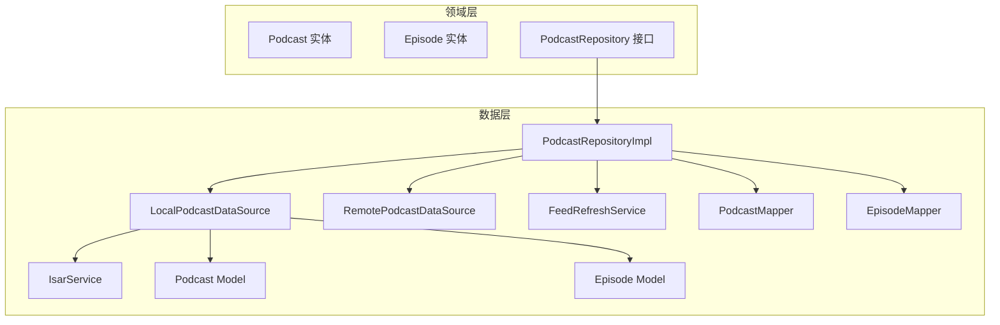
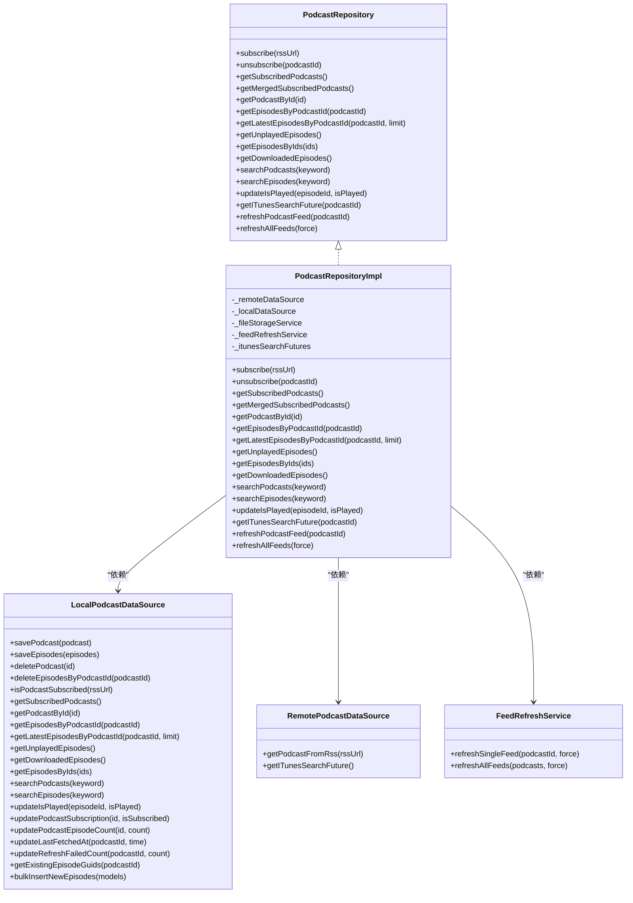
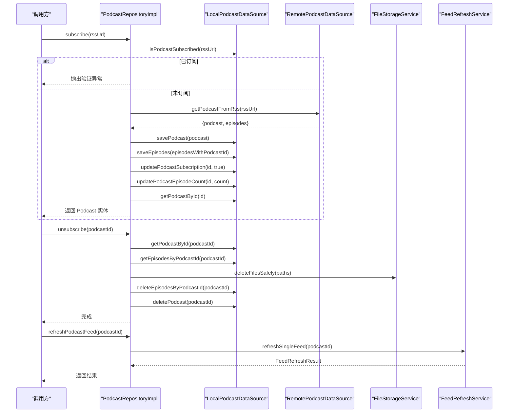
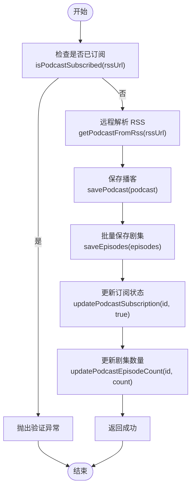
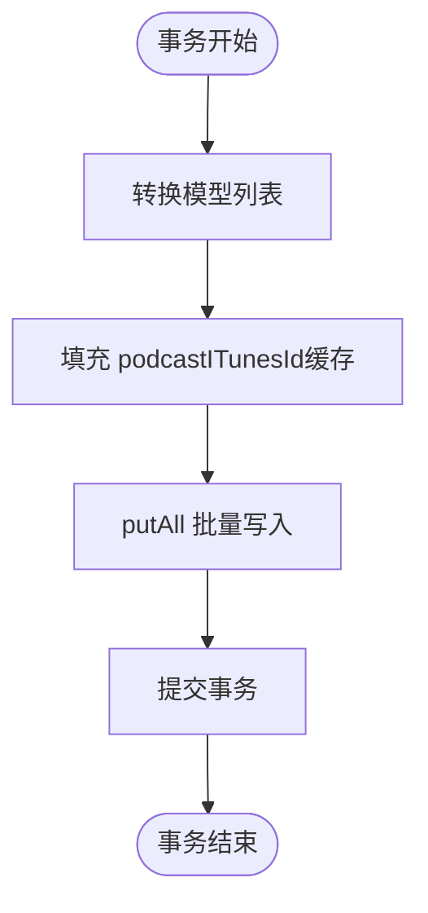
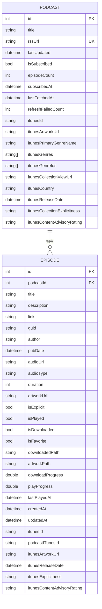
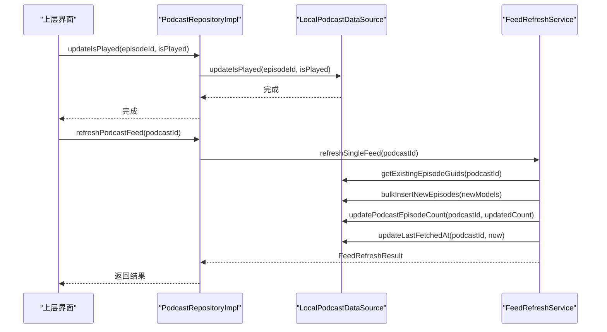
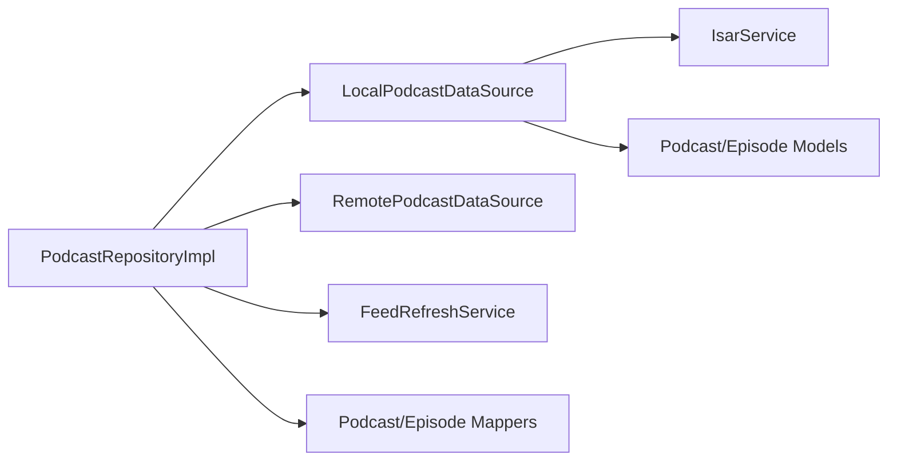

# 订阅管理

<cite>
**本文引用的文件**   
- [podcast_repository_impl.dart](file://lib/data/repositories/podcast_repository_impl.dart)
- [podcast_repository.dart](file://lib/domain/repositories/podcast_repository.dart)
- [local_podcast_datasource.dart](file://lib/data/datasources/local_podcast_datasource.dart)
- [remote_podcast_datasource.dart](file://lib/data/datasources/remote_podcast_datasource.dart)
- [feed_refresh_service.dart](file://lib/data/services/feed_refresh_service.dart)
- [podcast_model.dart](file://lib/data/models/podcast_model.dart)
- [episode_model.dart](file://lib/data/models/episode_model.dart)
- [podcast_mapper.dart](file://lib/data/mappers/podcast_mapper.dart)
- [episode_mapper.dart](file://lib/data/mappers/episode_mapper.dart)
- [isar_service.dart](file://lib/data/database/isar_service.dart)
- [podcast.dart](file://lib/domain/entities/podcast.dart)
- [episode.dart](file://lib/domain/entities/episode.dart)
</cite>

## 目录
1. [简介](#简介)
2. [项目结构](#项目结构)
3. [核心组件](#核心组件)
4. [架构总览](#架构总览)
5. [详细组件分析](#详细组件分析)
6. [依赖关系分析](#依赖关系分析)
7. [性能考量](#性能考量)
8. [故障排查指南](#故障排查指南)
9. [结论](#结论)
10. [附录](#附录)

## 简介
本文件围绕 TinyCast 的播客订阅管理系统，聚焦 PodcastRepositoryImpl 的实现与职责边界，系统阐述 Repository 模式、数据源抽象、依赖注入、订阅状态管理、重复订阅检测、批量保存优化、事务处理机制，以及与 Isar 数据库的索引设计与查询优化。同时覆盖订阅添加、删除、更新、同步等核心操作的实现细节，并给出并发访问、数据迁移、错误恢复等场景的处理建议。

## 项目结构
- 领域层（domain）定义实体与仓库接口：Podcast、Episode、PodcastRepository。
- 数据层（data）实现仓库、数据源、映射器与服务：PodcastRepositoryImpl、LocalPodcastDataSource、RemotePodcastDataSource、FeedRefreshService、Mapper、IsarService。
- 持久化使用 Isar 本地数据库，通过 IsarService 统一管理与初始化。

**图表来源** 
- [podcast_repository.dart:1-42](file://lib/domain/repositories/podcast_repository.dart#L1-L42)
- [podcast_repository_impl.dart:15-36](file://lib/data/repositories/podcast_repository_impl.dart#L15-L36)
- [local_podcast_datasource.dart:13-17](file://lib/data/datasources/local_podcast_datasource.dart#L13-L17)
- [feed_refresh_service.dart:51-72](file://lib/data/services/feed_refresh_service.dart#L51-L72)
- [podcast_model.dart:5-23](file://lib/data/models/podcast_model.dart#L5-L23)
- [episode_model.dart:1-66](file://lib/data/models/episode_model.dart#L1-L66)
- [podcast_mapper.dart:5-94](file://lib/data/mappers/podcast_mapper.dart#L5-L94)
- [episode_mapper.dart:1-66](file://lib/data/mappers/episode_mapper.dart#L1-L66)
- [isar_service.dart:14-59](file://lib/data/database/isar_service.dart#L14-L59)

**章节来源**
- [podcast_repository.dart:1-42](file://lib/domain/repositories/podcast_repository.dart#L1-L42)
- [podcast_repository_impl.dart:15-36](file://lib/data/repositories/podcast_repository_impl.dart#L15-L36)
- [local_podcast_datasource.dart:13-17](file://lib/data/datasources/local_podcast_datasource.dart#L13-L17)
- [feed_refresh_service.dart:51-72](file://lib/data/services/feed_refresh_service.dart#L51-L72)
- [podcast_model.dart:5-23](file://lib/data/models/podcast_model.dart#L5-L23)
- [episode_model.dart:1-66](file://lib/data/models/episode_model.dart#L1-L66)
- [podcast_mapper.dart:5-94](file://lib/data/mappers/podcast_mapper.dart#L5-L94)
- [episode_mapper.dart:1-66](file://lib/data/mappers/episode_mapper.dart#L1-L66)
- [isar_service.dart:14-59](file://lib/data/database/isar_service.dart#L14-L59)

## 核心组件
- PodcastRepository（接口）：定义订阅、取消订阅、查询、搜索、播放状态更新、Feed 刷新等能力。
- PodcastRepositoryImpl（实现）：协调远程与本地数据源、合并服务、文件存储、Feed 刷新服务；负责重复订阅检测、事务性写入、批量保存与结果映射。
- LocalPodcastDataSource（本地数据源）：基于 Isar 的 CRUD、过滤、排序、批量插入、GUID 去重、计数与时间戳更新。
- RemotePodcastDataSource（远程数据源）：解析 RSS、获取 iTunes 搜索 Future 等。
- FeedRefreshService（刷新服务）：冷却控制、退化策略、增量更新、并发限制与统计汇总。
- Mapper（映射器）：Entity 与 Model 的双向转换与批量转换。
- IsarService（数据库服务）：数据库打开/关闭、清理、版本、事务封装。

**章节来源**
- [podcast_repository.dart:1-42](file://lib/domain/repositories/podcast_repository.dart#L1-L42)
- [podcast_repository_impl.dart:15-36](file://lib/data/repositories/podcast_repository_impl.dart#L15-L36)
- [local_podcast_datasource.dart:13-17](file://lib/data/datasources/local_podcast_datasource.dart#L13-L17)
- [feed_refresh_service.dart:51-72](file://lib/data/services/feed_refresh_service.dart#L51-L72)
- [podcast_mapper.dart:5-94](file://lib/data/mappers/podcast_mapper.dart#L5-L94)
- [episode_mapper.dart:1-66](file://lib/data/mappers/episode_mapper.dart#L1-L66)
- [isar_service.dart:14-59](file://lib/data/database/isar_service.dart#L14-L59)

## 架构总览
PodcastRepositoryImpl 作为领域与数据层的桥梁，遵循 Repository 模式，屏蔽底层数据源差异，向上提供统一的业务语义操作。数据访问通过 LocalPodcastDataSource 与 RemotePodcastDataSource 解耦，复杂逻辑（如订阅流程、刷新策略）下沉到专用服务中。

**图表来源** 
- [podcast_repository.dart:1-42](file://lib/domain/repositories/podcast_repository.dart#L1-L42)
- [podcast_repository_impl.dart:15-36](file://lib/data/repositories/podcast_repository_impl.dart#L15-L36)
- [local_podcast_datasource.dart:13-17](file://lib/data/datasources/local_podcast_datasource.dart#L13-L17)
- [remote_podcast_datasource.dart:1-200](file://lib/data/datasources/remote_podcast_datasource.dart#L1-L200)
- [feed_refresh_service.dart:51-72](file://lib/data/services/feed_refresh_service.dart#L51-L72)

## 详细组件分析

### PodcastRepositoryImpl 实现要点
- 依赖注入：构造函数支持可选参数，便于测试与替换实现。
- 订阅流程：
  - 重复订阅检测：先检查是否已订阅，避免重复写入。
  - 远程解析：调用远程数据源解析 RSS，得到 Podcast 与 Episode 列表。
  - 本地持久化：保存 Podcast（含存在性判断），批量保存 Episodes，更新订阅状态与剧集数量。
  - iTunes 信息：异步获取 iTunes 搜索 Future 并缓存，供后续关联。
- 取消订阅：
  - 删除已下载文件（安全删除）。
  - 级联删除 Episodes，再删除 Podcast。
- 查询与搜索：
  - 返回 Entity 列表，内部通过 Mapper 转换。
  - 支持按 ID、最新、未播放、已下载等多维度查询。
- 播放状态更新：直接委托给本地数据源进行事务更新。
- Feed 刷新：
  - 单条刷新：委托 FeedRefreshService，包含冷却、退化、增量更新、失败计数。
  - 批量刷新：分片并发执行，汇总统计。

**图表来源** 
- [podcast_repository_impl.dart:39-141](file://lib/data/repositories/podcast_repository_impl.dart#L39-L141)
- [podcast_repository_impl.dart:144-183](file://lib/data/repositories/podcast_repository_impl.dart#L144-L183)
- [podcast_repository_impl.dart:462-486](file://lib/data/repositories/podcast_repository_impl.dart#L462-L486)
- [feed_refresh_service.dart:74-202](file://lib/data/services/feed_refresh_service.dart#L74-L202)

**章节来源**
- [podcast_repository_impl.dart:39-141](file://lib/data/repositories/podcast_repository_impl.dart#L39-L141)
- [podcast_repository_impl.dart:144-183](file://lib/data/repositories/podcast_repository_impl.dart#L144-L183)
- [podcast_repository_impl.dart:462-486](file://lib/data/repositories/podcast_repository_impl.dart#L462-L486)

### 订阅状态管理与重复订阅检测
- 重复订阅检测在订阅入口即完成，避免冗余网络请求与写入。
- 订阅状态字段 isSubscribed 与 subscribedAt 在更新订阅时设置，保证一致性。
- 取消订阅时级联清理，确保数据完整性。

**图表来源** 
- [podcast_repository_impl.dart:39-141](file://lib/data/repositories/podcast_repository_impl.dart#L39-L141)
- [local_podcast_datasource.dart:240-274](file://lib/data/datasources/local_podcast_datasource.dart#L240-L274)
- [local_podcast_datasource.dart:373-411](file://lib/data/datasources/local_podcast_datasource.dart#L373-L411)

**章节来源**
- [podcast_repository_impl.dart:39-141](file://lib/data/repositories/podcast_repository_impl.dart#L39-L141)
- [local_podcast_datasource.dart:240-274](file://lib/data/datasources/local_podcast_datasource.dart#L240-L274)
- [local_podcast_datasource.dart:373-411](file://lib/data/datasources/local_podcast_datasource.dart#L373-L411)

### 批量保存优化与事务处理
- 批量保存 Episodes 使用 writeTxn 包裹 putAll，确保原子性与一致性。
- 保存 Podcast 时使用写事务，并在事务内做存在性判断，避免重复主键冲突。
- 更新订阅状态与剧集数量均使用独立事务，保证局部变更的隔离性。

**图表来源** 
- [local_podcast_datasource.dart:129-179](file://lib/data/datasources/local_podcast_datasource.dart#L129-L179)
- [local_podcast_datasource.dart:89-127](file://lib/data/datasources/local_podcast_datasource.dart#L89-L127)

**章节来源**
- [local_podcast_datasource.dart:129-179](file://lib/data/datasources/local_podcast_datasource.dart#L129-L179)
- [local_podcast_datasource.dart:89-127](file://lib/data/datasources/local_podcast_datasource.dart#L89-L127)

### Isar 数据库操作、索引设计与查询优化
- 索引设计：
  - Podcast.title 普通索引，加速标题相关查询。
  - Podcast.rssUrl 唯一索引，保障订阅 URL 唯一性。
  - Podcast.lastUpdated 普通索引，辅助排序与筛选。
- 查询优化：
  - 使用 filter().sortByPubDateDesc() 进行有序查询，减少内存排序开销。
  - 使用 limit 限制返回数量，降低 IO 压力。
  - 使用 getAll(ids) 批量读取，结合内存排序满足展示需求。
- 数据一致性：
  - 所有写操作均包裹在 writeTxn 中，保证事务性。
  - GUID 去重用于增量更新，避免重复入库。

**图表来源** 
- [podcast_model.dart:5-77](file://lib/data/models/podcast_model.dart#L5-L77)
- [episode_model.dart:1-66](file://lib/data/models/episode_model.dart#L1-L66)

**章节来源**
- [podcast_model.dart:5-77](file://lib/data/models/podcast_model.dart#L5-L77)
- [episode_model.dart:1-66](file://lib/data/models/episode_model.dart#L1-L66)
- [local_podcast_datasource.dart:276-338](file://lib/data/datasources/local_podcast_datasource.dart#L276-L338)
- [local_podcast_datasource.dart:650-678](file://lib/data/datasources/local_podcast_datasource.dart#L650-L678)

### 订阅添加、删除、更新、同步的核心操作
- 添加订阅：
  - 重复检测 -> 远程解析 -> 本地持久化 -> 状态与计数更新 -> 返回实体。
- 删除订阅：
  - 文件删除 -> 级联删除 Episodes -> 删除 Podcast。
- 更新操作：
  - 播放状态更新：事务内更新 isPlayed 与 updatedAt。
  - iTunes 信息更新：批量更新 podcast 及关联 episode 的 iTunes 字段。
- 同步（Feed 刷新）：
  - 冷却与退化策略 -> 增量更新（GUID 去重）-> 更新计数与时间戳 -> 失败计数与恢复。

**图表来源** 
- [podcast_repository_impl.dart:449-454](file://lib/data/repositories/podcast_repository_impl.dart#L449-L454)
- [local_podcast_datasource.dart:680-704](file://lib/data/datasources/local_podcast_datasource.dart#L680-L704)
- [feed_refresh_service.dart:74-202](file://lib/data/services/feed_refresh_service.dart#L74-L202)

**章节来源**
- [podcast_repository_impl.dart:449-454](file://lib/data/repositories/podcast_repository_impl.dart#L449-L454)
- [local_podcast_datasource.dart:680-704](file://lib/data/datasources/local_podcast_datasource.dart#L680-L704)
- [feed_refresh_service.dart:74-202](file://lib/data/services/feed_refresh_service.dart#L74-L202)

### 与上层业务逻辑的解耦设计与接口规范
- 接口契约：PodcastRepository 明确定义所有对外能力，屏蔽实现细节。
- 依赖注入：构造时注入数据源与服务，便于单元测试与替换。
- 错误处理：统一转换为 AppException，区分 validation、storage、unknown 等类型，便于上层捕获与提示。
- 映射分离：Entity 与 Model 通过 Mapper 解耦，避免领域层与数据层耦合。

**章节来源**
- [podcast_repository.dart:1-42](file://lib/domain/repositories/podcast_repository.dart#L1-L42)
- [podcast_repository_impl.dart:23-36](file://lib/data/repositories/podcast_repository_impl.dart#L23-L36)
- [podcast_mapper.dart:5-94](file://lib/data/mappers/podcast_mapper.dart#L5-L94)

## 依赖关系分析
- 模块耦合：
  - PodcastRepositoryImpl 对 Local/Remote 数据源与 FeedRefreshService 强依赖，但通过接口与构造注入保持松耦合。
  - LocalPodcastDataSource 依赖 IsarService，集中管理数据库生命周期与事务。
- 外部依赖：
  - Isar 本地数据库，提供高性能读写与索引。
  - 文件系统服务用于下载文件的增删改查。
  - ITunes 搜索服务用于扩展元数据。

**图表来源** 
- [podcast_repository_impl.dart:15-36](file://lib/data/repositories/podcast_repository_impl.dart#L15-L36)
- [local_podcast_datasource.dart:13-17](file://lib/data/datasources/local_podcast_datasource.dart#L13-L17)
- [feed_refresh_service.dart:51-72](file://lib/data/services/feed_refresh_service.dart#L51-L72)
- [podcast_mapper.dart:5-94](file://lib/data/mappers/podcast_mapper.dart#L5-L94)
- [episode_mapper.dart:1-66](file://lib/data/mappers/episode_mapper.dart#L1-L66)
- [isar_service.dart:14-59](file://lib/data/database/isar_service.dart#L14-L59)

**章节来源**
- [podcast_repository_impl.dart:15-36](file://lib/data/repositories/podcast_repository_impl.dart#L15-L36)
- [local_podcast_datasource.dart:13-17](file://lib/data/datasources/local_podcast_datasource.dart#L13-L17)
- [feed_refresh_service.dart:51-72](file://lib/data/services/feed_refresh_service.dart#L51-L72)
- [podcast_mapper.dart:5-94](file://lib/data/mappers/podcast_mapper.dart#L5-L94)
- [episode_mapper.dart:1-66](file://lib/data/mappers/episode_mapper.dart#L1-L66)
- [isar_service.dart:14-59](file://lib/data/database/isar_service.dart#L14-L59)

## 性能考量
- 批量写入：使用 writeTxn 与 putAll 减少事务开销与锁竞争。
- 查询优化：利用索引与排序，限制返回数量，避免全表扫描。
- 并发控制：批量刷新采用分片并发（最大并发数限制），避免资源争用。
- 冷却与退化：刷新冷却与失败次数阈值延长间隔，降低远端压力。
- 内存排序：对少量结果集在内存排序，减少数据库负担。

[本节为通用指导，不直接分析具体文件]

## 故障排查指南
- 订阅失败：
  - 检查重复订阅检测是否误判。
  - 查看远程解析是否返回有效数据。
  - 确认本地写入事务是否成功。
- 取消订阅失败：
  - 检查文件删除是否权限不足或路径无效。
  - 确认级联删除顺序是否正确。
- 刷新失败：
  - 查看冷却与退化策略是否导致跳过。
  - 检查 GUID 去重逻辑与增量更新结果。
  - 关注失败计数与恢复逻辑。
- 数据库问题：
  - 确认 Isar 初始化成功。
  - 检查索引与约束是否冲突。
  - 使用 clear/deleteDatabase 进行重置测试。

**章节来源**
- [podcast_repository_impl.dart:129-141](file://lib/data/repositories/podcast_repository_impl.dart#L129-L141)
- [podcast_repository_impl.dart:173-183](file://lib/data/repositories/podcast_repository_impl.dart#L173-L183)
- [feed_refresh_service.dart:180-202](file://lib/data/services/feed_refresh_service.dart#L180-L202)
- [isar_service.dart:61-102](file://lib/data/database/isar_service.dart#L61-L102)

## 结论
PodcastRepositoryImpl 以清晰的 Repository 模式组织订阅管理逻辑，通过数据源抽象与依赖注入实现高内聚低耦合。结合 Isar 的高效索引与事务能力，实现了可靠的订阅状态管理、重复检测、批量保存与一致性保证。FeedRefreshService 提供了健壮的刷新策略，兼顾性能与稳定性。整体架构易于扩展与维护，适合复杂业务场景下的播客订阅管理。

[本节为总结性内容，不直接分析具体文件]

## 附录
- 并发访问建议：
  - 使用写事务保护关键路径，避免竞态条件。
  - 批量操作尽量合并，减少事务切换。
- 数据迁移建议：
  - 在 IsarService 中维护版本号，按需执行迁移脚本。
  - 迁移前备份与回滚策略。
- 错误恢复建议：
  - 区分可重试与不可重试错误。
  - 记录详细日志与堆栈，便于定位问题。

[本节为通用指导，不直接分析具体文件]