# 数据持久化

<cite>
**本文引用的文件**   
- [lib/data/database/isar_service.dart](file://lib/data/database/isar_service.dart)
- [lib/data/database/isar_collections.dart](file://lib/data/database/isar_collections.dart)
- [lib/data/models/episode_model.dart](file://lib/data/models/episode_model.dart)
- [lib/data/models/podcast_model.dart](file://lib/data/models/podcast_model.dart)
- [lib/data/models/favorite_model.dart](file://lib/data/models/favorite_model.dart)
- [lib/data/models/queue_model.dart](file://lib/data/models/queue_model.dart)
- [lib/data/models/app_settings_model.dart](file://lib/data/models/app_settings_model.dart)
- [lib/data/datasources/local_podcast_datasource.dart](file://lib/data/datasources/local_podcast_datasource.dart)
- [lib/data/datasources/local_favorite_datasource.dart](file://lib/data/datasources/local_favorite_datasource.dart)
- [lib/data/datasources/local_queue_datasource.dart](file://lib/data/datasources/local_queue_datasource.dart)
- [lib/data/repositories/podcast_repository_impl.dart](file://lib/data/repositories/podcast_repository_impl.dart)
- [lib/core/services/sync_tombstone_store.dart](file://lib/core/services/sync_tombstone_store.dart)
- [lib/core/services/sync_delete_recorder.dart](file://lib/core/services/sync_delete_recorder.dart)
- [lib/core/services/sync_service.dart](file://lib/core/services/sync_service.dart)
- [docs/database.md](file://docs/database.md)
</cite>

## 更新摘要
**所做更改**   
- 新增墓碑系统章节，详细说明收藏和队列数据源的删除同步机制
- 更新收藏数据源部分，展示与 SyncDeleteRecorder 的集成
- 更新队列数据源部分，展示批量删除操作的墓碑记录
- 新增同步服务中墓碑处理的工作流程图
- 更新故障排查指南，包含墓碑系统相关问题

## 目录
1. [简介](#简介)
2. [项目结构](#项目结构)
3. [核心组件](#核心组件)
4. [架构总览](#架构总览)
5. [详细组件分析](#详细组件分析)
6. [墓碑系统：本地删除的同步跟踪](#墓碑系统本地删除的同步跟踪)
7. [依赖关系分析](#依赖关系分析)
8. [性能与优化](#性能与优化)
9. [故障排查指南](#故障排查指南)
10. [结论](#结论)
11. [附录](#附录)

## 简介
本文件聚焦 TinyCast 的数据持久化系统，围绕 Isar 数据库设计、数据模型定义、查询优化策略展开，结合 IsarService 的数据库操作、EpisodeModel/PodcastModel 实体定义、LocalPodcastDataSource 的数据访问模式，以及与 Repository 层的协作关系进行系统化说明。文档同时覆盖索引优化、事务处理、数据迁移（版本管理）、缓存策略等关键能力，并提供常见问题的定位与解决方案，帮助初学者快速上手，也为有经验的开发者提供深入的技术细节。

**最新更新**：新增了墓碑系统章节，详细说明收藏和队列数据源如何集成新的墓碑系统来实现本地删除的正确跟踪和同步传播。

## 项目结构
TinyCast 在 data 层采用"数据源 + 仓库"的分层组织：
- database：Isar 初始化与生命周期管理、集合名常量
- models：Isar 集合实体（Podcast、Episode、Favorite、Queue、AppSettings 等）
- datasources：本地数据源（如 LocalPodcastDataSource、LocalFavoriteDataSource、LocalQueueDataSource），封装对 Isar 的具体读写
- repositories：领域仓库实现（如 PodcastRepositoryImpl），协调远程/本地数据源并对外暴露统一接口
- core/services：同步相关服务（SyncTombstoneStore、SyncDeleteRecorder、SyncService），处理跨设备数据同步

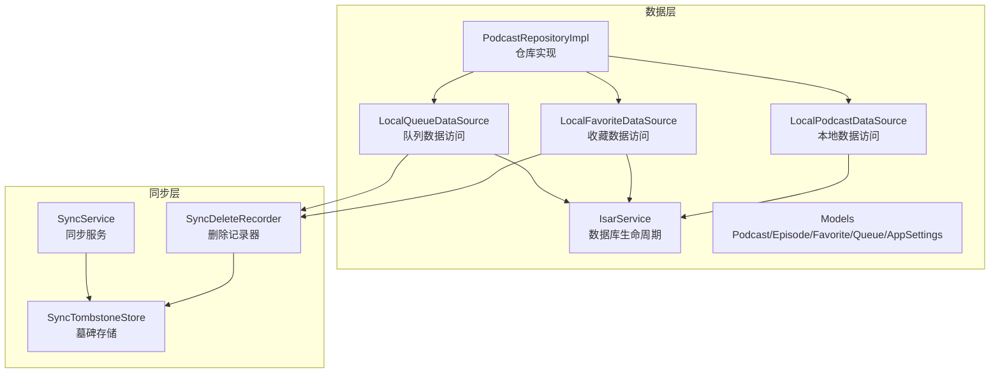

**图表来源**
- [lib/data/database/isar_service.dart:14-59](file://lib/data/database/isar_service.dart#L14-L59)
- [lib/data/datasources/local_podcast_datasource.dart:13-18](file://lib/data/datasources/local_podcast_datasource.dart#L13-L18)
- [lib/data/datasources/local_favorite_datasource.dart:9-13](file://lib/data/datasources/local_favorite_datasource.dart#L9-L13)
- [lib/data/datasources/local_queue_datasource.dart:10-14](file://lib/data/datasources/local_queue_datasource.dart#L10-L14)
- [lib/core/services/sync_tombstone_store.dart:11-19](file://lib/core/services/sync_tombstone_store.dart#L11-L19)
- [lib/core/services/sync_delete_recorder.dart:14-19](file://lib/core/services/sync_delete_recorder.dart#L14-L19)

## 核心组件
- IsarService：单例式数据库服务，负责打开/关闭数据库、清理、删除数据库文件、基础写事务封装（例如更新 Episode 下载状态）。
- Models：使用 @collection 注解声明 Isar 集合，包含字段、索引、枚举映射等。
- LocalPodcastDataSource：面向播客与剧集的本地数据访问，封装查询、保存、批量插入、搜索、状态更新等操作，广泛使用 writeTxn 保证一致性。
- LocalFavoriteDataSource：收藏数据访问，支持添加、移除、检查收藏状态，集成墓碑系统以跟踪删除操作。
- LocalQueueDataSource：队列数据访问，支持添加、移除、清空队列，集成墓碑系统以跟踪批量删除操作。
- PodcastRepositoryImpl：对外暴露订阅、取消订阅、获取列表、刷新 feed 等业务方法，协调 Remote/Local 数据源与文件存储、iTunes 搜索等。
- SyncTombstoneStore：墓碑存储，使用 SharedPreferences 持久化本地删除操作，确保跨设备同步时正确传播删除。
- SyncDeleteRecorder：删除记录器，在数据源执行删除操作时自动记录墓碑信息。
- SyncService：同步服务，协调本地和云端数据的同步，处理墓碑的推送和确认。

**章节来源**
- [lib/data/database/isar_service.dart:14-136](file://lib/data/database/isar_service.dart#L14-L136)
- [lib/data/models/podcast_model.dart:1-78](file://lib/data/models/podcast_model.dart#L1-L78)
- [lib/data/models/episode_model.dart:1-67](file://lib/data/models/episode_model.dart#L1-L67)
- [lib/data/datasources/local_podcast_datasource.dart:13-859](file://lib/data/datasources/local_podcast_datasource.dart#L13-L859)
- [lib/data/datasources/local_favorite_datasource.dart:9-194](file://lib/data/datasources/local_favorite_datasource.dart#L9-L194)
- [lib/data/datasources/local_queue_datasource.dart:10-460](file://lib/data/datasources/local_queue_datasource.dart#L10-L460)
- [lib/core/services/sync_tombstone_store.dart:11-108](file://lib/core/services/sync_tombstone_store.dart#L11-L108)
- [lib/core/services/sync_delete_recorder.dart:14-85](file://lib/core/services/sync_delete_recorder.dart#L14-L85)

## 架构总览
下图展示了从上层仓库到本地数据源再到 Isar 的调用链，以及事务与索引的使用点。

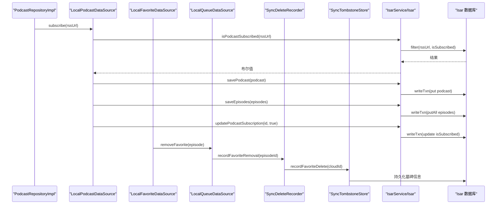

**图表来源**
- [lib/data/repositories/podcast_repository_impl.dart:39-141](file://lib/data/repositories/podcast_repository_impl.dart#L39-L141)
- [lib/data/datasources/local_podcast_datasource.dart:89-127](file://lib/data/datasources/local_podcast_datasource.dart#L89-L127)
- [lib/data/datasources/local_favorite_datasource.dart:83-118](file://lib/data/datasources/local_favorite_datasource.dart#L83-L118)
- [lib/core/services/sync_delete_recorder.dart:22-30](file://lib/core/services/sync_delete_recorder.dart#L22-L30)

## 详细组件分析

### IsarService：数据库生命周期与基础操作
- 单例模式：通过静态 instance 获取唯一实例，避免重复打开。
- 初始化：根据应用文档目录创建数据库，注册所有 Schema，支持 inspector 调试开关。
- 生命周期：open/close/clearAll/deleteDatabase 提供完整生命周期管理。
- 事务封装：writeTxn 用于原子性写入；updateEpisodeDownloadStatus 演示了按 ID 查找、字段更新、时间戳维护与异常包装。

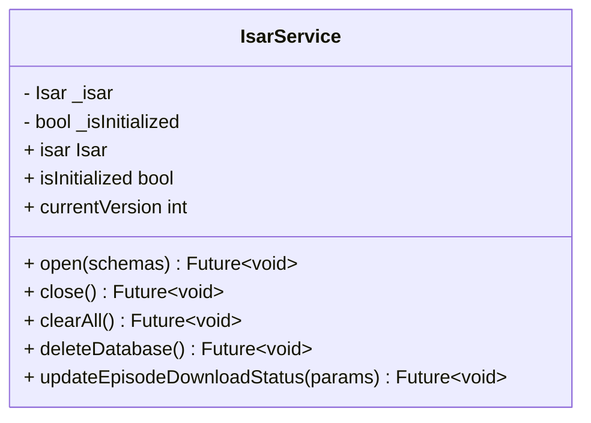

**图表来源**
- [lib/data/database/isar_service.dart:14-136](file://lib/data/database/isar_service.dart#L14-L136)

**章节来源**
- [lib/data/database/isar_service.dart:14-136](file://lib/data/database/isar_service.dart#L14-L136)

### 数据模型：Podcast、Episode、Favorite、Queue、AppSettings
- Podcast：标题、描述、封面、RSS URL（唯一索引）、分类、关键词、订阅状态、更新时间、iTunes 扩展字段等。
- Episode：关联 podcastId（索引）、发布时间（索引）、音频信息、播放/下载状态、进度、时间戳、iTunes 扩展字段等。
- Favorite：收藏条目，关联 episodeId（索引）。
- Queue：播放队列，关联 episodeId（索引）、position（索引）、时间戳。
- AppSettings：应用设置，含自动下载策略、刷新间隔、播放速度、音量、睡眠定时器等枚举配置。

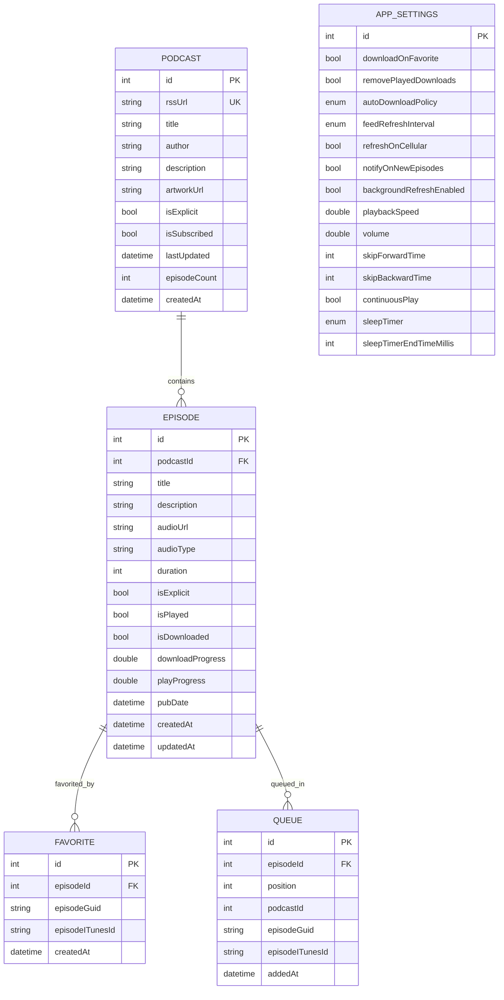

**图表来源**
- [lib/data/models/podcast_model.dart:1-78](file://lib/data/models/podcast_model.dart#L1-L78)
- [lib/data/models/episode_model.dart:1-67](file://lib/data/models/episode_model.dart#L1-L67)
- [lib/data/models/favorite_model.dart:1-20](file://lib/data/models/favorite_model.dart#L1-L20)
- [lib/data/models/queue_model.dart:1-29](file://lib/data/models/queue_model.dart#L1-L29)
- [lib/data/models/app_settings_model.dart:1-79](file://lib/data/models/app_settings_model.dart#L1-L79)

**章节来源**
- [lib/data/models/podcast_model.dart:1-78](file://lib/data/models/podcast_model.dart#L1-L78)
- [lib/data/models/episode_model.dart:1-67](file://lib/data/models/episode_model.dart#L1-L67)
- [lib/data/models/favorite_model.dart:1-20](file://lib/data/models/favorite_model.dart#L1-L20)
- [lib/data/models/queue_model.dart:1-29](file://lib/data/models/queue_model.dart#L1-L29)
- [lib/data/models/app_settings_model.dart:1-79](file://lib/data/models/app_settings_model.dart#L1-L79)

### LocalPodcastDataSource：本地数据访问模式
- 查询模式：
  - 全量过滤后内存筛选（如 getSubscribedPodcasts 先 findAll 再过滤 isSubscribed）。
  - 条件查询（filter().rssUrlEqualTo()/isSubscribedEqualTo()）。
  - 排序与分页（sortByPubDateDesc().limit(limit)）。
  - 批量获取（getAll(ids)）。
- 写入模式：
  - 单条写入（put）与批量写入（putAll）。
  - 事务包裹（writeTxn）确保一致性。
  - 复杂更新（如批量更新 episode 的 podcastITunesId、更新订阅状态、计数、最后获取时间等）。
- 搜索模式：
  - 全文模糊匹配（titleContains/descriptionContains，大小写不敏感）。
- 错误处理：
  - 捕获 IsarError 与通用异常，统一转换为 AppException.storage/unknown，附带堆栈与上下文日志。

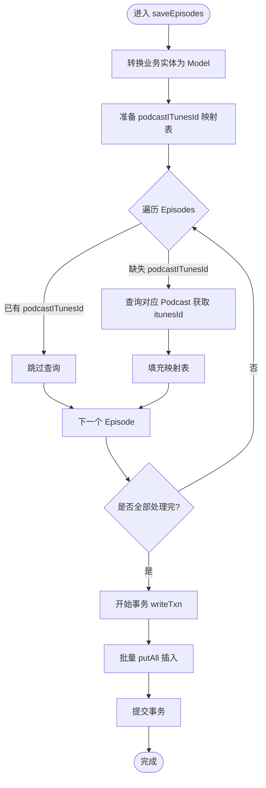

**图表来源**
- [lib/data/datasources/local_podcast_datasource.dart:129-179](file://lib/data/datasources/local_podcast_datasource.dart#L129-L179)

**章节来源**
- [lib/data/datasources/local_podcast_datasource.dart:19-859](file://lib/data/datasources/local_podcast_datasource.dart#L19-L859)

### LocalFavoriteDataSource：收藏数据访问与墓碑系统集成
- 收藏操作：支持添加、移除、检查收藏状态，使用多种标识符（itunesId、guid、episodeId）进行精确匹配。
- **墓碑系统集成**：在移除收藏操作后，自动调用 `SyncDeleteRecorder.instance.recordFavoriteRemoval()` 记录删除操作。
- 事务处理：所有数据库操作都使用 writeTxn 包裹，确保数据一致性。
- 错误处理：统一的异常处理和日志记录，便于问题追踪。

**更新** 收藏数据源现在集成了墓碑系统，当用户移除收藏时，会自动记录删除操作以便后续同步到云端。

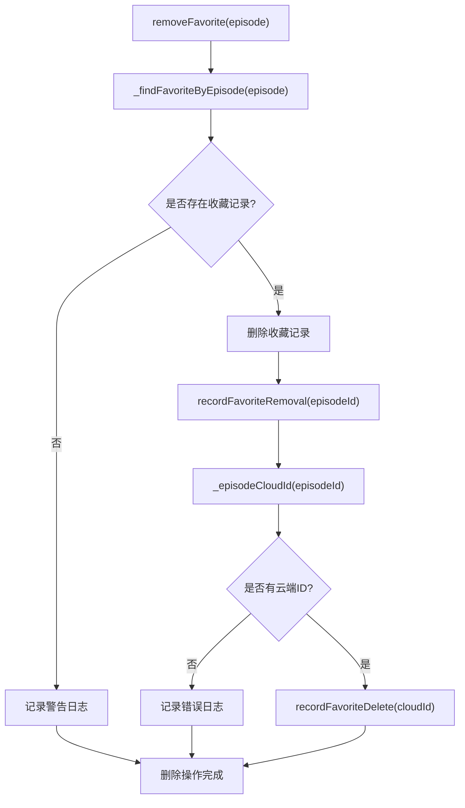

**图表来源**
- [lib/data/datasources/local_favorite_datasource.dart:83-118](file://lib/data/datasources/local_favorite_datasource.dart#L83-L118)
- [lib/core/services/sync_delete_recorder.dart:22-30](file://lib/core/services/sync_delete_recorder.dart#L22-L30)

**章节来源**
- [lib/data/datasources/local_favorite_datasource.dart:9-194](file://lib/data/datasources/local_favorite_datasource.dart#L9-L194)

### LocalQueueDataSource：队列数据访问与墓碑系统集成
- 队列操作：支持添加到队列、插播到队首、移除、清空队列、按播客ID批量移除等操作。
- **墓碑系统集成**：在所有删除操作中（单个移除、批量移除、清空队列）都会调用 `SyncDeleteRecorder.instance.recordQueueRemoval()` 记录删除操作。
- 位置管理：智能处理队列项的位置调整，确保队列顺序的一致性。
- 批量操作优化：对于大量删除操作，使用批量删除提高效率。

**更新** 队列数据源现在集成了墓碑系统，所有删除操作都会记录墓碑信息，确保跨设备同步时正确传播删除。

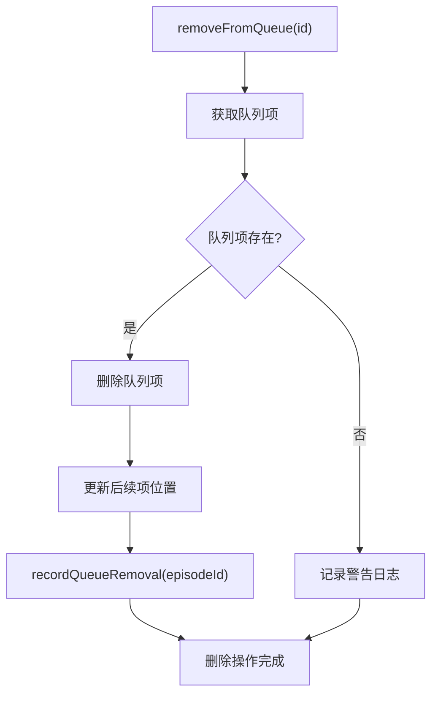

**图表来源**
- [lib/data/datasources/local_queue_datasource.dart:190-242](file://lib/data/datasources/local_queue_datasource.dart#L190-L242)
- [lib/core/services/sync_delete_recorder.dart:32-41](file://lib/core/services/sync_delete_recorder.dart#L32-L41)

**章节来源**
- [lib/data/datasources/local_queue_datasource.dart:10-460](file://lib/data/datasources/local_queue_datasource.dart#L10-L460)

### PodcastRepositoryImpl：与数据源的协作
- 订阅流程：检查是否已订阅 -> 拉取 RSS -> 保存 Podcast -> 保存 Episodes -> 更新订阅状态与计数 -> 返回实体。
- 取消订阅：删除本地文件（已下载的音频）-> 删除 Episodes -> 删除 Podcast。
- 列表与搜索：委托 LocalPodcastDataSource 获取数据，并通过 Mapper 转换为领域实体。
- 刷新 Feed：委托 FeedRefreshService 执行单条或批量刷新，记录成功/失败统计。

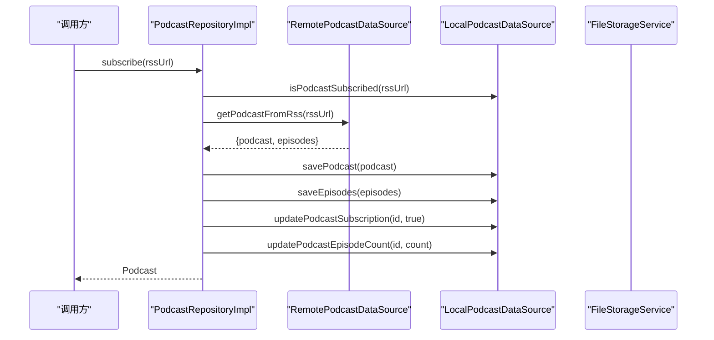

**图表来源**
- [lib/data/repositories/podcast_repository_impl.dart:39-141](file://lib/data/repositories/podcast_repository_impl.dart#L39-L141)
- [lib/data/datasources/local_podcast_datasource.dart:89-127](file://lib/data/datasources/local_podcast_datasource.dart#L89-L127)
- [lib/data/datasources/local_podcast_datasource.dart:129-179](file://lib/data/datasources/local_podcast_datasource.dart#L129-L179)
- [lib/data/datasources/local_podcast_datasource.dart:373-411](file://lib/data/datasources/local_podcast_datasource.dart#L373-L411)

**章节来源**
- [lib/data/repositories/podcast_repository_impl.dart:39-141](file://lib/data/repositories/podcast_repository_impl.dart#L39-L141)
- [lib/data/repositories/podcast_repository_impl.dart:144-183](file://lib/data/repositories/podcast_repository_impl.dart#L144-L183)
- [lib/data/repositories/podcast_repository_impl.dart:186-241](file://lib/data/repositories/podcast_repository_impl.dart#L186-L241)
- [lib/data/repositories/podcast_repository_impl.dart:462-522](file://lib/data/repositories/podcast_repository_impl.dart#L462-L522)

## 墓碑系统：本地删除的同步跟踪

墓碑系统是 TinyCast 数据同步的核心组件，专门用于跟踪和传播本地删除操作到云端和其他设备。该系统解决了传统镜像删除方法可能导致的数据丢失问题。

### 墓碑系统架构

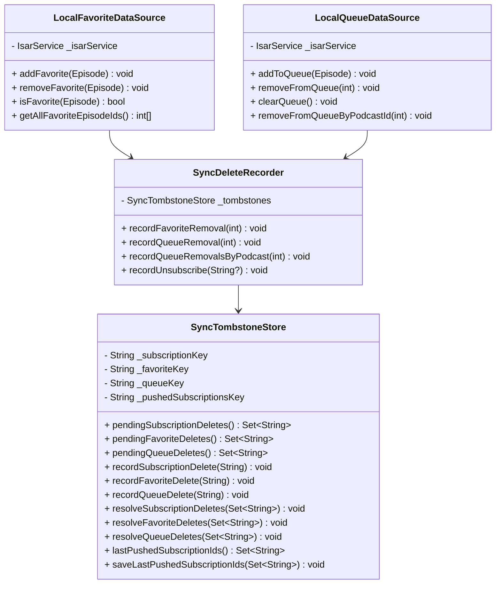

**图表来源**
- [lib/core/services/sync_tombstone_store.dart:11-108](file://lib/core/services/sync_tombstone_store.dart#L11-L108)
- [lib/core/services/sync_delete_recorder.dart:14-85](file://lib/core/services/sync_delete_recorder.dart#L14-L85)
- [lib/data/datasources/local_favorite_datasource.dart:9-194](file://lib/data/datasources/local_favorite_datasource.dart#L9-L194)
- [lib/data/datasources/local_queue_datasource.dart:10-460](file://lib/data/datasources/local_queue_datasource.dart#L10-L460)

### 墓碑工作原理

墓碑系统通过以下步骤确保删除操作的正确传播：

1. **本地删除记录**：当用户在本地删除收藏或队列项时，数据源会调用 `SyncDeleteRecorder` 记录删除操作。

2. **云端ID解析**：`SyncDeleteRecorder` 会从数据库中查找对应的云端ID（supabaseId），这是删除操作的关键标识符。

3. **墓碑持久化**：云端ID被存储在 `SyncTombstoneStore` 中，使用 SharedPreferences 进行持久化。

4. **同步时推送**：在下次同步时，`SyncService` 会读取待处理的删除操作，并调用相应的云端API执行删除。

5. **删除确认**：云端删除成功后，墓碑会被清除，避免重复删除。

### 墓碑类型和处理流程

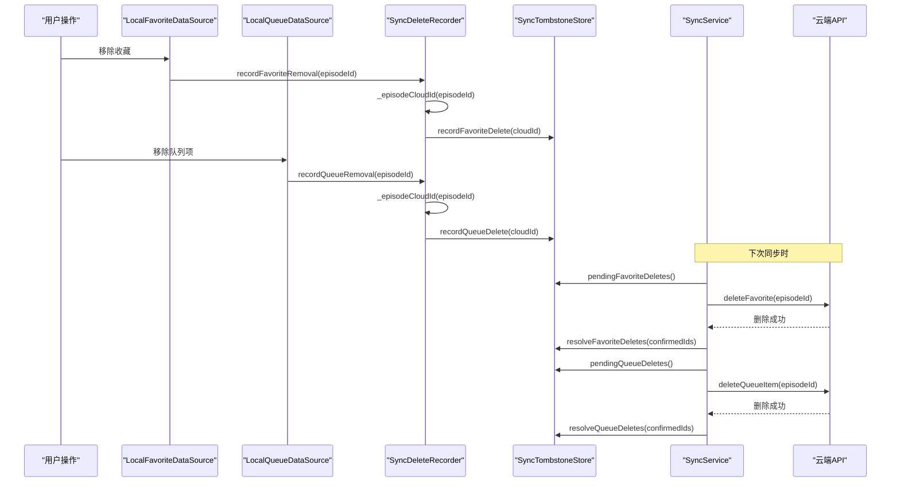

**图表来源**
- [lib/data/datasources/local_favorite_datasource.dart:83-118](file://lib/data/datasources/local_favorite_datasource.dart#L83-L118)
- [lib/data/datasources/local_queue_datasource.dart:190-242](file://lib/data/datasources/local_queue_datasource.dart#L190-L242)
- [lib/core/services/sync_delete_recorder.dart:22-41](file://lib/core/services/sync_delete_recorder.dart#L22-L41)
- [lib/core/services/sync_service.dart:370-453](file://lib/core/services/sync_service.dart#L370-L453)

### 墓碑存储机制

`SyncTombstoneStore` 使用三个独立的键来存储不同类型的删除操作：
- `sync_tombstone_favorites`：收藏删除
- `sync_tombstone_queue`：队列删除  
- `sync_tombstone_subscriptions`：订阅删除

每个键存储的是云端ID的字符串列表，这些ID会在删除确认后从列表中移除。

**章节来源**
- [lib/core/services/sync_tombstone_store.dart:11-108](file://lib/core/services/sync_tombstone_store.dart#L11-L108)
- [lib/core/services/sync_delete_recorder.dart:14-85](file://lib/core/services/sync_delete_recorder.dart#L14-L85)
- [lib/core/services/sync_service.dart:170-176](file://lib/core/services/sync_service.dart#L170-L176)
- [lib/core/services/sync_service.dart:370-453](file://lib/core/services/sync_service.dart#L370-L453)

## 依赖关系分析
- IsarService 依赖 path_provider 获取应用文档目录，依赖 isar_community 进行数据库操作。
- LocalPodcastDataSource 依赖 IsarService 提供的 Isar 实例，依赖 Mapper 将领域实体与 Model 互转。
- LocalFavoriteDataSource 和 LocalQueueDataSource 依赖 IsarService 和 SyncDeleteRecorder。
- PodcastRepositoryImpl 依赖 Local/Remote 数据源、文件存储服务、iTunes 搜索服务、Feed 刷新服务。
- SyncDeleteRecorder 依赖 SyncTombstoneStore 和 IsarService。
- SyncService 依赖 SyncTombstoneStore 和各种数据源。

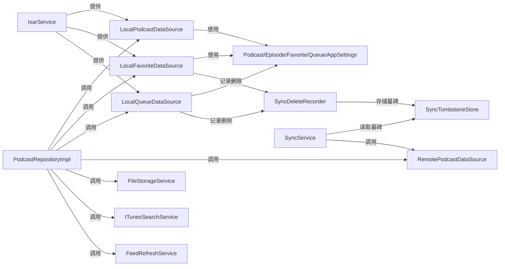

**图表来源**
- [lib/data/database/isar_service.dart:1-12](file://lib/data/database/isar_service.dart#L1-L12)
- [lib/data/datasources/local_podcast_datasource.dart:1-12](file://lib/data/datasources/local_podcast_datasource.dart#L1-L12)
- [lib/data/datasources/local_favorite_datasource.dart:1-8](file://lib/data/datasources/local_favorite_datasource.dart#L1-L8)
- [lib/data/datasources/local_queue_datasource.dart:1-8](file://lib/data/datasources/local_queue_datasource.dart#L1-L8)
- [lib/core/services/sync_delete_recorder.dart:1-7](file://lib/core/services/sync_delete_recorder.dart#L1-L7)
- [lib/core/services/sync_tombstone_store.dart:1-3](file://lib/core/services/sync_tombstone_store.dart#L1-L3)

**章节来源**
- [lib/data/database/isar_service.dart:1-12](file://lib/data/database/isar_service.dart#L1-L12)
- [lib/data/datasources/local_podcast_datasource.dart:1-12](file://lib/data/datasources/local_podcast_datasource.dart#L1-L12)
- [lib/data/datasources/local_favorite_datasource.dart:1-8](file://lib/data/datasources/local_favorite_datasource.dart#L1-L8)
- [lib/data/datasources/local_queue_datasource.dart:1-8](file://lib/data/datasources/local_queue_datasource.dart#L1-L8)
- [lib/core/services/sync_delete_recorder.dart:1-7](file://lib/core/services/sync_delete_recorder.dart#L1-L7)
- [lib/core/services/sync_tombstone_store.dart:1-3](file://lib/core/services/sync_tombstone_store.dart#L1-L3)

## 性能与优化
- 索引优化
  - Podcast.rssUrl 使用唯一索引，加速去重与精确查找。
  - Episode.podcastId、Episode.pubDate 建立索引，提升按播客分组与按时间排序的性能。
  - Favorite.episodeId、Queue.position 建立索引，提高收藏与队列查询效率。
- 事务处理
  - 所有写操作均使用 writeTxn 包裹，确保原子性与一致性。
  - 批量插入（putAll）减少事务边界次数，降低锁竞争。
- 查询优化
  - 优先使用 filter().xxxEqualTo()/Contains() 等条件查询，避免全表扫描。
  - 排序与限制（sortByPubDateDesc().limit(n)）在数据库侧完成，减少内存压力。
  - 批量获取（getAll(ids)）配合内存排序，适用于已知 ID 列表的场景。
- 数据迁移与版本
  - IsarService 中维护 _currentVersion，便于未来引入 schema 升级逻辑（当前版本为 1）。
  - 建议后续结合 Isar 的版本迁移 API，实现平滑升级。
- 缓存策略
  - 建议在高频读取路径（如订阅列表、最新节目）增加内存缓存层（如 Provider/State），减少重复 IO。
  - 对于搜索结果与 iTunes 元数据，可考虑短期缓存与失效策略。
- **墓碑系统优化**
  - 墓碑存储使用 SharedPreferences，避免数据库操作开销。
  - 删除操作是 best-effort 性质，失败不会影响本地数据完整性。
  - 云端ID解析失败时静默处理，确保用户体验不受影响。

**章节来源**
- [lib/data/models/podcast_model.dart:11-23](file://lib/data/models/podcast_model.dart#L11-L23)
- [lib/data/models/episode_model.dart:11-25](file://lib/data/models/episode_model.dart#L11-L25)
- [lib/data/models/favorite_model.dart:11-12](file://lib/data/models/favorite_model.dart#L11-L12)
- [lib/data/models/queue_model.dart:11-25](file://lib/data/models/queue_model.dart#L11-L25)
- [lib/data/database/isar_service.dart:16-17](file://lib/data/database/isar_service.dart#L16-L17)
- [lib/data/datasources/local_podcast_datasource.dart:276-338](file://lib/data/datasources/local_podcast_datasource.dart#L276-L338)
- [lib/data/datasources/local_podcast_datasource.dart:806-859](file://lib/data/datasources/local_podcast_datasource.dart#L806-L859)
- [lib/core/services/sync_delete_recorder.dart:8-13](file://lib/core/services/sync_delete_recorder.dart#L8-L13)

## 故障排查指南
- 数据库未初始化
  - 现象：访问 isar 属性抛出 StateError。
  - 排查：确认是否在 open() 之后使用；检查 open() 是否成功。
  - 参考：[lib/data/database/isar_service.dart:31-36](file://lib/data/database/isar_service.dart#L31-L36)
- 文件权限问题
  - 现象：打开/关闭/删除数据库时抛出 FileSystemException。
  - 排查：检查应用文档目录权限；确认路径存在且可写。
  - 参考：[lib/data/database/isar_service.dart:44-58](file://lib/data/database/isar_service.dart#L44-L58)、[lib/data/database/isar_service.dart:89-102](file://lib/data/database/isar_service.dart#L89-L102)
- 查询失败与异常包装
  - 现象：IsarError 被捕获并转为 AppException.storage/unknown。
  - 排查：查看日志中的原始错误与堆栈；确认查询条件与索引是否匹配。
  - 参考：[lib/data/datasources/local_podcast_datasource.dart:42-56](file://lib/data/datasources/local_podcast_datasource.dart#L42-L56)、[lib/data/datasources/local_podcast_datasource.dart:112-127](file://lib/data/datasources/local_podcast_datasource.dart#L112-L127)
- 批量插入性能问题
  - 现象：大量 episode 插入耗时较长。
  - 排查：确认是否使用 writeTxn 包裹 putAll；避免在事务内做额外查询。
  - 参考：[lib/data/datasources/local_podcast_datasource.dart:806-859](file://lib/data/datasources/local_podcast_datasource.dart#L806-L859)
- 订阅状态不一致
  - 现象：isSubscribed 更新后查询仍为旧值。
  - 排查：确认是否在事务中提交；检查是否存在并发写入冲突。
  - 参考：[lib/data/datasources/local_podcast_datasource.dart:373-411](file://lib/data/datasources/local_podcast_datasource.dart#L373-L411)
- **墓碑系统相关问题**
  - 现象：本地删除后云端数据未同步。
  - 排查：检查 SyncDeleteRecorder 是否正确调用；确认云端ID解析是否成功；查看 SyncTombstoneStore 中是否有待处理的墓碑。
  - 参考：[lib/core/services/sync_delete_recorder.dart:22-41](file://lib/core/services/sync_delete_recorder.dart#L22-L41)、[lib/core/services/sync_tombstone_store.dart:74-94](file://lib/core/services/sync_tombstone_store.dart#L74-L94)
  - 现象：墓碑无法清除导致重复删除。
  - 排查：检查 SyncService 中的删除确认逻辑；确认云端API调用是否成功。
  - 参考：[lib/core/services/sync_service.dart:395-401](file://lib/core/services/sync_service.dart#L395-L401)、[lib/core/services/sync_service.dart:447-453](file://lib/core/services/sync_service.dart#L447-L453)

**章节来源**
- [lib/data/database/isar_service.dart:31-36](file://lib/data/database/isar_service.dart#L31-L36)
- [lib/data/database/isar_service.dart:44-58](file://lib/data/database/isar_service.dart#L44-L58)
- [lib/data/database/isar_service.dart:89-102](file://lib/data/database/isar_service.dart#L89-L102)
- [lib/data/datasources/local_podcast_datasource.dart:42-56](file://lib/data/datasources/local_podcast_datasource.dart#L42-L56)
- [lib/data/datasources/local_podcast_datasource.dart:112-127](file://lib/data/datasources/local_podcast_datasource.dart#L112-L127)
- [lib/data/datasources/local_podcast_datasource.dart:373-411](file://lib/data/datasources/local_podcast_datasource.dart#L373-L411)
- [lib/data/datasources/local_podcast_datasource.dart:806-859](file://lib/data/datasources/local_podcast_datasource.dart#L806-L859)
- [lib/core/services/sync_delete_recorder.dart:22-41](file://lib/core/services/sync_delete_recorder.dart#L22-L41)
- [lib/core/services/sync_tombstone_store.dart:74-94](file://lib/core/services/sync_tombstone_store.dart#L74-L94)
- [lib/core/services/sync_service.dart:395-401](file://lib/core/services/sync_service.dart#L395-L401)
- [lib/core/services/sync_service.dart:447-453](file://lib/core/services/sync_service.dart#L447-L453)

## 结论
TinyCast 的数据持久化以 Isar 为核心，通过清晰的分层（Service/Models/Datasource/Repository）实现了高内聚、低耦合的本地数据访问。索引与事务的正确使用保障了查询性能与数据一致性；Repository 层屏蔽了底层细节，提供了统一的业务接口。

**最新更新**：新增的墓碑系统为收藏和队列数据源提供了可靠的删除同步机制，解决了跨设备数据一致性问题。该系统的 best-effort 设计确保了即使同步失败也不会影响本地数据的完整性。

未来可在版本迁移、缓存策略与并发控制方面进一步增强，以满足更大规模数据与更高并发场景的需求。墓碑系统的完善使得 TinyCast 能够提供更可靠的多设备同步体验。

## 附录
- 数据库技术文档概览与初始化示例参见：[docs/database.md:1-42](file://docs/database.md#L1-L42)
- 集合名常量集中管理参见：[lib/data/database/isar_collections.dart:1-22](file://lib/data/database/isar_collections.dart#L1-L22)
- 墓碑系统实现参见：[lib/core/services/sync_tombstone_store.dart:1-108](file://lib/core/services/sync_tombstone_store.dart#L1-108)
- 删除记录器实现参见：[lib/core/services/sync_delete_recorder.dart:1-85](file://lib/core/services/sync_delete_recorder.dart#L1-85)
- 同步服务中的墓碑处理参见：[lib/core/services/sync_service.dart:170-176](file://lib/core/services/sync_service.dart#L170-L176)、[lib/core/services/sync_service.dart:370-453](file://lib/core/services/sync_service.dart#L370-L453)