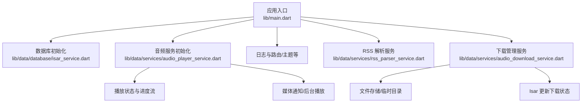
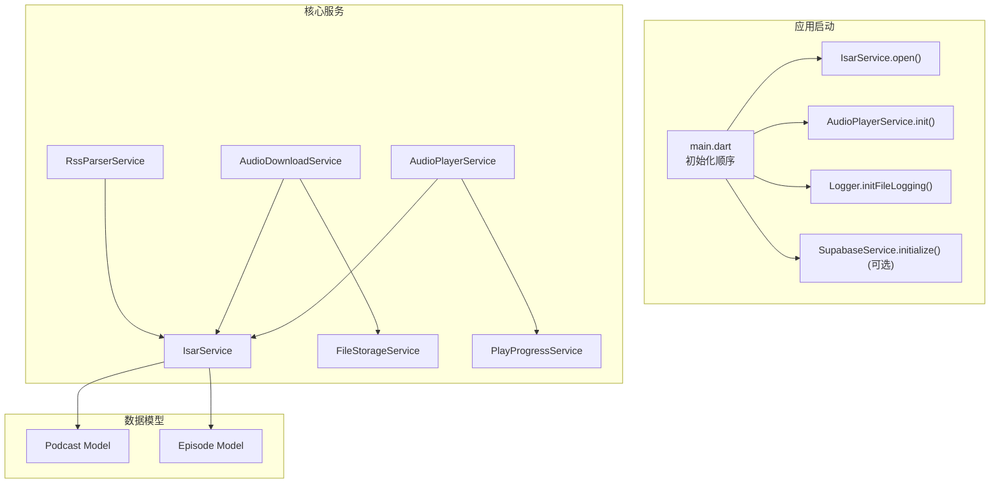
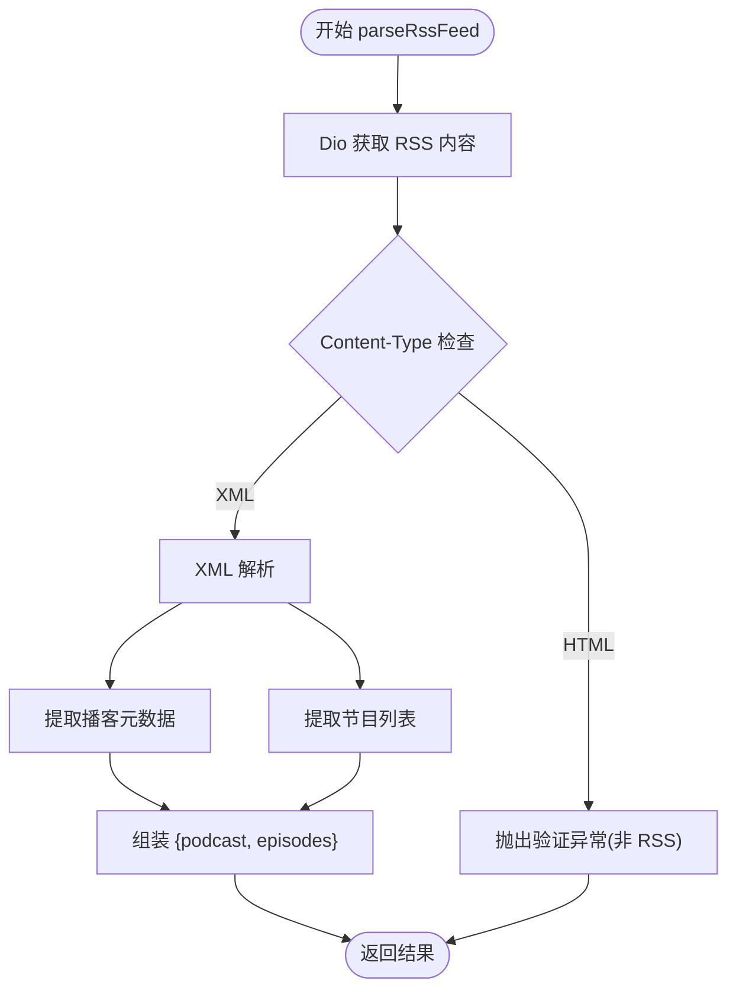
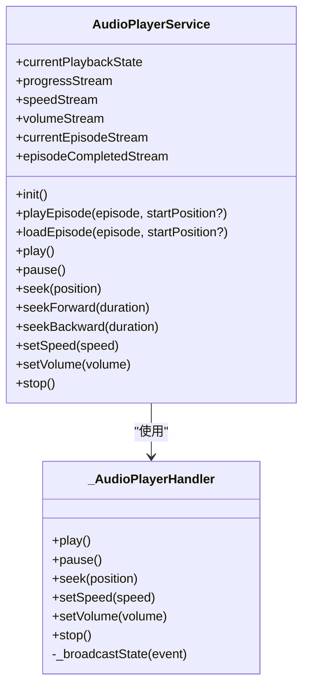
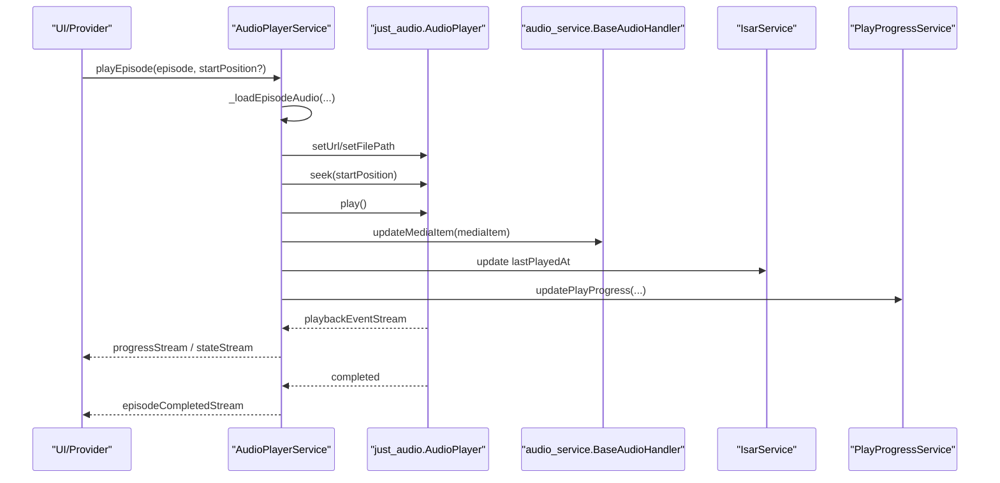
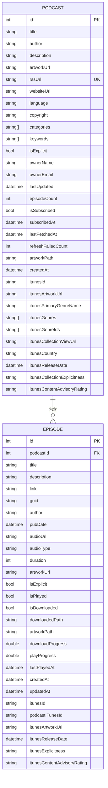
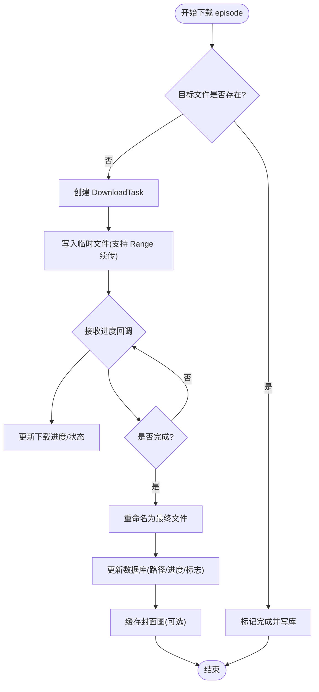
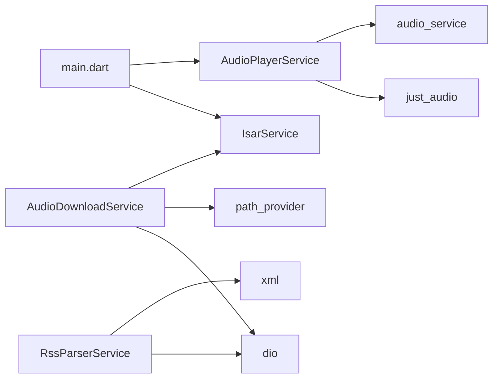

# 核心功能模块

<cite>
**本文引用的文件**   
- [main.dart](file://lib/main.dart)
- [pubspec.yaml](file://pubspec.yaml)
- [rss_parser_service.dart](file://lib/data/services/rss_parser_service.dart)
- [audio_player_service.dart](file://lib/data/services/audio_player_service.dart)
- [audio_download_service.dart](file://lib/data/services/audio_download_service.dart)
- [isar_service.dart](file://lib/data/database/isar_service.dart)
- [podcast_model.dart](file://lib/data/models/podcast_model.dart)
- [episode_model.dart](file://lib/data/models/episode_model.dart)
- [database.md](file://docs/database.md)
- [download_queue_debug.md](file://docs/download_queue_debug.md)
- [audio-playback/spec.md](file://.trae/specs/audio-playback/spec.md)
- [audio-playback/tasks.md](file://.trae/specs/audio-playback/tasks.md)
- [itunes-search-integration/spec.md](file://.trae/specs/itunes-search-integration/spec.md)
- [queue-management/spec.md](file://.trae/specs/queue-management/spec.md)
</cite>

## 目录
1. [简介](#简介)
2. [项目结构](#项目结构)
3. [核心组件](#核心组件)
4. [架构总览](#架构总览)
5. [详细组件分析](#详细组件分析)
6. [依赖关系分析](#依赖关系分析)
7. [性能考量](#性能考量)
8. [故障排查指南](#故障排查指南)
9. [结论](#结论)
10. [附录](#附录)

## 简介
本文件聚焦 TinyCast 的核心功能模块，围绕播客订阅系统、音频播放系统、数据持久化（Isar）、下载管理系统进行系统化说明。文档涵盖 RSS 解析机制、播放器架构设计、数据库模型与迁移、下载队列管理等关键实现细节、调用关系、接口与业务模型，并提供来自实际代码库的引用路径，帮助初学者快速上手，同时为有经验的开发者提供足够的技术深度。

## 项目结构
TinyCast 采用分层组织：
- lib/main.dart：应用入口、窗口管理、初始化流程（数据库、播放器、日志、Supabase）
- lib/data/services：核心服务（RSS 解析、音频播放、下载、文件存储、图片缓存等）
- lib/data/models：Isar 数据模型（Podcast、Episode 等）
- lib/data/database：Isar 数据库服务封装
- docs：数据库与下载调试等技术文档
- .trae/specs：需求规格与任务清单（音频播放、iTunes 搜索、队列管理等）

图表来源 
- [main.dart:106-194](file://lib/main.dart#L106-L194)
- [isar_service.dart:38-59](file://lib/data/database/isar_service.dart#L38-L59)
- [audio_player_service.dart:100-134](file://lib/data/services/audio_player_service.dart#L100-L134)
- [rss_parser_service.dart:40-128](file://lib/data/services/rss_parser_service.dart#L40-L128)
- [audio_download_service.dart:196-408](file://lib/data/services/audio_download_service.dart#L196-L408)

章节来源
- [main.dart:106-194](file://lib/main.dart#L106-L194)
- [pubspec.yaml:18-144](file://pubspec.yaml#L18-L144)

## 核心组件
- RSS 解析服务：负责拉取并解析 RSS XML，提取播客元数据与节目列表，兼容 iTunes/Dublin Core 命名空间，具备反爬虫检测与重试策略。
- 音频播放服务：基于 just_audio + audio_service，提供播放控制、进度跟踪、速度/音量调节、后台播放与媒体通知、播放位置持久化。
- 下载管理服务：支持断点续传、并发队列、暂停/恢复/取消、进度事件、封面图缓存与错误分类；失败后不会自动重试，需用户重新发起。
- Isar 数据库服务：单例打开/关闭、清理/删除、事务写入、下载状态更新；配合 models 生成 schema。

章节来源
- [rss_parser_service.dart:16-128](file://lib/data/services/rss_parser_service.dart#L16-L128)
- [audio_player_service.dart:31-134](file://lib/data/services/audio_player_service.dart#L31-L134)
- [audio_download_service.dart:129-210](file://lib/data/services/audio_download_service.dart#L129-L210)
- [isar_service.dart:14-59](file://lib/data/database/isar_service.dart#L14-L59)

## 架构总览
整体架构遵循“服务层 + 数据模型”的分层模式：
- 入口 main.dart 统一初始化 Isar、AudioPlayerService、日志与可选 Supabase
- 各服务通过 IsarService 访问本地数据
- UI 层通过 Riverpod Provider 订阅服务状态（如播放状态、下载进度）

图表来源 
- [main.dart:179-194](file://lib/main.dart#L179-L194)
- [isar_service.dart:38-59](file://lib/data/database/isar_service.dart#L38-L59)
- [audio_player_service.dart:100-134](file://lib/data/services/audio_player_service.dart#L100-L134)
- [rss_parser_service.dart:40-128](file://lib/data/services/rss_parser_service.dart#L40-L128)
- [audio_download_service.dart:196-408](file://lib/data/services/audio_download_service.dart#L196-L408)

## 详细组件分析

### RSS 解析机制
- 输入：RSS URL
- 处理：Dio 请求 -> XML 解析 -> 提取 channel/item 字段 -> 构建 Podcast/Episode 对象
- 输出：包含 podcast 与 episodes 的 Map
- 特性：
  - 支持标准 RSS 与 iTunes/Dublin Core 命名空间
  - 自动识别 HTML 响应与反爬虫挑战（SG-Captcha）
  - 重试策略与超时配置
  - GUID 缺失时回退到基于 audioUrl 的稳定标识

图表来源 
- [rss_parser_service.dart:40-128](file://lib/data/services/rss_parser_service.dart#L40-L128)
- [rss_parser_service.dart:139-187](file://lib/data/services/rss_parser_service.dart#L139-L187)
- [rss_parser_service.dart:190-267](file://lib/data/services/rss_parser_service.dart#L190-L267)

章节来源
- [rss_parser_service.dart:40-128](file://lib/data/services/rss_parser_service.dart#L40-L128)
- [itunes-search-integration/spec.md:153-160](file://.trae/specs/itunes-search-integration/spec.md#L153-L160)

### 播放器架构设计
- 基础能力：播放/暂停/停止、跳转、快进/快退、速度/音量设置
- 状态与进度：Stream 广播当前状态、进度、缓冲位置、速度、音量、当前节目
- 后台播放：audio_service 集成，锁屏控制、媒体通知
- 持久化：播放位置定期保存，完成度阈值标记已播放
- 加载逻辑：优先本地文件（支持多目录查找），不存在则回退网络 URL

图表来源 
- [audio_player_service.dart:31-134](file://lib/data/services/audio_player_service.dart#L31-L134)
- [audio_player_service.dart:586-652](file://lib/data/services/audio_player_service.dart#L586-L652)

图表来源 
- [audio_player_service.dart:192-300](file://lib/data/services/audio_player_service.dart#L192-L300)
- [audio_player_service.dart:326-343](file://lib/data/services/audio_player_service.dart#L326-L343)
- [audio_player_service.dart:469-507](file://lib/data/services/audio_player_service.dart#L469-L507)

章节来源
- [audio-player/spec.md:22-160](file://.trae/specs/audio-playback/spec.md#L22-L160)
- [audio-player/tasks.md:1-88](file://.trae/specs/audio-playback/tasks.md#L1-L88)
- [audio_player_service.dart:100-134](file://lib/data/services/audio_player_service.dart#L100-L134)
- [audio_player_service.dart:192-300](file://lib/data/services/audio_player_service.dart#L192-L300)
- [audio_player_service.dart:469-507](file://lib/data/services/audio_player_service.dart#L469-L507)

### Isar 数据库设计与数据模型
- 模型：Podcast、Episode 等集合，含索引与唯一约束
- 初始化：单例 IsarService.open()，注册所有 Schema，启用 Inspector（开发模式）
- 维护：clearAll/deleteDatabase/close
- 常用操作：updateEpisodeDownloadStatus（事务内更新）

图表来源 
- [podcast_model.dart:5-77](file://lib/data/models/podcast_model.dart#L5-L77)
- [episode_model.dart:5-66](file://lib/data/models/episode_model.dart#L5-L66)

章节来源
- [database.md:1-493](file://docs/database.md#L1-L493)
- [isar_service.dart:38-59](file://lib/data/database/isar_service.dart#L38-L59)
- [podcast_model.dart:5-77](file://lib/data/models/podcast_model.dart#L5-L77)
- [episode_model.dart:5-66](file://lib/data/models/episode_model.dart#L5-L66)

### 下载队列管理与文件存储
- 任务模型：DownloadTask（状态、进度、字节数、优先级、取消令牌）
- 队列：DownloadQueue（最大并发、活跃下载、已完成/失败记录）
- 能力：下载/暂停/恢复/取消、断点续传、进度事件、封面图缓存、批量下载
- 错误处理：网络错误分类、存储空间不足、文件损坏、重试与提示

图表来源 
- [audio_download_service.dart:196-408](file://lib/data/services/audio_download_service.dart#L196-L408)
- [audio_download_service.dart:410-481](file://lib/data/services/audio_download_service.dart#L410-L481)
- [audio_download_service.dart:539-576](file://lib/data/services/audio_download_service.dart#L539-L576)

章节来源
- [audio_download_service.dart:129-210](file://lib/data/services/audio_download_service.dart#L129-L210)
- [audio_download_service.dart:196-408](file://lib/data/services/audio_download_service.dart#L196-L408)
- [download_queue_debug.md:140-192](file://docs/download_queue_debug.md#L140-L192)

### 播放队列与连续播放
- 场景：播放完成后自动播放下一集或停止
- 持久化：队列变化保存到数据库，应用启动恢复
- UI：空队列提示、长按菜单、快捷操作

章节来源
- [queue-management/spec.md:72-154](file://.trae/specs/queue-management/spec.md#L72-L154)

## 依赖关系分析
- 外部依赖（部分）：
  - 音频：just_audio、audio_service
  - 网络：dio、connectivity_plus
  - 解析：xml、intl
  - 数据库：isar_community、isar_community_flutter_libs
  - 存储：path_provider、path
  - 缓存：cached_network_image
  - 安全：crypto、flutter_secure_storage
  - 国际化：intl
  - HTML：html、flutter_widget_from_html
  - 云服务：supabase_flutter

图表来源 
- [pubspec.yaml:18-144](file://pubspec.yaml#L18-L144)
- [main.dart:179-194](file://lib/main.dart#L179-L194)
- [audio_player_service.dart:100-134](file://lib/data/services/audio_player_service.dart#L100-L134)
- [rss_parser_service.dart:40-128](file://lib/data/services/rss_parser_service.dart#L40-L128)
- [audio_download_service.dart:196-408](file://lib/data/services/audio_download_service.dart#L196-L408)

章节来源
- [pubspec.yaml:18-144](file://pubspec.yaml#L18-L144)

## 性能考量
- RSS 解析：合理超时与重试，避免频繁失败请求；对 HTML/反爬虫提前判断减少无效解析
- 播放器：优先本地文件读取，减少网络延迟；进度保存节流，避免频繁 IO
- 下载：断点续传降低重复流量；限制并发数量避免拥塞；临时文件原子替换保证一致性
- 数据库：使用事务批量更新；按需查询与索引优化（title、rssUrl、pubDate 等）

[本节为通用指导，不直接分析具体文件]

## 故障排查指南
- 下载显示 “No tasks were processed from queue”
  - 检查队列长度、activeDownloadsCount、maxConcurrentDownloads 设置
  - 确认 canStartNewDownload 是否为 false
- 下载开始但立即失败
  - 校验音频 URL 有效性、文件系统权限、网络连接
  - 查看错误日志中的类型与消息
- Episode not found in database
  - 确认 episode ID 格式与存在性
  - 查询数据库中 episodes 列表核对

章节来源
- [download_queue_debug.md:140-192](file://docs/download_queue_debug.md#L140-L192)

## 结论
TinyCast 的核心模块以清晰的服务边界与数据模型为基础，结合 Isar 高性能本地存储、just_audio/audio_service 的播放能力以及完善的下载管理机制，构建了稳定可靠的播客体验。通过合理的错误处理、进度持久化与并发控制，系统在复杂网络与存储环境下仍能提供良好用户体验。建议后续持续优化 RSS 解析鲁棒性、播放器状态同步与下载队列调度策略。

[本节为总结，不直接分析具体文件]

## 附录
- 配置项与环境变量：
  - Supabase：SUPABASE_URL、SUPABASE_ANON_KEY（通过 --dart-define 传入）
- 代码生成命令：
  - Isar：dart run build_runner build --delete-conflicting-outputs
- 调试工具：
  - Isar Inspector：开发模式下启用，浏览器访问本地端口查看数据库

章节来源
- [main.dart:47-72](file://lib/main.dart#L47-L72)
- [database.md:442-493](file://docs/database.md#L442-L493)