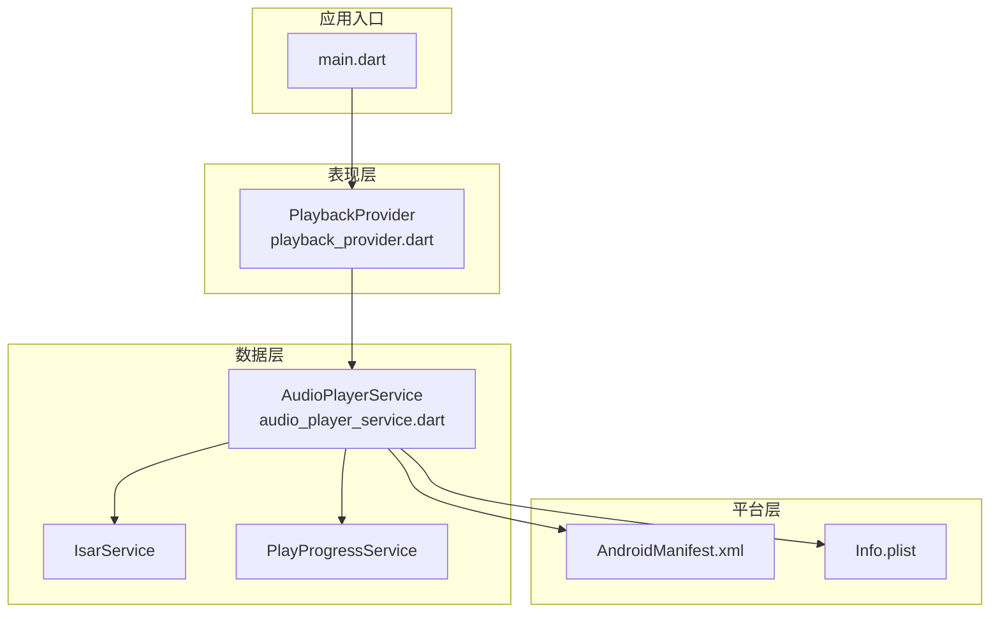
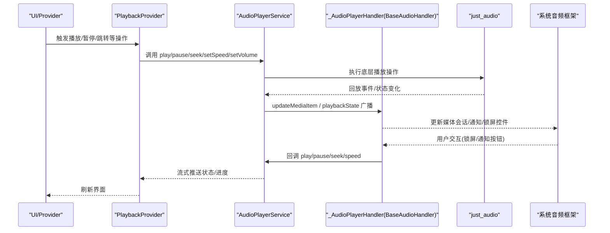
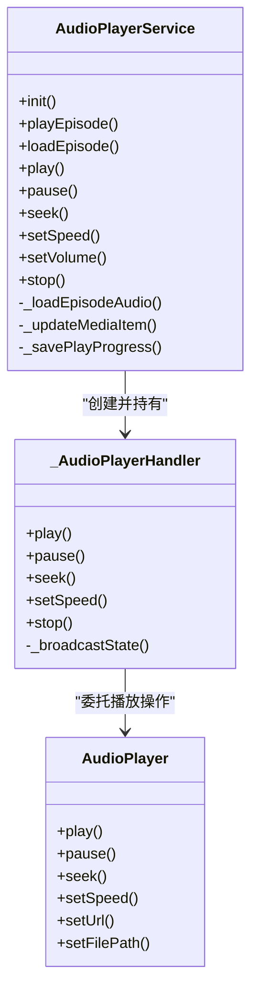
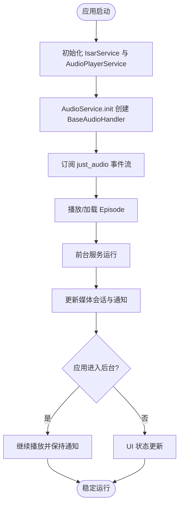
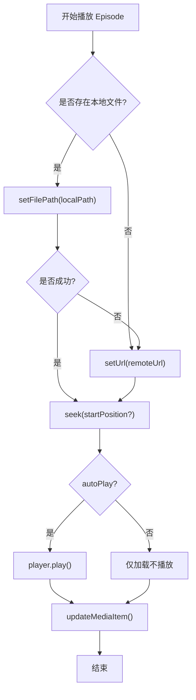
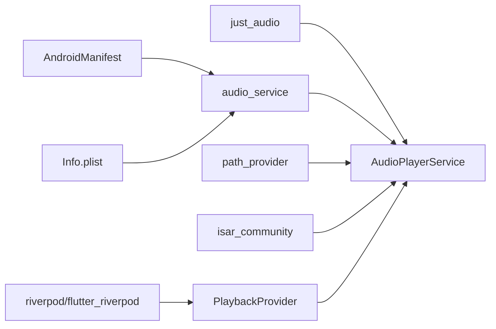

# 后台音频服务

<cite>
**本文引用的文件**   
- [audio_player_service.dart](file://lib/data/services/audio_player_service.dart)
- [playback_provider.dart](file://lib/presentation/providers/playback_provider.dart)
- [main.dart](file://lib/main.dart)
- [AndroidManifest.xml](file://android/app/src/main/AndroidManifest.xml)
- [Info.plist](file://ios/Runner/Info.plist)
- [pubspec.yaml](file://pubspec.yaml)
</cite>

## 目录
1. [简介](#简介)
2. [项目结构](#项目结构)
3. [核心组件](#核心组件)
4. [架构总览](#架构总览)
5. [详细组件分析](#详细组件分析)
6. [依赖关系分析](#依赖关系分析)
7. [性能考量](#性能考量)
8. [故障排查指南](#故障排查指南)
9. [结论](#结论)
10. [附录](#附录)

## 简介
本技术文档围绕后台音频服务的实现展开，重点解析 BaseAudioHandler 的集成机制、系统级音频控制、通知栏与锁屏控件、媒体会话管理、音频焦点处理、后台播放生命周期，以及 Android/iOS 平台差异与配置要求。同时提供错误处理与异常恢复策略、多平台兼容性方案、性能优化建议与调试技巧，并总结后台播放最佳实践与安全注意事项。

## 项目结构
本项目采用分层组织：数据层包含播放器服务与数据库访问；表现层通过 Riverpod Provider 管理播放状态；入口 main.dart 负责应用初始化与平台分支；平台侧分别通过 AndroidManifest.xml 与 Info.plist 声明后台音频能力与服务。

**图表来源** 
- [main.dart:106-194](file://lib/main.dart#L106-L194)
- [audio_player_service.dart:100-134](file://lib/data/services/audio_player_service.dart#L100-L134)
- [playback_provider.dart:84-101](file://lib/presentation/providers/playback_provider.dart#L84-L101)
- [AndroidManifest.xml:37-51](file://android/app/src/main/AndroidManifest.xml#L37-L51)
- [Info.plist:27-31](file://ios/Runner/Info.plist#L27-L31)

**章节来源**
- [main.dart:106-194](file://lib/main.dart#L106-L194)
- [pubspec.yaml:62-66](file://pubspec.yaml#L62-L66)

## 核心组件
- AudioPlayerService：封装 just_audio 播放器实例，暴露播放控制、进度、速度、音量等流式接口；集成 audio_service 的 BaseAudioHandler，负责媒体会话与通知更新；实现本地/网络音频路径选择与播放位置持久化。
- PlaybackProvider（Riverpod）：订阅 AudioPlayerService 的状态流，维护 UI 所需 PlayerState，处理自动保存进度、睡眠定时器、连续播放、队列管理与完成事件处理。
- 平台配置：Android 通过 Manifest 注册 AudioService 与 MediaButtonReceiver；iOS 通过 Info.plist 声明后台音频模式。

**章节来源**
- [audio_player_service.dart:31-134](file://lib/data/services/audio_player_service.dart#L31-L134)
- [playback_provider.dart:64-101](file://lib/presentation/providers/playback_provider.dart#L64-L101)
- [AndroidManifest.xml:37-51](file://android/app/src/main/AndroidManifest.xml#L37-L51)
- [Info.plist:27-31](file://ios/Runner/Info.plist#L27-L31)

## 架构总览
下图展示从 UI 到系统音频框架的调用链路与数据流向，涵盖 BaseAudioHandler 在系统中的角色。

**图表来源** 
- [audio_player_service.dart:107-134](file://lib/data/services/audio_player_service.dart#L107-L134)
- [audio_player_service.dart:586-652](file://lib/data/services/audio_player_service.dart#L586-L652)
- [playback_provider.dart:169-205](file://lib/presentation/providers/playback_provider.dart#L169-L205)

## 详细组件分析

### BaseAudioHandler 实现机制
- 继承 BaseAudioHandler 的 _AudioPlayerHandler 将 just_audio 的播放事件映射为系统媒体会话状态，包括 controls、systemActions、processingState、playing、updatePosition、bufferedPosition、speed、queueIndex 等。
- 关键方法：
  - play/pause/seek/setSpeed/stop：直接委托给 just_audio 的 AudioPlayer，并在 pause/seek 后触发进度保存回调。
  - _broadcastState：监听 PlaybackEvent，计算并广播当前播放状态，供通知栏与锁屏控件同步。
- 媒体项更新：_updateMediaItem 将 Episode 信息转换为 MediaItem，设置标题、作者、封面、时长等，驱动通知栏显示。

**图表来源** 
- [audio_player_service.dart:100-134](file://lib/data/services/audio_player_service.dart#L100-L134)
- [audio_player_service.dart:586-652](file://lib/data/services/audio_player_service.dart#L586-L652)

**章节来源**
- [audio_player_service.dart:586-652](file://lib/data/services/audio_player_service.dart#L586-L652)
- [audio_player_service.dart:326-343](file://lib/data/services/audio_player_service.dart#L326-L343)

### 系统级音频控制与通知栏管理
- Android：
  - 通过 AudioService.init 配置 androidNotificationChannelId、androidNotificationChannelName、androidNotificationOngoing、androidStopForegroundOnPause 等参数，确保前台服务与通知渠道正确。
  - Manifest 中声明 com.ryanheise.audioservice.AudioService 与 MediaButtonReceiver，启用媒体浏览服务与硬件按键响应。
- iOS：
  - Info.plist 中 UIBackgroundModes 包含 audio 与 fetch，允许后台音频播放与后台任务。
- 媒体会话：
  - 通过 updateMediaItem 更新通知内容，controls 与 systemActions 定义可用操作，androidCompactActionIndices 指定紧凑视图按钮顺序。

**章节来源**
- [audio_player_service.dart:107-134](file://lib/data/services/audio_player_service.dart#L107-L134)
- [AndroidManifest.xml:37-51](file://android/app/src/main/AndroidManifest.xml#L37-L51)
- [Info.plist:27-31](file://ios/Runner/Info.plist#L27-L31)
- [audio_player_service.dart:326-343](file://lib/data/services/audio_player_service.dart#L326-L343)

### 锁屏控件集成
- _AudioPlayerHandler 的 _broadcastState 设置 controls 列表（快退、播放/暂停、快进），并启用 seek、seekForward、seekBackward、setSpeed 等系统动作，使锁屏控件与通知栏一致。
- queueIndex 用于指示当前队列项，便于跨设备或系统媒体中心联动。

**章节来源**
- [audio_player_service.dart:620-651](file://lib/data/services/audio_player_service.dart#L620-L651)

### 媒体会话管理与音频焦点处理
- 媒体会话由 audio_service 统一抽象，BaseAudioHandler 负责将 just_audio 状态映射到系统会话。
- 音频焦点：audio_service 内部处理焦点请求与释放，配合前台服务类型 mediaPlayback 保证播放优先级。
- 播放完成：just_audio 触发 completed 事件，AudioPlayerService 发送 episodeCompletedStream，由 PlaybackProvider 处理后续逻辑（标记已播放、自动删除下载、刷新未播放列表、连续播放）。

**章节来源**
- [audio_player_service.dart:140-161](file://lib/data/services/audio_player_service.dart#L140-L161)
- [playback_provider.dart:216-265](file://lib/presentation/providers/playback_provider.dart#L216-L265)

### 后台播放的生命周期管理
- 应用启动：main.dart 初始化 IsarService 与 AudioPlayerService.instance.init()，建立 audio_service 与 just_audio 的桥接。
- 进入后台：audio_service 以前台服务运行，保持播放；通知栏持续显示媒体控制。
- 退出/销毁：AudioPlayerService.dispose 保存进度、取消订阅、释放播放器与控制器。

**图表来源** 
- [main.dart:179-194](file://lib/main.dart#L179-L194)
- [audio_player_service.dart:100-134](file://lib/data/services/audio_player_service.dart#L100-L134)

**章节来源**
- [main.dart:179-194](file://lib/main.dart#L179-L194)
- [audio_player_service.dart:560-583](file://lib/data/services/audio_player_service.dart#L560-L583)

### 播放状态与进度持久化
- 状态流：playbackStateStream、progressStream、speedStream、volumeStream、currentEpisodeStream、episodeCompletedStream 覆盖所有关键状态。
- 进度保存：_savePlayProgress 定期或触发式保存 positionMs 与 progressRatio，超过阈值时标记已播放；PlaybackProvider 每 10 秒自动保存，避免频繁 I/O。
- 恢复逻辑：应用重启后，PlaybackProvider 读取最近播放历史，尝试恢复 Episode 与位置，若本地文件存在则 loadEpisode，否则仅恢复 UI 状态。

**章节来源**
- [audio_player_service.dart:469-507](file://lib/data/services/audio_player_service.dart#L469-L507)
- [playback_provider.dart:361-411](file://lib/presentation/providers/playback_provider.dart#L361-L411)
- [playback_provider.dart:438-577](file://lib/presentation/providers/playback_provider.dart#L438-L577)

### 播放控制与算法流程
- 播放/暂停/停止：直接委托 just_audio，并在暂停/停止时保存进度。
- 跳转：seek/seekForward/seekBackward 边界检查，防止越界。
- 速度与音量：setSpeed/setVolume 更新播放器并广播新值。
- Episode 加载：优先本地文件，不存在则回退到远程 URL；支持 startPosition 与 autoPlay 控制。

**图表来源** 
- [audio_player_service.dart:192-300](file://lib/data/services/audio_player_service.dart#L192-L300)

**章节来源**
- [audio_player_service.dart:302-324](file://lib/data/services/audio_player_service.dart#L302-L324)
- [audio_player_service.dart:382-420](file://lib/data/services/audio_player_service.dart#L382-L420)
- [audio_player_service.dart:422-450](file://lib/data/services/audio_player_service.dart#L422-L450)

### 播放完成与连续播放
- 完成事件：just_audio 触发 completed，AudioPlayerService 发送 episodeCompletedStream。
- PlaybackProvider 处理：
  - 从队列移除已完成 Episode
  - 标记为已播放
  - 根据设置自动删除下载文件
  - 刷新未播放列表
  - 睡眠定时器优先于连续播放
  - 按设置自动播放下一集（队列优先，其次未播放列表）

**章节来源**
- [playback_provider.dart:216-265](file://lib/presentation/providers/playback_provider.dart#L216-L265)
- [playback_provider.dart:319-359](file://lib/presentation/providers/playback_provider.dart#L319-L359)

## 依赖关系分析
- 外部依赖：
  - just_audio：底层音频解码与播放
  - audio_service：后台播放、媒体会话、通知与锁屏控件
  - path_provider：获取应用支持/文档目录以定位本地音频
  - isar_community：本地数据库存储 Episode 与播放历史
  - riverpod/flutter_riverpod：状态管理与响应式 UI
- 平台依赖：
  - Android：AudioService、MediaButtonReceiver、foregroundServiceType=mediaPlayback
  - iOS：UIBackgroundModes.audio/fetch

**图表来源** 
- [pubspec.yaml:62-66](file://pubspec.yaml#L62-L66)
- [AndroidManifest.xml:37-51](file://android/app/src/main/AndroidManifest.xml#L37-L51)
- [Info.plist:27-31](file://ios/Runner/Info.plist#L27-L31)

**章节来源**
- [pubspec.yaml:62-66](file://pubspec.yaml#L62-L66)

## 性能考量
- 流式更新：使用 StreamController.broadcast 减少不必要的重建，仅在必要时推送状态。
- 进度保存节流：PlaybackProvider 每 10 秒或进度变化达到阈值才保存，降低 I/O 压力。
- 本地文件优先：优先 setFilePath 读取本地缓存，失败再回退网络，提升首开速度。
- 资源释放：dispose 中取消订阅、关闭控制器、释放播放器，避免内存泄漏。
- 前台服务：Android 使用 mediaPlayback 前台服务，避免被系统回收导致中断。

[本节为通用指导，无需引用具体文件]

## 故障排查指南
- 无法显示通知或锁屏控件：
  - 检查 AndroidManifest 中 AudioService 与 MediaButtonReceiver 声明是否正确。
  - 确认 AudioService.init 的 channelId 与 channelName 配置有效。
- 后台播放中断：
  - iOS 确认 UIBackgroundModes 包含 audio。
  - Android 确认 foregroundServiceType=mediaPlayback。
- 播放失败或无声音：
  - 检查本地文件路径是否存在，必要时回退到远程 URL。
  - 查看日志输出，确认 setUrl/setFilePath 是否抛出异常。
- 进度未保存或恢复失败：
  - 检查 PlayProgressService 写入是否成功。
  - 验证应用重启后恢复逻辑是否找到 Episode 与位置。

**章节来源**
- [AndroidManifest.xml:37-51](file://android/app/src/main/AndroidManifest.xml#L37-L51)
- [Info.plist:27-31](file://ios/Runner/Info.plist#L27-L31)
- [audio_player_service.dart:192-300](file://lib/data/services/audio_player_service.dart#L192-L300)
- [playback_provider.dart:438-577](file://lib/presentation/providers/playback_provider.dart#L438-L577)

## 结论
本项目通过 AudioPlayerService 与 BaseAudioHandler 的协作，实现了稳定的后台音频播放、媒体会话管理与跨平台通知/锁屏控件集成。PlaybackProvider 以 Riverpod 为核心，提供响应式状态管理与完善的业务逻辑（进度持久化、睡眠定时器、连续播放、队列处理）。平台配置简洁明确，错误处理与资源释放完善，具备良好可维护性与扩展性。

[本节为总结，无需引用具体文件]

## 附录

### 平台配置示例
- Android 通知渠道与权限：
  - 在 AudioService.init 中设置 androidNotificationChannelId、androidNotificationChannelName、androidNotificationOngoing、androidStopForegroundOnPause。
  - 在 Manifest 中声明 AudioService 与 MediaButtonReceiver，设置 exported=true 与 intent-filter。
- iOS 后台模式：
  - 在 Info.plist 中添加 UIBackgroundModes 数组，包含 audio 与 fetch。
- 图标资源与手势控制：
  - 通过 MediaItem.artUri 设置封面图，controls 与 systemActions 定义可用手势与按钮。

**章节来源**
- [audio_player_service.dart:107-134](file://lib/data/services/audio_player_service.dart#L107-L134)
- [AndroidManifest.xml:37-51](file://android/app/src/main/AndroidManifest.xml#L37-L51)
- [Info.plist:27-31](file://ios/Runner/Info.plist#L27-L31)
- [audio_player_service.dart:326-343](file://lib/data/services/audio_player_service.dart#L326-L343)

### 与系统音频框架的交互方式
- Android：AudioService 作为 MediaBrowserService 的前台服务，接收系统媒体命令并更新通知与锁屏控件。
- iOS：AVAudioSession 与 AVPlayer 由 audio_service 封装，后台模式由 UIBackgroundModes 控制。
- 媒体会话：BaseAudioHandler 将 just_audio 状态映射为系统会话，确保跨设备一致性。

**章节来源**
- [AndroidManifest.xml:37-51](file://android/app/src/main/AndroidManifest.xml#L37-L51)
- [Info.plist:27-31](file://ios/Runner/Info.plist#L27-L31)
- [audio_player_service.dart:620-651](file://lib/data/services/audio_player_service.dart#L620-L651)

### 错误处理与异常恢复机制
- 加载失败：捕获异常并重置播放器状态，清理当前 Episode 与控制器。
- 进度保存失败：记录日志但不中断主流程，下次触发时重试。
- 恢复失败：清除状态并保留 UI 显示，避免崩溃。

**章节来源**
- [audio_player_service.dart:282-299](file://lib/data/services/audio_player_service.dart#L282-L299)
- [audio_player_service.dart:500-507](file://lib/data/services/audio_player_service.dart#L500-L507)
- [playback_provider.dart:556-577](file://lib/presentation/providers/playback_provider.dart#L556-L577)

### 多平台兼容性解决方案
- 移动端与桌面端分支：main.dart 中检测 Platform.isIOS/Android，跳过窗口管理相关初始化，直接运行移动端 UI。
- 路径兼容：_findLocalAudioPath 优先应用支持目录，回退到文档目录以兼容旧版本下载文件。

**章节来源**
- [main.dart:106-114](file://lib/main.dart#L106-L114)
- [audio_player_service.dart:509-538](file://lib/data/services/audio_player_service.dart#L509-L538)

### 性能优化建议
- 减少重复初始化：AudioPlayerService 单例模式避免多次 init。
- 节流保存：PlaybackProvider 定时与阈值双重条件触发保存。
- 本地优先：优先本地文件播放，降低网络延迟。
- 资源释放：dispose 中全面清理订阅与控制器。

**章节来源**
- [audio_player_service.dart:31-36](file://lib/data/services/audio_player_service.dart#L31-L36)
- [playback_provider.dart:361-411](file://lib/presentation/providers/playback_provider.dart#L361-L411)
- [audio_player_service.dart:560-583](file://lib/data/services/audio_player_service.dart#L560-L583)

### 调试技巧
- 启用详细日志：AudioPlayerService 与 PlaybackProvider 均输出关键步骤日志，便于定位问题。
- 检查系统会话：通过系统媒体中心查看通知与锁屏控件是否正常。
- 验证路径：打印本地文件路径与存在性，确认回退逻辑生效。

**章节来源**
- [audio_player_service.dart:199-228](file://lib/data/services/audio_player_service.dart#L199-L228)
- [playback_provider.dart:544-558](file://lib/presentation/providers/playback_provider.dart#L544-L558)

### 后台播放最佳实践与安全考虑
- 最佳实践：
  - 始终在前台服务中播放，确保稳定性。
  - 合理设置通知内容与控件，提升用户体验。
  - 及时保存进度，支持断点续播。
- 安全考虑：
  - 避免硬编码敏感信息，使用环境变量或配置文件。
  - 谨慎处理用户输入与网络地址，防止注入攻击。
  - 保护本地文件路径与权限，避免越权访问。

[本节为通用指导，无需引用具体文件]