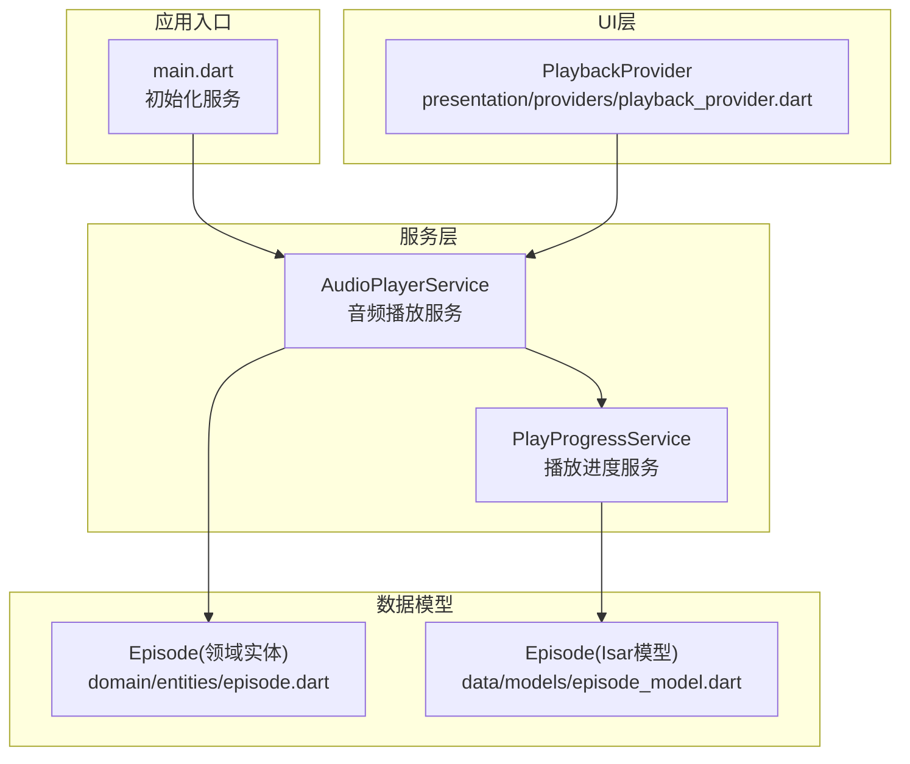
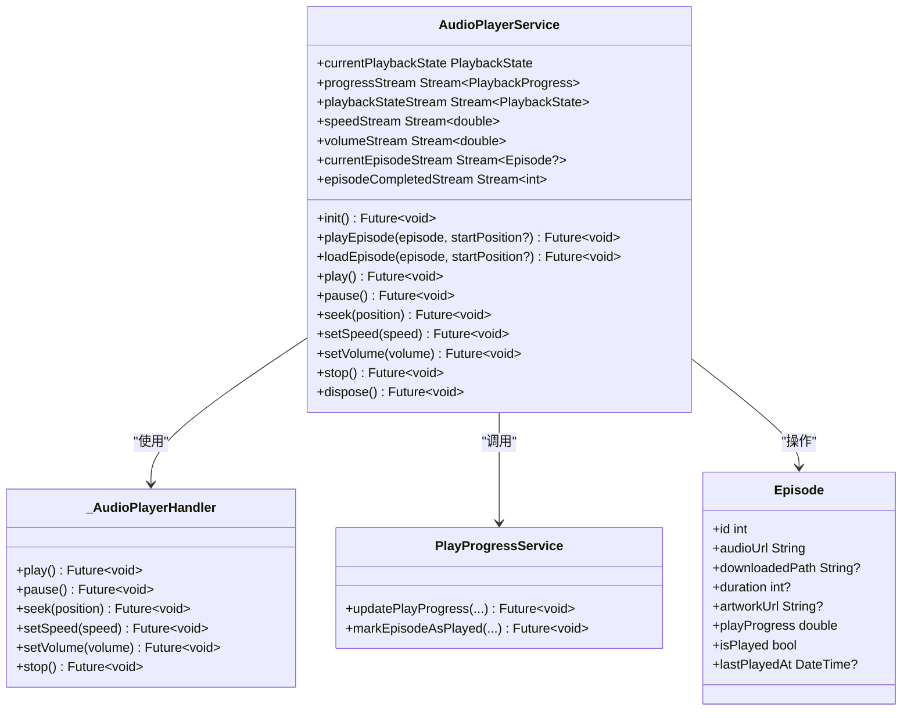
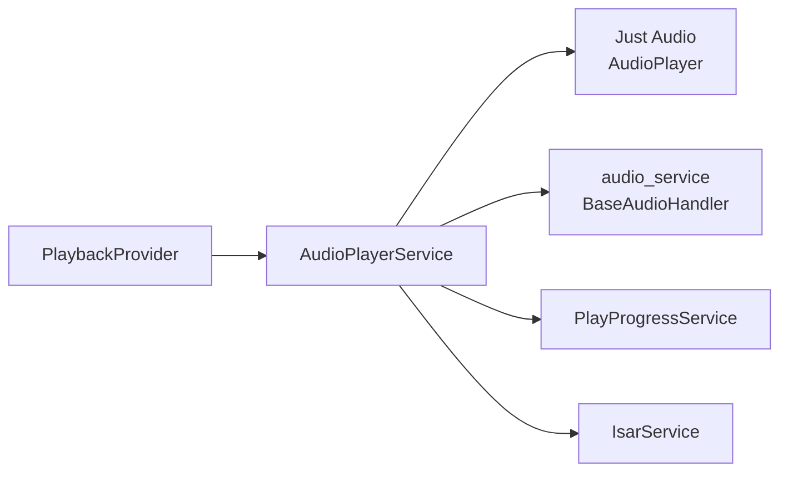

# 播放器核心服务

<cite>
**本文引用的文件**
- [audio_player_service.dart](file://lib/data/services/audio_player_service.dart)
- [play_progress_service.dart](file://lib/core/services/play_progress_service.dart)
- [episode_model.dart](file://lib/data/models/episode_model.dart)
- [episode.dart](file://lib/domain/entities/episode.dart)
- [main.dart](file://lib/main.dart)
- [playback_provider.dart](file://lib/presentation/providers/playback_provider.dart)
</cite>

## 目录
1. [简介](#简介)
2. [项目结构](#项目结构)
3. [核心组件](#核心组件)
4. [架构总览](#架构总览)
5. [详细组件分析](#详细组件分析)
6. [依赖关系分析](#依赖关系分析)
7. [性能考量](#性能考量)
8. [故障排查指南](#故障排查指南)
9. [结论](#结论)
10. [附录：使用示例与最佳实践](#附录使用示例与最佳实践)

## 简介
本技术文档围绕 AudioPlayerService 展开，系统性阐述其单例模式实现、Just Audio 集成、播放状态管理、本地与网络音频加载策略、错误处理与内存管理、Stream 事件监听机制以及播放进度持久化逻辑。同时提供 playEpisode、loadEpisode、play、pause、seek 等核心方法的实现要点与参数说明，并给出常见使用场景的最佳实践建议。

## 项目结构
AudioPlayerService 位于数据服务层，负责封装 Just Audio 的底层能力，并通过 audio_service 暴露后台播放与媒体通知能力；播放进度通过 PlayProgressService 持久化到 Isar 数据库；UI 层通过 Provider 订阅播放状态与进度流。

图表来源
- [main.dart:181](file://lib/main.dart#L181)
- [audio_player_service.dart:31-134](file://lib/data/services/audio_player_service.dart#L31-L134)
- [play_progress_service.dart:8-42](file://lib/core/services/play_progress_service.dart#L8-L42)
- [episode_model.dart:1-66](file://lib/data/models/episode_model.dart#L1-L66)
- [episode.dart:1-66](file://lib/domain/entities/episode.dart#L1-L66)
- [playback_provider.dart:72](file://lib/presentation/providers/playback_provider.dart#L72)

章节来源
- [main.dart:181](file://lib/main.dart#L181)
- [audio_player_service.dart:31-134](file://lib/data/services/audio_player_service.dart#L31-L134)

## 核心组件
- AudioPlayerService：单例音频播放服务，封装 Just Audio 与 audio_service，提供播放控制、状态与进度广播、媒体项更新、播放完成事件、本地/网络音频加载策略与错误恢复。
- PlayProgressService：播放进度持久化服务，统一更新播放历史与 Episode 缓存字段（如 isPlayed、playProgress、lastPlayedAt）。
- Episode 模型：领域实体与 Isar 模型分别承载业务属性与持久化字段，包含音频地址、下载路径、播放进度、封面等信息。
- PlaybackProvider：UI 状态提供者，订阅 AudioPlayerService 的 Stream，驱动 UI 刷新。

章节来源
- [audio_player_service.dart:31-134](file://lib/data/services/audio_player_service.dart#L31-L134)
- [play_progress_service.dart:8-42](file://lib/core/services/play_progress_service.dart#L8-L42)
- [episode_model.dart:1-66](file://lib/data/models/episode_model.dart#L1-L66)
- [episode.dart:1-66](file://lib/domain/entities/episode.dart#L1-L66)
- [playback_provider.dart:72](file://lib/presentation/providers/playback_provider.dart#L72)

## 架构总览
AudioPlayerService 采用单例模式，内部持有 Just Audio 的 AudioPlayer 实例，并通过多个 StreamController 对外暴露播放状态、进度、速度、音量、当前剧集与播放完成事件。初始化时创建 audio_service 的 AudioHandler，用于系统级媒体控制与通知。

图表来源
- [audio_player_service.dart:31-134](file://lib/data/services/audio_player_service.dart#L31-L134)
- [audio_player_service.dart:586-652](file://lib/data/services/audio_player_service.dart#L586-L652)
- [play_progress_service.dart:8-42](file://lib/core/services/play_progress_service.dart#L8-L42)
- [episode.dart:1-66](file://lib/domain/entities/episode.dart#L1-L66)

## 详细组件分析

### 单例模式与初始化流程
- 单例：通过私有构造函数与静态实例保证全局唯一性。
- 初始化：
  - 调用 AudioService.init 创建后台处理器与配置（Android 通知通道、前台服务等）。
  - 订阅 Just Audio 的 playbackEventStream、playerStateStream、positionStream，用于状态与进度更新。
  - 设置默认音量并广播初始值。
  - 异常捕获与日志记录，失败时抛出以便上层处理。

章节来源
- [audio_player_service.dart:31-36](file://lib/data/services/audio_player_service.dart#L31-L36)
- [audio_player_service.dart:100-134](file://lib/data/services/audio_player_service.dart#L100-L134)

### 播放状态管理机制
- 状态枚举：stopped、playing、paused、buffering。
- 状态推导：基于 _player.playing 与 processingState 计算当前状态，并通过 StreamController 广播。
- 播放完成：当 processingState 为 completed 时触发 _onPlaybackCompleted，仅发送 episodeCompletedStream，具体业务由上层 Provider 处理。

章节来源
- [audio_player_service.dart:12](file://lib/data/services/audio_player_service.dart#L12)
- [audio_player_service.dart:79-88](file://lib/data/services/audio_player_service.dart#L79-L88)
- [audio_player_service.dart:140-161](file://lib/data/services/audio_player_service.dart#L140-L161)

### 播放进度与 Stream 事件
- 进度对象：PlaybackProgress 包含 position、duration、bufferedPosition，并提供 progressRatio 计算。
- 事件监听：
  - playbackEventStream → 更新进度。
  - playerStateStream → 更新状态与播放完成事件。
  - positionStream → 定期更新进度。
- 进度保存：在 pause、seek、stop 等操作后调用 _savePlayProgress，将位置与比例写入 PlayProgressService，并在达到阈值时标记已播放。

章节来源
- [audio_player_service.dart:14-29](file://lib/data/services/audio_player_service.dart#L14-L29)
- [audio_player_service.dart:117-123](file://lib/data/services/audio_player_service.dart#L117-L123)
- [audio_player_service.dart:163-173](file://lib/data/services/audio_player_service.dart#L163-L173)
- [audio_player_service.dart:359-391](file://lib/data/services/audio_player_service.dart#L359-L391)
- [audio_player_service.dart:469-507](file://lib/data/services/audio_player_service.dart#L469-L507)

### 本地与网络音频加载策略
- 优先本地：若 episode.downloadedPath 存在，尝试在应用支持目录或文档目录查找本地文件。
- 回退网络：本地文件不存在或 setFilePath 失败时，回退到 episode.audioUrl。
- URL 类型判断：http/https 走 setUrl，本地路径走 setFilePath。
- 启动前停止：加载新音频前先 stop 当前播放，避免状态不一致。

章节来源
- [audio_player_service.dart:192-300](file://lib/data/services/audio_player_service.dart#L192-L300)
- [audio_player_service.dart:509-538](file://lib/data/services/audio_player_service.dart#L509-L538)

### 核心方法详解
- playEpisode(episode, startPosition?)
  - 自动播放并更新 lastPlayedAt，调用内部 _loadEpisodeAudio(autoPlay=true, updateLastPlayedAt=true)。
- loadEpisode(episode, startPosition?)
  - 仅加载不自动播放，且不更新时间戳（autoPlay=false, updateLastPlayedAt=false）。
- play()/pause()/seek()
  - 直接委托给 Just Audio 的 AudioPlayer，并在暂停与跳转后保存进度。
- seekForward/seekBackward
  - 以固定时长快进/快退，边界检查防止越界。
- setSpeed/setVolume
  - 设置速度与音量，并广播新值。
- stop
  - 保存进度、停止播放、清空当前剧集并广播空值。

章节来源
- [audio_player_service.dart:302-324](file://lib/data/services/audio_player_service.dart#L302-L324)
- [audio_player_service.dart:345-467](file://lib/data/services/audio_player_service.dart#L345-L467)

### 与 Just Audio 和 audio_service 的集成
- Just Audio：通过 AudioPlayer 实例进行音频源设置、播放控制与状态监听。
- audio_service：通过 BaseAudioHandler 子类暴露系统媒体控制，同步播放状态、进度、缓冲、速度与队列索引。

章节来源
- [audio_player_service.dart:107-115](file://lib/data/services/audio_player_service.dart#L107-L115)
- [audio_player_service.dart:586-652](file://lib/data/services/audio_player_service.dart#L586-L652)

### 播放完成与业务解耦
- 播放完成事件仅广播 episodeCompletedStream，不包含业务逻辑，由上层 Provider 决定下一集或队列行为。

章节来源
- [audio_player_service.dart:144-161](file://lib/data/services/audio_player_service.dart#L144-L161)

### 播放进度持久化逻辑
- _savePlayProgress：
  - 计算进度比例与毫秒位置。
  - 调用 PlayProgressService.updatePlayProgress 更新历史记录与 Episode 缓存。
  - 当进度≥0.95 时调用 markEpisodeAsPlayed 标记已播放。
- PlayProgressService：
  - 更新播放历史并同步 Episode 的 isPlayed、playProgress、lastPlayedAt。

章节来源
- [audio_player_service.dart:469-507](file://lib/data/services/audio_player_service.dart#L469-L507)
- [play_progress_service.dart:17-42](file://lib/core/services/play_progress_service.dart#L17-L42)
- [play_progress_service.dart:44-70](file://lib/core/services/play_progress_service.dart#L44-L70)
- [play_progress_service.dart:106-144](file://lib/core/services/play_progress_service.dart#L106-L144)

### 错误处理与内存管理
- 错误处理：
  - 初始化、播放、暂停、跳转、速度/音量设置均 try-catch 并记录日志，必要时 rethrow。
  - 加载失败时重置播放器状态与当前剧集，确保后续可用。
- 内存管理：
  - dispose 中取消所有 StreamSubscription，释放 AudioPlayer 与 StreamController。
  - 停止播放与清理资源避免泄漏。

章节来源
- [audio_player_service.dart:100-134](file://lib/data/services/audio_player_service.dart#L100-L134)
- [audio_player_service.dart:282-300](file://lib/data/services/audio_player_service.dart#L282-L300)
- [audio_player_service.dart:560-583](file://lib/data/services/audio_player_service.dart#L560-L583)

## 依赖关系分析
AudioPlayerService 依赖 Just Audio 与 audio_service，通过 PlayProgressService 与 Isar 交互，UI 层通过 Provider 订阅其 Stream。

图表来源
- [audio_player_service.dart:31-134](file://lib/data/services/audio_player_service.dart#L31-L134)
- [play_progress_service.dart:8-42](file://lib/core/services/play_progress_service.dart#L8-L42)
- [playback_provider.dart:72](file://lib/presentation/providers/playback_provider.dart#L72)

章节来源
- [audio_player_service.dart:31-134](file://lib/data/services/audio_player_service.dart#L31-L134)
- [play_progress_service.dart:8-42](file://lib/core/services/play_progress_service.dart#L8-L42)
- [playback_provider.dart:72](file://lib/presentation/providers/playback_provider.dart#L72)

## 性能考量
- 本地优先策略减少网络请求与缓冲时间。
- 仅在必要时机保存进度（暂停、跳转、停止），避免频繁 I/O。
- 使用 broadcast Stream 降低订阅者开销，避免重复计算。
- dispose 及时释放资源，防止内存泄漏。

[本节为通用指导，无需引用具体文件]

## 故障排查指南
- 初始化失败：检查 AudioService 配置与权限，查看日志输出。
- 无法播放本地文件：确认 downloadedPath 是否存在于支持目录或文档目录，必要时回退网络 URL。
- 进度未保存：确认 pause/seek/stop 是否被调用，检查 PlayProgressService 是否成功写入。
- 播放完成后无动作：确认上层 Provider 是否订阅 episodeCompletedStream 并处理业务逻辑。

章节来源
- [audio_player_service.dart:100-134](file://lib/data/services/audio_player_service.dart#L100-L134)
- [audio_player_service.dart:509-538](file://lib/data/services/audio_player_service.dart#L509-L538)
- [audio_player_service.dart:469-507](file://lib/data/services/audio_player_service.dart#L469-L507)
- [audio_player_service.dart:144-161](file://lib/data/services/audio_player_service.dart#L144-L161)

## 结论
AudioPlayerService 以单例模式为核心，结合 Just Audio 与 audio_service 实现了稳定可靠的音频播放能力。通过清晰的 Stream 事件与播放状态管理，配合 PlayProgressService 的持久化机制，提供了良好的用户体验与可维护性。建议在 UI 层通过 Provider 订阅相关流，合理处理播放完成事件与错误恢复，以获得最佳体验。

[本节为总结，无需引用具体文件]

## 附录：使用示例与最佳实践

### 初始化与服务获取
- 在应用启动时调用 AudioPlayerService.instance.init() 完成初始化。
- 通过 AudioPlayerService.instance 获取单例服务。

章节来源
- [main.dart:181](file://lib/main.dart#L181)
- [audio_player_service.dart:31-36](file://lib/data/services/audio_player_service.dart#L31-L36)

### 播放与加载
- 播放某集：调用 playEpisode(episode, startPosition?)，自动播放并更新时间戳。
- 预加载某集：调用 loadEpisode(episode, startPosition?)，仅加载不自动播放。

章节来源
- [audio_player_service.dart:302-324](file://lib/data/services/audio_player_service.dart#L302-L324)

### 播放控制
- 播放/暂停：play()/pause()，或在 togglePlayPause() 中切换。
- 跳转：seek(Duration)，支持前进后退快捷方法。
- 速度与音量：setSpeed(double)、setVolume(double)，并订阅对应 Stream。

章节来源
- [audio_player_service.dart:345-467](file://lib/data/services/audio_player_service.dart#L345-L467)

### 订阅播放状态与进度
- 订阅 playbackStateStream、progressStream、speedStream、volumeStream、currentEpisodeStream、episodeCompletedStream。
- 根据状态更新 UI，根据进度绘制进度条，根据速度/音量更新控件。

章节来源
- [audio_player_service.dart:65-77](file://lib/data/services/audio_player_service.dart#L65-L77)
- [playback_provider.dart:72](file://lib/presentation/providers/playback_provider.dart#L72)

### 播放完成处理
- 订阅 episodeCompletedStream，在上层 Provider 中实现“标记已播放”“自动下一集”等业务逻辑。

章节来源
- [audio_player_service.dart:144-161](file://lib/data/services/audio_player_service.dart#L144-L161)

### 最佳实践建议
- 始终在加载新音频前停止当前播放，避免状态冲突。
- 优先使用本地文件路径，若无则回退网络 URL。
- 在关键操作（暂停、跳转、停止）后保存进度，确保用户下次进入能恢复。
- 对可能失败的异步操作添加 try-catch 与日志，便于定位问题。
- 在应用退出或页面销毁时调用 dispose，释放资源。

章节来源
- [audio_player_service.dart:192-300](file://lib/data/services/audio_player_service.dart#L192-L300)
- [audio_player_service.dart:469-507](file://lib/data/services/audio_player_service.dart#L469-L507)
- [audio_player_service.dart:560-583](file://lib/data/services/audio_player_service.dart#L560-L583)