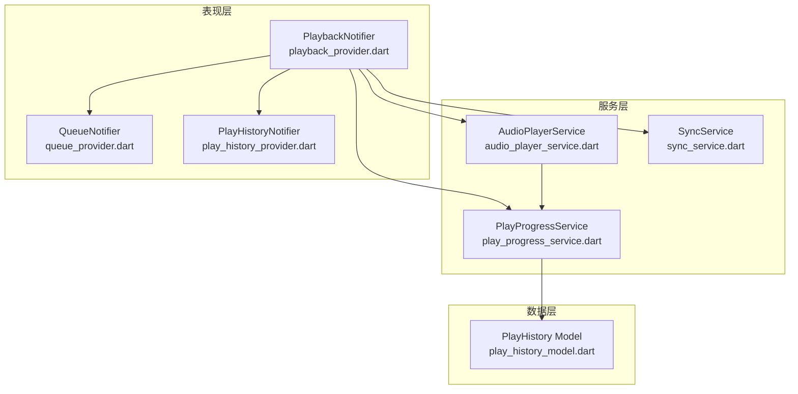
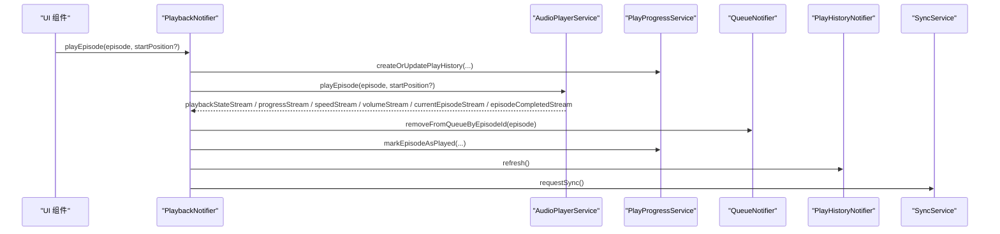
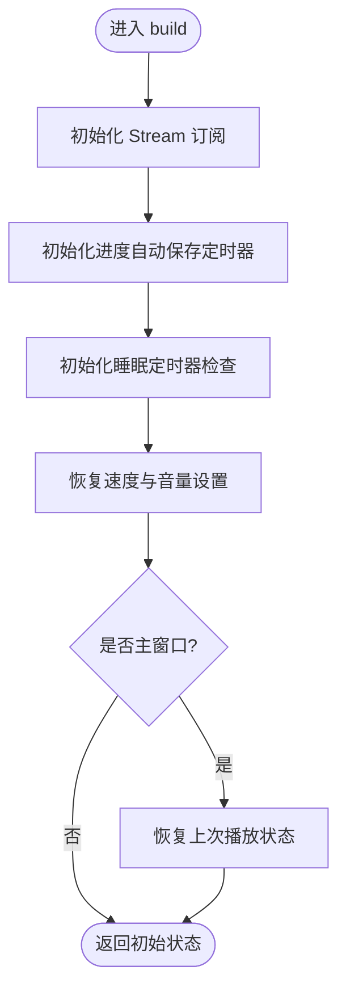
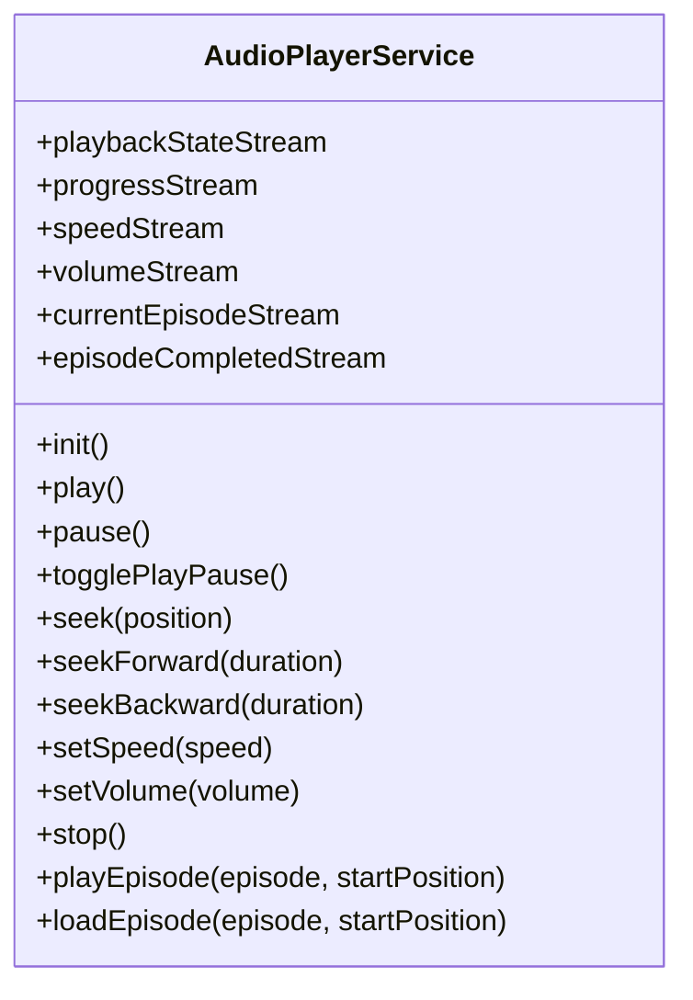
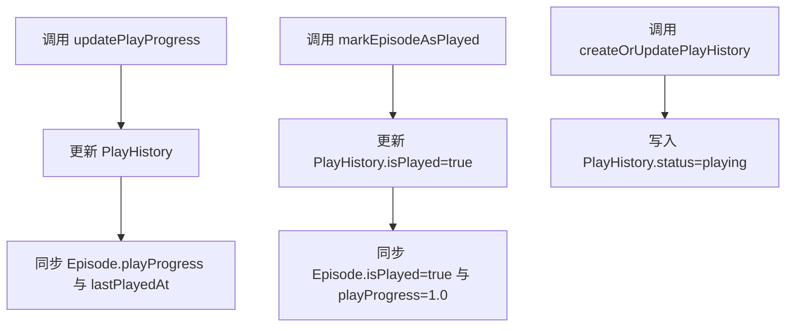
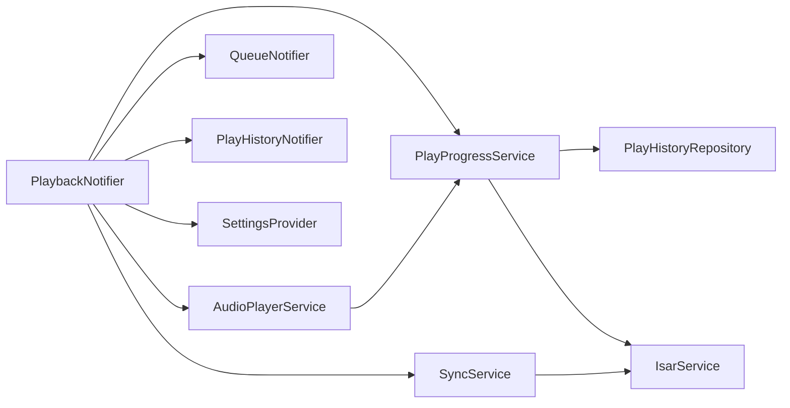

# 播放状态管理

<cite>
**本文引用的文件**   
- [lib/presentation/providers/playback_provider.dart](file://lib/presentation/providers/playback_provider.dart)
- [lib/data/services/audio_player_service.dart](file://lib/data/services/audio_player_service.dart)
- [lib/core/services/play_progress_service.dart](file://lib/core/services/play_progress_service.dart)
- [lib/presentation/providers/play_history_provider.dart](file://lib/presentation/providers/play_history_provider.dart)
- [lib/presentation/providers/queue_provider.dart](file://lib/presentation/providers/queue_provider.dart)
- [lib/data/models/play_history_model.dart](file://lib/data/models/play_history_model.dart)
- [lib/core/services/sync_service.dart](file://lib/core/services/sync_service.dart)
</cite>

## 目录
1. [简介](#简介)
2. [项目结构](#项目结构)
3. [核心组件](#核心组件)
4. [架构总览](#架构总览)
5. [详细组件分析](#详细组件分析)
6. [依赖关系分析](#依赖关系分析)
7. [性能考量](#性能考量)
8. [故障排查指南](#故障排查指南)
9. [结论](#结论)
10. [附录](#附录)

## 简介
本文件围绕 PlaybackProvider 的状态管理进行系统化说明，重点覆盖：
- 基于 Riverpod 的响应式状态更新机制与 Stream 订阅生命周期
- 播放状态枚举（stopped、playing、paused、buffering）的定义与使用场景
- 播放队列管理、当前剧集跟踪、播放历史记录的维护逻辑
- 与 AudioPlayerService 的交互方式、状态持久化机制与同步策略
- UI 层订阅播放状态的 Provider 使用示例
- 性能优化策略与常见问题解决方案

## 项目结构
播放状态管理涉及 Presentation 层的 Provider、Data 层的 Service/Repository、Domain 层的实体模型以及跨层的数据同步。关键文件如下：
- 播放状态与流程编排：PlaybackNotifier（playback_provider.dart）
- 音频引擎与事件流：AudioPlayerService（audio_player_service.dart）
- 播放进度与历史记录服务：PlayProgressService（play_progress_service.dart）
- 播放历史列表与查询：PlayHistoryProvider（play_history_provider.dart）
- 播放队列：QueueProvider（queue_provider.dart）
- 播放历史数据模型：PlayHistory（play_history_model.dart）
- 云端同步：SyncService（sync_service.dart）

图表来源
- [lib/presentation/providers/playback_provider.dart:64-214](file://lib/presentation/providers/playback_provider.dart#L64-L214)
- [lib/data/services/audio_player_service.dart:31-134](file://lib/data/services/audio_player_service.dart#L31-L134)
- [lib/core/services/play_progress_service.dart:8-42](file://lib/core/services/play_progress_service.dart#L8-L42)
- [lib/presentation/providers/play_history_provider.dart:10-50](file://lib/presentation/providers/play_history_provider.dart#L10-L50)
- [lib/presentation/providers/queue_provider.dart:78-137](file://lib/presentation/providers/queue_provider.dart#L78-L137)
- [lib/data/models/play_history_model.dart:1-51](file://lib/data/models/play_history_model.dart#L1-L51)
- [lib/core/services/sync_service.dart:512-537](file://lib/core/services/sync_service.dart#L512-L537)

章节来源
- [lib/presentation/providers/playback_provider.dart:64-214](file://lib/presentation/providers/playback_provider.dart#L64-L214)
- [lib/data/services/audio_player_service.dart:31-134](file://lib/data/services/audio_player_service.dart#L31-L134)
- [lib/core/services/play_progress_service.dart:8-42](file://lib/core/services/play_progress_service.dart#L8-L42)
- [lib/presentation/providers/play_history_provider.dart:10-50](file://lib/presentation/providers/play_history_provider.dart#L10-L50)
- [lib/presentation/providers/queue_provider.dart:78-137](file://lib/presentation/providers/queue_provider.dart#L78-L137)
- [lib/data/models/play_history_model.dart:1-51](file://lib/data/models/play_history_model.dart#L1-L51)
- [lib/core/services/sync_service.dart:512-537](file://lib/core/services/sync_service.dart#L512-L537)

## 核心组件
- PlayerState：播放器状态载体，包含当前剧集、是否播放、当前位置、总时长、速度与音量等字段，并提供 progressRatio 计算。
- PlaybackNotifier：基于 Notifier<PlayerState> 的核心状态管理器，负责订阅 AudioPlayerService 的多条 Stream，统一更新 UI 状态，并协调播放历史、队列与设置。
- AudioPlayerService：封装 just_audio 与 audio_service，提供播放控制、进度与状态广播、媒体项更新、后台任务桥接。
- PlayProgressService：统一处理播放进度与播放历史的持久化，并在需要时同步 Episode 缓存字段。
- PlayHistoryProvider：维护已完成播放历史列表，支持刷新与本地标记完成。
- QueueProvider：维护播放队列，支持增删改查与按剧集 ID 移除。
- PlayHistory 模型：Isar 集合，记录播放进度、是否已播、状态、时间戳等。
- SyncService：负责将本地播放历史与云端数据进行合并与冲突解决。

章节来源
- [lib/presentation/providers/playback_provider.dart:23-62](file://lib/presentation/providers/playback_provider.dart#L23-L62)
- [lib/presentation/providers/playback_provider.dart:64-214](file://lib/presentation/providers/playback_provider.dart#L64-L214)
- [lib/data/services/audio_player_service.dart:31-134](file://lib/data/services/audio_player_service.dart#L31-L134)
- [lib/core/services/play_progress_service.dart:8-42](file://lib/core/services/play_progress_service.dart#L8-L42)
- [lib/presentation/providers/play_history_provider.dart:10-50](file://lib/presentation/providers/play_history_provider.dart#L10-L50)
- [lib/presentation/providers/queue_provider.dart:78-137](file://lib/presentation/providers/queue_provider.dart#L78-L137)
- [lib/data/models/play_history_model.dart:1-51](file://lib/data/models/play_history_model.dart#L1-L51)

## 架构总览
PlaybackProvider 通过 Riverpod 的 Notifier 暴露响应式状态，订阅 AudioPlayerService 的多个 Stream，实现播放状态、进度、速度、音量、当前剧集与播放完成的实时同步。播放完成后，自动清理队列、标记已播、触发未播放列表刷新、根据设置决定是否连续播放下一集。播放进度以定时器与阈值策略持久化到 PlayHistory，并通过 PlayProgressService 同步 Episode 缓存。

图表来源
- [lib/presentation/providers/playback_provider.dart:583-607](file://lib/presentation/providers/playback_provider.dart#L583-L607)
- [lib/presentation/providers/playback_provider.dart:216-265](file://lib/presentation/providers/playback_provider.dart#L216-L265)
- [lib/data/services/audio_player_service.dart:302-324](file://lib/data/services/audio_player_service.dart#L302-L324)
- [lib/core/services/play_progress_service.dart:72-104](file://lib/core/services/play_progress_service.dart#L72-L104)
- [lib/presentation/providers/queue_provider.dart:210-233](file://lib/presentation/providers/queue_provider.dart#L210-L233)
- [lib/presentation/providers/play_history_provider.dart:23-25](file://lib/presentation/providers/play_history_provider.dart#L23-L25)
- [lib/core/services/sync_service.dart:512-537](file://lib/core/services/sync_service.dart#L512-L537)

## 详细组件分析

### PlaybackNotifier（播放状态与流程编排）
- 状态结构：PlayerState 包含 currentEpisode、isPlaying、currentPosition、duration、speed、volume，并提供 progressRatio 计算。
- Stream 订阅：在 build 中初始化并订阅 playbackStateStream、progressStream、speedStream、volumeStream、currentEpisodeStream、episodeCompletedStream；在 dispose 中取消订阅。
- 自动保存进度：每 10 秒检查一次，满足时间或进度阈值条件时调用 _saveCurrentProgress。
- 播放完成处理：移除队列中的已播剧集、标记为已播、可选自动删除下载文件、刷新未播放列表、睡眠定时器优先于连续播放、否则自动播放下一集（优先队列，其次未播放列表）。
- 恢复上次播放：应用启动时从 PlayHistory 获取最新记录，构造 Episode 并尝试加载音频；若本地文件不存在且无远程 URL，则仅恢复 UI 状态。
- 设置恢复：从 SettingsService 恢复速度与音量。
- 同步请求：在暂停、停止、标记完成等时机触发 SyncService.requestSync。

图表来源
- [lib/presentation/providers/playback_provider.dart:84-101](file://lib/presentation/providers/playback_provider.dart#L84-L101)
- [lib/presentation/providers/playback_provider.dart:103-118](file://lib/presentation/providers/playback_provider.dart#L103-L118)
- [lib/presentation/providers/playback_provider.dart:151-167](file://lib/presentation/providers/playback_provider.dart#L151-L167)
- [lib/presentation/providers/playback_provider.dart:438-577](file://lib/presentation/providers/playback_provider.dart#L438-L577)

章节来源
- [lib/presentation/providers/playback_provider.dart:23-62](file://lib/presentation/providers/playback_provider.dart#L23-L62)
- [lib/presentation/providers/playback_provider.dart:64-214](file://lib/presentation/providers/playback_provider.dart#L64-L214)
- [lib/presentation/providers/playback_provider.dart:216-359](file://lib/presentation/providers/playback_provider.dart#L216-L359)
- [lib/presentation/providers/playback_provider.dart:361-431](file://lib/presentation/providers/playback_provider.dart#L361-L431)
- [lib/presentation/providers/playback_provider.dart:438-577](file://lib/presentation/providers/playback_provider.dart#L438-L577)
- [lib/presentation/providers/playback_provider.dart:583-607](file://lib/presentation/providers/playback_provider.dart#L583-L607)

### AudioPlayerService（音频引擎与事件流）
- 播放状态枚举：PlaybackState 包含 stopped、playing、paused、buffering，由底层播放器状态推导。
- 事件流：提供 playbackStateStream、progressStream、speedStream、volumeStream、currentEpisodeStream、episodeCompletedStream。
- 播放控制：play、pause、togglePlayPause、seek、seekForward、seekBackward、setSpeed、setVolume、stop。
- 播放完成：当 ProcessingState.completed 时发送 episodeCompletedStream，业务逻辑交由 PlaybackNotifier 处理。
- 媒体项更新：updateMediaItem 用于系统通知栏展示。
- 进度保存：_savePlayProgress 定期保存进度，超过阈值标记为已播。

图表来源
- [lib/data/services/audio_player_service.dart:31-134](file://lib/data/services/audio_player_service.dart#L31-L134)
- [lib/data/services/audio_player_service.dart:136-190](file://lib/data/services/audio_player_service.dart#L136-L190)
- [lib/data/services/audio_player_service.dart:302-324](file://lib/data/services/audio_player_service.dart#L302-L324)
- [lib/data/services/audio_player_service.dart:469-507](file://lib/data/services/audio_player_service.dart#L469-L507)

章节来源
- [lib/data/services/audio_player_service.dart:12-29](file://lib/data/services/audio_player_service.dart#L12-L29)
- [lib/data/services/audio_player_service.dart:31-134](file://lib/data/services/audio_player_service.dart#L31-L134)
- [lib/data/services/audio_player_service.dart:136-190](file://lib/data/services/audio_player_service.dart#L136-L190)
- [lib/data/services/audio_player_service.dart:302-324](file://lib/data/services/audio_player_service.dart#L302-L324)
- [lib/data/services/audio_player_service.dart:469-507](file://lib/data/services/audio_player_service.dart#L469-L507)

### PlayProgressService（播放进度与历史记录）
- updatePlayProgress：更新 PlayHistory 并同步 Episode 的 playProgress 与 lastPlayedAt。
- markEpisodeAsPlayed：标记为已播并同步 Episode 的 isPlayed 与 playProgress=1.0。
- createOrUpdatePlayHistory：创建或更新播放历史，设置 status=playing，记录位置与进度。

图表来源
- [lib/core/services/play_progress_service.dart:17-42](file://lib/core/services/play_progress_service.dart#L17-L42)
- [lib/core/services/play_progress_service.dart:44-70](file://lib/core/services/play_progress_service.dart#L44-L70)
- [lib/core/services/play_progress_service.dart:72-104](file://lib/core/services/play_progress_service.dart#L72-L104)
- [lib/core/services/play_progress_service.dart:106-144](file://lib/core/services/play_progress_service.dart#L106-L144)

章节来源
- [lib/core/services/play_progress_service.dart:8-42](file://lib/core/services/play_progress_service.dart#L8-L42)
- [lib/core/services/play_progress_service.dart:44-70](file://lib/core/services/play_progress_service.dart#L44-L70)
- [lib/core/services/play_progress_service.dart:72-104](file://lib/core/services/play_progress_service.dart#L72-L104)
- [lib/core/services/play_progress_service.dart:106-144](file://lib/core/services/play_progress_service.dart#L106-L144)

### PlayHistoryProvider（播放历史列表）
- completedHistoriesProvider：维护已完成播放历史列表，支持刷新与本地标记完成。
- latestPlayingHistoryProvider：FutureProvider 获取最新播放历史。

章节来源
- [lib/presentation/providers/play_history_provider.dart:10-50](file://lib/presentation/providers/play_history_provider.dart#L10-L50)
- [lib/presentation/providers/play_history_provider.dart:52-61](file://lib/presentation/providers/play_history_provider.dart#L52-L61)

### QueueProvider（播放队列）
- queueNotifierProvider：维护队列状态与 episodes 列表，支持加载、添加、插入前端、移除、清空等操作。
- removeByPodcastId：按播客 ID 过滤队列。

章节来源
- [lib/presentation/providers/queue_provider.dart:78-137](file://lib/presentation/providers/queue_provider.dart#L78-L137)
- [lib/presentation/providers/queue_provider.dart:210-233](file://lib/presentation/providers/queue_provider.dart#L210-L233)
- [lib/presentation/providers/queue_provider.dart:260-274](file://lib/presentation/providers/queue_provider.dart#L260-L274)

### PlayHistory 模型（数据模型）
- PlayHistoryStatus：playing、completed、skipped。
- 字段包括 episodeId、podcastId、title、artworkUrl、lastPlayedPositionMs、playProgress、isPlayed、playedDuration、status、lastUpdateTime、createdAt、isDeleted 等。

章节来源
- [lib/data/models/play_history_model.dart:1-51](file://lib/data/models/play_history_model.dart#L1-L51)

### SyncService（云端同步）
- 合并播放历史：将云端播放历史与本地记录合并，解析状态与时间戳。
- 播放历史映射：根据 episodeCloudId 定位本地 Episode，构建 PlayHistory 对象。

章节来源
- [lib/core/services/sync_service.dart:512-537](file://lib/core/services/sync_service.dart#L512-L537)
- [lib/core/services/sync_service.dart:1086-1114](file://lib/core/services/sync_service.dart#L1086-L1114)
- [lib/core/services/sync_service.dart:1202-1231](file://lib/core/services/sync_service.dart#L1202-L1231)

## 依赖关系分析
- PlaybackNotifier 依赖 AudioPlayerService（播放控制与事件）、PlayProgressService（进度与历史）、QueueProvider（队列操作）、PlayHistoryProvider（历史列表刷新）、SettingsProvider（设置恢复）、SyncService（同步）。
- AudioPlayerService 依赖 IsarService（更新 Episode.lastPlayedAt）、PlayProgressService（进度持久化）。
- PlayProgressService 依赖 PlayHistoryRepository（持久化）与 IsarService（同步 Episode 缓存）。
- SyncService 依赖 IsarService（读写数据库）与云端数据源（合并策略）。

图表来源
- [lib/presentation/providers/playback_provider.dart:64-214](file://lib/presentation/providers/playback_provider.dart#L64-L214)
- [lib/data/services/audio_player_service.dart:31-134](file://lib/data/services/audio_player_service.dart#L31-L134)
- [lib/core/services/play_progress_service.dart:8-42](file://lib/core/services/play_progress_service.dart#L8-L42)
- [lib/core/services/sync_service.dart:512-537](file://lib/core/services/sync_service.dart#L512-L537)

章节来源
- [lib/presentation/providers/playback_provider.dart:64-214](file://lib/presentation/providers/playback_provider.dart#L64-L214)
- [lib/data/services/audio_player_service.dart:31-134](file://lib/data/services/audio_player_service.dart#L31-L134)
- [lib/core/services/play_progress_service.dart:8-42](file://lib/core/services/play_progress_service.dart#L8-L42)
- [lib/core/services/sync_service.dart:512-537](file://lib/core/services/sync_service.dart#L512-L537)

## 性能考量
- 进度保存节流：每 10 秒检查一次，结合时间差与进度变化阈值（≥5% 或 ≥5 秒）减少频繁 I/O。
- 订阅生命周期：在 build 中订阅，在 onDispose 中取消，避免内存泄漏与重复回调。
- 恢复优先级：用户主动播放会中断恢复流程，防止竞态。
- 文件存在性检查：恢复播放前检查本地文件路径，失败回退到远程 URL，提升鲁棒性。
- 队列与历史刷新：仅在必要时刷新，避免不必要的重渲染。

[本节为通用指导，不直接分析具体文件]

## 故障排查指南
- 播放状态不同步：检查 Stream 订阅是否在 build 中初始化，dispose 是否正确取消。
- 进度未保存：确认定时器是否运行，阈值条件是否满足；查看 _saveCurrentProgress 调用点。
- 播放完成未处理：确认 episodeCompletedStream 是否被监听，_onEpisodeCompleted 是否执行。
- 恢复失败：检查 PlayHistory 是否存在对应记录，Episode 是否可获取，本地文件是否存在。
- 队列异常：查看 QueueNotifier 的日志输出，确认 add/remove/clear 操作是否成功。
- 同步失败：检查 SyncService.requestSync 是否被调用，云端合并逻辑是否正常。

章节来源
- [lib/presentation/providers/playback_provider.dart:84-101](file://lib/presentation/providers/playback_provider.dart#L84-L101)
- [lib/presentation/providers/playback_provider.dart:361-431](file://lib/presentation/providers/playback_provider.dart#L361-L431)
- [lib/presentation/providers/playback_provider.dart:216-265](file://lib/presentation/providers/playback_provider.dart#L216-L265)
- [lib/presentation/providers/playback_provider.dart:438-577](file://lib/presentation/providers/playback_provider.dart#L438-L577)
- [lib/presentation/providers/queue_provider.dart:104-137](file://lib/presentation/providers/queue_provider.dart#L104-L137)
- [lib/core/services/sync_service.dart:512-537](file://lib/core/services/sync_service.dart#L512-L537)

## 结论
PlaybackProvider 通过 Riverpod 的 Notifier 模式实现了高度响应式的播放状态管理，结合 AudioPlayerService 的事件流与 PlayProgressService 的持久化策略，形成了稳定可靠的播放体验。配合队列管理与历史记录，支持连续播放、进度恢复与云端同步。建议遵循本文的最佳实践与排查指南，确保状态一致性与性能优化。

[本节为总结，不直接分析具体文件]

## 附录

### 播放状态枚举定义与使用场景
- stopped：播放器空闲或未加载，适用于初始状态或停止后。
- playing：正在播放，适用于正常播放与缓冲完成后。
- paused：暂停状态，适用于用户手动暂停或系统原因暂停。
- buffering：缓冲中，适用于网络加载或本地读取阶段。

章节来源
- [lib/data/services/audio_player_service.dart:12-29](file://lib/data/services/audio_player_service.dart#L12-L29)
- [lib/data/services/audio_player_service.dart:175-190](file://lib/data/services/audio_player_service.dart#L175-L190)

### UI 层订阅播放状态示例
- 使用 ref.watch(playbackProvider) 获取 PlayerState，或直接 watch 各独立 Provider（如 isPlayingProvider、currentPositionProvider、durationProvider、speedProvider、volumeProvider、progressRatioProvider）。
- 在 ConsumerWidget 或 Consumer 中使用 ref.watch 订阅，实现响应式更新。

章节来源
- [lib/presentation/providers/playback_provider.dart:735-766](file://lib/presentation/providers/playback_provider.dart#L735-L766)

### 与 AudioPlayerService 的交互方式
- 播放控制：play、pause、togglePlayPause、seek、seekForward、seekBackward、setSpeed、setVolume、stop。
- 播放与加载：playEpisode（自动播放）、loadEpisode（仅加载）。
- 事件订阅：playbackStateStream、progressStream、speedStream、volumeStream、currentEpisodeStream、episodeCompletedStream。

章节来源
- [lib/data/services/audio_player_service.dart:302-324](file://lib/data/services/audio_player_service.dart#L302-L324)
- [lib/data/services/audio_player_service.dart:345-467](file://lib/data/services/audio_player_service.dart#L345-L467)
- [lib/data/services/audio_player_service.dart:65-77](file://lib/data/services/audio_player_service.dart#L65-L77)

### 状态持久化机制
- 播放进度：每 10 秒或达到阈值时调用 PlayProgressService.updatePlayProgress，同时同步 Episode 缓存。
- 播放完成：超过阈值（短剧≥95%，长剧剩余≤60s）标记为已播，并同步 Episode.isPlayed。
- 历史记录：createOrUpdatePlayHistory 写入 PlayHistory，status=playing；完成时更新为 completed。

章节来源
- [lib/presentation/providers/playback_provider.dart:361-431](file://lib/presentation/providers/playback_provider.dart#L361-L431)
- [lib/core/services/play_progress_service.dart:17-42](file://lib/core/services/play_progress_service.dart#L17-L42)
- [lib/core/services/play_progress_service.dart:44-70](file://lib/core/services/play_progress_service.dart#L44-L70)
- [lib/core/services/play_progress_service.dart:72-104](file://lib/core/services/play_progress_service.dart#L72-L104)

### 最佳实践
- 使用 Notifier 管理复杂状态，保持单一职责与清晰边界。
- 合理设计 Stream 订阅生命周期，避免内存泄漏。
- 采用节流与阈值策略降低 I/O 频率。
- 在恢复流程中加入用户操作优先级判断，避免竞态。
- 对异步操作进行错误捕获与日志记录，便于问题定位。

[本节为通用指导，不直接分析具体文件]

### 常见问题解决方案
- 状态不同步：检查 Stream 订阅与状态更新逻辑。
- 进度丢失：确认定时器与阈值条件，检查持久化调用链。
- 播放完成未处理：确认 episodeCompletedStream 监听与业务逻辑。
- 恢复失败：检查数据源与文件存在性，增加回退逻辑。
- 队列异常：查看日志与操作返回值，确保一致性。
- 同步失败：检查 SyncService 调用与云端合并逻辑。

章节来源
- [lib/presentation/providers/playback_provider.dart:84-101](file://lib/presentation/providers/playback_provider.dart#L84-L101)
- [lib/presentation/providers/playback_provider.dart:361-431](file://lib/presentation/providers/playback_provider.dart#L361-L431)
- [lib/presentation/providers/playback_provider.dart:216-265](file://lib/presentation/providers/playback_provider.dart#L216-L265)
- [lib/presentation/providers/playback_provider.dart:438-577](file://lib/presentation/providers/playback_provider.dart#L438-L577)
- [lib/presentation/providers/queue_provider.dart:104-137](file://lib/presentation/providers/queue_provider.dart#L104-L137)
- [lib/core/services/sync_service.dart:512-537](file://lib/core/services/sync_service.dart#L512-L537)