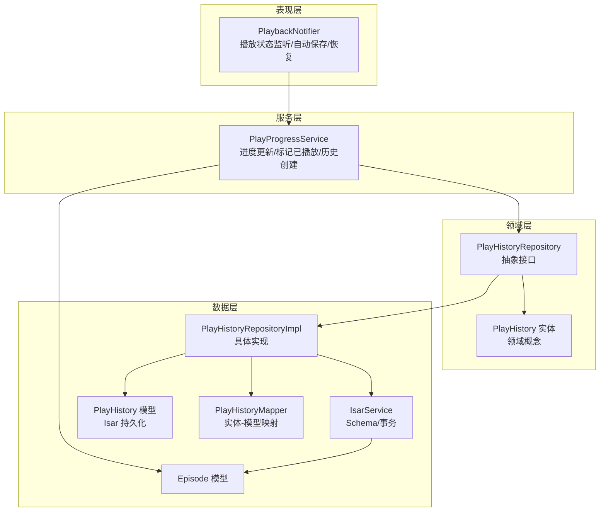
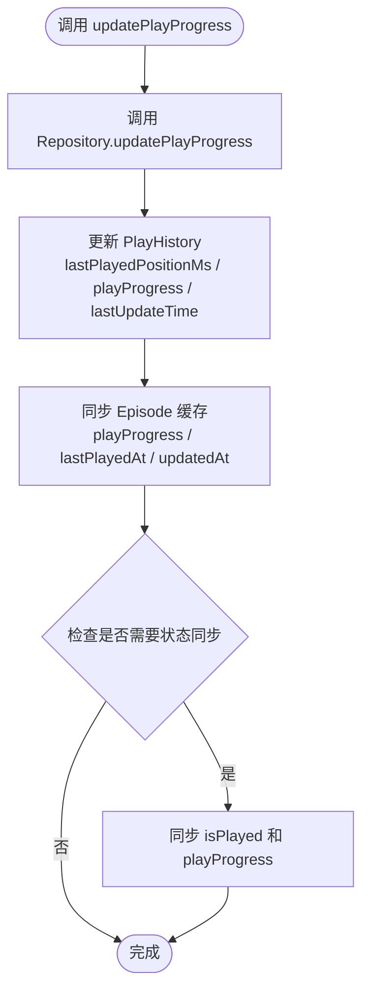
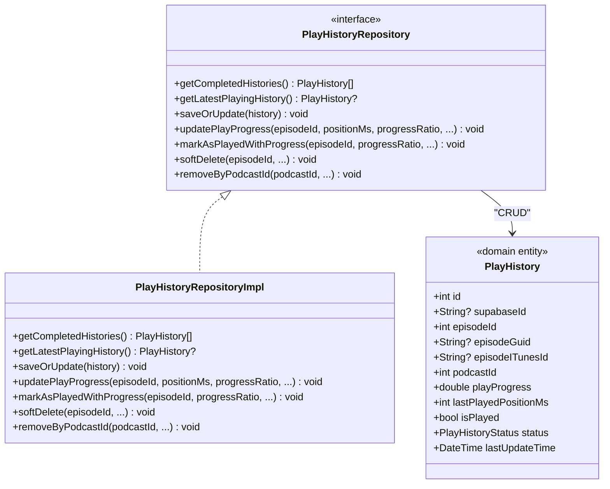
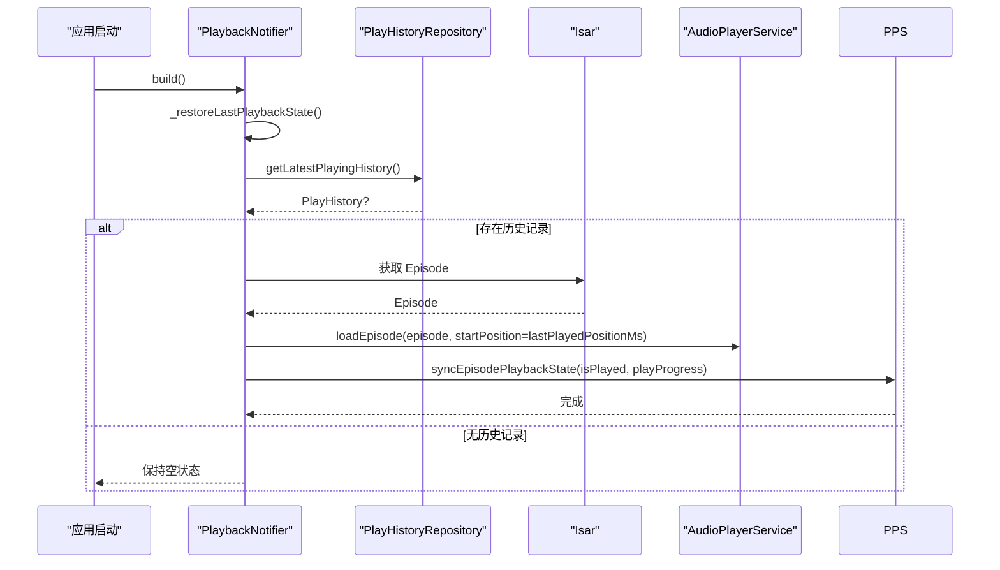
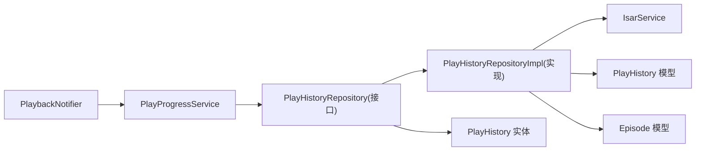

# 播放进度跟踪

<cite>
**本文引用的文件**   
- [play_progress_service.dart](file://lib/core/services/play_progress_service.dart)
- [play_history_repository_impl.dart](file://lib/domain/repositories/play_history_repository.dart)
- [play_history_repository_impl.dart](file://lib/data/repositories/play_history_repository_impl.dart)
- [play_history_model.dart](file://lib/data/models/play_history_model.dart)
- [play_history_entity.dart](file://lib/domain/entities/play_history.dart)
- [episode_model.dart](file://lib/data/models/episode_model.dart)
- [playback_provider.dart](file://lib/presentation/providers/playback_provider.dart)
- [isar_service.dart](file://lib/data/database/isar_service.dart)
</cite>

## 更新摘要
**所做更改**   
- 更新了 PlayHistoryRepository 从数据层迁移到领域层的架构变更说明
- 新增了 PlayHistory 实体与 Isar 模型的解耦设计说明
- 增强了 PlayProgressService 的 Episode 播放状态同步功能
- 改进了错误处理和详细日志记录机制
- 更新了依赖关系图和架构图以反映新的分层架构

## 目录
1. [简介](#简介)
2. [项目结构](#项目结构)
3. [核心组件](#核心组件)
4. [架构总览](#架构总览)
5. [详细组件分析](#详细组件分析)
6. [依赖关系分析](#依赖关系分析)
7. [性能与内存管理](#性能与内存管理)
8. [故障恢复与排错](#故障恢复与排错)
9. [结论](#结论)
10. [附录：使用示例与最佳实践](#附录使用示例与最佳实践)

## 简介
本文件为 PlayProgressService 的详细服务文档，聚焦播放进度跟踪的架构设计、数据持久化策略、实时更新机制、数据同步方案、断点续播与跨设备同步。内容覆盖 Isar 数据库集成、数据模型定义、查询优化、触发条件与频率控制、数据完整性保证，以及性能优化与故障恢复策略。

**更新** 本次更新重点反映了 PlayHistoryRepository 从数据层迁移到领域层的架构重构，引入了完整的依赖倒置原则，以及增强的 PlayProgressService 功能和改进的错误处理机制。

## 项目结构
播放进度跟踪采用清晰的分层架构设计：
- 表现层（Presentation）：PlaybackNotifier 负责播放器状态监听、自动保存定时器、启动恢复逻辑。
- 服务层（Core Services）：PlayProgressService 统一封装"更新播放进度""标记已播放""创建或更新历史记录""同步 Episode 缓存"。
- 领域层（Domain）：PlayHistoryRepository 抽象接口定义业务规则，PlayHistory 实体表示领域概念。
- 数据层（Data）：PlayHistoryRepositoryImpl 实现具体的数据访问逻辑；IsarService 管理 Isar 实例与 Schema；Episode/PlayHistory 模型定义数据结构。



**图表来源**
- [playback_provider.dart:361-431](file://lib/presentation/providers/playback_provider.dart#L361-L431)
- [play_progress_service.dart:17-145](file://lib/core/services/play_progress_service.dart#L17-L145)
- [play_history_repository.dart:1-82](file://lib/domain/repositories/play_history_repository.dart#L1-L82)
- [play_history_repository_impl.dart:11-312](file://lib/data/repositories/play_history_repository_impl.dart#L11-L312)
- [play_history_model.dart:1-52](file://lib/data/models/play_history_model.dart#L1-L52)
- [play_history_entity.dart:1-94](file://lib/domain/entities/play_history.dart#L1-L94)

**章节来源**
- [play_progress_service.dart:1-176](file://lib/core/services/play_progress_service.dart#L1-L176)
- [play_history_repository.dart:1-82](file://lib/domain/repositories/play_history_repository.dart#L1-L82)
- [play_history_repository_impl.dart:1-312](file://lib/data/repositories/play_history_repository_impl.dart#L1-L312)
- [play_history_model.dart:1-52](file://lib/data/models/play_history_model.dart#L1-L52)
- [play_history_entity.dart:1-94](file://lib/domain/entities/play_history.dart#L1-L94)
- [episode_model.dart:1-67](file://lib/data/models/episode_model.dart#L1-L67)
- [playback_provider.dart:1-748](file://lib/presentation/providers/playback_provider.dart#L1-L748)

## 核心组件
- **PlayProgressService**：对外暴露统一的进度更新接口，内部协调 Repository 与 Isar 事务，确保 PlayHistory 与 Episode 缓存一致性。新增增强的 Episode 播放状态同步功能。
- **PlayHistoryRepository**：领域层抽象接口，定义了播放历史操作的业务契约，实现了依赖倒置原则。
- **PlayHistoryRepositoryImpl**：数据层具体实现，提供对 PlayHistory 的增删改查；IsarService 管理 Isar 实例与 Schema；Episode/PlayHistory 模型定义数据结构。
- **PlaybackNotifier**：驱动自动保存策略（时间+进度阈值）、生命周期事件处理、启动恢复流程。
- **IsarService**：集中管理 Isar 实例、Schema 注册、事务与基础操作。
- **数据模型**：PlayHistory（播放历史主表）、Episode（剧集元数据与缓存字段）。

**更新** 新增了 PlayHistory 领域实体，实现了与 Isar 持久化模型的完全解耦，提升了代码的可测试性和可维护性。

**章节来源**
- [play_progress_service.dart:1-176](file://lib/core/services/play_progress_service.dart#L1-L176)
- [play_history_repository.dart:1-82](file://lib/domain/repositories/play_history_repository.dart#L1-L82)
- [play_history_repository_impl.dart:1-312](file://lib/data/repositories/play_history_repository_impl.dart#L1-L312)
- [play_history_model.dart:1-52](file://lib/data/models/play_history_model.dart#L1-L52)
- [play_history_entity.dart:1-94](file://lib/domain/entities/play_history.dart#L1-L94)
- [episode_model.dart:1-67](file://lib/data/models/episode_model.dart#L1-L67)
- [isar_service.dart:1-137](file://lib/data/database/isar_service.dart#L1-L137)

## 架构总览
播放进度跟踪采用"单源事实 + 缓存副本"的设计：
- **事实源**：PlayHistory 表作为唯一真实数据源，记录精确位置、比例、状态、更新时间等。
- **缓存副本**：Episode.playProgress/lastPlayedAt 作为快速读取的缓存，由服务层在写入后同步更新。
- **自动保存**：基于时间间隔与进度变化阈值的组合策略，降低 I/O 压力。
- **启动恢复**：应用启动时从 PlayHistory 恢复上次播放内容与位置，必要时回写 Episode 缓存。
- **云同步**：通过 SyncService 拉取云端播放历史，按 last_update_time 合并本地记录。

**更新** 新增了领域层抽象和数据层实现的分离，通过依赖倒置原则提高了系统的灵活性和可测试性。

```mermaid
sequenceDiagram
participant UI as "UI/播放器"
participant BN as "PlaybackNotifier"
participant PPS as "PlayProgressService"
participant R as "PlayHistoryRepository(接口)"
impl as "PlayHistoryRepositoryImpl(实现)"
participant DB as "Isar(PlayHistory)"
participant EP as "Isar(Episode)"
UI->>BN : 播放中进度变化
BN->>BN : 判断是否满足保存条件(时间/进度)
BN->>PPS : updatePlayProgress(episodeId, positionMs, progressRatio, ...)
PPS->>R : updatePlayProgress(...)
R->>impl : 调用具体实现
impl->>DB : 写入/更新 PlayHistory
PPS->>EP : 同步 Episode.playProgress/lastPlayedAt
EP-->>PPS : 完成
DB-->>impl : 完成
impl-->>R : 完成
R-->>PPS : 完成
PPS-->>BN : 完成
```

**图表来源**
- [playback_provider.dart:361-431](file://lib/presentation/providers/playback_provider.dart#L361-L431)
- [play_progress_service.dart:17-42](file://lib/core/services/play_progress_service.dart#L17-L42)
- [play_history_repository.dart:25-31](file://lib/domain/repositories/play_history_repository.dart#L25-L31)
- [play_history_repository_impl.dart:110-121](file://lib/data/repositories/play_history_repository_impl.dart#L110-L121)
- [isar_service.dart:38-59](file://lib/data/database/isar_service.dart#L38-L59)

## 详细组件分析

### PlayProgressService：进度更新与状态同步
职责
- **更新播放进度**：调用 Repository 更新 PlayHistory，并同步 Episode 缓存。
- **标记已播放**：将 PlayHistory 标记为 completed，并将 Episode 的 isPlayed 与 playProgress 置为 1.0。
- **创建或更新历史记录**：根据 Episode 信息构造 PlayHistory，首次播放即创建，后续复用。
- **同步播放状态**：新增的 syncEpisodePlaybackState 方法用于同步 Episode 的 isPlayed 和 playProgress 字段。

关键流程
- **updatePlayProgress**：先写 PlayHistory，再写 Episode 缓存。
- **markEpisodeAsPlayed**：设置 PlayHistory 状态为 completed，并同步 Episode 缓存。
- **createOrUpdatePlayHistory**：构造完整的历史记录并持久化。
- **syncEpisodePlaybackState**：新增方法，专门用于同步 Episode 的播放状态到缓存。

**更新** 增强了错误处理机制，所有方法都包含详细的异常捕获和日志记录，提高了系统的健壮性。



**图表来源**
- [play_progress_service.dart:17-42](file://lib/core/services/play_progress_service.dart#L17-L42)
- [play_progress_service.dart:109-134](file://lib/core/services/play_progress_service.dart#L109-L134)
- [play_history_repository.dart:25-31](file://lib/domain/repositories/play_history_repository.dart#L25-L31)

**章节来源**
- [play_progress_service.dart:1-176](file://lib/core/services/play_progress_service.dart#L1-L176)

### PlayHistoryRepository：领域抽象与数据实现
职责
- **领域抽象**：PlayHistoryRepository 接口定义了播放历史操作的业务契约。
- **多键匹配**：优先按 episodeITunesId，其次 episodeGuid，最后 episodeId 定位记录。
- **进度更新**：更新 lastPlayedPositionMs、playedDuration、lastUpdateTime。
- **标记完成**：设置 isPlayed=true、status=completed、playProgress=1.0。
- **软删除与批量清理**：支持按 podcastId/guid/itunesId 清理历史。

查询优化
- **使用索引字段**：episodeId、podcastId、lastUpdateTime 用于排序与过滤。
- **事务写入**：所有写操作包裹在 writeTxn 中，保证原子性。
- **实体映射**：通过 PlayHistoryMapper 实现领域实体与 Isar 模型的转换。

**更新** 实现了完整的依赖倒置原则，领域层只依赖抽象接口，数据层负责具体实现细节。



**图表来源**
- [play_history_repository.dart:1-82](file://lib/domain/repositories/play_history_repository.dart#L1-L82)
- [play_history_repository_impl.dart:11-312](file://lib/data/repositories/play_history_repository_impl.dart#L11-L312)
- [play_history_entity.dart:1-94](file://lib/domain/entities/play_history.dart#L1-L94)

**章节来源**
- [play_history_repository.dart:1-82](file://lib/domain/repositories/play_history_repository.dart#L1-L82)
- [play_history_repository_impl.dart:1-312](file://lib/data/repositories/play_history_repository_impl.dart#L1-L312)
- [play_history_entity.dart:1-94](file://lib/domain/entities/play_history.dart#L1-L94)

### PlaybackNotifier：自动保存与恢复
自动保存策略
- **定时器**：每 10 秒检查一次是否需要保存。
- **双重触发**：距上次保存≥10秒，或进度变化≥5% 或≥5000ms。
- **生命周期**：切换 episode、停止播放、应用退出时立即保存最终进度。

启动恢复
- **启动时查询**：最新播放中的历史记录。
- **若找到记录**：加载对应 Episode，并以 lastPlayedPositionMs 作为起始位置。
- **恢复完成后**：将 PlayHistory 的状态同步到 Episode 缓存。

**更新** 增强了恢复流程的健壮性，增加了文件存在性检查和更详细的错误处理。



**图表来源**
- [playback_provider.dart:447-559](file://lib/presentation/providers/playback_provider.dart#L447-L559)
- [play_history_repository.dart:7-8](file://lib/domain/repositories/play_history_repository.dart#L7-L8)
- [play_progress_service.dart:109-134](file://lib/core/services/play_progress_service.dart#L109-L134)

**章节来源**
- [playback_provider.dart:1-748](file://lib/presentation/providers/playback_provider.dart#L1-L748)

### Isar 集成与数据模型
- **IsarService**：集中打开数据库、注册 Schema（包含 PlayHistorySchema），提供事务与基础操作。
- **PlayHistory**：包含 episodeId、guid/itunesId、podcastId、标题、封面、播放位置、进度、状态、更新时间、软删除标志等。
- **Episode**：包含播放相关缓存字段 playProgress、lastPlayedAt、isPlayed 等。
- **PlayHistory 实体**：领域层的概念模型，与 Isar 持久化模型完全解耦。

**更新** 新增了领域实体 PlayHistory，实现了与持久化模型的完全分离，提升了代码的可测试性和可维护性。

**章节来源**
- [isar_service.dart:38-59](file://lib/data/database/isar_service.dart#L38-L59)
- [play_history_model.dart:1-52](file://lib/data/models/play_history_model.dart#L1-L52)
- [episode_model.dart:1-67](file://lib/data/models/episode_model.dart#L1-L67)
- [play_history_entity.dart:1-94](file://lib/domain/entities/play_history.dart#L1-L94)

## 依赖关系分析
- **PlaybackNotifier** 依赖 PlayProgressService 进行进度更新与状态标记。
- **PlayProgressService** 依赖 PlayHistoryRepository 抽象接口与 IsarService。
- **PlayHistoryRepositoryImpl** 直接操作 Isar 集合（PlayHistory、Episode）。
- **领域层** 只依赖抽象接口，不关心具体实现细节。



**图表来源**
- [playback_provider.dart:361-431](file://lib/presentation/providers/playback_provider.dart#L361-L431)
- [play_progress_service.dart:17-145](file://lib/core/services/play_progress_service.dart#L17-L145)
- [play_history_repository.dart:1-82](file://lib/domain/repositories/play_history_repository.dart#L1-L82)
- [play_history_repository_impl.dart:11-312](file://lib/data/repositories/play_history_repository_impl.dart#L11-L312)

**章节来源**
- [playback_provider.dart:1-748](file://lib/presentation/providers/playback_provider.dart#L1-L748)
- [play_progress_service.dart:1-176](file://lib/core/services/play_progress_service.dart#L1-L176)
- [play_history_repository.dart:1-82](file://lib/domain/repositories/play_history_repository.dart#L1-L82)
- [play_history_repository_impl.dart:1-312](file://lib/data/repositories/play_history_repository_impl.dart#L1-L312)

## 性能与内存管理
- **写入节流**：自动保存采用"时间+进度阈值"双条件，避免高频 I/O。
- **事务批量**：所有写操作使用 writeTxn，减少锁竞争与磁盘抖动。
- **索引优化**：对 episodeId、podcastId、lastUpdateTime 建立索引，提升查询与排序效率。
- **内存友好**：仅在需要时加载 Episode，恢复流程中对文件存在性做校验，避免无效 IO。
- **日志与调试**：开发模式启用 Isar Inspector，便于观察数据与性能。

**更新** 增强了错误处理和日志记录，提供了更详细的调试信息和异常追踪。

**章节来源**
- [playback_provider.dart:361-431](file://lib/presentation/providers/playback_provider.dart#L361-L431)
- [play_history_repository_impl.dart:77-117](file://lib/data/repositories/play_history_repository_impl.dart#L77-L117)

## 故障恢复与排错
- **异常隔离**：所有数据库操作均 try-catch，错误仅记录日志，不中断播放。
- **恢复降级**：若 Episode 被删除或文件缺失，恢复流程会跳过音频加载，保持 UI 空状态。
- **云地冲突**：以 last_update_time 为准进行合并，失败记录单独捕获不影响整体。
- **常见问题排查**：
  - **进度未保存**：检查自动保存定时器是否运行、阈值条件是否满足。
  - **恢复失败**：确认 PlayHistory 是否存在、Episode 是否可查、本地文件路径是否正确。
  - **同步异常**：查看 SyncService 日志，确认云端字段映射与时间解析。

**更新** 增强了错误处理机制，所有方法都包含详细的异常捕获和日志记录，包括堆栈跟踪信息。

**章节来源**
- [play_progress_service.dart:34-42](file://lib/core/services/play_progress_service.dart#L34-L42)
- [play_progress_service.dart:127-134](file://lib/core/services/play_progress_service.dart#L127-L134)
- [playback_provider.dart:447-559](file://lib/presentation/providers/playback_provider.dart#L447-L559)

## 结论
PlayProgressService 通过"事实源 + 缓存副本"的架构，结合智能自动保存与稳健的恢复机制，实现了可靠的播放进度跟踪。配合 Isar 的高性能与索引优化，以及云同步的增量合并策略，系统在用户体验与数据一致性之间取得良好平衡。

**更新** 通过引入领域层抽象和数据层实现的分离，系统获得了更好的可测试性、可维护性和扩展性。新的 PlayHistory 实体设计确保了领域概念的清晰表达，而依赖倒置原则的应用使得系统更加灵活和易于重构。

## 附录：使用示例与最佳实践
- **更新播放进度**
  - **调用方式**：通过 PlayProgressService.instance.updatePlayProgress(episodeId, positionMs, progressRatio, episodeGuid?, episodeITunesId?)。
  - **触发时机**：PlaybackNotifier 每 10 秒或进度变化≥5%/≥5000ms 时调用。
  - **参考路径**：[playback_provider.dart:361-431](file://lib/presentation/providers/playback_provider.dart#L361-L431)、[play_progress_service.dart:17-42](file://lib/core/services/play_progress_service.dart#L17-L42)。

- **获取播放历史**
  - **已完成历史**：PlayHistoryRepository.getCompletedHistories()，按 lastUpdateTime 倒序。
  - **最近播放中**：PlayHistoryRepository.getLatestPlayingHistory()，用于启动恢复。
  - **参考路径**：[play_history_repository.dart:5-7](file://lib/domain/repositories/play_history_repository.dart#L5-L7)。

- **清理过期数据**
  - **按播客清理**：PlayHistoryRepository.removeByPodcastId(podcastId|podcastGuid|podcastITunesId)。
  - **软删除**：PlayHistoryRepository.softDelete(episodeId)，保留记录但标记 isDeleted=true。
  - **参考路径**：[play_history_repository.dart:70-81](file://lib/domain/repositories/play_history_repository.dart#L70-L81)。

- **断点续播与恢复**
  - **启动恢复**：PlaybackNotifier._restoreLastPlaybackState() 从 PlayHistory 恢复 Episode 与起始位置。
  - **状态同步**：使用 PlayProgressService.syncEpisodePlaybackState() 同步播放状态到 Episode 缓存。
  - **参考路径**：[playback_provider.dart:447-559](file://lib/presentation/providers/playback_provider.dart#L447-L559)、[play_progress_service.dart:109-134](file://lib/core/services/play_progress_service.dart#L109-L134)。

- **最佳实践**
  - **始终通过 PlayProgressService 更新进度**，避免绕过 Repository 直接写库。
  - **使用 episodeITunesId/episodeGuid** 提高记录定位稳定性。
  - **利用 Isar Inspector** 监控数据与性能，及时发现问题。
  - **在长时间播放场景下关注内存占用与 I/O 频率**，合理调整保存阈值。
  - **遵循依赖倒置原则**，领域层只依赖抽象接口，便于测试和替换实现。

**更新** 新增了关于依赖倒置原则和领域实体使用的最佳实践指导。

**章节来源**
- [playback_provider.dart:361-431](file://lib/presentation/providers/playback_provider.dart#L361-L431)
- [play_history_repository.dart:5-7](file://lib/domain/repositories/play_history_repository.dart#L5-L7)
- [play_history_repository.dart:70-81](file://lib/domain/repositories/play_history_repository.dart#L70-L81)
- [playback_provider.dart:447-559](file://lib/presentation/providers/playback_provider.dart#L447-L559)
- [play_progress_service.dart:109-134](file://lib/core/services/play_progress_service.dart#L109-L134)