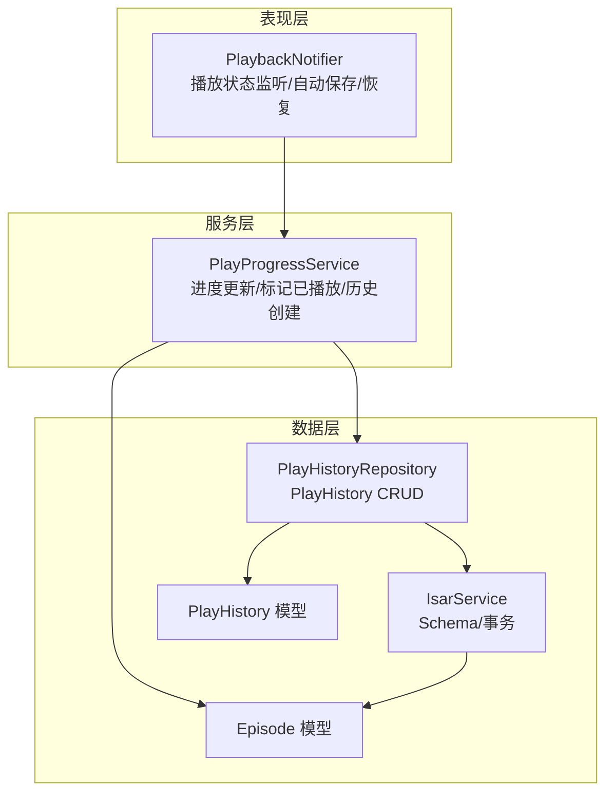
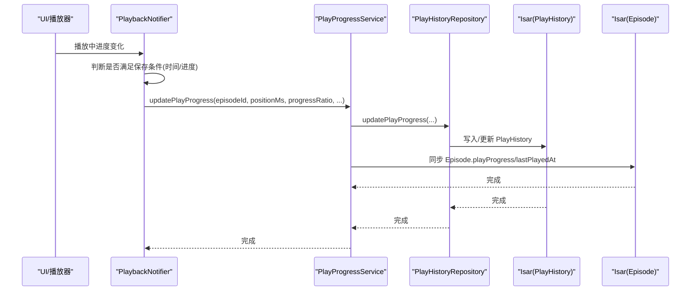
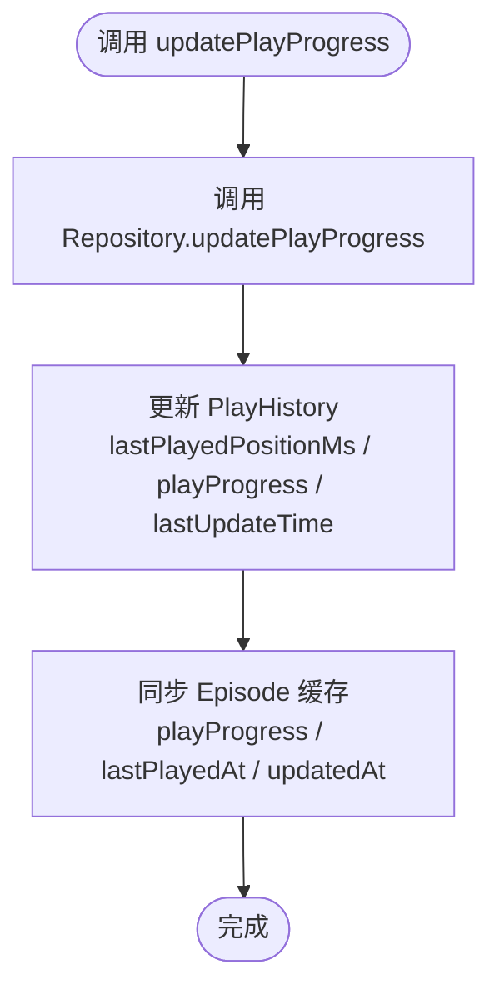
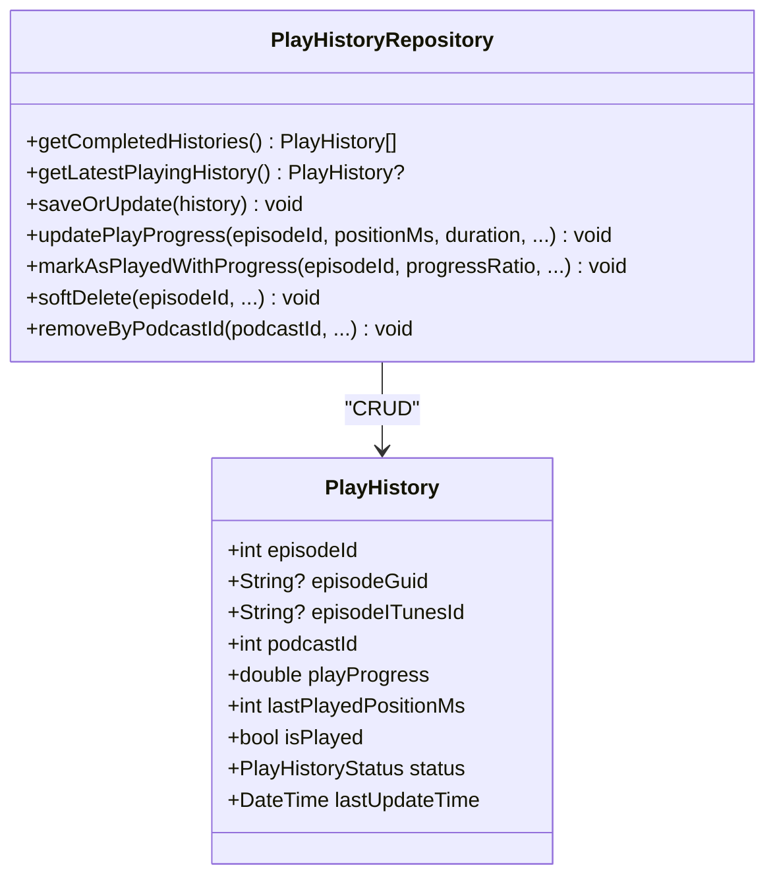
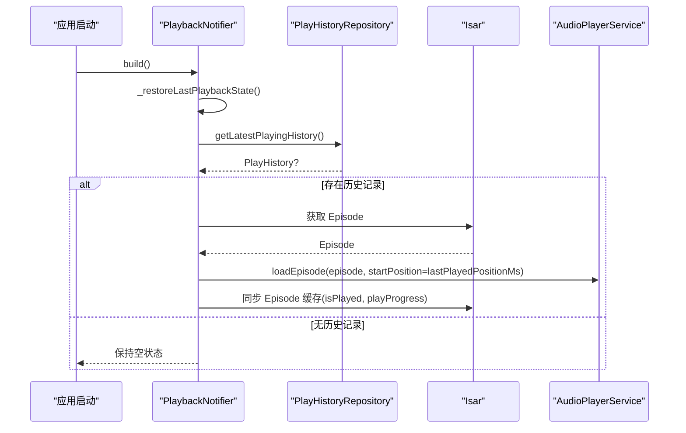
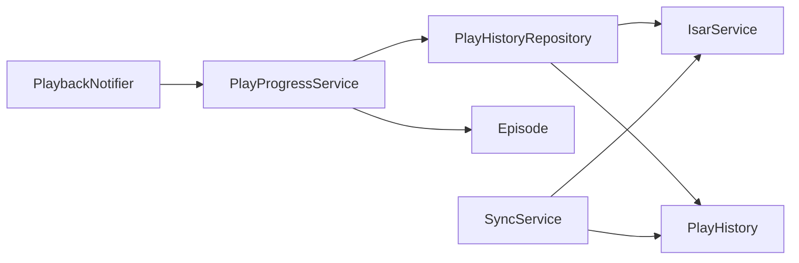

# 播放进度跟踪

<cite>
**本文引用的文件**   
- [play_progress_service.dart](file://lib/core/services/play_progress_service.dart)
- [play_history_model.dart](file://lib/data/models/play_history_model.dart)
- [play_history_repository.dart](file://lib/data/repositories/play_history_repository.dart)
- [episode_model.dart](file://lib/data/models/episode_model.dart)
- [isar_service.dart](file://lib/data/database/isar_service.dart)
- [playback_provider.dart](file://lib/presentation/providers/playback_provider.dart)
- [sync_service.dart](file://lib/core/services/sync_service.dart)
- [database.md](file://docs/database.md)
</cite>

## 目录
1. [简介](#简介)
2. [项目结构](#项目结构)
3. [核心组件](#核心组件)
4. [架构总览](#架构总览)
5. [详细组件分析](#详细组件分析)
6. [依赖关系分析](#依赖关系分析)
7. [性能与内存管理](#性能与内存管理)
8. [故障恢复与排错](#故障恢复与排错)
9. [结论](#结论)
10. [附录：使用示例与最佳实践](#附录使用示例与最佳实践)

## 简介
本文件为 PlayProgressService 的详细服务文档，聚焦播放进度跟踪的架构设计、数据持久化策略、实时更新机制、数据同步方案、断点续播与跨设备同步。内容覆盖 Isar 数据库集成、数据模型定义、查询优化、触发条件与频率控制、数据完整性保证，以及性能优化与故障恢复策略。

## 项目结构
播放进度跟踪涉及三层协作：
- 表现层（Presentation）：PlaybackNotifier 负责播放器状态监听、自动保存定时器、启动恢复逻辑。
- 服务层（Core Services）：PlayProgressService 统一封装“更新播放进度”“标记已播放”“创建或更新历史记录”“同步 Episode 缓存”。
- 数据层（Data）：PlayHistoryRepository 提供对 PlayHistory 的增删改查；IsarService 管理 Isar 实例与 Schema；Episode/PlayHistory 模型定义数据结构。

图表来源
- [playback_provider.dart:361-431](file://lib/presentation/providers/playback_provider.dart#L361-L431)
- [play_progress_service.dart:17-145](file://lib/core/services/play_progress_service.dart#L17-L145)
- [play_history_repository.dart:77-117](file://lib/data/repositories/play_history_repository.dart#L77-L117)
- [isar_service.dart:38-59](file://lib/data/database/isar_service.dart#L38-L59)
- [play_history_model.dart:1-51](file://lib/data/models/play_history_model.dart#L1-L51)
- [episode_model.dart:1-67](file://lib/data/models/episode_model.dart#L1-L67)

章节来源
- [play_progress_service.dart:1-145](file://lib/core/services/play_progress_service.dart#L1-L145)
- [play_history_repository.dart:1-351](file://lib/data/repositories/play_history_repository.dart#L1-L351)
- [play_history_model.dart:1-51](file://lib/data/models/play_history_model.dart#L1-L51)
- [episode_model.dart:1-67](file://lib/data/models/episode_model.dart#L1-L67)
- [isar_service.dart:1-137](file://lib/data/database/isar_service.dart#L1-L137)
- [playback_provider.dart:1-200](file://lib/presentation/providers/playback_provider.dart#L1-L200)

## 核心组件
- PlayProgressService：对外暴露统一的进度更新接口，内部协调 Repository 与 Isar 事务，确保 PlayHistory 与 Episode 缓存一致性。
- PlayHistoryRepository：实现 PlayHistory 的查找、更新、创建、软删除、按播客清理等能力，并维护 episodeGuid/itunesId 的多级匹配策略。
- PlaybackNotifier：驱动自动保存策略（时间+进度阈值）、生命周期事件处理、启动恢复流程。
- IsarService：集中管理 Isar 实例、Schema 注册、事务与基础操作。
- 数据模型：PlayHistory（播放历史主表）、Episode（剧集元数据与缓存字段）。

章节来源
- [play_progress_service.dart:1-145](file://lib/core/services/play_progress_service.dart#L1-L145)
- [play_history_repository.dart:1-351](file://lib/data/repositories/play_history_repository.dart#L1-L351)
- [play_history_model.dart:1-51](file://lib/data/models/play_history_model.dart#L1-L51)
- [episode_model.dart:1-67](file://lib/data/models/episode_model.dart#L1-L67)
- [isar_service.dart:1-137](file://lib/data/database/isar_service.dart#L1-L137)

## 架构总览
播放进度跟踪采用“单源事实 + 缓存副本”的设计：
- 事实源：PlayHistory 表作为唯一真实数据源，记录精确位置、比例、状态、更新时间等。
- 缓存副本：Episode.playProgress/lastPlayedAt 作为快速读取的缓存，由服务层在写入后同步更新。
- 自动保存：基于时间间隔与进度变化阈值的组合策略，降低 I/O 压力。
- 启动恢复：应用启动时从 PlayHistory 恢复上次播放内容与位置，必要时回写 Episode 缓存。
- 云同步：通过 SyncService 拉取云端播放历史，按 last_update_time 合并本地记录。

图表来源
- [playback_provider.dart:361-431](file://lib/presentation/providers/playback_provider.dart#L361-L431)
- [play_progress_service.dart:17-42](file://lib/core/services/play_progress_service.dart#L17-L42)
- [play_history_repository.dart:104-117](file://lib/data/repositories/play_history_repository.dart#L104-L117)
- [isar_service.dart:38-59](file://lib/data/database/isar_service.dart#L38-L59)

## 详细组件分析

### PlayProgressService：进度更新与状态同步
职责
- 更新播放进度：调用 Repository 更新 PlayHistory，并同步 Episode 缓存。
- 标记已播放：将 PlayHistory 标记为 completed，并将 Episode 的 isPlayed 与 playProgress 置为 1.0。
- 创建或更新历史记录：根据 Episode 信息构造 PlayHistory，首次播放即创建，后续复用。

关键流程
- updatePlayProgress：先写 PlayHistory，再写 Episode 缓存。
- markEpisodeAsPlayed：设置 PlayHistory 状态为 completed，并同步 Episode 缓存。
- createOrUpdatePlayHistory：构造完整的历史记录并持久化。

图表来源
- [play_progress_service.dart:17-42](file://lib/core/services/play_progress_service.dart#L17-L42)
- [play_progress_service.dart:106-124](file://lib/core/services/play_progress_service.dart#L106-L124)
- [play_history_repository.dart:104-117](file://lib/data/repositories/play_history_repository.dart#L104-L117)

章节来源
- [play_progress_service.dart:1-145](file://lib/core/services/play_progress_service.dart#L1-L145)

### PlayHistoryRepository：数据访问与一致性
职责
- 多键匹配：优先按 episodeITunesId，其次 episodeGuid，最后 episodeId 定位记录。
- 进度更新：更新 lastPlayedPositionMs、playedDuration、lastUpdateTime。
- 标记完成：设置 isPlayed=true、status=completed、playProgress=1.0。
- 软删除与批量清理：支持按 podcastId/guid/itunesId 清理历史。

查询优化
- 使用索引字段：episodeId、podcastId、lastUpdateTime 用于排序与过滤。
- 事务写入：所有写操作包裹在 writeTxn 中，保证原子性。

图表来源
- [play_history_repository.dart:7-351](file://lib/data/repositories/play_history_repository.dart#L7-L351)
- [play_history_model.dart:1-51](file://lib/data/models/play_history_model.dart#L1-L51)

章节来源
- [play_history_repository.dart:1-351](file://lib/data/repositories/play_history_repository.dart#L1-L351)
- [play_history_model.dart:1-51](file://lib/data/models/play_history_model.dart#L1-L51)

### PlaybackNotifier：自动保存与恢复
自动保存策略
- 定时器：每 10 秒检查一次是否需要保存。
- 双重触发：距上次保存≥10秒，或进度变化≥5% 或≥5000ms。
- 生命周期：切换 episode、停止播放、应用退出时立即保存最终进度。

启动恢复
- 启动时查询最新播放中的历史记录。
- 若找到记录，加载对应 Episode，并以 lastPlayedPositionMs 作为起始位置。
- 恢复完成后，将 PlayHistory 的状态同步到 Episode 缓存。

图表来源
- [playback_provider.dart:438-577](file://lib/presentation/providers/playback_provider.dart#L438-L577)
- [play_history_repository.dart:58-70](file://lib/data/repositories/play_history_repository.dart#L58-L70)
- [isar_service.dart:38-59](file://lib/data/database/isar_service.dart#L38-L59)

章节来源
- [playback_provider.dart:1-200](file://lib/presentation/providers/playback_provider.dart#L1-L200)
- [playback_provider.dart:361-431](file://lib/presentation/providers/playback_provider.dart#L361-L431)
- [playback_provider.dart:438-577](file://lib/presentation/providers/playback_provider.dart#L438-L577)

### Isar 集成与数据模型
- IsarService：集中打开数据库、注册 Schema（包含 PlayHistorySchema），提供事务与基础操作。
- PlayHistory：包含 episodeId、guid/itunesId、podcastId、标题、封面、播放位置、进度、状态、更新时间、软删除标志等。
- Episode：包含播放相关缓存字段 playProgress、lastPlayedAt、isPlayed 等。

章节来源
- [isar_service.dart:38-59](file://lib/data/database/isar_service.dart#L38-L59)
- [play_history_model.dart:1-51](file://lib/data/models/play_history_model.dart#L1-L51)
- [episode_model.dart:1-67](file://lib/data/models/episode_model.dart#L1-L67)
- [database.md:1-493](file://docs/database.md#L1-L493)

### 云同步与数据合并
- 拉取云端播放历史：按 since 时间戳拉取增量。
- 合并策略：以 last_update_time 为准，若云端更晚则覆盖本地；不存在则新建记录。
- 错误隔离：每条记录合并失败不影响整体流程。

章节来源
- [sync_service.dart:594-657](file://lib/core/services/sync_service.dart#L594-L657)
- [sync_service.dart:1270-1306](file://lib/core/services/sync_service.dart#L1270-L1306)

## 依赖关系分析
- PlaybackNotifier 依赖 PlayProgressService 进行进度更新与状态标记。
- PlayProgressService 依赖 PlayHistoryRepository 与 IsarService。
- PlayHistoryRepository 直接操作 Isar 集合（PlayHistory、Episode）。
- SyncService 依赖 IsarService 与 PlayHistory 模型进行云地合并。

图表来源
- [playback_provider.dart:361-431](file://lib/presentation/providers/playback_provider.dart#L361-L431)
- [play_progress_service.dart:17-145](file://lib/core/services/play_progress_service.dart#L17-L145)
- [play_history_repository.dart:77-117](file://lib/data/repositories/play_history_repository.dart#L77-L117)
- [sync_service.dart:594-657](file://lib/core/services/sync_service.dart#L594-L657)

章节来源
- [playback_provider.dart:1-200](file://lib/presentation/providers/playback_provider.dart#L1-L200)
- [play_progress_service.dart:1-145](file://lib/core/services/play_progress_service.dart#L1-L145)
- [play_history_repository.dart:1-351](file://lib/data/repositories/play_history_repository.dart#L1-L351)
- [sync_service.dart:594-657](file://lib/core/services/sync_service.dart#L594-L657)

## 性能与内存管理
- 写入节流：自动保存采用“时间+进度阈值”双条件，避免高频 I/O。
- 事务批量：所有写操作使用 writeTxn，减少锁竞争与磁盘抖动。
- 索引优化：对 episodeId、podcastId、lastUpdateTime 建立索引，提升查询与排序效率。
- 内存友好：仅在需要时加载 Episode，恢复流程中对文件存在性做校验，避免无效 IO。
- 日志与调试：开发模式启用 Isar Inspector，便于观察数据与性能。

章节来源
- [playback_provider.dart:361-431](file://lib/presentation/providers/playback_provider.dart#L361-L431)
- [play_history_repository.dart:77-117](file://lib/data/repositories/play_history_repository.dart#L77-L117)
- [database.md:468-493](file://docs/database.md#L468-L493)

## 故障恢复与排错
- 异常隔离：所有数据库操作均 try-catch，错误仅记录日志，不中断播放。
- 恢复降级：若 Episode 被删除或文件缺失，恢复流程会跳过音频加载，保持 UI 空状态。
- 云地冲突：以 last_update_time 为准进行合并，失败记录单独捕获不影响整体。
- 常见问题排查：
  - 进度未保存：检查自动保存定时器是否运行、阈值条件是否满足。
  - 恢复失败：确认 PlayHistory 是否存在、Episode 是否可查、本地文件路径是否正确。
  - 同步异常：查看 SyncService 日志，确认云端字段映射与时间解析。

章节来源
- [play_progress_service.dart:34-42](file://lib/core/services/play_progress_service.dart#L34-L42)
- [playback_provider.dart:438-577](file://lib/presentation/providers/playback_provider.dart#L438-L577)
- [sync_service.dart:594-657](file://lib/core/services/sync_service.dart#L594-L657)

## 结论
PlayProgressService 通过“事实源 + 缓存副本”的架构，结合智能自动保存与稳健的恢复机制，实现了可靠的播放进度跟踪。配合 Isar 的高性能与索引优化，以及云同步的增量合并策略，系统在用户体验与数据一致性之间取得良好平衡。未来可在统计分析与搜索筛选方面进一步增强。

## 附录：使用示例与最佳实践
- 更新播放进度
  - 调用方式：通过 PlayProgressService.instance.updatePlayProgress(episodeId, positionMs, progressRatio, episodeGuid?, episodeITunesId?)。
  - 触发时机：PlaybackNotifier 每 10 秒或进度变化≥5%/≥5000ms 时调用。
  - 参考路径：[playback_provider.dart:361-431](file://lib/presentation/providers/playback_provider.dart#L361-L431)、[play_progress_service.dart:17-42](file://lib/core/services/play_progress_service.dart#L17-L42)。

- 获取播放历史
  - 已完成历史：PlayHistoryRepository.getCompletedHistories()，按 lastUpdateTime 倒序。
  - 最近播放中：PlayHistoryRepository.getLatestPlayingHistory()，用于启动恢复。
  - 参考路径：[play_history_repository.dart:37-70](file://lib/data/repositories/play_history_repository.dart#L37-L70)。

- 清理过期数据
  - 按播客清理：PlayHistoryRepository.removeByPodcastId(podcastId|podcastGuid|podcastITunesId)。
  - 软删除：PlayHistoryRepository.softDelete(episodeId)，保留记录但标记 isDeleted=true。
  - 参考路径：[play_history_repository.dart:306-349](file://lib/data/repositories/play_history_repository.dart#L306-L349)。

- 断点续播与恢复
  - 启动恢复：PlaybackNotifier._restoreLastPlaybackState() 从 PlayHistory 恢复 Episode 与起始位置。
  - 参考路径：[playback_provider.dart:438-577](file://lib/presentation/providers/playback_provider.dart#L438-L577)。

- 跨设备同步
  - 拉取与合并：SyncService 拉取云端播放历史，按 last_update_time 合并本地记录。
  - 参考路径：[sync_service.dart:594-657](file://lib/core/services/sync_service.dart#L594-L657)、[sync_service.dart:1270-1306](file://lib/core/services/sync_service.dart#L1270-L1306)。

- 最佳实践
  - 始终通过 PlayProgressService 更新进度，避免绕过 Repository 直接写库。
  - 使用 episodeITunesId/episodeGuid 提高记录定位稳定性。
  - 利用 Isar Inspector 监控数据与性能，及时发现问题。
  - 在长时间播放场景下关注内存占用与 I/O 频率，合理调整保存阈值。

章节来源
- [playback_provider.dart:361-431](file://lib/presentation/providers/playback_provider.dart#L361-L431)
- [play_history_repository.dart:37-70](file://lib/data/repositories/play_history_repository.dart#L37-L70)
- [play_history_repository.dart:306-349](file://lib/data/repositories/play_history_repository.dart#L306-L349)
- [playback_provider.dart:438-577](file://lib/presentation/providers/playback_provider.dart#L438-L577)
- [sync_service.dart:594-657](file://lib/core/services/sync_service.dart#L594-L657)
- [sync_service.dart:1270-1306](file://lib/core/services/sync_service.dart#L1270-L1306)