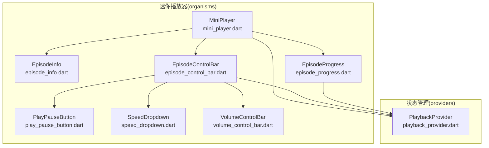
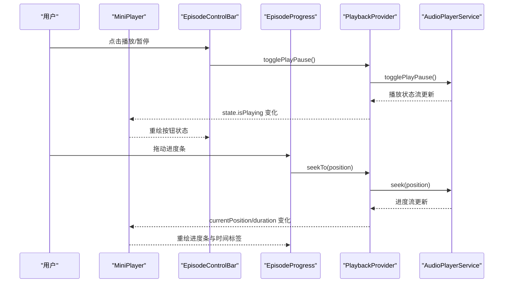
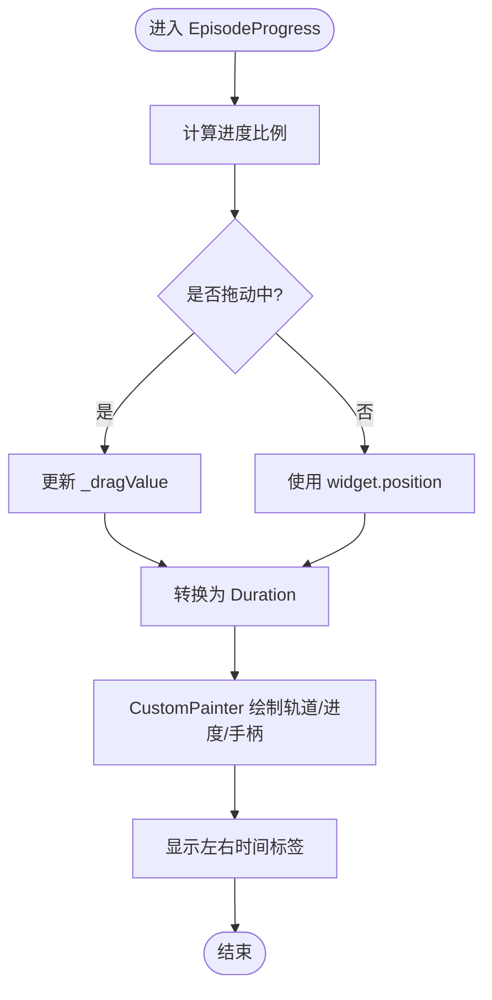
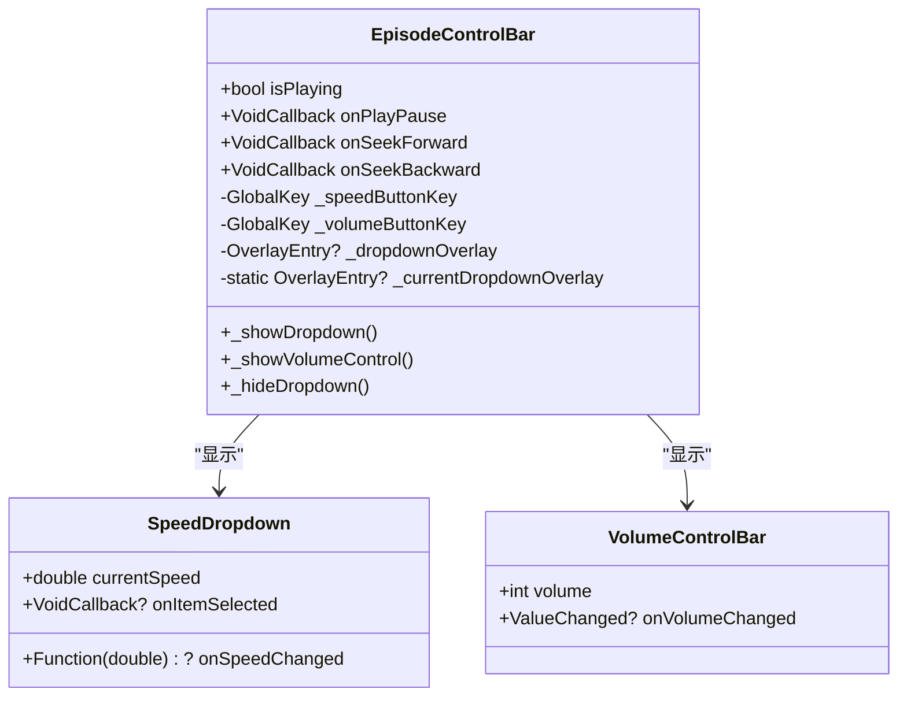
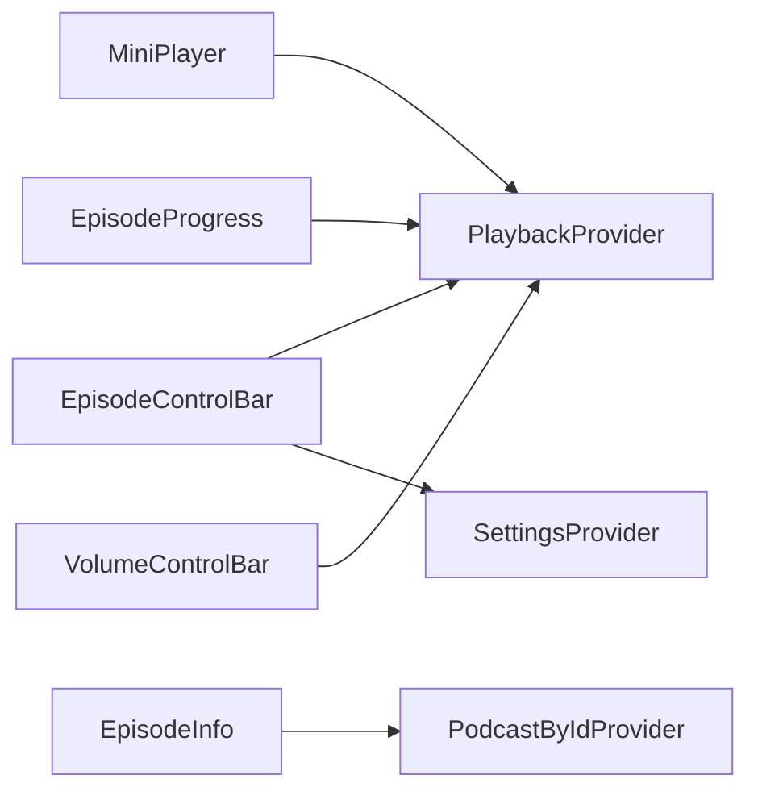

# 迷你播放器组件

<cite>
**本文引用的文件**   
- [mini_player.dart](file://lib/presentation/widgets/organisms/mini_player/mini_player.dart)
- [episode_info.dart](file://lib/presentation/widgets/organisms/mini_player/episode_info.dart)
- [episode_progress.dart](file://lib/presentation/widgets/organisms/mini_player/episode_progress.dart)
- [episode_control_bar.dart](file://lib/presentation/widgets/organisms/mini_player/episode_control_bar/episode_control_bar.dart)
- [play_pause_button.dart](file://lib/presentation/widgets/organisms/mini_player/episode_control_bar/play_pause_button.dart)
- [speed_dropdown.dart](file://lib/presentation/widgets/organisms/mini_player/speed_dropdown.dart)
- [volume_control_bar.dart](file://lib/presentation/widgets/organisms/mini_player/volume_control_bar/volume_control_bar.dart)
- [playback_provider.dart](file://lib/presentation/providers/playback_provider.dart)
</cite>

## 目录
1. [简介](#简介)
2. [项目结构](#项目结构)
3. [核心组件](#核心组件)
4. [架构总览](#架构总览)
5. [详细组件分析](#详细组件分析)
6. [依赖关系分析](#依赖关系分析)
7. [性能考量](#性能考量)
8. [故障排查指南](#故障排查指南)
9. [结论](#结论)
10. [附录](#附录)

## 简介
本文件为 MiniPlayer（迷你播放器）组件的完整 UI 文档，面向开发者与产品人员。内容涵盖：
- 设计模式与组件架构：基于 Riverpod 的状态管理、ConsumerWidget/ConsumerStatefulWidget 的使用、Overlay 弹出交互。
- Material Design 规范应用：主题化颜色、圆角、阴影、图标与排版风格。
- 响应式布局适配：根据屏幕尺寸与亮度动态调整样式与位置计算。
- 动画效果实现：悬停/按下态过渡、进度条拖拽反馈、弹出层显示/隐藏。
- 属性配置与事件处理：播放控制、进度跳转、音量调节、播放速度切换等。
- 数据绑定与状态更新：与 PlaybackProvider 的双向绑定、流式订阅与自动保存。
- 主题定制与样式覆盖：通过 AppTheme 统一配色与尺寸。
- 无障碍支持：可点击区域、光标提示、语义文本。
- 测试最佳实践与性能优化建议。

## 项目结构
MiniPlayer 采用“组织器（Organism）+ 分子（Molecule）+ 原子（Atom）”的分层组织方式，核心文件位于 presentation/widgets/organisms/mini_player 目录下，并通过 providers 层进行状态管理。

图表来源
- [mini_player.dart:1-54](file://lib/presentation/widgets/organisms/mini_player/mini_player.dart#L1-L54)
- [episode_info.dart:1-71](file://lib/presentation/widgets/organisms/mini_player/episode_info.dart#L1-L71)
- [episode_progress.dart:1-288](file://lib/presentation/widgets/organisms/mini_player/episode_progress.dart#L1-L288)
- [episode_control_bar.dart:1-315](file://lib/presentation/widgets/organisms/mini_player/episode_control_bar/episode_control_bar.dart#L1-L315)
- [play_pause_button.dart:1-88](file://lib/presentation/widgets/organisms/mini_player/episode_control_bar/play_pause_button.dart#L1-L88)
- [speed_dropdown.dart:1-63](file://lib/presentation/widgets/organisms/mini_player/speed_dropdown.dart#L1-L63)
- [volume_control_bar.dart:1-238](file://lib/presentation/widgets/organisms/mini_player/volume_control_bar/volume_control_bar.dart#L1-L238)
- [playback_provider.dart:1-766](file://lib/presentation/providers/playback_provider.dart#L1-L766)

章节来源
- [mini_player.dart:1-54](file://lib/presentation/widgets/organisms/mini_player/mini_player.dart#L1-L54)
- [playback_provider.dart:1-766](file://lib/presentation/providers/playback_provider.dart#L1-L766)

## 核心组件
- MiniPlayer：组合 EpisodeInfo、EpisodeControlBar、EpisodeProgress，并订阅 playbackProvider 提供当前剧集、播放状态、进度与时长。
- EpisodeInfo：展示专辑封面与标题信息，同时加载播客标题；无标题时显示默认文案。
- EpisodeProgress：自定义绘制进度轨道与拖动手柄，支持点击与拖动跳转，左右时间标签显示。
- EpisodeControlBar：集中播放控制（后退、播放/暂停、前进）、播放速度下拉菜单、音量控制弹出窗口。
- PlayPauseButton：播放/暂停按钮，带悬停/按下态动画与主题色。
- SpeedDropdown：播放速度选择列表，选中项打勾标记。
- VolumeControlBar：音量滑块，支持点击与拖动调节音量。

章节来源
- [mini_player.dart:1-54](file://lib/presentation/widgets/organisms/mini_player/mini_player.dart#L1-L54)
- [episode_info.dart:1-71](file://lib/presentation/widgets/organisms/mini_player/episode_info.dart#L1-L71)
- [episode_progress.dart:1-288](file://lib/presentation/widgets/organisms/mini_player/episode_progress.dart#L1-L288)
- [episode_control_bar.dart:1-315](file://lib/presentation/widgets/organisms/mini_player/episode_control_bar/episode_control_bar.dart#L1-L315)
- [play_pause_button.dart:1-88](file://lib/presentation/widgets/organisms/mini_player/episode_control_bar/play_pause_button.dart#L1-L88)
- [speed_dropdown.dart:1-63](file://lib/presentation/widgets/organisms/mini_player/speed_dropdown.dart#L1-L63)
- [volume_control_bar.dart:1-238](file://lib/presentation/widgets/organisms/mini_player/volume_control_bar/volume_control_bar.dart#L1-L238)

## 架构总览
MiniPlayer 通过 ConsumerWidget/ConsumerStatefulWidget 订阅 playbackProvider 的状态变化，使用 Riverpod 的 Notifier 驱动 UI 更新。播放控制事件回调到 playbackProvider.notifier，进而调用 AudioPlayerService 完成底层播放逻辑。

图表来源
- [mini_player.dart:1-54](file://lib/presentation/widgets/organisms/mini_player/mini_player.dart#L1-L54)
- [episode_control_bar.dart:1-315](file://lib/presentation/widgets/organisms/mini_player/episode_control_bar/episode_control_bar.dart#L1-L315)
- [episode_progress.dart:1-288](file://lib/presentation/widgets/organisms/mini_player/episode_progress.dart#L1-L288)
- [playback_provider.dart:1-766](file://lib/presentation/providers/playback_provider.dart#L1-L766)

## 详细组件分析

### MiniPlayer（组织器）
- 职责：组合子组件、读取主题、订阅播放状态。
- 关键行为：
  - 从 playbackProvider 获取 currentEpisode、isPlaying、currentPosition、duration。
  - 将 EpisodeInfo、EpisodeControlBar、EpisodeProgress 以 Column 垂直排列，使用主题背景与内边距。
- 主题与响应式：
  - 使用 AppTheme.fromBrightness 获取亮/暗主题。
  - 通过 MediaQuery.platformBrightnessOf(context) 判断系统亮度。

章节来源
- [mini_player.dart:1-54](file://lib/presentation/widgets/organisms/mini_player/mini_player.dart#L1-L54)
- [playback_provider.dart:1-766](file://lib/presentation/providers/playback_provider.dart#L1-L766)

### EpisodeInfo（剧集信息）
- 职责：展示专辑封面与节目标题、播客标题。
- 数据源：
  - title/artworkUrl/podcastId 由父组件传入。
  - 通过 podcastByIdProvider 异步加载播客标题，空值时显示默认文案。
- 主题与布局：
  - 使用 ArtworkImage 组件渲染封面，尺寸与圆角来自主题。
  - 两行文本（节目标题、播客标题），支持溢出省略。

章节来源
- [episode_info.dart:1-71](file://lib/presentation/widgets/organisms/mini_player/episode_info.dart#L1-L71)

### EpisodeProgress（进度条）
- 职责：显示播放进度、总时长，支持点击与拖动跳转。
- 交互逻辑：
  - 使用 GestureDetector 处理 onTapDown、onHorizontalDragStart/Update/End。
  - 使用 CustomPainter 绘制轨道、已播放部分与拖动手柄。
  - 时间标签格式化为 mm:ss 或 HH:mm:ss。
- 主题与样式：
  - 轨道高度、手柄半径、颜色均受主题控制。
  - 悬停/拖动时显示手柄，提升可发现性。

图表来源
- [episode_progress.dart:1-288](file://lib/presentation/widgets/organisms/mini_player/episode_progress.dart#L1-L288)

章节来源
- [episode_progress.dart:1-288](file://lib/presentation/widgets/organisms/mini_player/episode_progress.dart#L1-L288)

### EpisodeControlBar（控制栏）
- 职责：集中播放控制、播放速度选择、音量控制弹出窗口。
- 交互逻辑：
  - 播放速度：点击按钮打开 SpeedDropdown Overlay，选择后调用 setSpeed 并持久化设置。
  - 音量控制：点击按钮打开 VolumeControlPopup Overlay，拖动滑块实时调节音量。
  - 播放控制：后退、播放/暂停、前进按钮分别调用 onSeekBackward/onPlayPause/onSeekForward。
- 弹出层管理：
  - 使用 OverlayEntry 与全局静态变量确保同一时间仅一个弹出层。
  - 点击遮罩层关闭弹出窗口，避免内存泄漏。

图表来源
- [episode_control_bar.dart:1-315](file://lib/presentation/widgets/organisms/mini_player/episode_control_bar/episode_control_bar.dart#L1-L315)
- [speed_dropdown.dart:1-63](file://lib/presentation/widgets/organisms/mini_player/speed_dropdown.dart#L1-L63)
- [volume_control_bar.dart:1-238](file://lib/presentation/widgets/organisms/mini_player/volume_control_bar/volume_control_bar.dart#L1-L238)

章节来源
- [episode_control_bar.dart:1-315](file://lib/presentation/widgets/organisms/mini_player/episode_control_bar/episode_control_bar.dart#L1-L315)

### PlayPauseButton（播放/暂停按钮）
- 职责：根据 isPlaying 切换图标，提供悬停/按下态动画。
- 主题与样式：
  - 背景色与内容色由 AppThemeData 提供。
  - 使用 AnimatedContainer 实现平滑过渡。

章节来源
- [play_pause_button.dart:1-88](file://lib/presentation/widgets/organisms/mini_player/episode_control_bar/play_pause_button.dart#L1-L88)

### SpeedDropdown（播放速度下拉）
- 职责：展示可选播放速度，选中项打勾标记。
- 交互逻辑：
  - 选择速度后触发 onSpeedChanged 回调，并关闭下拉菜单。

章节来源
- [speed_dropdown.dart:1-63](file://lib/presentation/widgets/organisms/mini_player/speed_dropdown.dart#L1-L63)

### VolumeControlBar（音量控制条）
- 职责：显示当前音量，支持点击与拖动调节。
- 交互逻辑：
  - 使用 GestureDetector 处理点击与水平拖动，实时更新音量。
  - CustomPainter 绘制轨道与手柄。

章节来源
- [volume_control_bar.dart:1-238](file://lib/presentation/widgets/organisms/mini_player/volume_control_bar/volume_control_bar.dart#L1-L238)

## 依赖关系分析
- MiniPlayer 依赖 playbackProvider 提供播放状态与数据。
- EpisodeControlBar 依赖 speedProvider 与 settingsProvider 进行速度设置与持久化。
- EpisodeProgress 与 VolumeControlBar 通过回调与 playbackProvider 交互。
- EpisodeInfo 依赖 podcastByIdProvider 获取播客标题。

图表来源
- [mini_player.dart:1-54](file://lib/presentation/widgets/organisms/mini_player/mini_player.dart#L1-L54)
- [episode_control_bar.dart:1-315](file://lib/presentation/widgets/organisms/mini_player/episode_control_bar/episode_control_bar.dart#L1-L315)
- [episode_progress.dart:1-288](file://lib/presentation/widgets/organisms/mini_player/episode_progress.dart#L1-L288)
- [volume_control_bar.dart:1-238](file://lib/presentation/widgets/organisms/mini_player/volume_control_bar/volume_control_bar.dart#L1-L238)
- [episode_info.dart:1-71](file://lib/presentation/widgets/organisms/mini_player/episode_info.dart#L1-L71)
- [playback_provider.dart:1-766](file://lib/presentation/providers/playback_provider.dart#L1-L766)

章节来源
- [playback_provider.dart:1-766](file://lib/presentation/providers/playback_provider.dart#L1-L766)

## 性能考量
- 使用 ConsumerWidget/ConsumerStatefulWidget 精确订阅所需状态，减少不必要的重建。
- 进度条与音量条使用 CustomPainter 绘制，避免复杂 Widget 树带来的重绘开销。
- Overlay 弹出层在 dispose 时正确移除，防止内存泄漏。
- 播放进度自动保存策略：周期性保存与阈值触发，降低频繁 I/O 操作。
- 主题与样式通过 AppTheme 统一管理，避免重复计算。

[本节为通用指导，不直接分析具体文件]

## 故障排查指南
- 播放状态不同步：检查 playbackProvider 的流订阅是否正确初始化与销毁。
- 进度条拖动无效：确认 GestureRecognizer 的坐标转换与 RenderBox 获取是否正常。
- 弹出层未关闭：检查 OverlayEntry 的 remove 调用与全局静态变量清理。
- 主题颜色异常：确认 AppTheme.fromBrightness 的亮度判断与主题字段赋值。
- 播放速度未持久化：检查 settingsProvider 的 updatePlaybackSpeed 调用。

章节来源
- [playback_provider.dart:1-766](file://lib/presentation/providers/playback_provider.dart#L1-L766)
- [episode_progress.dart:1-288](file://lib/presentation/widgets/organisms/mini_player/episode_progress.dart#L1-L288)
- [episode_control_bar.dart:1-315](file://lib/presentation/widgets/organisms/mini_player/episode_control_bar/episode_control_bar.dart#L1-L315)

## 结论
MiniPlayer 组件通过清晰的层次结构与 Riverpod 状态管理，实现了完整的播放控制、进度交互与主题化外观。其设计遵循 Material Design 规范，具备良好的响应式与动画体验。通过合理的性能优化与错误处理策略，确保了稳定与高效的运行表现。

[本节为总结性内容，不直接分析具体文件]

## 附录
- 集成示例（概念性说明）：
  - 在任意页面中引入 MiniPlayer 组件，作为底部固定容器。
  - 通过 playbackProvider 的 playEpisode 方法设置当前剧集。
  - 使用 EpisodeInfo、EpisodeProgress、EpisodeControlBar 独立嵌入其他布局。
- 主题定制：
  - 修改 AppTheme 中的 miniPlayerBackground、episodeInfoCoverWidth/Height、episodeProgressTrackColor 等字段。
- 无障碍支持：
  - 为可点击控件添加合适的语义文本与焦点顺序。
  - 使用 SystemMouseCursors.click 提升鼠标交互体验。

[本节为补充说明，不直接分析具体文件]