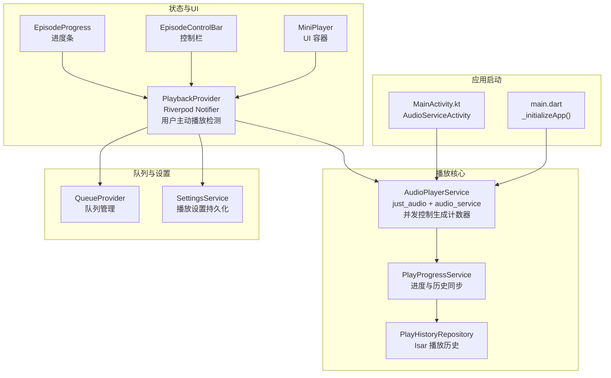
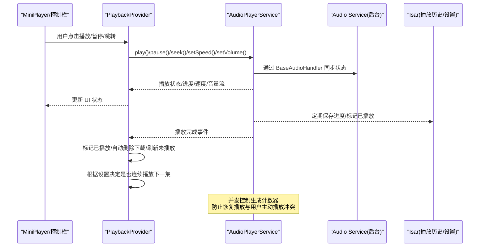
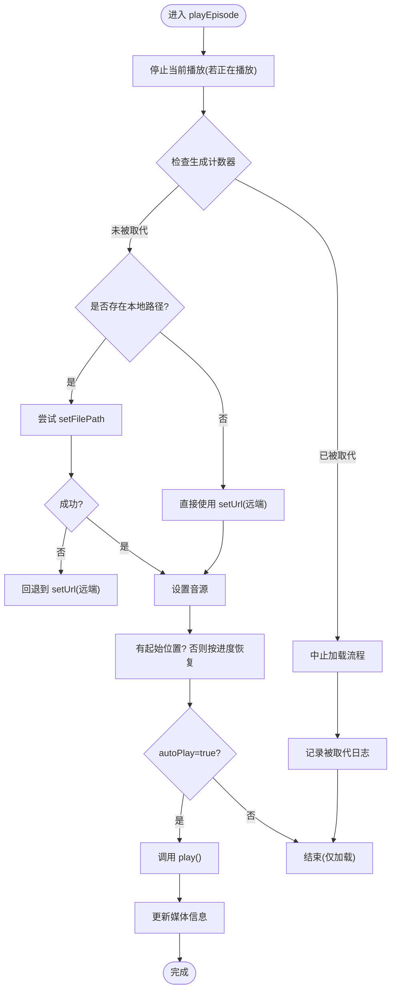
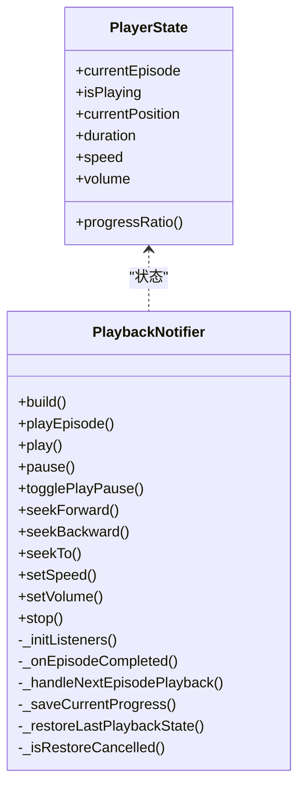
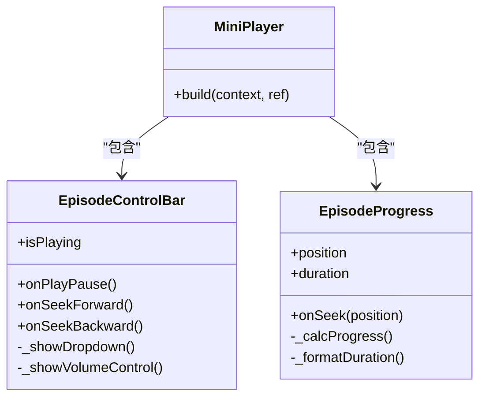
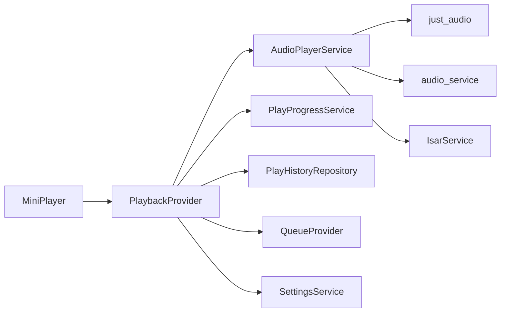

# 音频播放系统

<cite>
**本文引用的文件**   
- [audio_player_service.dart](file://lib/data/services/audio_player_service.dart)
- [playback_provider.dart](file://lib/presentation/providers/playback_provider.dart)
- [mini_player.dart](file://lib/presentation/widgets/organisms/mini_player/mini_player.dart)
- [episode_control_bar.dart](file://lib/presentation/widgets/organisms/mini_player/episode_control_bar/episode_control_bar.dart)
- [episode_progress.dart](file://lib/presentation/widgets/organisms/mini_player/episode_progress.dart)
- [play_progress_service.dart](file://lib/core/services/play_progress_service.dart)
- [play_history_repository_impl.dart](file://lib/data/repositories/play_history_repository_impl.dart)
- [queue_provider.dart](file://lib/presentation/providers/queue_provider.dart)
- [settings_service.dart](file://lib/data/services/settings_service.dart)
- [main.dart](file://lib/main.dart)
- [MainActivity.kt](file://android/app/src/main/kotlin/com/example/tinycast/MainActivity.kt)
</cite>

## 更新摘要
**所做更改**   
- 新增并发控制生成计数器系统，防止恢复播放与用户主动播放之间的竞态条件
- 增强 AudioPlayerService 的加载流程管理，确保被取代的加载操作优雅终止
- 更新 PlaybackProvider 的状态恢复机制，添加用户主动播放检测
- 完善错误处理和资源释放逻辑

## 目录
1. [简介](#简介)
2. [项目结构](#项目结构)
3. [核心组件](#核心组件)
4. [架构总览](#架构总览)
5. [详细组件分析](#详细组件分析)
6. [依赖关系分析](#依赖关系分析)
7. [性能与内存优化](#性能与内存优化)
8. [故障排查指南](#故障排查指南)
9. [结论](#结论)
10. [附录：配置项与参数说明](#附录配置项与参数说明)

## 简介
本文件为 TinyCast 的音频播放系统提供系统化文档，覆盖播放器架构、播放状态管理、后台播放实现、队列与进度跟踪、错误处理与内存优化等。内容基于仓库中的实际代码，重点解释 AudioPlayerService 的播放控制方法、PlaybackProvider 的状态管理、MiniPlayer 的 UI 组件，以及与 Just Audio、Audio Service 的关系。

**更新** 新增了并发控制生成计数器系统，有效防止恢复播放与用户主动播放之间的竞态条件，确保播放操作的顺序性和一致性。

## 项目结构
音频播放相关的关键位置与职责如下：
- 数据服务层：AudioPlayerService（封装 just_audio 与 audio_service）、PlayProgressService（统一进度与历史同步）
- 表现层状态：PlaybackProvider（Riverpod Notifier，聚合播放状态、自动保存、连续播放、睡眠定时器等）
- UI 组件：MiniPlayer 及其子组件 EpisodeControlBar、EpisodeProgress
- 数据持久化：PlayHistoryRepository（Isar 播放历史）、QueueProvider（队列管理与自动下一集）
- 应用初始化：main.dart 中初始化 Isar、AudioPlayerService；Android MainActivity 继承 AudioServiceActivity

图表来源 
- [main.dart:170-194](file://lib/main.dart#L170-L194)
- [MainActivity.kt:1-5](file://android/app/src/main/kotlin/com/example/tinycast/MainActivity.kt#L1-L5)
- [audio_player_service.dart:100-134](file://lib/data/services/audio_player_service.dart#L100-L134)
- [play_progress_service.dart:1-146](file://lib/core/services/play_progress_service.dart#L1-L146)
- [playback_provider.dart:64-101](file://lib/presentation/providers/playback_provider.dart#L64-L101)
- [mini_player.dart:9-54](file://lib/presentation/widgets/organisms/mini_player/mini_player.dart#L9-L54)
- [episode_control_bar.dart:15-31](file://lib/presentation/widgets/organisms/mini_player/episode_control_bar/episode_control_bar.dart#L15-L31)
- [episode_progress.dart:8-51](file://lib/presentation/widgets/organisms/mini_player/episode_progress.dart#L8-L51)
- [queue_provider.dart:78-85](file://lib/presentation/providers/queue_provider.dart#L78-L85)
- [settings_service.dart:8-40](file://lib/data/services/settings_service.dart#L8-L40)

章节来源
- [main.dart:170-194](file://lib/main.dart#L170-L194)
- [MainActivity.kt:1-5](file://android/app/src/main/kotlin/com/example/tinycast/MainActivity.kt#L1-L5)

## 核心组件
- AudioPlayerService
  - 封装 just_audio 的 AudioPlayer，暴露播放控制方法（play/pause/seek/skip/setSpeed/setVolume/stop/loadEpisode/playEpisode）
  - 通过 audio_service 的 BaseAudioHandler 实现后台播放与媒体通知
  - 维护播放状态流、进度流、速度/音量流、当前剧集流、完成事件流
  - 本地/远程音频优先策略：优先查找已下载本地文件，不存在则回退到远端 URL
  - **新增并发控制**：使用 `_loadGeneration` 生成计数器防止恢复播放与用户主动播放的竞态条件
  - 播放完成后仅发送事件，业务逻辑由 PlaybackProvider 处理
- PlaybackProvider
  - Riverpod Notifier，聚合播放器状态（当前剧集、是否播放、当前位置、总时长、速度、音量）
  - 监听 AudioPlayerService 的多个 Stream，更新 UI 状态
  - 自动保存播放进度（定时器+阈值），切换剧集时保存上一条记录
  - 播放完成后的业务编排：标记已播放、可选自动删除下载、刷新未播放列表、睡眠定时器检查、连续播放下一集
  - 应用启动恢复：从 PlayHistoryRepository 获取最近播放记录并恢复 UI 与播放器加载（不自动播放）
  - **新增用户主动播放检测**：`_userInitiatedPlayback` 标志位和 `_restoreGeneration` 计数器
- MiniPlayer 及子组件
  - MiniPlayer 作为容器，展示 EpisodeInfo、EpisodeControlBar、EpisodeProgress
  - EpisodeControlBar 提供播放/暂停、前进/后退、播放速度下拉菜单、音量弹出控制
  - EpisodeProgress 自定义绘制进度轨道与拖动手柄，支持点击与拖动跳转
- PlayProgressService
  - 统一更新播放进度与"已播放"状态，同时同步到 Episode 缓存（Isar）
  - 创建或更新 PlayHistory 记录，保证历史记录与 Episode 缓存一致性
- PlayHistoryRepository
  - 基于 Isar 的播放历史读写，支持按 episodeId/guid/itunesId 查找、更新进度、标记完成、软删除等
- QueueProvider
  - 管理播放队列（添加、移除、清空、插入队首），在播放完成后优先从队列取下一集
- SettingsService
  - 集中管理播放相关设置（速度、音量、快进/后退时间、连续播放、睡眠定时器等），并提供 watch 流用于多窗口同步

章节来源
- [audio_player_service.dart:31-134](file://lib/data/services/audio_player_service.dart#L31-L134)
- [audio_player_service.dart:192-300](file://lib/data/services/audio_player_service.dart#L192-L300)
- [audio_player_service.dart:345-467](file://lib/data/services/audio_player_service.dart#L345-L467)
- [audio_player_service.dart:586-652](file://lib/data/services/audio_player_service.dart#L586-L652)
- [playback_provider.dart:64-101](file://lib/presentation/providers/playback_provider.dart#L64-L101)
- [playback_provider.dart:169-214](file://lib/presentation/providers/playback_provider.dart#L169-L214)
- [playback_provider.dart:216-359](file://lib/presentation/providers/playback_provider.dart#L216-L359)
- [playback_provider.dart:361-436](file://lib/presentation/providers/playback_provider.dart#L361-L436)
- [playback_provider.dart:438-577](file://lib/presentation/providers/playback_provider.dart#L438-L577)
- [playback_provider.dart:583-607](file://lib/presentation/providers/playback_provider.dart#L583-L607)
- [mini_player.dart:9-54](file://lib/presentation/widgets/organisms/mini_player/mini_player.dart#L9-L54)
- [episode_control_bar.dart:15-31](file://lib/presentation/widgets/organisms/mini_player/episode_control_bar/episode_control_bar.dart#L15-L31)
- [episode_progress.dart:8-51](file://lib/presentation/widgets/organisms/mini_player/episode_progress.dart#L8-L51)
- [play_progress_service.dart:1-146](file://lib/core/services/play_progress_service.dart#L1-L146)
- [play_history_repository.dart:7-131](file://lib/data/repositories/play_history_repository_impl.dart#L7-L131)
- [queue_provider.dart:78-137](file://lib/presentation/providers/queue_provider.dart#L78-L137)
- [settings_service.dart:8-40](file://lib/data/services/settings_service.dart#L8-L40)

## 架构总览
TinyCast 的音频播放采用分层架构：UI 层通过 Riverpod Provider 订阅状态变化，状态层协调播放服务与数据层，播放服务封装底层 SDK（just_audio、audio_service）。

图表来源 
- [mini_player.dart:9-54](file://lib/presentation/widgets/organisms/mini_player/mini_player.dart#L9-L54)
- [playback_provider.dart:169-214](file://lib/presentation/providers/playback_provider.dart#L169-L214)
- [audio_player_service.dart:100-134](file://lib/data/services/audio_player_service.dart#L100-L134)
- [audio_player_service.dart:586-652](file://lib/data/services/audio_player_service.dart#L586-L652)
- [play_progress_service.dart:17-42](file://lib/core/services/play_progress_service.dart#L17-L42)

## 详细组件分析

### AudioPlayerService 播放控制与后台播放
- 初始化
  - 使用 AudioService.init 注册 _AudioPlayerHandler，配置 Android 通知通道与行为
  - 订阅 just_audio 的 playbackEventStream、playerStateStream、positionStream
  - 设置默认音量并广播初始值
- 播放控制
  - play/pause/togglePlayPause：直接调用 AudioPlayer 并记录日志
  - seek/seekForward/seekBackward：边界保护，避免越界
  - setSpeed/setVolume：范围校验与广播新值
  - stop：保存进度、清空当前剧集、广播空剧集
- 加载与播放
  - loadEpisode：仅加载不自动播放，用于恢复场景
  - playEpisode：加载并自动播放，更新 lastPlayedAt、媒体信息
  - 本地优先策略：先尝试 ApplicationSupportDirectory，再回退到 DocumentsDirectory，最后使用远端 URL
  - **新增并发控制**：使用 `_loadGeneration` 生成计数器，每次加载递增，被更新的加载流程会使旧流程中止
- 播放完成
  - 仅发送 episodeCompletedStream，业务逻辑交由 PlaybackProvider 处理
- 后台播放
  - _AudioPlayerHandler 将 just_audio 状态映射到 audio_service 的 playbackState，支持锁屏控制、媒体通知、系统动作

图表来源 
- [audio_player_service.dart:192-300](file://lib/data/services/audio_player_service.dart#L192-L300)
- [audio_player_service.dart:302-324](file://lib/data/services/audio_player_service.dart#L302-L324)
- [audio_player_service.dart:326-343](file://lib/data/services/audio_player_service.dart#L326-L343)

章节来源
- [audio_player_service.dart:100-134](file://lib/data/services/audio_player_service.dart#L100-L134)
- [audio_player_service.dart:192-300](file://lib/data/services/audio_player_service.dart#L192-L300)
- [audio_player_service.dart:345-467](file://lib/data/services/audio_player_service.dart#L345-L467)
- [audio_player_service.dart:586-652](file://lib/data/services/audio_player_service.dart#L586-L652)

### PlaybackProvider 状态管理与业务流程
- 构建与监听
  - build 中初始化监听器、自动保存定时器、睡眠定时器检查
  - 主窗口首次启动恢复上次播放状态（仅恢复 UI 与加载音频，不自动播放）
- 播放控制
  - play/pause/togglePlayPause：委托 AudioPlayerService，并在暂停或切换时保存进度
  - seekForward/seekBackward/seekTo：读取设置中的快进/后退时间，调用服务并保存进度
  - setSpeed/setVolume：调用服务并广播
  - stop：保存进度、标记完成（必要时）、清空当前剧集
- 播放完成处理
  - 从队列移除已完成剧集（若存在）
  - 标记已播放（PlayProgressService）
  - 根据设置自动删除已播放下载
  - 刷新未播放列表
  - 睡眠定时器检查（优先级高于连续播放）
  - 连续播放下一集（优先队列，其次未播放列表）
- 进度自动保存
  - 每 10 秒或进度变化超过阈值（5% 或 5 秒）触发保存
  - 保存时更新 PlayHistory 与 Episode 缓存
- 恢复流程
  - 查询最新播放历史，构造 Domain Episode，检查本地文件是否存在
  - 存在则调用 loadEpisode(startPosition)，失败则清理状态
  - **新增并发控制**：使用 `_restoreGeneration` 计数器和 `_isRestoreCancelled` 方法确保恢复流程不被用户主动播放中断

图表来源 
- [playback_provider.dart:23-62](file://lib/presentation/providers/playback_provider.dart#L23-L62)
- [playback_provider.dart:64-101](file://lib/presentation/providers/playback_provider.dart#L64-L101)
- [playback_provider.dart:169-214](file://lib/presentation/providers/playback_provider.dart#L169-L214)
- [playback_provider.dart:216-359](file://lib/presentation/providers/playback_provider.dart#L216-L359)
- [playback_provider.dart:361-436](file://lib/presentation/providers/playback_provider.dart#L361-L436)
- [playback_provider.dart:438-577](file://lib/presentation/providers/playback_provider.dart#L438-L577)
- [playback_provider.dart:583-607](file://lib/presentation/providers/playback_provider.dart#L583-L607)

章节来源
- [playback_provider.dart:64-101](file://lib/presentation/providers/playback_provider.dart#L64-L101)
- [playback_provider.dart:169-214](file://lib/presentation/providers/playback_provider.dart#L169-L214)
- [playback_provider.dart:216-359](file://lib/presentation/providers/playback_provider.dart#L216-L359)
- [playback_provider.dart:361-436](file://lib/presentation/providers/playback_provider.dart#L361-L436)
- [playback_provider.dart:438-577](file://lib/presentation/providers/playback_provider.dart#L438-L577)
- [playback_provider.dart:583-607](file://lib/presentation/providers/playback_provider.dart#L583-L607)

### MiniPlayer 与子组件
- MiniPlayer
  - 消费 playbackProvider 的 currentEpisode、isPlaying、currentPosition、duration
  - 组合 EpisodeInfo、EpisodeControlBar、EpisodeProgress
- EpisodeControlBar
  - 显示播放速度（文本）与播放控制按钮（后退、播放/暂停、前进）
  - 播放速度下拉菜单与音量弹出控制通过 Overlay 实现，避免遮挡
- EpisodeProgress
  - 自定义 CustomPainter 绘制轨道与手柄，支持点击与拖动跳转
  - 格式化时间为 mm:ss 或 hh:mm:ss

图表来源 
- [mini_player.dart:9-54](file://lib/presentation/widgets/organisms/mini_player/mini_player.dart#L9-L54)
- [episode_control_bar.dart:15-31](file://lib/presentation/widgets/organisms/mini_player/episode_control_bar/episode_control_bar.dart#L15-L31)
- [episode_progress.dart:8-51](file://lib/presentation/widgets/organisms/mini_player/episode_progress.dart#L8-L51)

章节来源
- [mini_player.dart:9-54](file://lib/presentation/widgets/organisms/mini_player/mini_player.dart#L9-L54)
- [episode_control_bar.dart:15-31](file://lib/presentation/widgets/organisms/mini_player/episode_control_bar/episode_control_bar.dart#L15-L31)
- [episode_progress.dart:8-51](file://lib/presentation/widgets/organisms/mini_player/episode_progress.dart#L8-L51)

### 播放队列与连续播放
- QueueProvider
  - 提供 addToQueue、removeFromQueueByEpisodeId、clearQueue、insertToQueueFront 等方法
  - 每次操作后 refresh 队列状态
- 连续播放策略
  - 播放完成后优先从队列取下一集，若无则从未播放列表取第一条
  - 若关闭连续播放，则停留在当前剧集

章节来源
- [queue_provider.dart:78-137](file://lib/presentation/providers/queue_provider.dart#L78-L137)
- [playback_provider.dart:320-359](file://lib/presentation/providers/playback_provider.dart#L320-L359)

### 播放进度与历史记录
- PlayProgressService
  - updatePlayProgress：更新 PlayHistory 并同步 Episode 缓存
  - markEpisodeAsPlayed：标记已播放并同步 Episode 缓存
  - createOrUpdatePlayHistory：创建或更新播放历史
- PlayHistoryRepository
  - 支持按 episodeId/guid/itunesId 查找记录
  - 更新进度、标记完成、软删除、批量清理等

章节来源
- [play_progress_service.dart:17-146](file://lib/core/services/play_progress_service.dart#L17-L146)
- [play_history_repository.dart:7-131](file://lib/data/repositories/play_history_repository_impl.dart#L7-L131)

### 设置与恢复
- SettingsService
  - 集中管理播放相关设置（速度、音量、快进/后退时间、连续播放、睡眠定时器等）
  - 提供 watch 流用于多窗口同步
- 应用启动恢复
  - main.dart 初始化 Isar 与 AudioPlayerService
  - PlaybackProvider 恢复上次播放状态（仅加载，不自动播放）

章节来源
- [settings_service.dart:8-40](file://lib/data/services/settings_service.dart#L8-L40)
- [main.dart:170-194](file://lib/main.dart#L170-L194)
- [playback_provider.dart:438-577](file://lib/presentation/providers/playback_provider.dart#L438-L577)

## 依赖关系分析
- AudioPlayerService 依赖 just_audio 与 audio_service，内部持有 IsarService 用于更新 lastPlayedAt
- PlaybackProvider 依赖 AudioPlayerService、PlayProgressService、PlayHistoryRepository、QueueProvider、SettingsService
- MiniPlayer 依赖 PlaybackProvider 提供的状态
- QueueProvider 依赖队列 UseCase 与 Repository（不在本节展开）
- SettingsService 依赖 Isar 与 SharedPreferences（迁移）

图表来源 
- [audio_player_service.dart:1-11](file://lib/data/services/audio_player_service.dart#L1-L11)
- [playback_provider.dart:1-21](file://lib/presentation/providers/playback_provider.dart#L1-L21)
- [mini_player.dart:1-8](file://lib/presentation/widgets/organisms/mini_player/mini_player.dart#L1-L8)

章节来源
- [audio_player_service.dart:1-11](file://lib/data/services/audio_player_service.dart#L1-L11)
- [playback_provider.dart:1-21](file://lib/presentation/providers/playback_provider.dart#L1-L21)
- [mini_player.dart:1-8](file://lib/presentation/widgets/organisms/mini_player/mini_player.dart#L1-L8)

## 性能与内存优化
- 流式订阅管理
  - AudioPlayerService 使用 broadcast StreamController，PlaybackProvider 在 dispose 中取消所有订阅，避免内存泄漏
- 进度保存节流
  - 每 10 秒或进度变化超过阈值才保存，减少数据库写入频率
- 本地文件优先
  - 优先使用本地文件，降低网络开销与缓冲延迟
- 播放器资源释放
  - dispose 中释放 AudioPlayer、关闭所有控制器与订阅
- 队列与历史记录
  - 播放完成后及时移除队列项，避免冗余数据
- 设置变更监听
  - SettingsService 提供 watch 流，避免频繁读取磁盘
- **新增并发控制优化**
  - 生成计数器避免重复加载和资源竞争
  - 优雅终止被取代的加载流程，防止资源浪费

章节来源
- [audio_player_service.dart:560-583](file://lib/data/services/audio_player_service.dart#L560-L583)
- [playback_provider.dart:361-436](file://lib/presentation/providers/playback_provider.dart#L361-L436)
- [audio_player_service.dart:192-300](file://lib/data/services/audio_player_service.dart#L192-L300)
- [playback_provider.dart:216-359](file://lib/presentation/providers/playback_provider.dart#L216-L359)
- [settings_service.dart:42-63](file://lib/data/services/settings_service.dart#L42-L63)

## 故障排查指南
- 无法播放或黑屏
  - 检查 AudioPlayerService 初始化是否成功（日志输出）
  - 确认本地文件路径是否存在，或远端 URL 可访问
  - 查看 _loadEpisodeAudio 的错误日志与回退逻辑
- 后台播放无效
  - 确认 Android MainActivity 继承 AudioServiceActivity
  - 检查 AudioService.init 的配置与通知通道 ID
- 进度未保存或恢复失败
  - 检查 PlayProgressService.updatePlayProgress 与 markEpisodeAsPlayed 是否被调用
  - 查看 PlayHistoryRepository 的记录是否存在与正确更新
- 连续播放不生效
  - 检查 SettingsService.continuousPlay 设置
  - 确认队列是否为空，或未播放列表是否有数据
- 睡眠定时器未触发
  - 检查 sleepTimer 与 sleepTimerEndTimeMillis 的设置
  - 查看 PlaybackProvider 的 _evaluateSleepTimer 逻辑
- **新增并发相关问题**
  - 检查 `_loadGeneration` 和 `_restoreGeneration` 计数器是否正确递增
  - 确认 `_isLoadSuperseded` 和 `_isRestoreCancelled` 方法逻辑正常
  - 查看被取代加载流程的日志输出

章节来源
- [audio_player_service.dart:192-300](file://lib/data/services/audio_player_service.dart#L192-L300)
- [audio_player_service.dart:100-134](file://lib/data/services/audio_player_service.dart#L100-L134)
- [MainActivity.kt:1-5](file://android/app/src/main/kotlin/com/example/tinycast/MainActivity.kt#L1-L5)
- [play_progress_service.dart:17-146](file://lib/core/services/play_progress_service.dart#L17-L146)
- [play_history_repository.dart:7-131](file://lib/data/repositories/play_history_repository_impl.dart#L7-L131)
- [playback_provider.dart:120-149](file://lib/presentation/providers/playback_provider.dart#L120-L149)

## 结论
TinyCast 的音频播放系统以 AudioPlayerService 为核心，结合 PlaybackProvider 的状态管理与 MiniPlayer 的 UI 交互，实现了完整的播放控制、后台播放、进度跟踪、历史记录与队列管理。通过 just_audio 与 audio_service 的集成，系统在移动端提供了稳定的播放体验。合理的节流保存、本地优先策略与资源释放机制保障了性能与内存安全。

**更新** 新增的并发控制生成计数器系统有效解决了恢复播放与用户主动播放之间的竞态条件问题，确保了播放操作的顺序性和一致性，提升了系统的稳定性和用户体验。

## 附录：配置项与参数说明
- AudioPlayerService
  - init：初始化播放器与后台服务
  - playEpisode/ loadEpisode：播放或加载指定剧集，支持 startPosition
  - play/pause/seek/seekForward/seekBackward/setSpeed/setVolume/stop：基础控制方法
  - 流：playbackStateStream、progressStream、speedStream、volumeStream、currentEpisodeStream、episodeCompletedStream
  - **新增属性**：`_loadGeneration` 生成计数器，用于并发控制
- PlaybackProvider
  - PlayerState：currentEpisode、isPlaying、currentPosition、duration、speed、volume、progressRatio
  - 方法：playEpisode、play、pause、togglePlayPause、seekForward、seekBackward、seekTo、setSpeed、setVolume、stop
  - 自动保存：每 10 秒或进度变化超阈值
  - 恢复：应用启动时恢复上次播放状态（仅加载）
  - **新增属性**：`_restoreGeneration` 恢复计数器、`_userInitiatedPlayback` 用户主动播放标志
- MiniPlayer 与子组件
  - MiniPlayer：组合 EpisodeInfo、EpisodeControlBar、EpisodeProgress
  - EpisodeControlBar：播放控制、速度下拉、音量弹出
  - EpisodeProgress：进度条与时间标签
- PlayProgressService
  - updatePlayProgress：更新进度与 Episode 缓存
  - markEpisodeAsPlayed：标记已播放并同步 Episode 缓存
  - createOrUpdatePlayHistory：创建或更新播放历史
- PlayHistoryRepository
  - getCompletedHistories/getLatestPlayingHistory/saveOrUpdate/updateProgress/markAsPlayedWithProgress/isEpisodePlayed 等
- QueueProvider
  - addToQueue/removeFromQueue/clearQueue/insertToQueueFront/removeFromQueueByEpisodeId/refresh
- SettingsService
  - playbackSpeed/volume/skipForwardTime/skipBackwardTime/continuousPlay/sleepTimer/sleepTimerEndTimeMillis 等

章节来源
- [audio_player_service.dart:31-134](file://lib/data/services/audio_player_service.dart#L31-L134)
- [audio_player_service.dart:302-467](file://lib/data/services/audio_player_service.dart#L302-L467)
- [playback_provider.dart:23-62](file://lib/presentation/providers/playback_provider.dart#L23-L62)
- [playback_provider.dart:583-607](file://lib/presentation/providers/playback_provider.dart#L583-L607)
- [mini_player.dart:9-54](file://lib/presentation/widgets/organisms/mini_player/mini_player.dart#L9-L54)
- [episode_control_bar.dart:15-31](file://lib/presentation/widgets/organisms/mini_player/episode_control_bar/episode_control_bar.dart#L15-L31)
- [episode_progress.dart:8-51](file://lib/presentation/widgets/organisms/mini_player/episode_progress.dart#L8-L51)
- [play_progress_service.dart:17-146](file://lib/core/services/play_progress_service.dart#L17-L146)
- [play_history_repository.dart:7-131](file://lib/data/repositories/play_history_repository_impl.dart#L7-L131)
- [queue_provider.dart:78-137](file://lib/presentation/providers/queue_provider.dart#L78-L137)
- [settings_service.dart:8-40](file://lib/data/services/settings_service.dart#L8-L40)