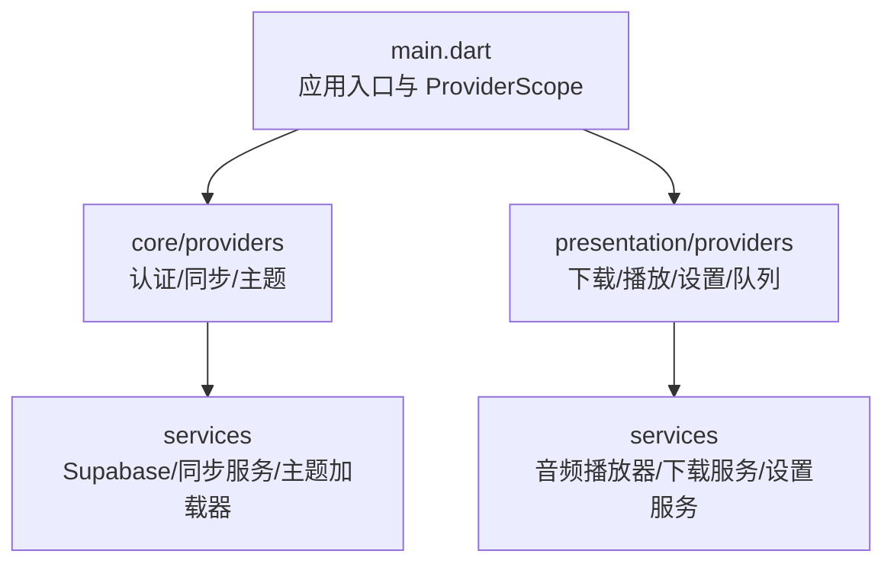
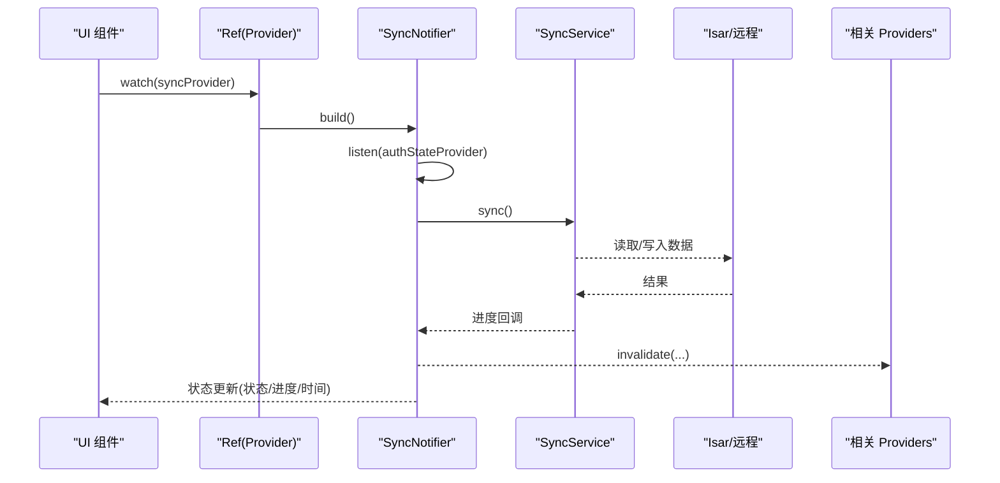
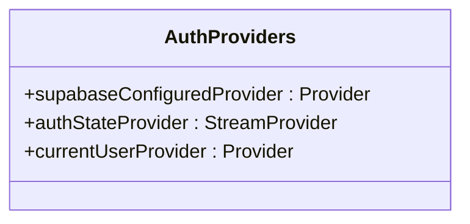
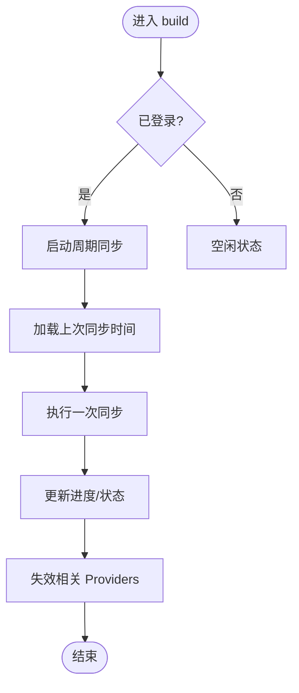
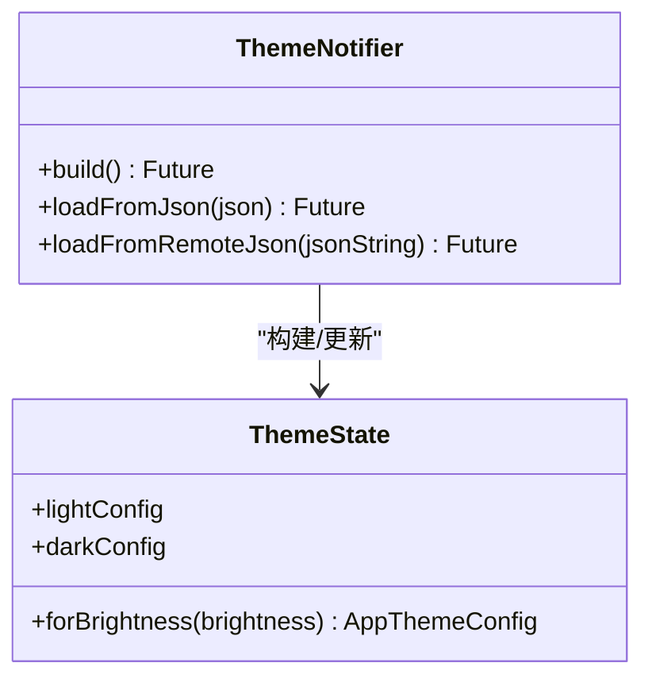
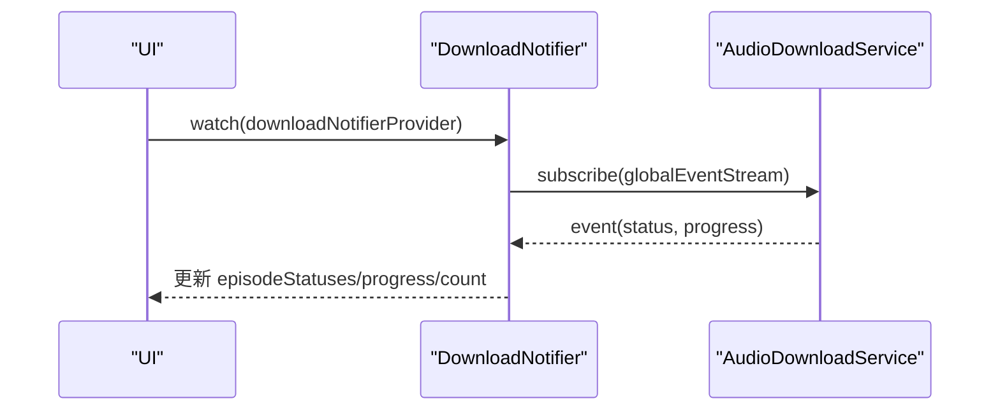
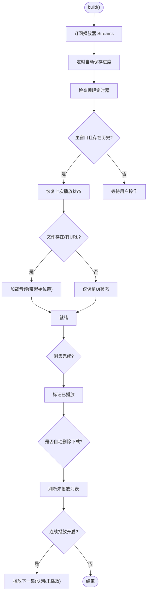
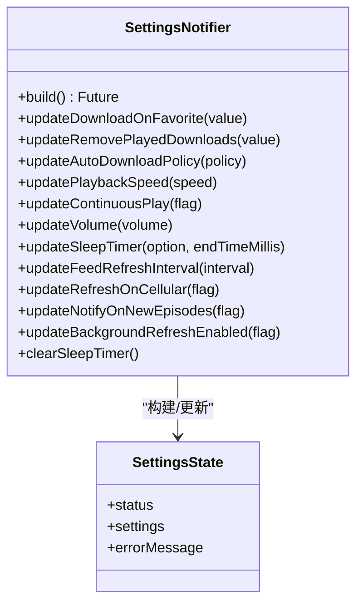
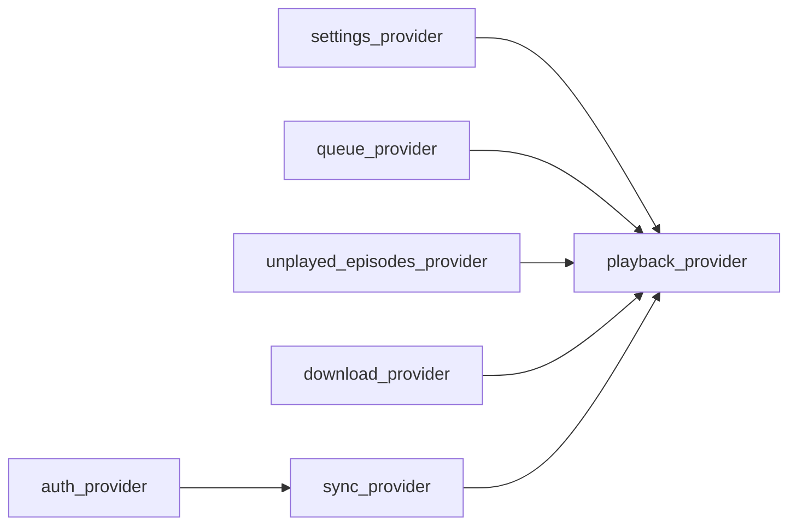

# 状态管理

<cite>
**本文引用的文件**   
- [pubspec.yaml](file://pubspec.yaml)
- [main.dart](file://main.dart)
- [base_provider.dart](file://lib/presentation/providers/base_provider.dart)
- [auth_provider.dart](file://lib/core/providers/auth_provider.dart)
- [sync_provider.dart](file://lib/core/providers/sync_provider.dart)
- [theme_provider.dart](file://lib/core/providers/theme_provider.dart)
- [download_provider.dart](file://lib/presentation/providers/download_provider.dart)
- [playback_provider.dart](file://lib/presentation/providers/playback_provider.dart)
- [settings_provider.dart](file://lib/presentation/providers/settings_provider.dart)
</cite>

## 目录
1. [简介](#简介)
2. [项目结构](#项目结构)
3. [核心组件](#核心组件)
4. [架构总览](#架构总览)
5. [详细组件分析](#详细组件分析)
6. [依赖关系分析](#依赖关系分析)
7. [性能考虑](#性能考虑)
8. [故障排查指南](#故障排查指南)
9. [结论](#结论)
10. [附录](#附录)

## 简介
本文件为 TinyCast 的状态管理系统提供系统化文档，聚焦 Riverpod 3.x 的使用方式与最佳实践。内容涵盖 Provider 设计模式（StateProvider、NotifierProvider、FutureProvider/AsyncNotifierProvider）的应用场景、状态流管理与响应式编程模式、状态更新机制、依赖注入与生命周期管理、性能优化技巧与调试方法，以及常见问题的解决方案。文档兼顾初学者友好性与高级技术细节，帮助读者在项目中正确、高效地使用 Riverpod。

## 项目结构
TinyCast 将状态管理集中在 core 与 presentation 两个层次：
- core/providers：跨功能共享的领域级状态（如认证、同步、主题）。
- presentation/providers：面向页面或功能的 UI 层状态（如下载、播放、设置、队列等）。
- main.dart：应用启动时通过 ProviderScope 提供全局依赖容器，初始化基础设施服务。

图表来源
- [main.dart:106-176](file://main.dart#L106-L176)
- [auth_provider.dart:1-22](file://lib/core/providers/auth_provider.dart#L1-L22)
- [sync_provider.dart:1-168](file://lib/core/providers/sync_provider.dart#L1-L168)
- [theme_provider.dart:1-92](file://lib/core/providers/theme_provider.dart#L1-L92)
- [download_provider.dart:1-156](file://lib/presentation/providers/download_provider.dart#L1-L156)
- [playback_provider.dart:1-766](file://lib/presentation/providers/playback_provider.dart#L1-L766)
- [settings_provider.dart:1-185](file://lib/presentation/providers/settings_provider.dart#L1-L185)

章节来源
- [pubspec.yaml:54-58](file://pubspec.yaml#L54-L58)
- [main.dart:106-176](file://main.dart#L106-L176)

## 核心组件
- 基础工具类 BaseProvider：封装通用 Provider 创建方式（同步、异步、Stream），便于统一风格与复用。
- 认证 Provider（StreamProvider）：基于 Supabase 认证事件流暴露当前用户状态。
- 同步 Notifier（NotifierProvider）：周期性同步、进度与错误状态管理，并在完成后失效相关 Provider。
- 主题 AsyncNotifier（AsyncNotifierProvider）：异步加载主题配置，支持 JSON 动态覆盖。
- 下载 Notifier（NotifierProvider）：订阅全局下载事件流，维护各剧集的下载状态与进度。
- 播放 Notifier（NotifierProvider）：聚合播放器状态、自动保存进度、连续播放、睡眠定时器等复杂逻辑。
- 设置 AsyncNotifier（AsyncNotifierProvider）：监听 Isar Settings Stream，提供统一的设置读写 API。

章节来源
- [base_provider.dart:1-28](file://lib/presentation/providers/base_provider.dart#L1-L28)
- [auth_provider.dart:1-22](file://lib/core/providers/auth_provider.dart#L1-L22)
- [sync_provider.dart:1-168](file://lib/core/providers/sync_provider.dart#L1-L168)
- [theme_provider.dart:1-92](file://lib/core/providers/theme_provider.dart#L1-L92)
- [download_provider.dart:1-156](file://lib/presentation/providers/download_provider.dart#L1-L156)
- [playback_provider.dart:1-766](file://lib/presentation/providers/playback_provider.dart#L1-L766)
- [settings_provider.dart:1-185](file://lib/presentation/providers/settings_provider.dart#L1-L185)

## 架构总览
Riverpod 3.x 在 TinyCast 中的使用要点：
- 所有 Provider 通过 ProviderScope 提供，确保依赖注入与生命周期管理。
- 使用 Notifier/AsyncNotifier 管理可变状态，使用 StreamProvider/FutureProvider 处理外部流与一次性异步数据。
- 通过 ref.listen 监听其他 Provider 变化，实现跨模块联动（如登录态驱动同步任务）。
- 通过 ref.invalidate 精确失效缓存，避免全量重建。
- 在 build() 中订阅外部 Stream，并在 onDispose 中释放资源，保证内存安全。

图表来源
- [sync_provider.dart:41-155](file://lib/core/providers/sync_provider.dart#L41-L155)
- [auth_provider.dart:9-16](file://lib/core/providers/auth_provider.dart#L9-L16)

章节来源
- [main.dart:106-176](file://main.dart#L106-L176)
- [sync_provider.dart:1-168](file://lib/core/providers/sync_provider.dart#L1-L168)

## 详细组件分析

### 认证 Provider（StreamProvider）
- 职责：暴露 Supabase 认证状态与当前用户。
- 关键点：
  - 使用 StreamProvider 监听 onAuthStateChange，映射出 User?。
  - 未初始化时返回空值，避免 UI 崩溃。
  - 提供 currentUserProvider 直接读取当前用户快照。

图表来源
- [auth_provider.dart:5-21](file://lib/core/providers/auth_provider.dart#L5-L21)

章节来源
- [auth_provider.dart:1-22](file://lib/core/providers/auth_provider.dart#L1-L22)

### 同步 Provider（NotifierProvider）
- 职责：管理同步状态、周期同步、进度与错误信息；登录后自动触发同步。
- 关键点：
  - 使用 ref.listen 监听 authStateProvider，根据登录态启停定时器。
  - 使用 Timer.periodic 实现周期同步，requestSync 防抖触发。
  - 同步完成后调用 ref.invalidate 失效相关 Provider，确保数据一致性。
  - 在 onDispose 中清理定时器，避免内存泄漏。

图表来源
- [sync_provider.dart:47-151](file://lib/core/providers/sync_provider.dart#L47-L151)

章节来源
- [sync_provider.dart:1-168](file://lib/core/providers/sync_provider.dart#L1-L168)

### 主题 Provider（AsyncNotifierProvider）
- 职责：异步加载主题配置，支持默认配置与 JSON 覆盖。
- 关键点：
  - build() 异步加载 light/dark 配置，失败回退到默认配置。
  - 提供 loadFromJson/loadFromRemoteJson 动态更新主题。
  - 使用 AsyncData 包裹状态，UI 可区分加载中/成功/错误。

图表来源
- [theme_provider.dart:65-91](file://lib/core/providers/theme_provider.dart#L65-L91)

章节来源
- [theme_provider.dart:1-92](file://lib/core/providers/theme_provider.dart#L1-L92)

### 下载 Provider（NotifierProvider）
- 职责：订阅全局下载事件流，维护每集的状态与进度，暴露计数与完成列表。
- 关键点：
  - 在 build() 中订阅 AudioDownloadService.globalEventStream，增量更新状态。
  - 提供 manualRefresh/clearEpisode/clearAll 等方法控制状态。
  - 在 onDispose 中取消订阅，防止内存泄漏。

图表来源
- [download_provider.dart:51-135](file://lib/presentation/providers/download_provider.dart#L51-L135)

章节来源
- [download_provider.dart:1-156](file://lib/presentation/providers/download_provider.dart#L1-L156)

### 播放 Provider（NotifierProvider）
- 职责：聚合播放器状态、自动保存播放进度、连续播放、睡眠定时器、自动删除下载等。
- 关键点：
  - 在 build() 中订阅播放器多路 Stream（播放状态、进度、速度、音量、当前剧集、完成事件）。
  - 定时自动保存进度，按条件触发（时间或进度阈值）。
  - 播放完成时标记已播放、检查自动删除、刷新未播放列表、处理下一集。
  - 主窗口启动时恢复上次播放状态，并尝试从本地文件或远端 URL 加载。
  - 通过 settingsProvider 读取设置影响行为（连续播放、跳过时长、音量、速度等）。

图表来源
- [playback_provider.dart:83-733](file://lib/presentation/providers/playback_provider.dart#L83-L733)

章节来源
- [playback_provider.dart:1-766](file://lib/presentation/providers/playback_provider.dart#L1-L766)

### 设置 Provider（AsyncNotifierProvider）
- 职责：监听 Isar 设置 Stream，提供统一的设置读写 API，并在关键设置变更时重启后台任务。
- 关键点：
  - build() 先迁移旧存储（SharedPreferences→Isar），然后订阅 watchSettings() 实时更新。
  - 提供 update* 方法封装具体设置项的写入，必要时触发 FeedRefreshScheduler 重启。
  - 在 onDispose 中取消订阅，避免内存泄漏。

图表来源
- [settings_provider.dart:35-184](file://lib/presentation/providers/settings_provider.dart#L35-L184)

章节来源
- [settings_provider.dart:1-185](file://lib/presentation/providers/settings_provider.dart#L1-L185)

### 基础 Provider 工具（BaseProvider）
- 职责：统一创建 Provider 的方式（同步、异步、Stream、懒加载），减少样板代码。
- 关键点：
  - create<T>：普通 Provider。
  - createAsync<T>：FutureProvider。
  - createStream<T>：StreamProvider。
  - createLazy<T>：延迟创建的 Provider（按需实例化）。

章节来源
- [base_provider.dart:1-28](file://lib/presentation/providers/base_provider.dart#L1-L28)

## 依赖关系分析
- 依赖注入：应用入口通过 ProviderScope 提供全局容器，所有 Provider 通过 ref.read/watch 获取依赖。
- 跨 Provider 依赖：
  - SyncNotifier 依赖 authStateProvider 判断登录态。
  - PlaybackNotifier 依赖 settingsProvider、queueNotifierProvider、unplayedEpisodesNotifierProvider 等。
  - DownloadNotifier 依赖 AudioDownloadService 的全局事件流。
- 失效策略：SyncNotifier 在完成同步后主动 invalidate 多个相关 Provider，确保 UI 与数据一致。

图表来源
- [auth_provider.dart:9-16](file://lib/core/providers/auth_provider.dart#L9-L16)
- [sync_provider.dart:143-150](file://lib/core/providers/sync_provider.dart#L143-L150)
- [playback_provider.dart:104-113](file://lib/presentation/providers/playback_provider.dart#L104-L113)
- [download_provider.dart:51-94](file://lib/presentation/providers/download_provider.dart#L51-L94)

章节来源
- [sync_provider.dart:143-150](file://lib/core/providers/sync_provider.dart#L143-L150)
- [playback_provider.dart:104-113](file://lib/presentation/providers/playback_provider.dart#L104-L113)

## 性能考虑
- 最小化重建：
  - 使用 ref.watch 精确订阅所需字段，避免整对象重建。
  - 将大对象拆分为多个小 Provider，按需组合。
- 合理失效：
  - 使用 ref.invalidate 精准失效缓存，而非强制重建整个树。
- 流式更新：
  - 优先使用 StreamProvider/AsyncNotifier 处理外部流，避免轮询。
- 资源管理：
  - 在 onDispose 中取消订阅与定时器，防止内存泄漏。
- 计算卸载：
  - 对耗时计算使用 compute() 或后台 Isolate（本项目未直接使用，但建议遵循）。
- 依赖版本：
  - Riverpod 3.x 移除 StateNotifier，采用 Notifier/AsyncNotifier，API 更简洁且性能更好。

[本节为通用指导，不直接分析具体文件]

## 故障排查指南
- 常见问题与解决：
  - 未包裹 ProviderScope：导致无法访问任何 Provider。需在 main.dart 中确保 runApp 前包裹 ProviderScope。
  - 未初始化 Supabase：authStateProvider 返回空值，需检查环境变量与初始化流程。
  - 同步失败：检查网络、权限、数据库连接；查看 Logger 输出与 errorMessage。
  - 播放状态不同步：确认播放器 Stream 订阅正常，检查自动保存与完成事件处理。
  - 设置未生效：确认 Isar 迁移成功，watchSettings() 是否正常推送。
- 调试技巧：
  - 使用 Logger 输出关键路径日志（项目已集成）。
  - 使用 DevTools 观察 Provider 状态与重建次数。
  - 在 Notifier.build() 中打印订阅与事件，定位流式问题。

章节来源
- [main.dart:106-176](file://main.dart#L106-L176)
- [auth_provider.dart:9-16](file://lib/core/providers/auth_provider.dart#L9-L16)
- [sync_provider.dart:132-141](file://lib/core/providers/sync_provider.dart#L132-L141)
- [playback_provider.dart:169-214](file://lib/presentation/providers/playback_provider.dart#L169-L214)
- [settings_provider.dart:44-61](file://lib/presentation/providers/settings_provider.dart#L44-L61)

## 结论
TinyCast 基于 Riverpod 3.x 构建了清晰、可扩展的状态管理体系。通过 Notifier/AsyncNotifier 管理复杂业务状态，StreamProvider/FutureProvider 处理外部流与异步数据，结合 ref.listen/ref.invalidate 实现跨模块联动与精准失效。该体系在保证性能的同时，提供了良好的可维护性与可测试性。建议在新增功能时遵循现有模式，保持状态边界清晰、依赖关系简单、资源释放完善。

[本节为总结，不直接分析具体文件]

## 附录
- Riverpod 3.x 迁移要点：
  - 移除 StateNotifier，改用 Notifier/AsyncNotifier。
  - StateNotifierProvider → NotifierProvider。
  - valueOrNull → value。
- 推荐实践：
  - 每个功能模块一个 Notifier，职责单一。
  - 使用 AsyncNotifier 处理异步数据，避免阻塞 UI。
  - 在 build() 中订阅外部流，onDispose 中释放资源。
  - 使用 ref.invalidate 精准失效，避免全量重建。

章节来源
- [.trae/specs/upgrade-dependencies/summary.md:18-65](file://.trae/specs/upgrade-dependencies/summary.md#L18-L65)