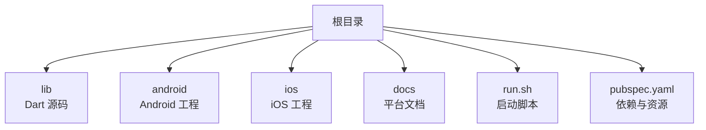
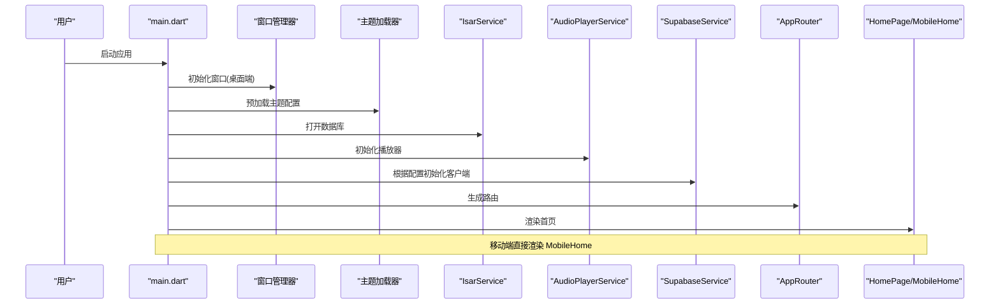
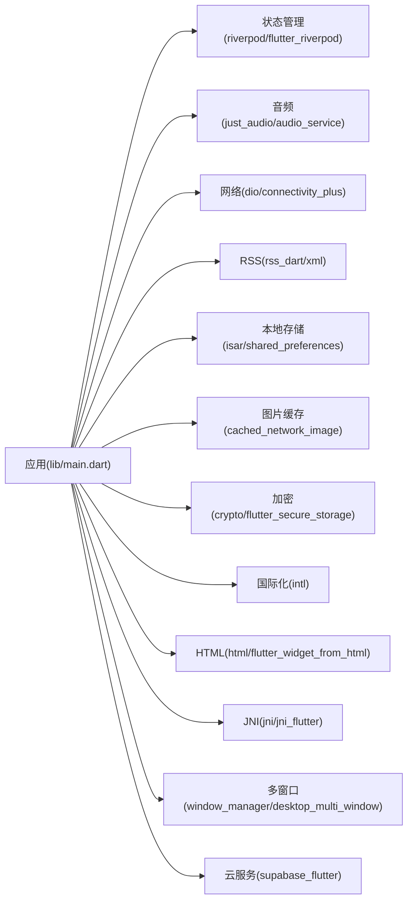

# 快速开始

<cite>
**本文引用的文件**
- [README.md](file://README.md)
- [pubspec.yaml](file://pubspec.yaml)
- [lib/main.dart](file://lib/main.dart)
- [android/app/build.gradle.kts](file://android/app/build.gradle.kts)
- [android/local.properties](file://android/local.properties)
- [android/app/src/main/AndroidManifest.xml](file://android/app/src/main/AndroidManifest.xml)
- [ios/Podfile](file://ios/Podfile)
- [ios/Runner/Info.plist](file://ios/Runner/Info.plist)
- [run.sh](file://run.sh)
- [docs/supabase_setup.md](file://docs/supabase_setup.md)
- [docs/PLATFORM_PERMISSIONS.md](file://docs/PLATFORM_PERMISSIONS.md)
- [analysis_options.yaml](file://analysis_options.yaml)
</cite>

## 目录
1. [简介](#简介)
2. [项目结构](#项目结构)
3. [核心组件](#核心组件)
4. [架构总览](#架构总览)
5. [详细组件分析](#详细组件分析)
6. [依赖分析](#依赖分析)
7. [性能考虑](#性能考虑)
8. [故障排除指南](#故障排除指南)
9. [结论](#结论)
10. [附录](#附录)

## 简介
本指南面向首次接触 TinyCast 的开发者，目标是帮助你从零开始搭建开发环境、安装依赖、配置平台（Android/iOS），并成功运行应用。同时提供常见问题的排查方法与基本使用示例，包括启动应用、订阅播客与播放音频等基础操作。

## 项目结构
TinyCast 是一个跨平台的 Flutter 应用，支持 Android、iOS、macOS、Windows、Linux 与 Web。根目录包含：
- lib：Dart 源码入口 main.dart 以及业务模块
- android / ios：原生平台工程与配置文件
- docs：平台权限与 Supabase 配置说明
- run.sh：一键启动脚本，自动加载 .env 环境变量并传入 flutter run
- pubspec.yaml：Flutter 依赖与资源声明

**章节来源**
- [README.md:1-6](file://README.md#L1-L6)
- [pubspec.yaml:1-196](file://pubspec.yaml#L1-L196)

## 核心组件
- 应用入口与初始化：main.dart 负责平台分支、窗口管理、主题预加载、数据库与播放器初始化、Supabase 初始化、路由与页面挂载。
- 构建与依赖：pubspec.yaml 声明了 UI、状态管理、音频、网络、RSS、本地存储、加密、国际化、HTML 处理、JNI、SharedPreferences、Supabase 等依赖。
- 平台配置：
  - Android：build.gradle.kts 指定 Java/Kotlin 版本与 SDK；AndroidManifest.xml 声明必要权限与服务；local.properties 指向 Android SDK 与 Flutter SDK。
  - iOS：Podfile 通过 CocoaPods 管理依赖；Info.plist 声明后台音频模式与应用信息。
- 启动脚本：run.sh 读取 .env 中的 Supabase 凭据，自动选择目标平台并执行 flutter run。

**章节来源**
- [lib/main.dart:106-194](file://lib/main.dart#L106-L194)
- [pubspec.yaml:18-144](file://pubspec.yaml#L18-L144)
- [android/app/build.gradle.kts:1-45](file://android/app/build.gradle.kts#L1-L45)
- [android/app/src/main/AndroidManifest.xml:1-65](file://android/app/src/main/AndroidManifest.xml#L1-L65)
- [android/local.properties:1-5](file://android/local.properties#L1-L5)
- [ios/Podfile:1-44](file://ios/Podfile#L1-L44)
- [ios/Runner/Info.plist:1-76](file://ios/Runner/Info.plist#L1-L76)
- [run.sh:1-66](file://run.sh#L1-L66)

## 架构总览
下图展示了应用启动时的关键流程：平台检测、窗口初始化、主题与日志初始化、数据库与播放器初始化、Supabase 初始化、路由与首页渲染。

**图表来源**
- [lib/main.dart:106-194](file://lib/main.dart#L106-L194)

## 详细组件分析

### 环境与依赖准备
- 安装 Flutter SDK 并确保命令行可用。
- 克隆仓库后进入项目根目录。
- 安装依赖：
  - 通用：flutter pub get
  - iOS：cd ios && pod install && cd ..
- 检查 IDE 插件：
  - VS Code：安装 Dart 与 Flutter 扩展
  - Android Studio：安装 Flutter 插件
- 验证设备：
  - Android：连接设备或启动模拟器，确保 adb 可用
  - iOS：Xcode 已安装且模拟器可用

**章节来源**
- [pubspec.yaml:1-196](file://pubspec.yaml#L1-L196)
- [ios/Podfile:1-44](file://ios/Podfile#L1-L44)

### Android 平台配置
- 要求：
  - Android SDK 路径在 local.properties 中正确指向
  - Java 11 兼容（由 build.gradle.kts 指定）
  - 必要的权限已在 AndroidManifest.xml 中声明（网络、前台服务、媒体播放等）
- 常见问题：
  - 找不到 Android SDK：检查 local.properties 的 sdk.dir
  - Java 版本不匹配：确保 JDK 为 11
  - 无法找到设备：确认 adb 与设备连接正常

**章节来源**
- [android/local.properties:1-5](file://android/local.properties#L1-L5)
- [android/app/build.gradle.kts:1-45](file://android/app/build.gradle.kts#L1-L45)
- [android/app/src/main/AndroidManifest.xml:1-65](file://android/app/src/main/AndroidManifest.xml#L1-L65)

### iOS 平台配置
- 要求：
  - Xcode 与命令行工具已安装
  - CocoaPods 已安装并可用
  - Podfile 能正确解析 FLUTTER_ROOT
- 常见问题：
  - pod install 失败：先执行 flutter pub get，再重试
  - 找不到 FLUTTER_ROOT：删除 Generated.xcconfig 后重新 pub get

**章节来源**
- [ios/Podfile:1-44](file://ios/Podfile#L1-L44)
- [ios/Runner/Info.plist:1-76](file://ios/Runner/Info.plist#L1-L76)

### 首次运行与基本使用
- 使用脚本一键启动：
  - macOS/Linux/Windows：./run.sh
  - 指定平台：./run.sh android 或 ./run.sh ios
- 手动运行：
  - flutter run -d <device> --dart-define=SUPABASE_URL=xxx --dart-define=SUPABASE_ANON_KEY=xxx
- 基本操作：
  - 启动后进入首页，可浏览节目列表
  - 订阅播客：在订阅界面输入 RSS 地址进行订阅
  - 播放音频：点击任意剧集即可播放，支持锁屏控制与通知栏控制（需平台权限）

**章节来源**
- [run.sh:1-66](file://run.sh#L1-L66)
- [lib/main.dart:106-194](file://lib/main.dart#L106-L194)
- [docs/supabase_setup.md:1-131](file://docs/supabase_setup.md#L1-L131)

### Supabase 配置（可选）
- 获取凭据：登录 Supabase Dashboard → Settings → API，复制 Project URL 与 anon public 密钥
- 配置方式：
  - 开发调试：创建 .env 文件，填入 SUPABASE_URL 与 SUPABASE_ANON_KEY
  - 构建发布：在命令中使用 --dart-define 传入
- 安全注意：
  - .env 不会被提交到仓库；但 run.sh 会把值通过 --dart-define 编译进产物，不能放 service_role 等密钥
  - 未配置时应用会跳过 Supabase 初始化，不影响其他功能

**章节来源**
- [docs/supabase_setup.md:1-131](file://docs/supabase_setup.md#L1-L131)
- [lib/main.dart:46-72](file://lib/main.dart#L46-L72)

### 平台权限说明
- 当前应用使用 path_provider 的应用沙盒目录存储数据，无需额外文件访问权限
- Android 需要网络与前台服务权限（已在清单中声明）
- iOS 需要后台音频模式（已在 Info.plist 中声明）

**章节来源**
- [docs/PLATFORM_PERMISSIONS.md:1-133](file://docs/PLATFORM_PERMISSIONS.md#L1-L133)
- [android/app/src/main/AndroidManifest.xml:1-65](file://android/app/src/main/AndroidManifest.xml#L1-L65)
- [ios/Runner/Info.plist:1-76](file://ios/Runner/Info.plist#L1-L76)

## 依赖分析
- 核心依赖类别：
  - UI 与图标：lucide_icons_flutter、flutter_svg
  - 状态管理：riverpod、flutter_riverpod
  - 音频：just_audio、audio_service
  - 网络：dio、dio_http2_adapter、connectivity_plus
  - RSS 解析：rss_dart、xml
  - 本地存储：isar_community、shared_preferences
  - 图片缓存：cached_network_image
  - 加密与安全：crypto、flutter_secure_storage
  - 国际化与 HTML：intl、html、flutter_widget_from_html
  - JNI 与多窗口：jni、jni_flutter、window_manager、desktop_multi_window
  - 云服务：supabase_flutter、flutter_acrylic
- 资源声明：assets/images、icons、gravity_icons、themes/*.conf

**图表来源**
- [pubspec.yaml:18-144](file://pubspec.yaml#L18-L144)

**章节来源**
- [pubspec.yaml:18-144](file://pubspec.yaml#L18-L144)

## 性能考虑
- 使用 Isar 作为轻量级高性能本地数据库，适合播客元数据与播放进度存储
- 使用 cached_network_image 缓存网络图片，减少重复下载
- audio_service 提供后台播放能力，避免前台进程被回收导致中断
- Dio 支持 HTTP/2 适配器，提升网络请求效率
- Riverpod 响应式状态管理，减少不必要的重建

[本节为通用指导，不直接分析具体文件]

## 故障排除指南
- 无法找到 Android SDK：
  - 检查 android/local.properties 的 sdk.dir 是否正确
- Java 版本错误：
  - 确保 JDK 为 11（build.gradle.kts 指定）
- iOS 构建失败：
  - 先执行 flutter pub get，再执行 pod install
  - 若提示 FLUTTER_ROOT 缺失，删除 Generated.xcconfig 后重新 pub get
- Supabase 未配置提示：
  - 检查 .env 是否包含正确的 SUPABASE_URL 与 SUPABASE_ANON_KEY
  - 或使用 --dart-define 传入参数
- 设备不可见：
  - Android：adb devices 检查连接
  - iOS：xcrun xctrace list devices 查看可用设备

**章节来源**
- [android/local.properties:1-5](file://android/local.properties#L1-L5)
- [android/app/build.gradle.kts:1-45](file://android/app/build.gradle.kts#L1-L45)
- [ios/Podfile:1-44](file://ios/Podfile#L1-L44)
- [docs/supabase_setup.md:1-131](file://docs/supabase_setup.md#L1-L131)

## 结论
通过以上步骤，你可以在本地完成 TinyCast 的环境搭建与首次运行。建议优先使用 run.sh 脚本简化启动流程，按需配置 Supabase 以启用云同步功能。遇到问题时参考故障排除指南与平台权限说明，逐步定位并解决。

[本节为总结性内容，不直接分析具体文件]

## 附录
- 代码分析与 Lint：
  - analysis_options.yaml 启用了推荐的 Flutter lints，可在 IDE 中查看静态分析结果
- 资源与主题：
  - assets/themes/*.conf 用于 HOCON 格式的主题配置，支持颜色与排版定义

**章节来源**
- [analysis_options.yaml:1-36](file://analysis_options.yaml#L1-L36)
- [pubspec.yaml:180-196](file://pubspec.yaml#L180-L196)