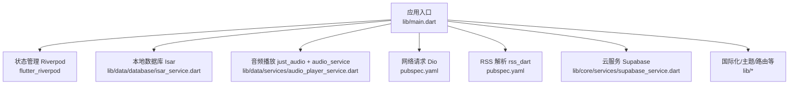
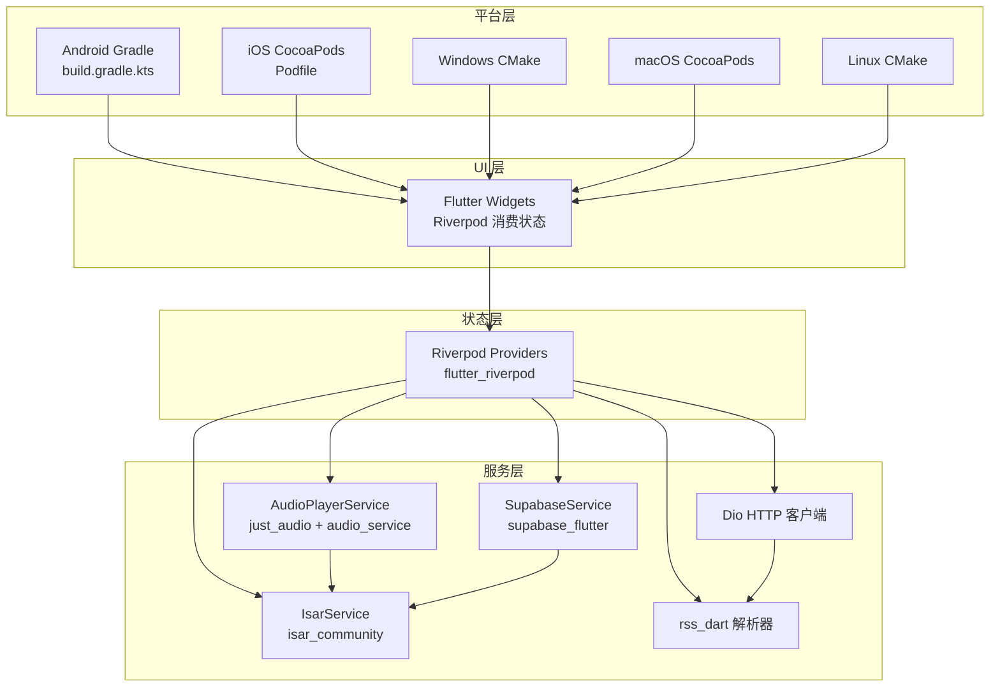
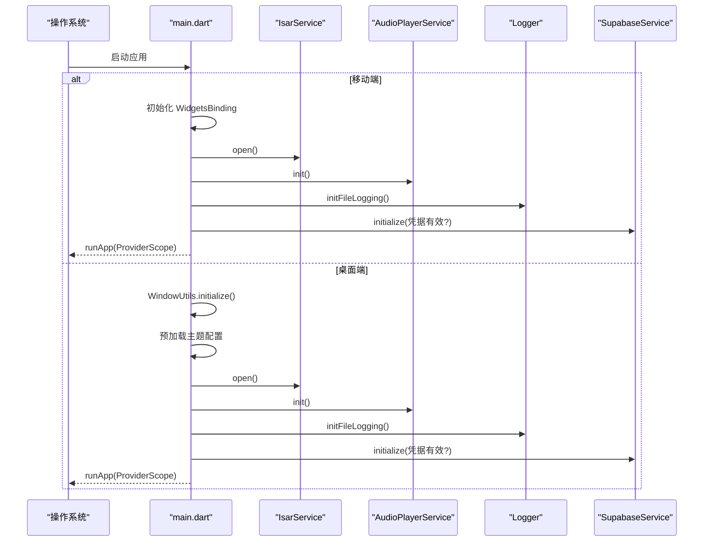
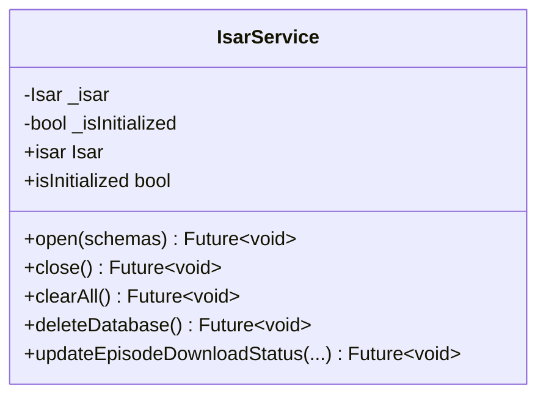
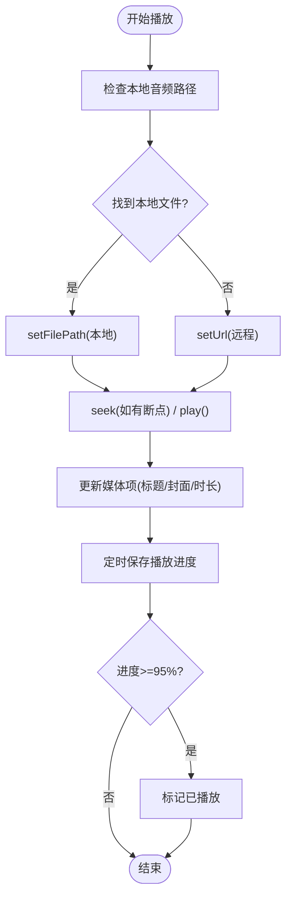
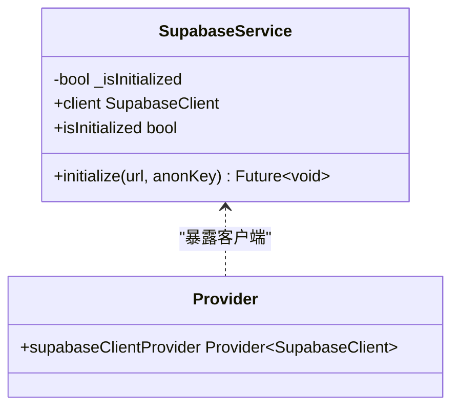
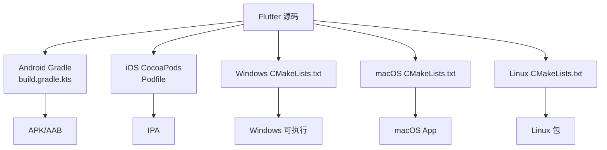
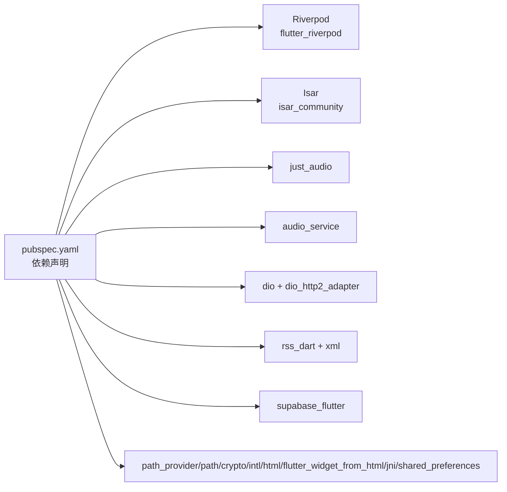

# 技术栈

<cite>
**本文引用的文件**   
- [pubspec.yaml](file://pubspec.yaml)
- [main.dart](file://lib/main.dart)
- [isar_service.dart](file://lib/data/database/isar_service.dart)
- [audio_player_service.dart](file://lib/data/services/audio_player_service.dart)
- [supabase_service.dart](file://lib/core/services/supabase_service.dart)
- [analysis_options.yaml](file://analysis_options.yaml)
- [devtools_options.yaml](file://devtools_options.yaml)
- [android/build.gradle.kts](file://android/app/build.gradle.kts)
- [ios/Podfile](file://ios/Podfile)
- [database.md](file://docs/database.md)
- [supabase_setup.md](file://docs/supabase_setup.md)
</cite>

## 目录
1. [简介](#简介)
2. [项目结构](#项目结构)
3. [核心组件](#核心组件)
4. [架构总览](#架构总览)
5. [详细组件分析](#详细组件分析)
6. [依赖关系分析](#依赖关系分析)
7. [性能考量](#性能考量)
8. [故障排查指南](#故障排查指南)
9. [结论](#结论)
10. [附录](#附录)

## 简介
本技术栈文档面向 TinyCast 播客应用的开发者，系统阐述 Flutter 作为跨平台框架的选型理由与优势，并逐项说明核心依赖库（Riverpod 3.x、Isar Community 3.x、just_audio + audio_service、Dio 5.x、rss_dart、Supabase Flutter SDK）的职责、版本约束与选择依据。同时覆盖 Android、iOS、Windows、macOS、Linux 多平台构建配置要点，以及开发工具链、代码分析与调试工具的使用建议，帮助团队在统一工程下高效交付高质量应用。

## 项目结构
TinyCast 采用 Flutter 标准工程结构，核心业务位于 lib 目录，按 core、data、domain、presentation 分层组织；各平台原生工程分别位于 android、ios、windows、macos、linux；资源与主题配置集中在 assets 与 docs。应用入口为 main.dart，负责初始化数据库、音频服务、日志与 Supabase 客户端，并根据运行平台与窗口参数启动不同界面。

图表来源
- [main.dart:106-194](file://lib/main.dart#L106-L194)
- [pubspec.yaml:18-144](file://pubspec.yaml#L18-L144)

章节来源
- [pubspec.yaml:1-196](file://pubspec.yaml#L1-L196)
- [main.dart:1-285](file://lib/main.dart#L1-L285)

## 核心组件
- Flutter 框架与 SDK
  - 作用：跨平台 UI 框架与运行时，支持移动端与桌面端统一开发体验。
  - 版本要求：Dart SDK ^3.9.2（见环境约束）。
  - 选择理由：一次编写、多端运行；丰富的生态与插件体系；对桌面端窗口管理与多窗口有良好支持。

- Riverpod 3.x 状态管理
  - 作用：响应式状态管理，提供 Provider/Consumer 模式，解耦 UI 与业务逻辑。
  - 版本：riverpod ^3.2.1、flutter_riverpod ^3.3.1。
  - 选择理由：类型安全、可测试性强、易于组合与复用；与 Flutter 生命周期集成良好。

- Isar Community 3.x 本地数据库
  - 作用：高性能 NoSQL 嵌入式数据库，用于存储播客、剧集、收藏、播放历史、队列与设置等数据。
  - 版本：is ar_community ^3.3.2、isar_community_flutter_libs ^3.3.2。
  - 选择理由：异步 API、类型安全、查询能力强；Inspector 便于开发期调试。

- just_audio + audio_service 音频播放
  - 作用：音频解码与播放控制，后台服务、锁屏控制、通知栏交互。
  - 版本：just_audio ^0.10.5、audio_service ^0.18.18。
  - 选择理由：跨平台稳定、支持本地与网络音频、完善的后台能力。

- Dio 5.x 网络请求
  - 作用：HTTP 客户端，支持拦截器、重试、HTTP/2 适配器、连接状态检测。
  - 版本：dio ^5.9.2、dio_http2_adapter ^2.0.0、connectivity_plus ^6.1.5。
  - 选择理由：功能完备、扩展性好、生态成熟。

- rss_dart RSS 解析
  - 作用：解析播客 RSS Feed，提取节目与剧集元数据。
  - 版本：rss_dart ^1.0.12、xml ^6.6.1。
  - 选择理由：轻量、专注 XML/RSS 解析，与 Dart 生态契合。

- Supabase Flutter SDK 云服务
  - 作用：认证、数据库、存储等后端能力集成。
  - 版本：supabase_flutter ^2.12.4。
  - 选择理由：开箱即用、与 Flutter 集成良好；支持环境变量注入与持久化会话。

章节来源
- [pubspec.yaml:18-144](file://pubspec.yaml#L18-L144)
- [supabase_setup.md:1-131](file://docs/supabase_setup.md#L1-L131)

## 架构总览
TinyCast 以 Flutter 为统一 UI 层，通过 Riverpod 进行状态驱动；数据层使用 Isar 做本地持久化，结合 Dio 与 rss_dart 完成网络与 RSS 数据获取；音频播放由 just_audio 与 audio_service 协同实现；云服务通过 Supabase 提供认证与同步能力。应用启动时完成数据库、音频服务、日志与 Supabase 的初始化，并按平台与窗口参数加载对应界面。

图表来源
- [main.dart:106-194](file://lib/main.dart#L106-L194)
- [pubspec.yaml:18-144](file://pubspec.yaml#L18-L144)
- [android/build.gradle.kts:1-45](file://android/app/build.gradle.kts#L1-L45)
- [ios/Podfile:1-44](file://ios/Podfile#L1-L44)

## 详细组件分析

### 应用启动与初始化流程
- 平台分支：移动端直接初始化并运行主界面；桌面端先初始化窗口工具与主题配置，再根据窗口参数创建不同窗口应用。
- 服务初始化：打开 Isar 数据库、初始化音频服务、开启文件日志；若配置了有效的 Supabase 凭据则初始化 Supabase 客户端。
- 生命周期：注册应用生命周期观察者，处理前台/后台切换时的刷新调度。

图表来源
- [main.dart:106-194](file://lib/main.dart#L106-L194)

章节来源
- [main.dart:106-194](file://lib/main.dart#L106-L194)

### Isar 数据库服务
- 职责：单例管理 Isar 实例，提供打开、关闭、清空、删除数据库等操作；封装常用写入事务（如更新下载状态）。
- 特性：启用 Inspector（非产品模式），便于开发期可视化检查数据；所有写操作在事务中执行保证原子性。
- 错误处理：捕获文件系统异常与通用异常，抛出明确错误信息。

图表来源
- [isar_service.dart:14-137](file://lib/data/database/isar_service.dart#L14-L137)

章节来源
- [isar_service.dart:1-137](file://lib/data/database/isar_service.dart#L1-L137)
- [database.md:1-502](file://docs/database.md#L1-L502)

### 音频播放服务
- 职责：封装 just_audio 播放器与 audio_service 后台控制；维护播放状态、进度、速度、音量等流式状态；处理本地与网络音频路径选择；保存播放进度与标记完成。
- 关键流程：初始化 AudioHandler；监听播放事件与状态变化；根据 downloadedPath 优先尝试本地文件，不存在则回退到远程 URL；播放完成后广播事件供上层处理。
- 错误处理：捕获播放、暂停、跳转、设置速度与音量等异常，记录日志并恢复播放器状态。

图表来源
- [audio_player_service.dart:100-174](file://lib/data/services/audio_player_service.dart#L100-L174)
- [audio_player_service.dart:192-300](file://lib/data/services/audio_player_service.dart#L192-L300)
- [audio_player_service.dart:469-507](file://lib/data/services/audio_player_service.dart#L469-L507)

章节来源
- [audio_player_service.dart:1-653](file://lib/data/services/audio_player_service.dart#L1-L653)

### Supabase 云服务集成
- 职责：单例管理 Supabase 客户端，提供初始化与访问接口；通过 Riverpod Provider 暴露客户端实例。
- 配置方式：支持 .env 与 --dart-define 编译时变量；未配置时跳过初始化不影响其他功能。
- 安全策略：敏感信息不打包进应用产物；优先读取 .env，其次使用编译参数。

图表来源
- [supabase_service.dart:1-55](file://lib/core/services/supabase_service.dart#L1-L55)

章节来源
- [supabase_service.dart:1-55](file://lib/core/services/supabase_service.dart#L1-L55)
- [supabase_setup.md:1-131](file://docs/supabase_setup.md#L1-L131)

### 多平台构建配置
- Android
  - 使用 Kotlin DSL 构建脚本，指定 Java/Kotlin 版本与 Flutter Gradle 插件；默认配置包含 debug/release 构建类型。
- iOS
  - 使用 CocoaPods 管理原生依赖；自动引入 Flutter 生成的 xcconfig；启用 use_frameworks! 与 flutter_install_all_ios_pods。
- Windows/macOS/Linux
  - 使用 CMake 构建 Flutter 桌面端；生成插件注册与头文件；遵循 Flutter 官方模板结构。

图表来源
- [android/build.gradle.kts:1-45](file://android/app/build.gradle.kts#L1-L45)
- [ios/Podfile:1-44](file://ios/Podfile#L1-L44)

章节来源
- [android/build.gradle.kts:1-45](file://android/app/build.gradle.kts#L1-L45)
- [ios/Podfile:1-44](file://ios/Podfile#L1-L44)

## 依赖关系分析
- 核心依赖声明集中于 pubspec.yaml，涵盖 UI、状态管理、数据库、音频、网络、RSS、加密、国际化、HTML 渲染、JNI、共享偏好、云服务与桌面特效等。
- 开发依赖包括 lint、代码生成、Mock、测试框架等，保障代码质量与可测试性。
- 平台相关依赖通过各自构建系统管理（Android Gradle、iOS CocoaPods、桌面 CMake）。

图表来源
- [pubspec.yaml:18-144](file://pubspec.yaml#L18-L144)

章节来源
- [pubspec.yaml:1-196](file://pubspec.yaml#L1-L196)

## 性能考量
- 数据库
  - 使用 Isar 的异步 API 与事务，避免阻塞 UI；启用 Inspector 提升开发期诊断效率。
  - 合理索引与查询条件，减少全表扫描；使用快照字段降低关联查询开销。
- 音频
  - 优先本地文件播放，减少网络抖动影响；断点续播与进度保存提升用户体验。
  - 后台服务与系统通知保持播放连续性，避免进程被回收导致中断。
- 网络
  - Dio 拦截器集中处理重试、缓存与错误；HTTP/2 适配器提升并发与吞吐。
  - 连接状态检测避免无效请求，提升资源利用率。
- 图片与资源
  - 使用缓存网络图片与 SVG 渲染，减少重复下载与绘制开销。
- 内存与生命周期
  - 及时释放 StreamSubscription 与播放器资源；在应用退出或窗口关闭时清理服务。

[本节为通用指导，无需特定文件引用]

## 故障排查指南
- Supabase 未配置提示
  - 现象：启动日志显示“Supabase 未配置（使用占位符），跳过初始化”。
  - 排查：确认 .env 文件或 --dart-define 传入的 SUPABASE_URL 与 SUPABASE_ANON_KEY 是否正确。
  - 参考：环境变量优先级与安全注意事项。
- Isar 数据库无法打开
  - 现象：抛出“Failed to access database directory”或“Failed to open Isar database”。
  - 排查：检查应用文档目录权限；确认 build_runner 已生成最新 Schema；清理并重建。
- 音频播放失败
  - 现象：setFilePath/setUrl 失败或本地文件找不到。
  - 排查：确认 downloadedPath 指向的文件存在；检查路径拼接逻辑；查看日志中的回退行为。
- 代码分析警告
  - 现象：analyze 输出实验性成员使用警告。
  - 处理：在 analysis_options.yaml 中忽略生成的 .g.dart 文件与实验性警告。

章节来源
- [supabase_setup.md:103-131](file://docs/supabase_setup.md#L103-L131)
- [isar_service.dart:38-102](file://lib/data/database/isar_service.dart#L38-L102)
- [audio_player_service.dart:192-300](file://lib/data/services/audio_player_service.dart#L192-L300)
- [analysis_options.yaml:1-36](file://analysis_options.yaml#L1-L36)

## 结论
TinyCast 基于 Flutter 构建跨平台播客应用，通过 Riverpod 实现响应式状态管理，Isar 提供高性能本地存储，just_audio 与 audio_service 保障稳定的音频播放体验，Dio 与 rss_dart 支撑网络与 RSS 数据处理，Supabase 提供云服务集成。配合完善的开发工具链与多平台构建配置，团队可在统一工程下高效迭代与维护。

[本节为总结，无需特定文件引用]

## 附录
- 开发工具链
  - 代码分析：analysis_options.yaml 继承 flutter_lints，排除生成文件与实验性警告。
  - 调试工具：devtools_options.yaml 配置 DevTools 扩展；Isar Inspector 在开发模式下可用。
  - 构建命令：使用 flutter run/build 系列命令，支持 --dart-define 注入环境变量。
- 最佳实践
  - 状态管理：将业务逻辑放入 Provider，UI 仅消费状态。
  - 数据访问：Repository 抽象数据源，隔离 Isar 与云端差异。
  - 音频播放：统一通过 AudioPlayerService 控制，避免多处直接调用播放器。
  - 网络请求：使用 Dio 拦截器统一处理鉴权、重试与错误。
  - 云服务：通过环境变量管理凭据，避免硬编码。

章节来源
- [analysis_options.yaml:1-36](file://analysis_options.yaml#L1-L36)
- [devtools_options.yaml:1-4](file://devtools_options.yaml#L1-L4)
- [supabase_setup.md:1-131](file://docs/supabase_setup.md#L1-L131)