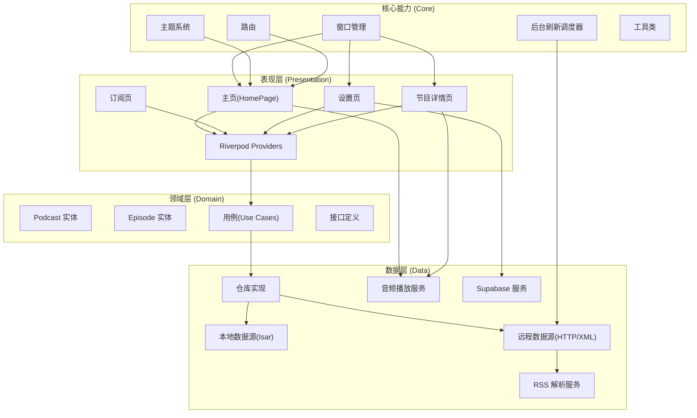
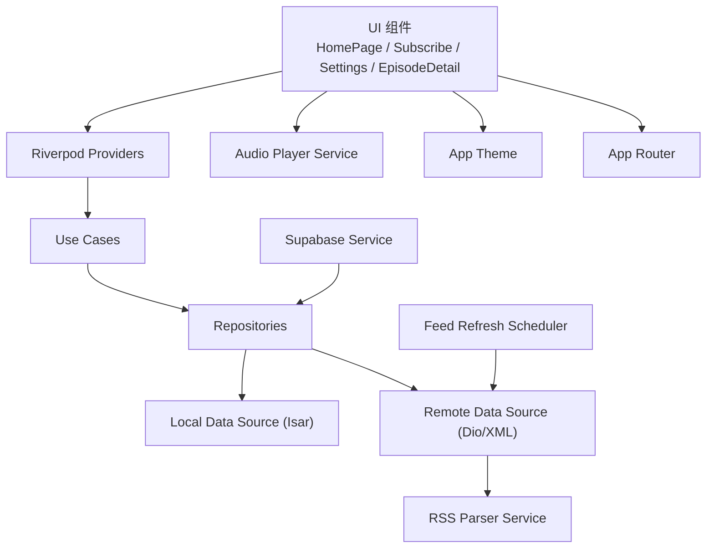
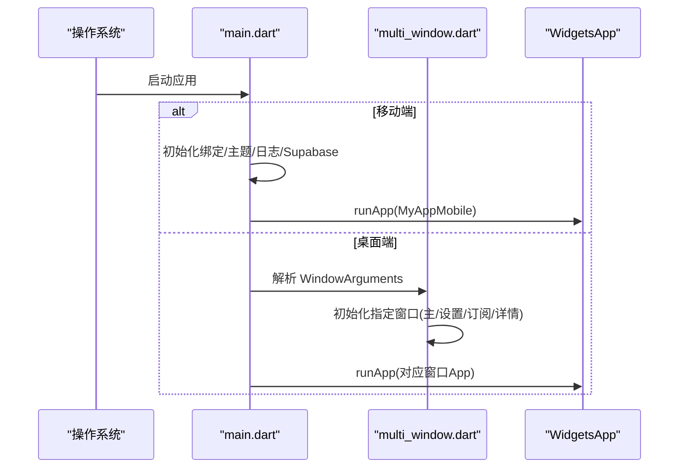
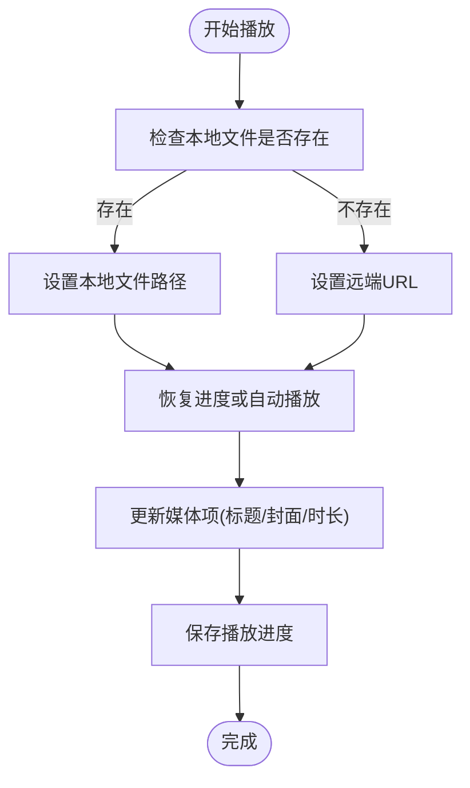
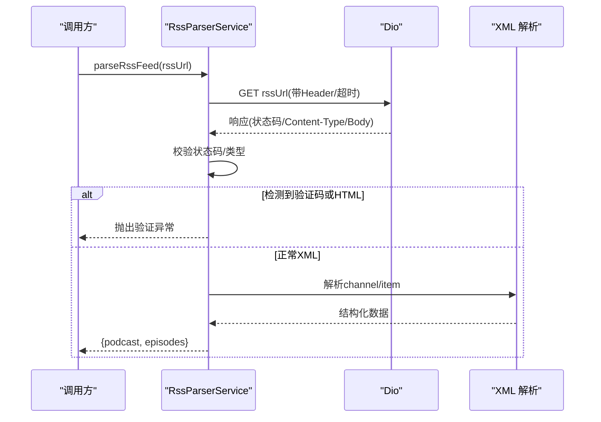
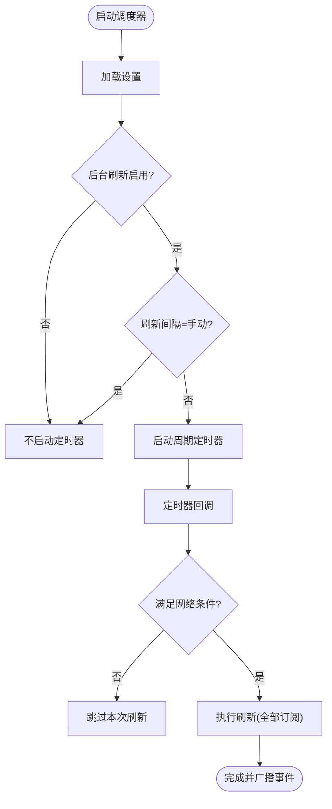
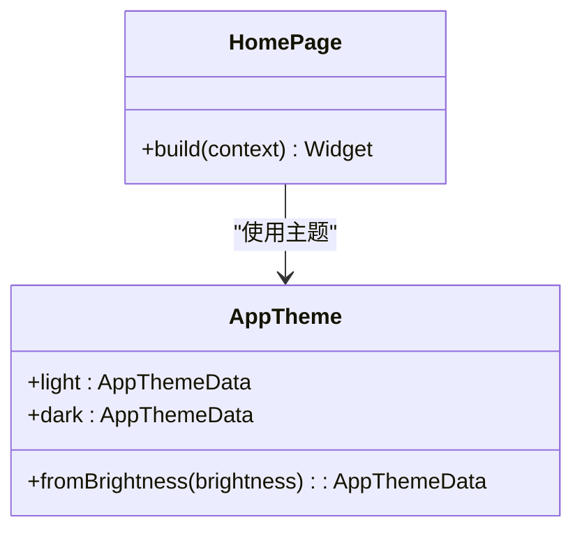
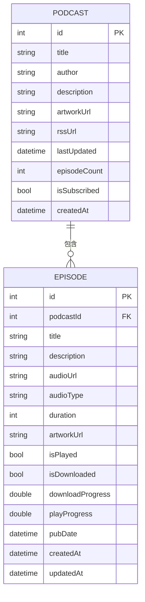
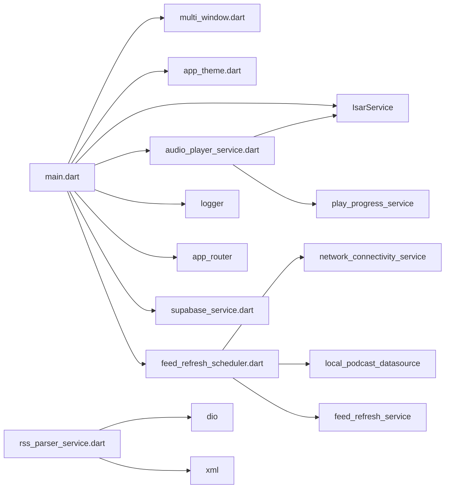

# 项目介绍

<cite>
**本文引用的文件**   
- [README.md](file://README.md)
- [pubspec.yaml](file://pubspec.yaml)
- [main.dart](file://lib/main.dart)
- [multi_window.dart](file://lib/multi_window.dart)
- [window_utils.dart](file://lib/window_utils.dart)
- [app_theme.dart](file://lib/core/theme/app_theme.dart)
- [supabase_service.dart](file://lib/core/services/supabase_service.dart)
- [feed_refresh_scheduler.dart](file://lib/core/services/feed_refresh_scheduler.dart)
- [rss_parser_service.dart](file://lib/data/services/rss_parser_service.dart)
- [audio_player_service.dart](file://lib/data/services/audio_player_service.dart)
- [podcast.dart](file://lib/domain/entities/podcast.dart)
- [episode.dart](file://lib/domain/entities/episode.dart)
- [AGENTS.md](file://AGENTS.md)
</cite>

## 更新摘要
**所做更改**   
- 增强了项目简介，从简单的一行描述扩展为全面的跨平台播客客户端介绍
- 添加了详细的"快速开始"部分，包含必要的安装和运行命令
- 更新了核心功能特性说明，突出多平台支持和完整功能集
- 完善了技术架构和设计理念的阐述
- 增加了开发环境配置和交付前检查流程

## 目录
1. [简介](#简介)
2. [快速开始](#快速开始)
3. [项目结构](#项目结构)
4. [核心组件](#核心组件)
5. [架构总览](#架构总览)
6. [详细组件分析](#详细组件分析)
7. [依赖关系分析](#依赖关系分析)
8. [性能考量](#性能考量)
9. [故障排查指南](#故障排查指南)
10. [结论](#结论)
11. [附录](#附录)

## 简介
TinyCast 是一款基于 Flutter 开发的跨平台播客客户端应用，支持 Android、iOS、macOS、Windows 和 Linux 五大平台。项目的核心目标是为播客爱好者提供简洁、高效且功能完整的订阅与播放体验。

### 核心价值主张
- **真正的跨平台支持**：同一套代码在移动设备和桌面端无缝运行，提供一致的用户体验
- **完整的 RSS 订阅管理**：解析标准 RSS/Atom 源，提取播客元数据与节目列表，支持后台定时刷新
- **专业级音频播放**：本地与网络音频播放、后台服务控制、播放进度持久化、速度/音量调节
- **智能下载缓存**：音频文件下载与缓存策略，断点续传与自动清理，提升离线收听体验
- **现代化主题系统**：可配置的 HOCON 配置文件主题系统与国际化支持
- **可选云同步**：通过 Supabase 进行认证与数据同步（可选启用）

### 设计理念与技术选型
- **Clean Architecture**：领域层、数据层、表现层清晰分离，职责明确、易于测试与维护
- **Riverpod 状态管理**：响应式、可组合、便于单元测试的现代状态管理方案
- **Isar 高性能数据库**：适合音频与媒体类应用的轻量级本地存储解决方案
- **just_audio + audio_service**：稳定可靠的音频播放与系统级控制能力
- **dio + xml 网络栈**：健壮的网络请求与 RSS 解析，具备重试与错误处理机制
- **桌面端多窗口**：window_manager + desktop_multi_window 实现原生窗口体验

**章节来源**
- [README.md:1-28](file://README.md#L1-L28)
- [pubspec.yaml:1-196](file://pubspec.yaml#L1-L196)
- [AGENTS.md:1-84](file://AGENTS.md#L1-L84)

## 快速开始
### 环境要求
- Flutter SDK 3.9.2 或更高版本
- Dart SDK 3.9.2 或更高版本
- 支持的平台：Android、iOS、macOS、Windows、Linux

### 安装步骤
```bash
# 克隆项目仓库
git clone https://github.com/your-repo/tinycast.git
cd tinycast

# 获取依赖包
flutter pub get
```

### 运行应用
```bash
# 默认运行（自动检测连接的设备）
flutter run

# 指定平台运行
flutter run -d android      # Android 设备
flutter run -d ios          # iOS 模拟器
flutter run -d macos        # macOS 桌面端
flutter run -d windows      # Windows 桌面端
flutter run -d linux        # Linux 桌面端
```

### 构建发布版本
```bash
# Android APK
flutter build apk --release

# Android App Bundle
flutter build appbundle --release

# iOS
flutter build ios --release

# macOS
flutter build macos --release

# Windows
flutter build windows --release

# Linux
flutter build linux --release
```

### 开发工具
```bash
# 静态代码分析（必须通过零警告）
flutter analyze

# 运行所有测试
flutter test

# 生成 Isar 数据库模型
dart run build_runner build --delete-conflicting-outputs
```

**章节来源**
- [README.md:5-28](file://README.md#L5-L28)
- [pubspec.yaml:11-13](file://pubspec.yaml#L11-L13)

## 项目结构
项目遵循典型的 Flutter 工程组织方式，并在 lib 下按 Clean Architecture 分层组织：



### 目录结构说明
- **core/**：通用能力（路由、主题、服务、工具等）
- **data/**：数据访问（数据库、数据源、仓库、模型、服务）
- **domain/**：领域模型与用例（实体、仓库接口、用例）
- **presentation/**：界面与状态（页面、组件、Provider）
- **assets/**：静态资源（图片、图标、主题配置）
- **android/**：Android 平台特定代码
- **ios/**：iOS 平台特定代码
- **windows/**：Windows 平台特定代码
- **macos/**：macOS 平台特定代码
- **linux/**：Linux 平台特定代码

**图示来源**
- [main.dart:106-177](file://lib/main.dart#L106-L177)
- [multi_window.dart:184-303](file://lib/multi_window.dart#L184-L303)
- [rss_parser_service.dart:40-128](file://lib/data/services/rss_parser_service.dart#L40-L128)
- [audio_player_service.dart:100-134](file://lib/data/services/audio_player_service.dart#L100-L134)
- [feed_refresh_scheduler.dart:49-72](file://lib/core/services/feed_refresh_scheduler.dart#L49-L72)
- [app_theme.dart:5-21](file://lib/core/theme/app_theme.dart#L5-L21)

**章节来源**
- [pubspec.yaml:1-196](file://pubspec.yaml#L1-L196)

## 核心组件
### 应用入口与初始化
- **main.dart**：负责根据平台选择启动路径（移动端/桌面端）、初始化窗口、加载主题、打开数据库、初始化音频服务与日志、按需初始化 Supabase，并注册生命周期观察者以驱动后台刷新调度器。
- **多窗口管理**：multi_window.dart 定义窗口参数 WindowArguments，解析 JSON 参数，创建主窗口、设置窗口、订阅窗口、节目详情窗口，并统一应用样式与路由。

### 主题系统
- **app_theme.dart**：提供明/暗主题切换，支持从硬编码或外部配置文件加载主题，使用 HOCON 格式配置文件。

### 音频播放服务
- **audio_player_service.dart**：封装 just_audio 与 audio_service，提供播放/暂停/跳转/变速/音量控制、播放进度持久化、后台通知与锁屏控制、播放完成事件。

### RSS 解析服务
- **rss_parser_service.dart**：使用 dio 拉取 XML，解析 Podcast 元数据与 Episode 列表，支持重试、反爬虫检测、HTML 响应识别与错误分类。

### 后台刷新调度器
- **feed_refresh_scheduler.dart**：根据设置与网络条件周期性触发刷新，调用 FeedRefreshService 批量更新订阅源。

### 云同步服务
- **supabase_service.dart**：单例初始化 Supabase 客户端，提供 Provider 注入。

**章节来源**
- [main.dart:106-194](file://lib/main.dart#L106-L194)
- [multi_window.dart:18-182](file://lib/multi_window.dart#L18-L182)
- [app_theme.dart:5-21](file://lib/core/theme/app_theme.dart#L5-L21)
- [audio_player_service.dart:100-134](file://lib/data/services/audio_player_service.dart#L100-L134)
- [rss_parser_service.dart:40-128](file://lib/data/services/rss_parser_service.dart#L40-L128)
- [feed_refresh_scheduler.dart:49-72](file://lib/core/services/feed_refresh_scheduler.dart#L49-L72)
- [supabase_service.dart:1-55](file://lib/core/services/supabase_service.dart#L1-L55)

## 架构总览
TinyCast 采用 Clean Architecture 的分层设计，确保代码的可维护性、可测试性和可扩展性：



### 分层职责
- **表现层（Presentation）**：页面与组件，通过 Riverpod 获取状态，调用 Use Case
- **领域层（Domain）**：实体与用例，定义业务规则与输入输出契约
- **数据层（Data）**：数据源（本地/远程）、仓库实现、服务（RSS 解析、音频播放、下载、缓存等）

**图示来源**
- [main.dart:106-177](file://lib/main.dart#L106-L177)
- [rss_parser_service.dart:40-128](file://lib/data/services/rss_parser_service.dart#L40-L128)
- [audio_player_service.dart:100-134](file://lib/data/services/audio_player_service.dart#L100-L134)
- [feed_refresh_scheduler.dart:49-72](file://lib/core/services/feed_refresh_scheduler.dart#L49-L72)
- [supabase_service.dart:1-55](file://lib/core/services/supabase_service.dart#L1-L55)

## 详细组件分析

### 应用入口与窗口管理
#### 入口流程
- **移动端**：初始化 WidgetsFlutterBinding、初始化应用、注册生命周期观察者、启动后台刷新调度器、运行 MyAppMobile
- **桌面端**：初始化窗口工具、预加载主题、解析窗口参数、根据类型初始化不同窗口（主窗口、设置、订阅、节目详情），运行对应 App

#### 窗口参数与序列化
- **WindowArguments** 支持 type、episode、podcast 字段，JSON 序列化/反序列化用于跨窗口传递数据

#### 窗口初始化
- **initMainWindow/initSettingsWindow/initSubscribeWindow/initEpisodeDetailWindow** 分别配置窗口尺寸、居中、隐藏标题栏、毛玻璃效果与全屏内容区域



**图示来源**
- [main.dart:106-177](file://lib/main.dart#L106-L177)
- [multi_window.dart:18-182](file://lib/multi_window.dart#L18-L182)

**章节来源**
- [main.dart:106-194](file://lib/main.dart#L106-L194)
- [multi_window.dart:18-182](file://lib/multi_window.dart#L18-L182)
- [window_utils.dart:1-6](file://lib/window_utils.dart#L1-L6)

### 音频播放服务
#### 功能要点
- 播放/暂停/停止、跳转、前进/后退、变速、音量控制
- 播放进度持久化（位置与百分比），超过阈值标记为已播放
- 后台服务集成（通知栏、锁屏控制、系统媒体操作）
- 本地与网络音频优先策略：优先查找本地文件，不存在则回退到远端 URL

#### 关键流程
- **playEpisode/loadEpisode** 内部统一走 _loadEpisodeAudio，处理本地/远端路径选择、播放器状态更新、媒体项更新、播放完成事件



**图示来源**
- [audio_player_service.dart:192-300](file://lib/data/services/audio_player_service.dart#L192-L300)
- [audio_player_service.dart:469-507](file://lib/data/services/audio_player_service.dart#L469-L507)

**章节来源**
- [audio_player_service.dart:100-134](file://lib/data/services/audio_player_service.dart#L100-L134)
- [audio_player_service.dart:192-300](file://lib/data/services/audio_player_service.dart#L192-L300)
- [audio_player_service.dart:469-507](file://lib/data/services/audio_player_service.dart#L469-L507)

### RSS 解析服务
#### 功能要点
- 使用 dio 发起 HTTP 请求，支持超时与重试
- 解析 XML，提取 Podcast 元数据与 Episode 列表，支持 iTunes/Dublin Core 扩展
- 反爬虫检测（SG-Captcha）、HTML 响应识别、错误分类与提示

#### 关键流程
- **parseRssFeed** 拉取内容 -> 校验状态码与类型 -> 检测验证码/HTML -> 解析 Podcast/Episodes -> 返回结果



**图示来源**
- [rss_parser_service.dart:40-128](file://lib/data/services/rss_parser_service.dart#L40-L128)
- [rss_parser_service.dart:139-267](file://lib/data/services/rss_parser_service.dart#L139-L267)

**章节来源**
- [rss_parser_service.dart:40-128](file://lib/data/services/rss_parser_service.dart#L40-L128)
- [rss_parser_service.dart:139-267](file://lib/data/services/rss_parser_service.dart#L139-L267)

### 后台刷新调度器
#### 功能要点
- 根据设置决定是否启用后台刷新与间隔；支持手动模式
- 结合网络连通性判断是否允许刷新（如蜂窝网络限制）
- 定时器触发时拉取已订阅播客，调用刷新服务批量更新

#### 关键流程
- **start()** 读取设置 -> 若启用且非手动 -> 启动周期任务 -> onTimerTick 检查网络 -> 执行刷新 -> 完成后广播事件



**图示来源**
- [feed_refresh_scheduler.dart:49-72](file://lib/core/services/feed_refresh_scheduler.dart#L49-72)
- [feed_refresh_scheduler.dart:88-115](file://lib/core/services/feed_refresh_scheduler.dart#L88-115)
- [feed_refresh_scheduler.dart:117-147](file://lib/core/services/feed_refresh_scheduler.dart#L117-147)

**章节来源**
- [feed_refresh_scheduler.dart:49-72](file://lib/core/services/feed_refresh_scheduler.dart#L49-72)
- [feed_refresh_scheduler.dart:88-115](file://lib/core/services/feed_refresh_scheduler.dart#L88-115)
- [feed_refresh_scheduler.dart:117-147](file://lib/core/services/feed_refresh_scheduler.dart#L117-147)

### 主题系统与首页布局
#### 主题系统
- **AppTheme** 提供 light/dark 主题，支持从硬编码或外部配置文件加载

#### 首页布局
- **HomePage** 包含窗口控制条（Windows）、顶部工具栏、迷你播放器、分割线与主体内容区



**图示来源**
- [app_theme.dart:5-21](file://lib/core/theme/app_theme.dart#L5-L21)
- [homepage.dart:1-37](file://lib/presentation/features/home/homepage.dart#L1-L37)

**章节来源**
- [app_theme.dart:5-21](file://lib/core/theme/app_theme.dart#L5-L21)
- [homepage.dart:1-37](file://lib/presentation/features/home/homepage.dart#L1-L37)

### 领域实体模型
#### Podcast：播客元数据
- 标题、作者、描述、封面、RSS 地址、分类、关键词、显式标志、更新时间、订阅状态等

#### Episode：节目信息
- 标题、描述、链接、GUID、作者、发布时间、音频地址与类型、时长、封面、播放/下载状态、进度、最后播放时间等



**图示来源**
- [podcast.dart:1-74](file://lib/domain/entities/podcast.dart#L1-L74)
- [episode.dart:1-66](file://lib/domain/entities/episode.dart#L1-L66)

**章节来源**
- [podcast.dart:1-74](file://lib/domain/entities/podcast.dart#L1-L74)
- [episode.dart:1-66](file://lib/domain/entities/episode.dart#L1-L66)

## 依赖关系分析
### 外部依赖概览
- **UI/图标**：lucide_icons_flutter、flutter_svg
- **桌面多窗口**：window_manager、desktop_multi_window
- **数据库**：isar_community、isar_community_flutter_libs
- **状态管理**：riverpod、flutter_riverpod
- **音频**：just_audio、audio_service
- **网络**：dio、dio_http2_adapter、connectivity_plus
- **RSS**：rss_dart、xml
- **文件/路径**：path_provider、path
- **图片缓存**：cached_network_image
- **加密与安全**：crypto、flutter_secure_storage
- **国际化**：intl
- **HTML**：html、flutter_widget_from_html
- **云服务**：supabase_flutter、flutter_acrylic

### 模块耦合
- **main.dart** 依赖窗口工具、主题加载器、Isar、音频服务、日志、路由、Supabase、FeedRefreshScheduler
- **multi_window.dart** 依赖主题、实体、路由、窗口控制组件
- **audio_player_service.dart** 依赖 Isar、PlayProgressService、Logger
- **rss_parser_service.dart** 依赖 Dio、XML、AppException、NetworkErrorHandler
- **feed_refresh_scheduler.dart** 依赖 NetworkConnectivityService、LocalPodcastDataSource、FeedRefreshService、SettingsService



**图示来源**
- [main.dart:106-194](file://lib/main.dart#L106-L194)
- [multi_window.dart:18-182](file://lib/multi_window.dart#L18-L182)
- [audio_player_service.dart:100-134](file://lib/data/services/audio_player_service.dart#L100-L134)
- [rss_parser_service.dart:40-128](file://lib/data/services/rss_parser_service.dart#L40-L128)
- [feed_refresh_scheduler.dart:49-72](file://lib/core/services/feed_refresh_scheduler.dart#L49-72)

**章节来源**
- [pubspec.yaml:1-196](file://pubspec.yaml#L1-L196)

## 性能考量
### 音频播放优化
- 优先本地文件播放减少网络延迟；失败回退远端 URL 保证可用性
- 播放进度定期保存，避免重复缓冲与丢失进度
- 后台服务与系统媒体控制降低前台资源占用

### RSS 解析优化
- 使用 dio 的超时与重试机制提高稳定性；对验证码/HTML 快速失败，避免无效解析
- 解析过程分步校验，尽早发现异常并记录日志

### 后台刷新优化
- 根据设置与网络条件控制刷新频率，避免频繁请求
- 仅在应用前台/可用网络时执行，节省电量与流量

### 主题与渲染优化
- 主题预加载减少首次渲染抖动；默认字体回退提升兼容性

### 存储与缓存优化
- Isar 索引优化查询；图片缓存减少重复下载；音频文件路径兼容新旧目录策略

## 故障排查指南
### 音频播放问题
- 检查本地文件是否存在（支持目录与文档目录兼容），确认路径正确
- 查看播放状态流与进度流，定位卡顿/缓冲阶段
- 确认后台服务初始化成功，通知与控制按钮可用

### RSS 解析失败
- 检查 Content-Type 是否为 XML；若返回 HTML，需通过网页查找订阅链接
- 遇到验证码（SG-Captcha）提示，建议切换网络或稍后重试
- 查看重试次数与错误分类，定位网络或解析异常

### 后台刷新未执行
- 检查设置中是否启用后台刷新与间隔；确认网络条件允许
- 观察调度器生命周期（应用暂停/恢复）是否正确停止与重启

### 主题与窗口问题
- 确认主题加载模式（硬编码/配置文件）；检查窗口初始化参数与标题栏样式

**章节来源**
- [audio_player_service.dart:192-300](file://lib/data/services/audio_player_service.dart#L192-L300)
- [rss_parser_service.dart:40-128](file://lib/data/services/rss_parser_service.dart#L40-L128)
- [feed_refresh_scheduler.dart:88-115](file://lib/core/services/feed_refresh_scheduler.dart#L88-115)

## 结论
TinyCast 以清晰的 Clean Architecture 与现代技术栈为基础，提供了跨平台的播客订阅与播放体验。通过稳健的 RSS 解析、高效的音频播放、灵活的后台刷新与可选的云同步能力，项目在易用性与可靠性之间取得平衡。

对于初学者，理解实体模型、服务职责与数据流向有助于快速上手；对于进阶用户，可在此基础上扩展搜索、批量订阅、更丰富的缓存策略与更多平台特性。项目的模块化设计和完善的文档体系使其成为学习和扩展的优秀基础。

## 附录
### 术语说明
- **播客（Podcast）**：音频节目集合，通常通过 RSS 订阅
- **节目（Episode）**：单个音频条目，包含元数据与音频地址
- **后台刷新**：按设定周期拉取订阅源的更新内容
- **本地/远端音频**：优先播放本地缓存文件，否则回退到网络地址

### 相关文档
- 权限说明、下载调试、数据库说明、Supabase 设置、UUID 文件名指南等位于 docs 目录
- AGENTS.md 提供完整的开发规范与架构指导

### 开发约定
- 遵循 `.agents/rules/` 中的编码规范与最佳实践
- 使用 Riverpod 进行状态管理，Isar 进行数据存储
- 自定义主题系统，禁用 Material Design 默认主题
- 统一的 AppRouter 导航系统

[本节为概念性内容，不直接分析具体文件]