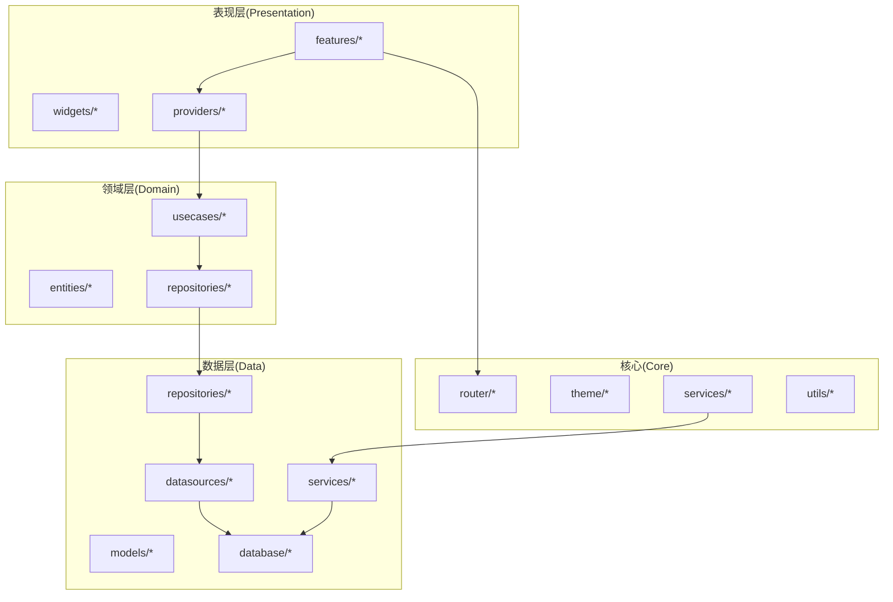
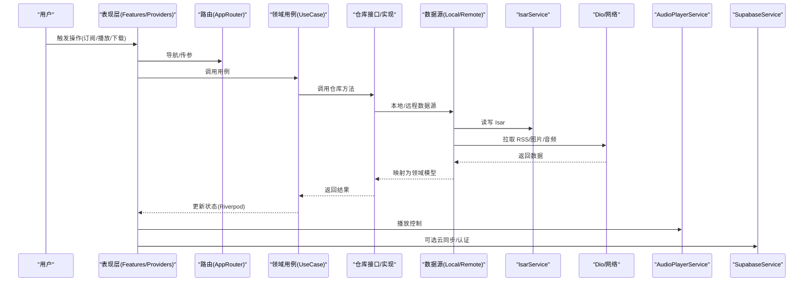
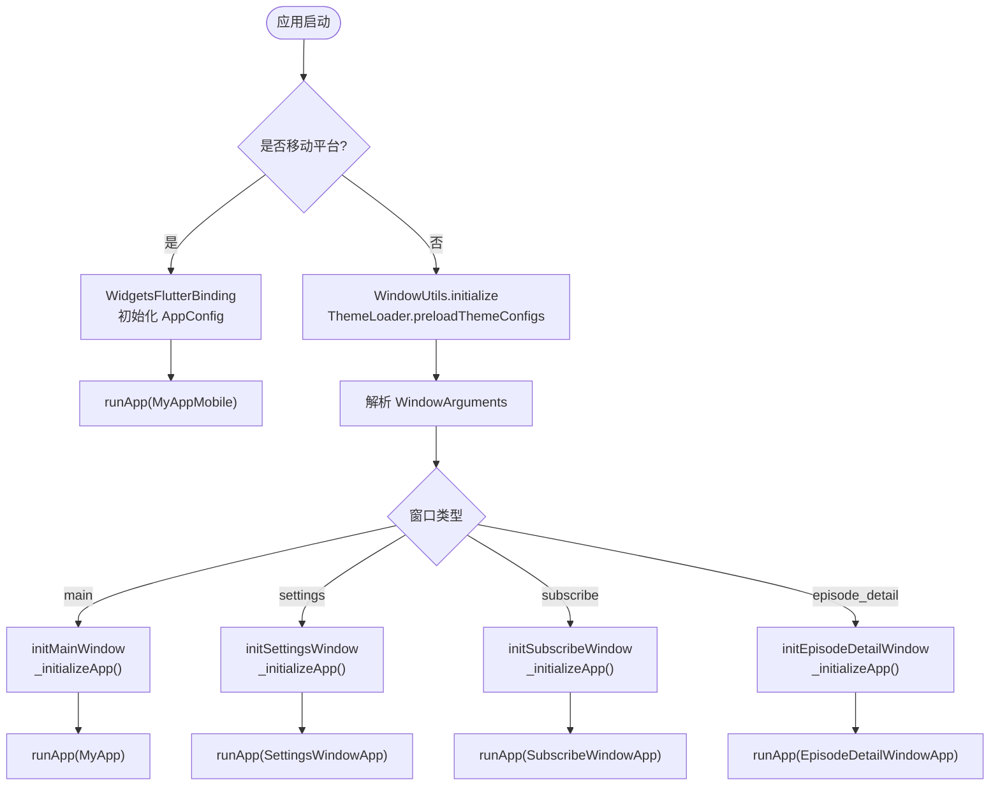
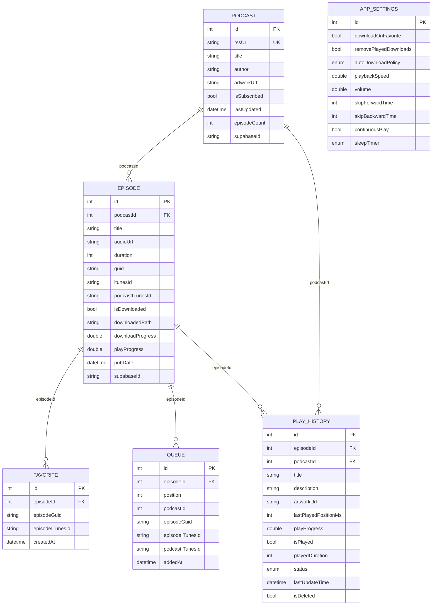
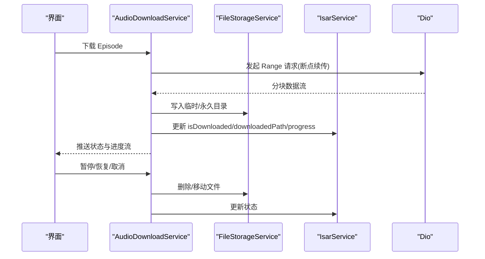
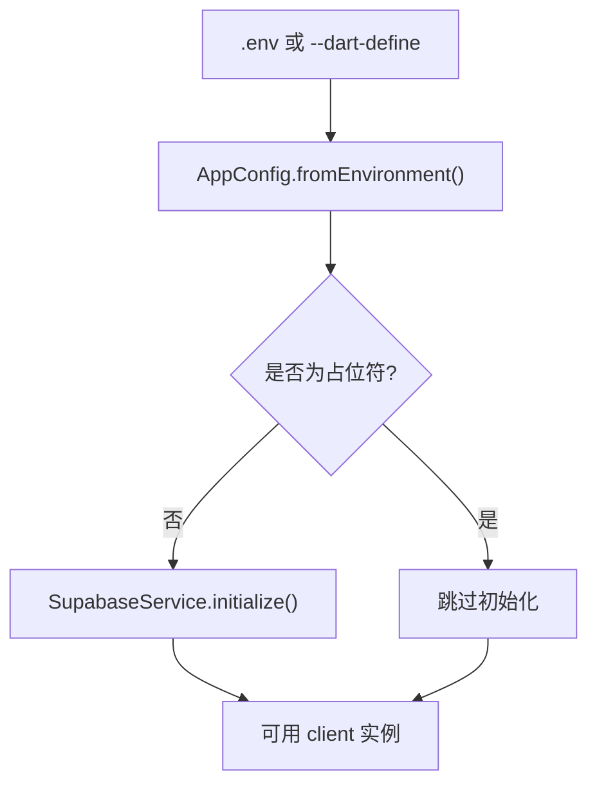
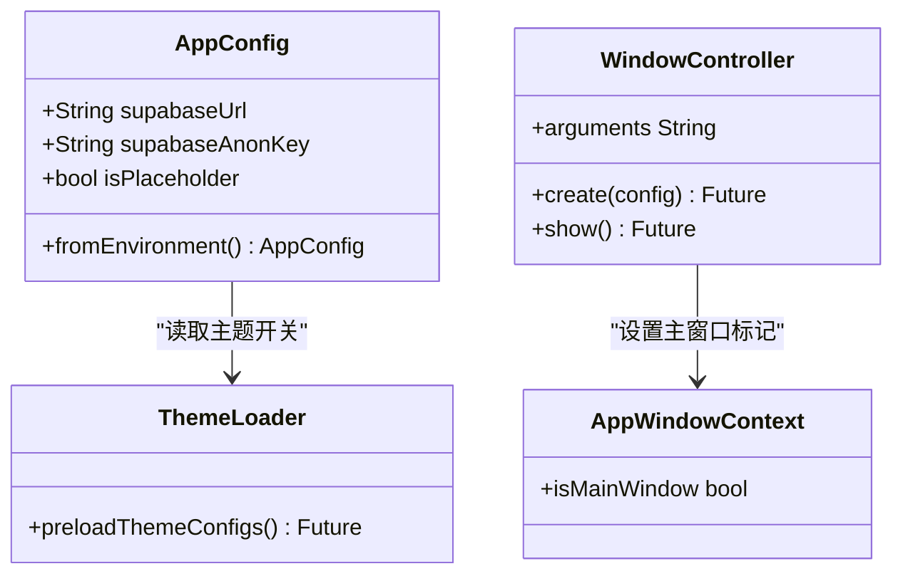
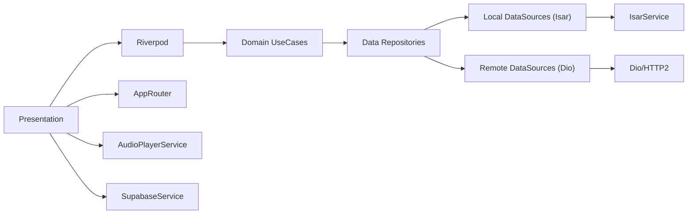

# 项目概览

<cite>
**本文引用的文件**
- [README.md](file://README.md)
- [pubspec.yaml](file://pubspec.yaml)
- [main.dart](file://lib/main.dart)
- [database.md](file://docs/database.md)
- [supabase_setup.md](file://docs/supabase_setup.md)
- [audio_download_usage.md](file://docs/audio_download_usage.md)
- [PLATFORM_PERMISSIONS.md](file://docs/PLATFORM_PERMISSIONS.md)
- [app_router.dart](file://lib/core/router/app_router.dart)
- [isar_service.dart](file://lib/data/database/isar_service.dart)
- [audio_player_service.dart](file://lib/data/services/audio_player_service.dart)
- [feed_refresh_scheduler.dart](file://lib/core/services/feed_refresh_scheduler.dart)
- [supabase_service.dart](file://lib/core/services/supabase_service.dart)
- [theme_loader.dart](file://lib/core/theme/theme_loader.dart)
- [theme_source_flag.dart](file://lib/core/theme/theme_source_flag.dart)
- [window_utils.dart](file://lib/window_utils.dart)
- [multi_window.dart](file://lib/multi_window.dart)
</cite>

## 目录
1. [简介](#简介)
2. [项目结构](#项目结构)
3. [核心组件](#核心组件)
4. [架构总览](#架构总览)
5. [详细组件分析](#详细组件分析)
6. [依赖分析](#依赖分析)
7. [性能考量](#性能考量)
8. [故障排查指南](#故障排查指南)
9. [结论](#结论)
10. [附录：快速开始](#附录快速开始)

## 简介
TinyCast 是一款基于 Flutter 开发的跨平台播客应用，支持 Android、iOS、Windows、macOS 和 Linux。项目以 Clean Architecture 组织代码，采用 Riverpod 进行状态管理，使用 Isar 作为高性能本地数据库，并可选集成 Supabase 实现云同步与认证。核心功能包括 RSS 订阅管理、音频播放、下载缓存、收藏与队列、搜索与历史记录、设置与主题等。

技术栈选择的原因与优势：
- Flutter：一套代码覆盖多端，UI 一致性好，生态完善。
- Clean Architecture：领域层与数据层解耦，便于测试与演进。
- Riverpod：响应式、可组合的状态管理，适合复杂交互的播客场景。
- Isar：嵌入式 NoSQL，异步、类型安全、查询高效，适合离线优先。
- Dio + HTTP/2：高性能网络请求与连接复用。
- Supabase（可选）：提供认证、数据库与存储能力，便于多设备同步。

**章节来源**
- [README.md:1-6](file://README.md#L1-L6)
- [pubspec.yaml:1-196](file://pubspec.yaml#L1-L196)

## 项目结构
项目遵循 Clean Architecture 分层：
- core：路由、主题、工具、服务（如 Supabase、Feed 刷新调度、网络连通性等）
- domain：实体、仓库接口、用例（UseCase）
- data：模型、数据源（本地/远程）、仓库实现、服务（播放器、下载、缓存、RSS 解析等）
- presentation：按功能模块 features 组织页面、组件与 Provider

**图表来源**
- [app_router.dart](file://lib/core/router/app_router.dart)
- [isar_service.dart](file://lib/data/database/isar_service.dart)
- [audio_player_service.dart](file://lib/data/services/audio_player_service.dart)

**章节来源**
- [pubspec.yaml:1-196](file://pubspec.yaml#L1-L196)

## 核心组件
- 应用入口与初始化：main.dart 负责平台分支、窗口初始化、主题预加载、Isar 与播放器初始化、Supabase 可选初始化、生命周期监听与 Feed 刷新调度启动。
- 路由系统：AppRouter 统一管理页面路由。
- 数据库：IsarService 单例管理 Isar 实例与集合注册。
- 音频播放：AudioPlayerService 封装播放控制、后台服务与状态。
- 云服务：SupabaseService 提供客户端初始化与访问。
- 主题系统：ThemeLoader 与 ThemeSourceFlag 支持 HOCON 配置或硬编码主题。
- 多窗口：multi_window.dart 与 window_utils.dart 支持桌面端多窗口与参数传递。

**章节来源**
- [main.dart:106-194](file://lib/main.dart#L106-L194)
- [app_router.dart](file://lib/core/router/app_router.dart)
- [isar_service.dart](file://lib/data/database/isar_service.dart)
- [audio_player_service.dart](file://lib/data/services/audio_player_service.dart)
- [supabase_service.dart](file://lib/core/services/supabase_service.dart)
- [theme_loader.dart](file://lib/core/theme/theme_loader.dart)
- [theme_source_flag.dart](file://lib/core/theme/theme_source_flag.dart)
- [multi_window.dart](file://lib/multi_window.dart)
- [window_utils.dart](file://lib/window_utils.dart)

## 架构总览
下图展示从 UI 到数据源的调用链与关键服务协作关系。

**图表来源**
- [main.dart:106-194](file://lib/main.dart#L106-L194)
- [app_router.dart](file://lib/core/router/app_router.dart)
- [isar_service.dart](file://lib/data/database/isar_service.dart)
- [audio_player_service.dart](file://lib/data/services/audio_player_service.dart)
- [supabase_service.dart](file://lib/core/services/supabase_service.dart)

## 详细组件分析

### 应用启动与生命周期
- 平台分支：移动端直接运行；桌面端先初始化窗口工具与主题，再根据 WindowArguments 决定主窗口或子窗口（设置、订阅、剧集详情）。
- 全局初始化：打开 Isar、初始化播放器、开启文件日志、按需初始化 Supabase。
- 生命周期：注册 WidgetsBindingObserver，处理应用暂停/恢复/退出，驱动 Feed 刷新调度器。

**图表来源**
- [main.dart:106-194](file://lib/main.dart#L106-L194)
- [window_utils.dart](file://lib/window_utils.dart)
- [multi_window.dart](file://lib/multi_window.dart)

**章节来源**
- [main.dart:106-194](file://lib/main.dart#L106-L194)

### 数据库与数据流（Isar）
- 集合：Podcast、Episode、Favorite、Queue、PlayHistory、SearchHistory、AppSettings。
- 关联策略：支持 iTunesId/Guid/自增 ID 的多级回退匹配，保证数据一致性。
- 生成与维护：通过 build_runner 生成 Schema；支持 Inspector、清空、删除等操作。

**图表来源**
- [database.md:324-396](file://docs/database.md#L324-L396)

**章节来源**
- [database.md:1-502](file://docs/database.md#L1-L502)
- [isar_service.dart](file://lib/data/database/isar_service.dart)

### 音频播放与下载缓存
- 播放：AudioPlayerService 封装播放控制、后台通知与锁屏控制。
- 下载：支持单个/批量下载、断点续传、并发控制、进度与状态流、取消与删除。
- 缓存：图片与音频分目录缓存，自动清理策略，保留最近 N 集，按大小阈值自动清理。

**图表来源**
- [audio_download_usage.md:1-254](file://docs/audio_download_usage.md#L1-L254)

**章节来源**
- [audio_download_usage.md:1-254](file://docs/audio_download_usage.md#L1-L254)

### 云同步与认证（Supabase）
- 环境变量：SUPABASE_URL、SUPABASE_ANON_KEY，支持 .env 与 --dart-define。
- 初始化：应用启动时按需初始化，未配置则跳过，不影响其他功能。
- 使用：通过 Provider 或直接访问 SupabaseService.client。

**图表来源**
- [supabase_setup.md:1-131](file://docs/supabase_setup.md#L1-L131)
- [main.dart:46-72](file://lib/main.dart#L46-L72)
- [main.dart:179-194](file://lib/main.dart#L179-L194)

**章节来源**
- [supabase_setup.md:1-131](file://docs/supabase_setup.md#L1-L131)
- [main.dart:46-72](file://lib/main.dart#L46-L72)
- [main.dart:179-194](file://lib/main.dart#L179-L194)

### 主题与多窗口
- 主题：支持 HOCON 配置文件与硬编码主题切换，启动时预加载。
- 多窗口：主窗口与设置/订阅/剧集详情子窗口，参数通过 WindowArguments 传递。

**图表来源**
- [main.dart:46-72](file://lib/main.dart#L46-L72)
- [theme_loader.dart](file://lib/core/theme/theme_loader.dart)
- [theme_source_flag.dart](file://lib/core/theme/theme_source_flag.dart)
- [multi_window.dart](file://lib/multi_window.dart)
- [window_utils.dart](file://lib/window_utils.dart)

**章节来源**
- [main.dart:116-176](file://lib/main.dart#L116-L176)

## 依赖分析
- 状态管理：Riverpod（riverpod、flutter_riverpod）
- 数据库：Isar（isar_community、isar_community_flutter_libs）
- 音频：just_audio、audio_service
- 网络：dio、dio_http2_adapter、connectivity_plus
- RSS/XML：rss_dart、xml
- 文件与路径：path_provider、path
- 图片缓存：cached_network_image
- 加密与安全：crypto、flutter_secure_storage
- 国际化：intl
- HTML：html、flutter_widget_from_html
- 云服务：supabase_flutter、flutter_acrylic
- 桌面窗口：window_manager、desktop_multi_window

**图表来源**
- [pubspec.yaml:1-196](file://pubspec.yaml#L1-L196)
- [app_router.dart](file://lib/core/router/app_router.dart)
- [isar_service.dart](file://lib/data/database/isar_service.dart)
- [audio_player_service.dart](file://lib/data/services/audio_player_service.dart)
- [supabase_service.dart](file://lib/core/services/supabase_service.dart)

**章节来源**
- [pubspec.yaml:1-196](file://pubspec.yaml#L1-L196)

## 性能考量
- 数据库：Isar 异步与索引优化，避免大字段入库，快照化历史减少关联开销。
- 网络：Dio + HTTP/2 提升吞吐；合理重试与拦截器；离线优先策略。
- 媒体：音频分段下载与缓存，图片 Hash 命名与缓存命中；后台播放服务降低 UI 阻塞。
- 内存与磁盘：自动清理策略，限制并发下载数，及时释放资源。
- 主题与渲染：HOCON 预加载减少首帧延迟；按需加载资源。

[本节为通用指导，不直接分析具体文件]

## 故障排查指南
- Supabase 未配置：检查 .env 或 --dart-define 参数，确认 URL 与 Key 有效。
- 数据库问题：启用 Isar Inspector 查看实时状态；必要时清空或重建数据库。
- 下载失败：检查网络状态、存储空间与权限；查看下载状态流与日志。
- 播放异常：确认 AudioPlayerService 初始化成功，检查音频格式与路径。
- 主题加载：确认 ThemeSourceFlag 与 HOCON 文件路径正确。

**章节来源**
- [supabase_setup.md:103-131](file://docs/supabase_setup.md#L103-L131)
- [database.md:468-502](file://docs/database.md#L468-L502)
- [audio_download_usage.md:247-254](file://docs/audio_download_usage.md#L247-L254)
- [PLATFORM_PERMISSIONS.md:1-133](file://docs/PLATFORM_PERMISSIONS.md#L1-L133)

## 结论
TinyCast 以 Clean Architecture 为核心，结合 Riverpod 与 Isar 构建出高内聚、低耦合且易于扩展的播客应用。其跨平台能力、完善的下载与播放体验、可选的云同步能力，使其在移动端与桌面端均能提供一致的优质体验。未来可在功能模块化、测试覆盖与性能监控方面持续优化。

[本节为总结性内容，不直接分析具体文件]

## 附录：快速开始
- 环境要求
  - Dart SDK ^3.9.2
  - Flutter SDK（与 Dart 版本兼容）
  - 各平台开发环境（Android/iOS/Windows/macOS/Linux）
- 安装步骤
  - 克隆仓库后执行依赖获取与代码生成（如需）
  - 配置 Supabase 环境变量（可选）
- 基本使用方法
  - 运行应用：默认进入主页，支持 RSS 订阅、播放、下载与设置
  - 桌面端多窗口：设置/订阅/剧集详情独立窗口
  - 主题切换：HOCON 配置或硬编码模式

**章节来源**
- [pubspec.yaml:12-13](file://pubspec.yaml#L12-L13)
- [supabase_setup.md:23-51](file://docs/supabase_setup.md#L23-L51)
- [main.dart:106-176](file://lib/main.dart#L106-L176)