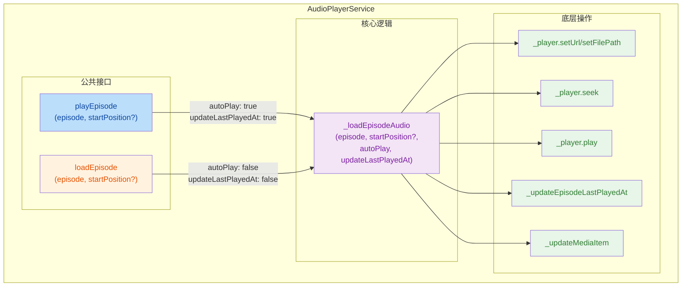

## 1. 高层摘要 (TL;DR)

- **影响范围:** 🟡 **中等** - 重构音频播放服务的核心方法，提升代码可维护性
- **关键变更:**
  - ✨ 将 `playEpisode` 重构为私有方法 `_loadEpisodeAudio`，支持自动播放和加载两种模式
  - ♻️ 消除 `playEpisode` 和 `loadEpisode` 之间的重复代码
  - 🎛️ 新增 `autoPlay` 和 `updateLastPlayedAt` 参数，提供更细粒度的控制
  - 📝 优化日志输出，根据操作类型动态显示不同的提示信息

---

## 2. 可视化概览 (代码逻辑映射)



---

## 3. 详细变更分析

### 📦 组件: `AudioPlayerService` (音频播放服务)

**变更说明:** 对音频加载和播放逻辑进行了重构，通过提取公共方法消除代码重复。

#### 🔧 核心重构逻辑

| 原方法 | 新方法 | 变更类型 | 说明 |
|--------|--------|----------|------|
| `playEpisode` | `_loadEpisodeAudio` | 重命名+扩展 | 变为私有方法，新增参数支持两种模式 |
| `loadEpisode` | `loadEpisode` | 简化 | 移除重复代码，调用 `_loadEpisodeAudio` |
| `playEpisode` | `playEpisode` | 新增 | 新的公共接口，调用 `_loadEpisodeAudio` |

#### 📋 新增参数说明

| 参数 | 类型 | 默认值 | 说明 |
|------|------|--------|------|
| `autoPlay` | `bool` | `true` | 是否自动播放音频 |
| `updateLastPlayedAt` | `bool` | `true` | 是否更新最后播放时间戳 |

#### 🎯 逻辑优化点

1. **条件播放进度恢复:**
   ```dart
   // 旧逻辑: 总是尝试恢复播放进度
   if (playProgress > 0 && playProgress < 1.0) {
     await _player.seek(savedPosition);
   }
   
   // 新逻辑: 仅在 autoPlay=true 时恢复播放进度
   if (autoPlay) {
     if (playProgress > 0 && playProgress < 1.0) {
       await _player.seek(savedPosition);
     }
   }
   ```

2. **条件执行播放:**
   ```dart
   // 旧逻辑: 总是执行播放
   await _player.play();
   
   // 新逻辑: 根据 autoPlay 参数决定是否播放
   if (autoPlay) {
     await _player.play();
   }
   ```

3. **条件更新播放时间:**
   ```dart
   // 旧逻辑: 总是更新最后播放时间
   await _updateEpisodeLastPlayedAt(episode.id);
   
   // 新逻辑: 根据 updateLastPlayedAt 参数决定是否更新
   if (updateLastPlayedAt) {
     await _updateEpisodeLastPlayedAt(episode.id);
   }
   ```

4. **动态日志输出:**
   ```dart
   // 根据 autoPlay 参数动态生成日志消息
   final action = autoPlay ? 'Playing' : 'Loading';
   Logger.info('$action episode: ${episode.title} from $audioPath');
   // ...
   Logger.info('${autoPlay ? "Started playing" : "Loaded"} episode: ${episode.title}');
   ```

#### 📊 代码行数变化

| 指标 | 变更前 | 变更后 | 差异 |
|------|--------|--------|------|
| 总行数 | ~65 行 | ~55 行 | **-10 行** ✅ |
| 重复代码块 | 2 处 | 0 处 | **-2 处** ✅ |

---

## 4. 影响与风险评估

### ✅ 积极影响

- **代码可维护性提升:** 消除了约 30 行重复代码，未来修改音频加载逻辑只需修改一处
- **灵活性增强:** 通过参数控制行为，支持更多使用场景
- **日志更清晰:** 根据实际操作显示不同的日志信息，便于调试

### ⚠️ 潜在风险

| 风险项 | 风险等级 | 缓解措施 |
|--------|----------|----------|
| **行为变更** | 🟡 低 | `playEpisode` 和 `loadEpisode` 的公共接口行为保持不变 |
| **私有方法依赖** | 🟢 极低 | `_loadEpisodeAudio` 为私有方法，不影响外部调用 |
| **参数默认值** | 🟢 极低 | 新参数均有合理的默认值，向后兼容 |

### 🧪 测试建议

1. **功能测试:**
   - ✅ 验证 `playEpisode` 仍然能正常播放并恢复播放进度
   - ✅ 验证 `loadEpisode` 能正确加载音频但不自动播放
   - ✅ 验证 `playEpisode` 会更新最后播放时间
   - ✅ 验证 `loadEpisode` 不会更新最后播放时间

2. **边界测试:**
   - 🧪 测试网络音频和本地音频的加载
   - 🧪 测试播放进度为 0、中间值、1.0 的情况
   - 🧪 测试 `startPosition` 参数的优先级

3. **日志验证:**
   - 📝 检查播放时日志显示 "Playing" / "Started playing"
   - 📝 检查加载时日志显示 "Loading" / "Loaded"

---

## 📌 总结

这是一次**高质量的重构**，通过提取公共方法 `_loadEpisodeAudio`，成功消除了 `playEpisode` 和 `loadEpisode` 之间的重复代码。新设计更加灵活，同时保持了向后兼容性。代码行数减少约 15%，可维护性显著提升。